# 最强 AR 眼镜 + 最受欢迎开源 AI，Meta 大会小扎赢麻了

> 来源：[https://v11enp9ok1h.feishu.cn/docx/HLqIdoRoGoiKMRxh8AwcN2vbnIb](https://v11enp9ok1h.feishu.cn/docx/HLqIdoRoGoiKMRxh8AwcN2vbnIb)

**「扎克伯格人去哪了？」**

这是在预计时间开始后十分钟、Meta Connect 2024 主题演讲仍然迟迟没有开始后，各大直播平台评论里观众提问最多的问题。原本预定将于太平洋时间早上十点（北京时间 9 月 26 日凌晨一点）开始的主题演讲，实际在计划时间开始 15 分钟后才随着 Meta 创始人扎克伯格跑步入场开幕：给人一种小扎也是踩点早高峰上班、不小心迟到的打工人的感觉。

**好在本次发布的新品足够重磅，还算弥补了全球网友损失的这十几分钟寿**命：除了更便宜的 Quest 3S 系列，还有 Meta AI 与 Llama 3.2，以及让我们得以一窥未来 AR 眼镜形态的 Orion 原型机。

最受欢迎的「AI 眼镜」、最强功能的 AR 眼镜，以及最多人使用的开源 AI，难怪最近扎克伯格的采访总给人一种「我强的可怕」的感觉——苦熬多年的元宇宙最终结出了 Orion 这样的 AR 之花、Llama 3.2 大模型依然在继续开源，他确实有底气说：

Meta，是一家用技术实现愿景的公司。

## Quest 3S：下一台销量千万的 Quest

可能是意识到因为自己迟到，让全世界多等十五分钟犯了众怒的原因，扎克伯格上台后甚至没怎么寒暄，迅速单刀直入，在演讲开始的三分钟内就公布了 Meta Quest 3S 的价格，堪称近几年的硬件产品发布会中的一股清流。

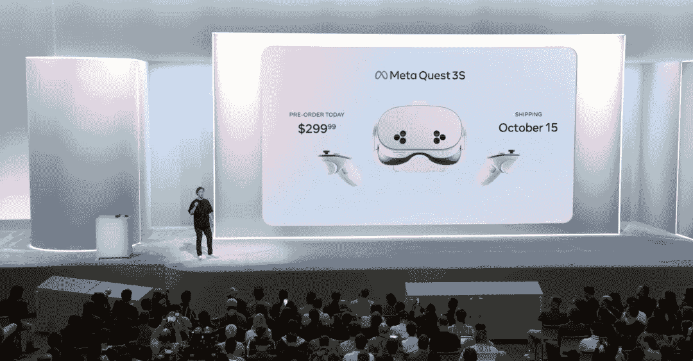

作为 Meta 寄予厚望、支撑起 Quest 系列全球出货量超千万台的新品。Meta Quest 3S 起售价 128GB 版本为 299 美元，256GB 版本售价 399 美元，十月 15 日开售。

相比 Quest 3 系列，定位入门级的 3S 在芯片等主要硬件规格上与 Quest 3 保持一致，但在机身材质与显示画质从 4K 降低至 2K（Quest 3S 单眼分辨率为 1832*1920）两个方面做了取舍，换来更低廉的售价。

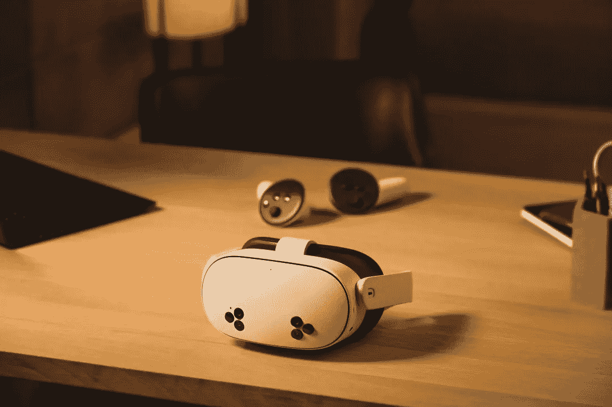

当然，作为 Meta 每年发布 Quest 新品吸引用户的惯例，这次也少不了一大批新游戏、新软件的登陆与适配：现在 Quest 3 系列不仅原生支持 Windows 11 设备拓展多显示器功能，此前备受期待的蝙蝠侠 IP MR 游戏《阿卡姆之影》属于附赠内容，从现在开始每一位在 2025 年四月之前购买 Quest 3S/3 的用户都能免费将其收入库中，算是硬件大厂中相当有诚意的软件促销内容了。

在 Quest 3S 发布之后，Quest 3 将仅保留 512GB 版本售卖，售价从原本的 649 美元降至 499 美元。

## Meta Rayban：新设计、新功能

在真正的大招放出来之前，扎克伯格还是卖了个关子，带大家回顾了一下 Meta Rayban 过去一年所取得的成绩。

作为很可能是迄今为止是业界唯一一款真正意义上取得现象级成功、出货量超百万的 AR 眼镜产品，Meta Rayban 系列对于 Meta 的重要性不言而喻。

因此本次发布会中，Meta 也给 Rayban 系列带来了一系列新功能：包括一款名为「Be my eyes」的互助类 App，用来让眼镜给低视力患者充当义眼，将眼镜所拍摄到的眼前数据实时上传，并由其他视力正常的志愿者帮助 Meta Rayban 的使用者来感知日常世界。

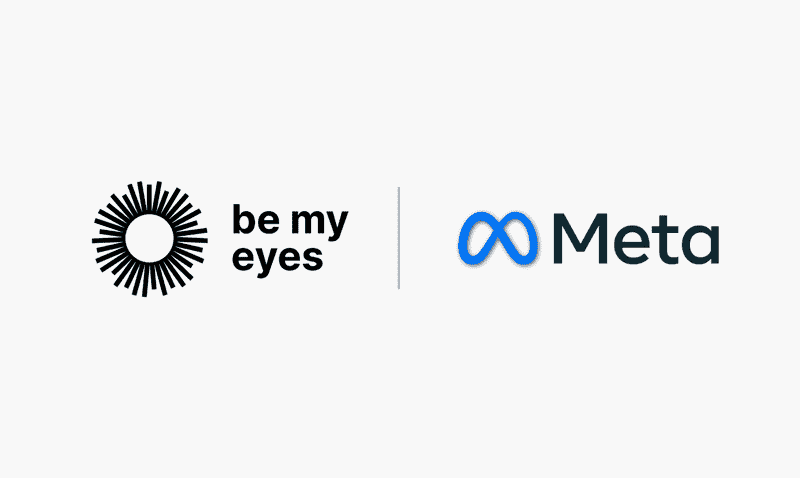

**Meta Rayban 眼镜所搭载的 M**eta AI 现在也加入了更多多模态功能——比如自动识别车牌号，帮你记录停车位置，以及通过语音指令要求 Meta AI 在航班着陆后三个小时内自动给家人报平安；或者是借助 Meta Rayban 的多模态能力，使用 Meta AI 来感知显示世界中的地标建筑，帮你快速适应一个新街区或城市——比如生成一份旅游计划。

**另外 Meta Rayban 现在也能**通过 Meta AI，实现实时语言翻译了——这是如今一些 TWS 耳机已经支持的功能，目前 Meta Rayban 的版本支持英语、西班牙语、法语与意大利语，未来还将有更多语言陆续加入。

最后，Meta 还发布了一款限量特别版 Meta Rayban，机身采用透明设计，整体在维持飞行员系列的时尚外观的同时看起来更有科技感。

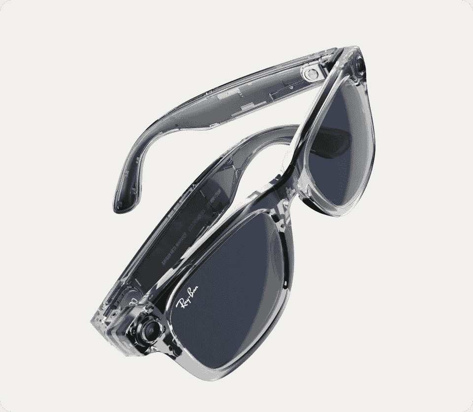

能够根据外部光源切换眼镜/墨镜形态、并且具有超高响应速度的  UltraTransitions® GEN S™ 系列镜片现在也加入了针对 Meta Rayban 的定制版，时尚的同时出街搭配更方便了。

## Orion：「下一代 AR 交互体验」

但我们都知道，Meta Rayban 其实并非典型意义上的「AR 眼镜」：由于 Meta Rayban 完全不具备内容显示能力，因此业内一直有不少人认为 Meta Rayban 所取得的成功，对于推动 AR 技术（尤其是显示技术）继续向前发展并无太大帮助，甚至是在摧毁 AR 初创企业生长的土壤，理由也很简单：

**「连行业老大做的智能眼镜都没有显示功能，会让**很多人会好奇AR 眼镜真的还有未来吗？」

但今天发布的新品，或许会让持有这种观点的质疑者完全收回这句话，因为 Meta 发布的 Orion AR 眼镜，当之无愧让我们看到了「下一代 AR 交互体验」的雏形。

在硬件上，Orion 采用了 ULED + 微型投影仪方案，不仅支持全彩内容显示，还能通过空间定位，将接近 Vision Pro 或 Quest 那样的窗口空间定位能力，整合在 AR 眼镜这样要轻盈的多的形态中，也可以说是 Meta 在 AR 领域研究的集大成之作。

为了支持接近 VR 头显的空间计算效果，Orion 在眼镜上塞进了七颗摄像头来感知周围环境。

为了搭建起能够处理这些数据的算力环境，Orion 又单独设计了一款体积不小的椭圆形计算单元，采用无线数据传输的方式来完成眼镜计算空间数据所需的算力，但因为是无线传输，所以计算单元与眼镜之间的距离不能超过 12 英尺。

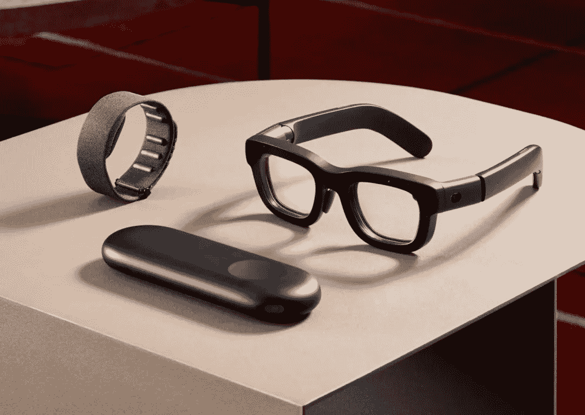

除了手势识别，Orion 还支持眼球视线交互，甚至通过搭配腕带，还能在你的手不刻意抬起来，自然低垂在腰间的状态下，识别到诸如「搓大拇指」这样微小的交互手势——这些甚至已经与 Vision Pro 的交互操作能力无异，但这些都被集成在了一台重量仅为 100 克，外观接近 Meta Rayban 的产品形态中。

仅仅以上目前 Orion 所展示出的能力，就已经堪称对 AR 眼镜领域的又一次「降维打击」：现场还播放了一条片，包括黄仁勋老黄在内的各界大拿在体验到 Orion 的实际表现后，众人纷纷露惊呼难以置信以及露出震惊表情的画面。

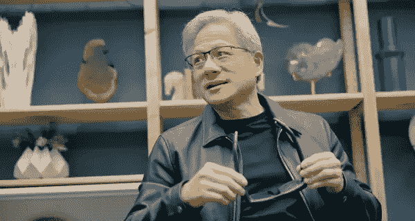

相比 Meta Rayban 通过产品的精准定义取得成功，Orion 这次是 Meta 从更高的技术维度上，再一次颠覆行业。

「这就是我们一直以来致力于达成的目标」，对于 Orion 对于 AR 眼镜现有能力带来的颠覆，扎克伯格这样表示了 Meta 的计划。

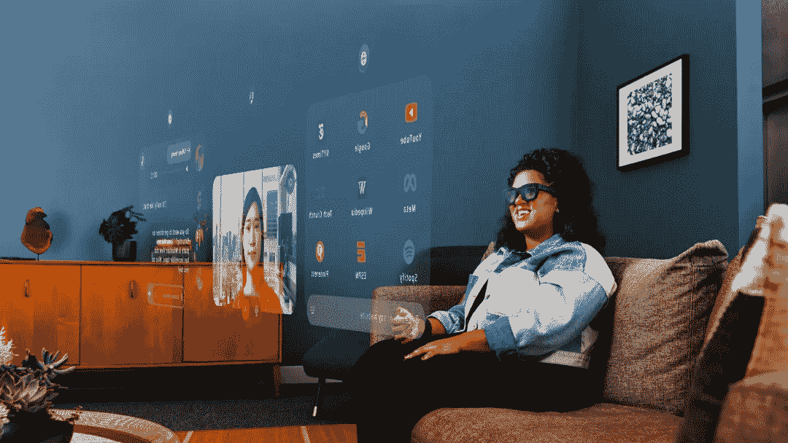

但扎克伯格也承认，现阶段的 Orion 还只是一个原型机，「在（AR 眼镜）正式量产面向用户之前，还有很多问题需要解决」。

比如，此前包括老黄在内的嘉宾，他们体验到的 Orion 的实际分辨率为 13 像素/度（Quest 3 为 25 像素/度），在显示效果上相比目前业内存在的 AR 眼镜，其实并无太大优势，但 Meta 也小小展示了一下藏着的底牌——另一台并未对外界过多展示的 Orion 原型机，已经能在相同体积下，做到 26 像素/度的清晰度。

只是在目前 AR 眼镜的产品形态下，更高的分辨率势必要牺牲更多的电池寿命——这对于强调全天佩戴的 AR 眼镜来讲很大程度上是一个致命的问题。

**另外，成本也是一个重要的量产考量因素：Meta 在会后向媒体透露：目前 Orion 这**套解决方案的硬件成本超过 1000 美元。这个价格相比 Vision Pro 的定价堪称低廉，但放在 AR 眼镜品类中已经是一个令人惊悚的天文数字。

因此，在价格与功能之间取得平衡也会是一个重要的考量。

无论如何，Orion 已经让我们得以「管中窥豹」地了解到，过去数年 Meta 在 AR 领域的技术积累，或许到明年 Meta Connect 25 上，我们就能看到更接近普通用户的 Meta AR 眼镜产品了。

## Meta AI ：月活 5 亿，小扎称「全球最多」

聊完硬件，扎克伯格还有 AI。

据扎克伯格透露，整合到 Facebook 和 Instagram 里的 Meta AI 聊天机器人现在月活用户是 5 亿，他还称，Meta AI 有望在年底前成为全球使用最多的 AI 助手。

紧跟各个行业对手，在 Connect 大会上，Meta AI 朝着多模态进一步迈进。

就像 OpenAI 那样，Meta 现在也有 AI 语音对话了。与 OpenAI 这一功能的入口是 ChatGPT，Meta 的入口则是 Messenger、Facebook、WhatsApp 和 Instagram D 等众多产品，用户可以在这些产品里用语音与 MetaAI 对话。

扎克伯格说：「我认为，与文本相比，语音将成为与AI交互的更自然方式。」

随着该功能开始推出，据扎克伯格介绍，用户可以选择不同的语音选项，包括一些美国名人的熟悉声音。在舞台上，一个以奥卡菲娜为模型的 AI 语音回答了扎克伯格的一个问题。

Meta 显然吸取了教训，已经与这些名人达成合作，没像 OpenAI 那样未经同意用了斯嘉丽·约翰逊的声音后惹来控诉。

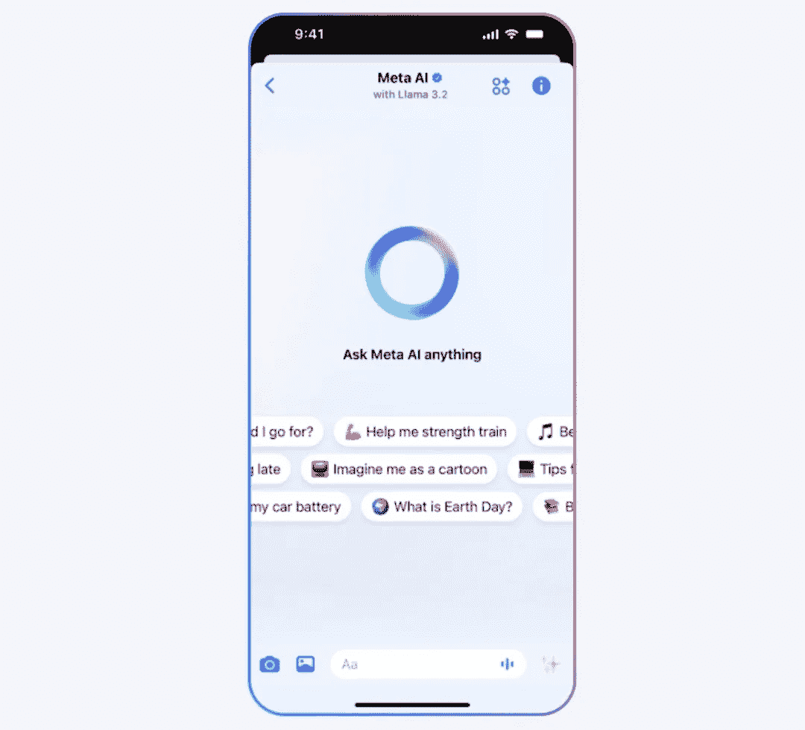

除了语音对话，Meta AI 还有一些大厂 AI 机器人必备的「常规操作」，比如图像编辑功能，用户直接用自然语言就能给自己的照片简单 P 图，包括给人物换衣服，给照片换背景等。

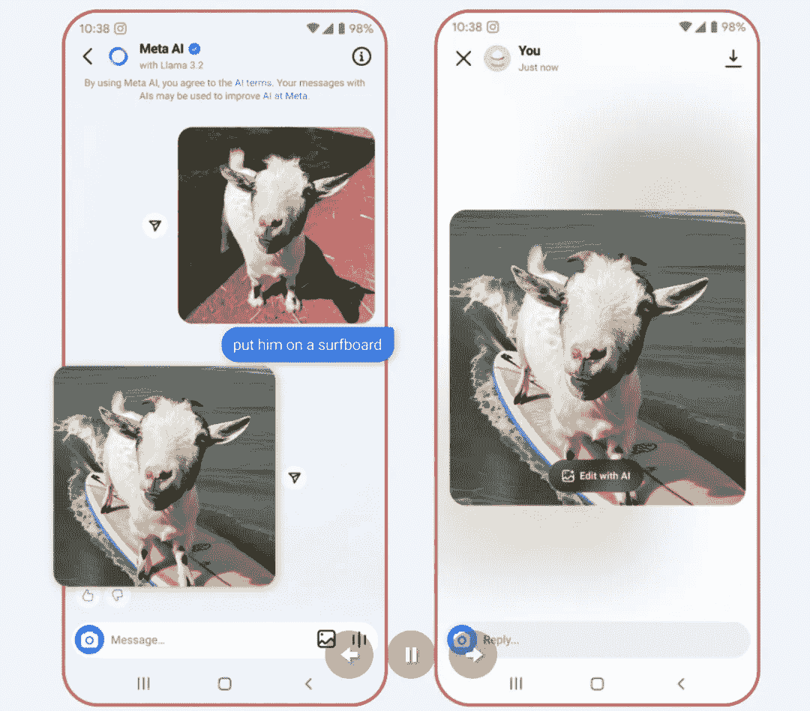

用户可以将 AI 生成的图像直接分享到 Facebook 和 Instagram 上，Meta AI 还可以为社交帖子建议标题。

另外，用户还在与 Meta AI 的聊天中分享照片，就照片进行提问。比如分享在徒步时看到的一朵花的照片，询问这是什么花，或者分享一道新菜的照片，并询问如何制作它等。

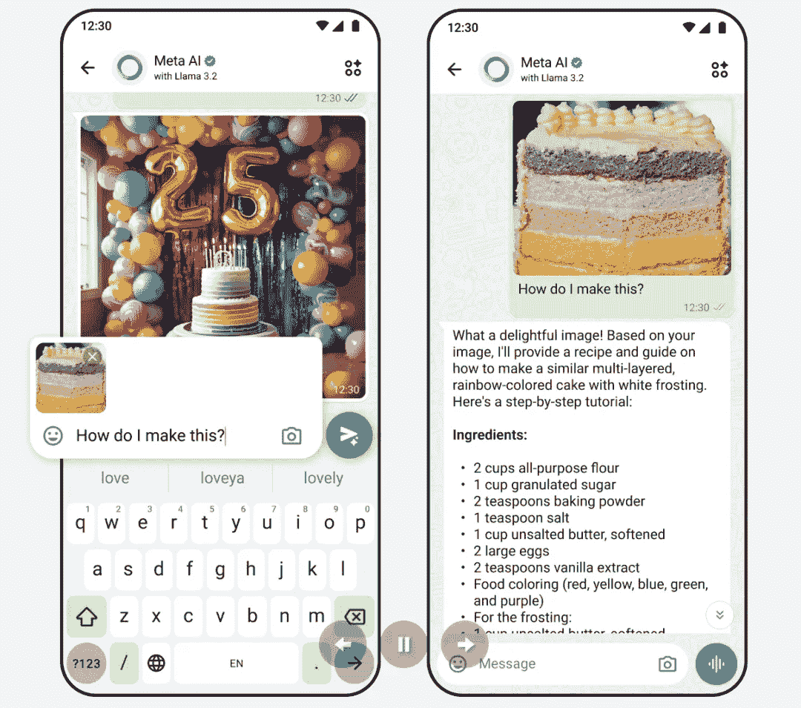

语音、图片之外，Meta 的 AI 功能还将应用在视频上。Meta 正在测试自动视频配音和口型同步功能，它将自动翻译 Instagram 上的 Reels 短视频，即使短视频创作者讲不同的语言，也可以让不同的观众听到自己的「母语」。

Meta 的这款 AI 翻译功能目前还在 Instagram 和 Facebook 上小规模测试，翻译一些来自拉丁美洲和美国的创作者的视频，语言为英语和西班牙语，扎克伯格计划未来将其扩展到更多的创作者和语言。

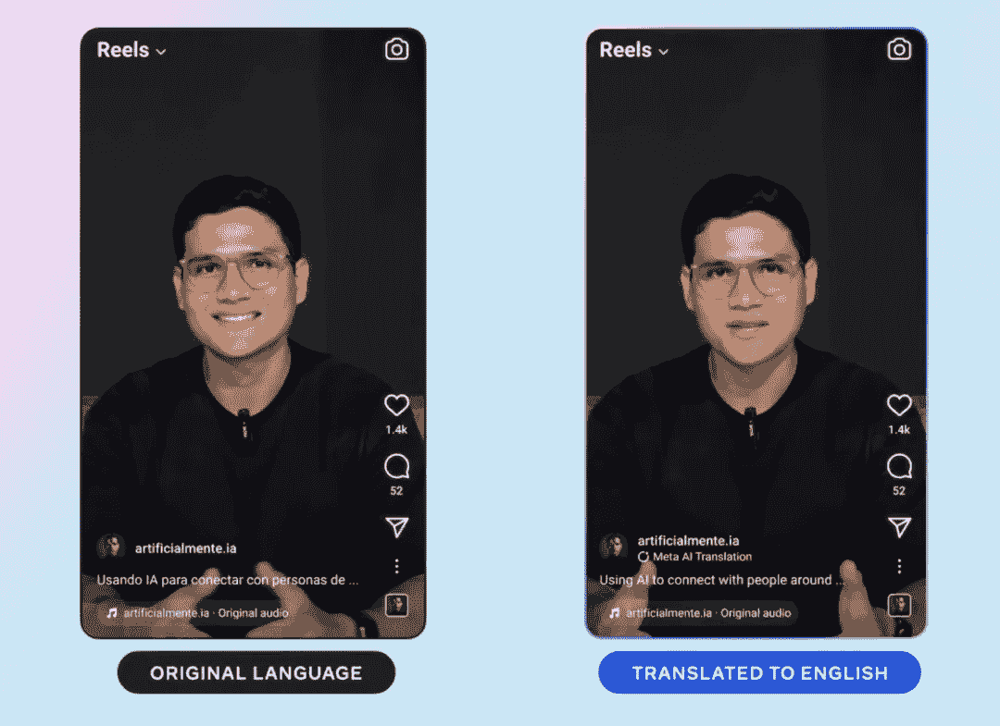

在 AI 与硬件的融合方面，Meta 的与 Ray-Ban 合作的智能眼镜也加入了包括翻译在内的 AI 功能，扎克伯格将其称为新的「以 AI 为中心的设备」。

根据介绍，这款眼镜无需每次都说「Hey Meta」就能向 Meta AI 提出后续问题。

这款眼镜还能够进行实时 AI 翻译，在现场演示中，扎克伯格讲英语，另一个人讲西班牙语，双方进行了一场对话，智能眼镜充当了翻译。不过，从效果来看，翻译还是像传统的随身翻译那样有一定「时差」。

## AI 新模型：Llama 3.2，继续开源

在 Connect 大会上，扎克伯格还介绍了 Meta 最新的 Llama 3.2 系列模型，其中包括小型和中型视觉 LLM（11B 和 90B），以及适合边缘和移动设备的轻量级纯文本模型（1B 和 3B）。

扎克伯格继续高举「开源」的大旗，不想让 OpenAI 等一家独大，提供 Llama 3.2 的开放下载，社区开发者可以在 Llama 官网和 AI 社区 Hugging Face 上直接获取这些模型。

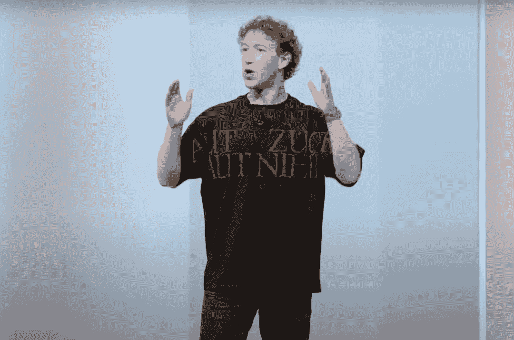

Llama 3.2 系列中最大的两个模型，11B 和 90B，支持图像推理用例，如包括图表和图形在内的文档级理解、图像的字幕生成，以及基于自然语言描述在图像中定向定位对象等视觉定位任务。

例如，一个人可以就上一年他们小型企业在哪个月份销售最好提出问题，Llama 3.2 可以基于可用的图表进行推理并快速提供答案。在另一个例子中，该模型可以使用地图进行推理，帮助回答诸如徒步何时变得更陡峭等问题。

11B 和 90B 模型还可以弥合视觉和语言之间的差距，从图像中提取细节，理解场景，然后撰写一两句话，可用作图像字幕来帮助讲述故事。

轻量级的 1B 和 3B 模型则有多语言文本生成和工具调用能力，它们使用了两种方法——「剪枝」和「蒸馏」，是首批能够适应设备的小型 Llama 模型。

据介绍，开发者能够用这些模型使构建设备端的自主应用。例如，此类应用可以帮助总结最近收到的 10 条消息，提取行动项，并利用工具调用直接发送后续会议的日历邀请。

在数据隐私问题上常年备受各界诟病的 Meta，此处的旗号是要「实现数据永不离开设备的强大隐私保护」。

在本地运行这些模型有两个主要优势。首先，由于处理在本地完成，提示和响应会感觉更即时。其次，本地运行模型可保持隐私，不会将诸如消息和日历信息等数据发送到云端，使整体应用更加私密。由于处理在本地完成，应用可以清楚地控制哪些查询保留在设备上，哪些可能需要由云端的更大模型处理。

据 Meta 声称，Llama 3.2 视觉模型在图像识别和一系列视觉理解任务上，可与 Claude 3 Haiku 和 GPT4o-mini 竞争。3B 模型在诸如遵循指令、摘要、提示重写和工具使用等任务上优于 Gemma 2 2.6B 和 Phi 3.5-mini 模型，而 1B 模型在与 Gemma 竞争时表现出色。

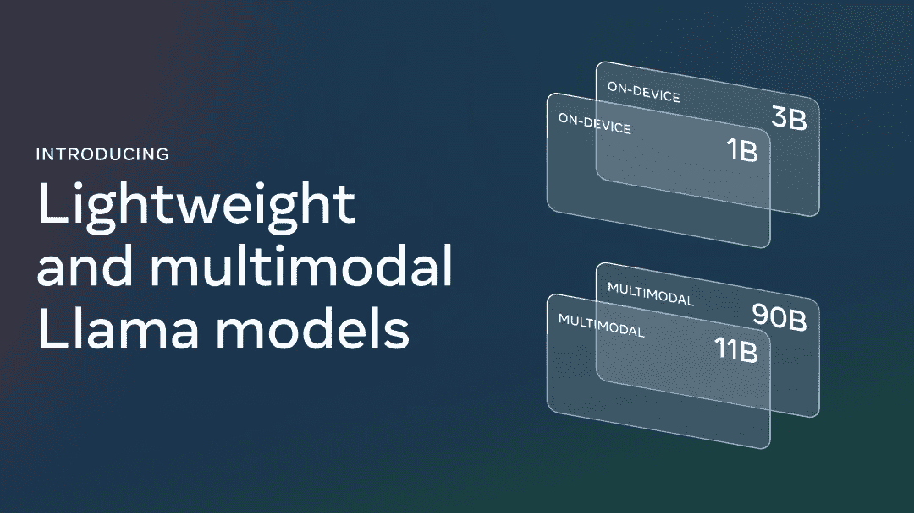

之所以坚持开源，目前 Meta 的官方说法是，「确保世界各地的更多人能够获得 AI 提供的机会，防止权力集中在少数人手中。」

当然，值得指出的是，Meta 的模型属于「开放权重」，而非完全「开放源代码」。这一度引起业界对于 Meta 的模型是否是真正意义开源的争议，但对于全球一些开发者来说，有总归比没有强。

另外一方面，构建 LLM 总是昂贵的，Meta 也有自己的商业利益要考虑，在何种程度上不损害公司利益，扎克伯克有自己的考量。

其中的关键一点，他此前已经在公开信中明确提到：「Meta 与封闭模型提供商之间的一个关键区别是，出售 AI 模型访问权限不是我们的商业模式。这意味着公开发布 Llama 不会像封闭提供商那样削弱我们的收入、可持续性或投资研究的能力。（这是一些封闭模型提供商不断游说政府反对开源的原因之一。」

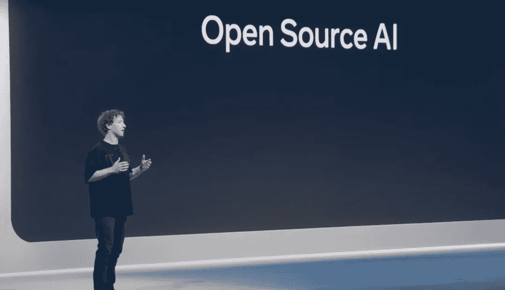

此次 Meta Connect 大会，在 Orion 上，能看到 AR 眼镜这一形态，未来进一步模糊 AR/VR 边界的潜力，可以说 Meta 凭借 Orion 的发布，一战重新稳固了自己在 AR 眼镜技术领域的龙头地位。

至于 AI，从 Meta 的发布会来看，多模态 AI 已经成为大厂和巨头的标配。而在 AI 模型上，关于开放和闭源哪种更好的争论还在继续，扎克伯格的选择，可以视作对 OpenAI 等闭源模型巨头发起的挑战。

但依然要面对的现实是，无论 AR 还是 AI，在产品形态和技术选型上依然处于无尽的变化之中，而 Meta 显然让全世界知道，自己，才是那个最有资格来定义这些重要技术产品的公司。