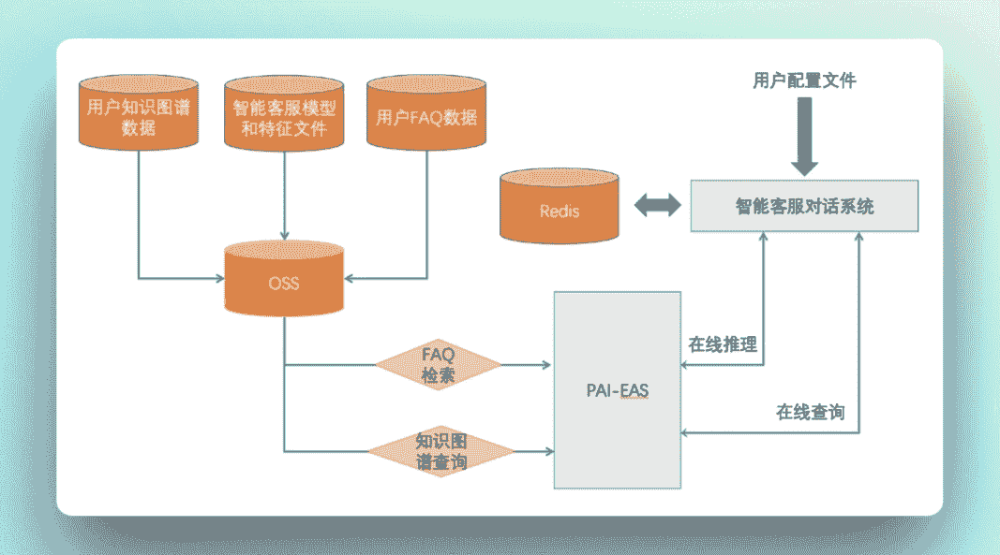
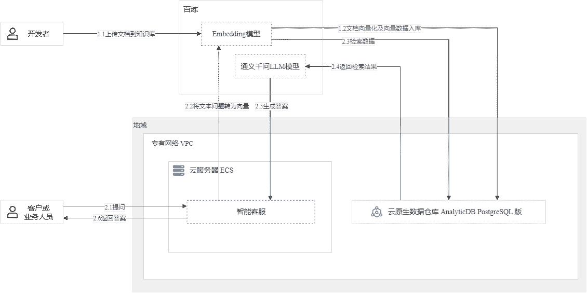
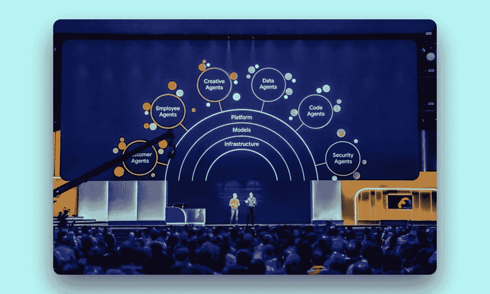

# 9🈷️27日

> 来源：[https://v11enp9ok1h.feishu.cn/docx/VnNjdDiqzomh6CxfAYMcaxcNnKg](https://v11enp9ok1h.feishu.cn/docx/VnNjdDiqzomh6CxfAYMcaxcNnKg)

+   《[智能客服对话系统解决方案](https://v11enp9ok1h.feishu.cn/wiki/E3fzwnJ7Qie553kQj2LcnHYTnUf?from=from_copylink)》针对问题咨询场景中出现大量相关领域的问题，PAI提供了智能客服对话系统解决方案，以降低客户等待时间和人工客服成本。本文以汽车售前咨询业务领域为例，介绍如何基于人工智能算法，快速构建智能客服对话系统。

+   《[AnalyticDB与通义千问搭建AI智能客服](https://v11enp9ok1h.feishu.cn/wiki/AqPGwUZUmiliz0k0neBcOJvbnke?from=from_copylink)》大模型虽然可以理解并生成自然语言，但由于缺乏特定领域的专业知识、没有企业的私域知识、知识更新不及时等问题，无法直接用于企业的AI智能客服。为了解决这一问题，企业可以采用RAG技术，从外部知识库（企业的私域知识）检索知识。召回的知识将和原始查询融合成prompt，为大模型提供更丰富的上下文信息，从而生成更加准确的回答。本方案将指导您快速创建一个RAG应用（AnalyticDB for PostgreSQL向量存储+通义千问LLM模型），实现企业的AI智能客服，更高效地解决客户问题。

+   《[Google发布全球 185 个各大企业的生成式 AI 实际应用落地案例](https://v11enp9ok1h.feishu.cn/wiki/Tnwtwz3pKiqVKlkcJn5cuJ41nge?from=from_copylink)》

