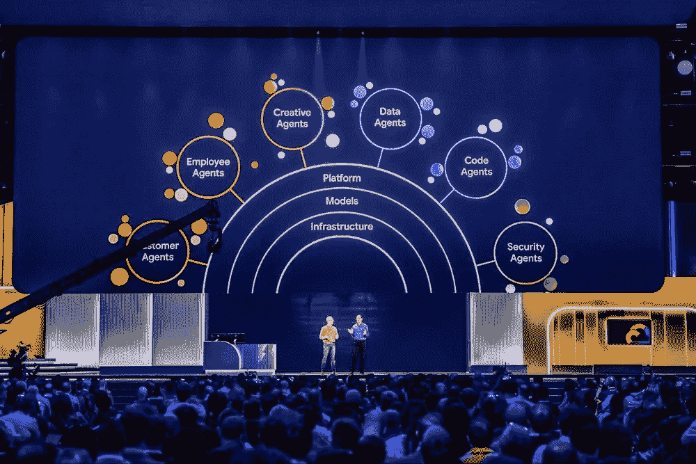
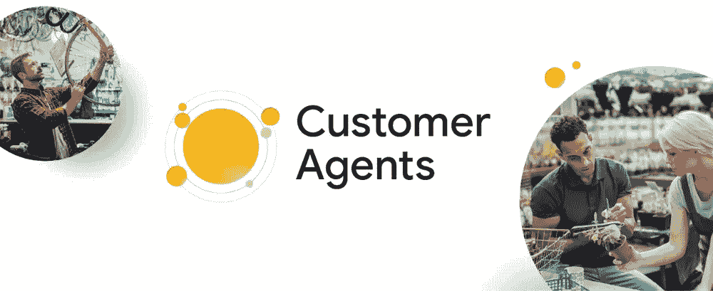
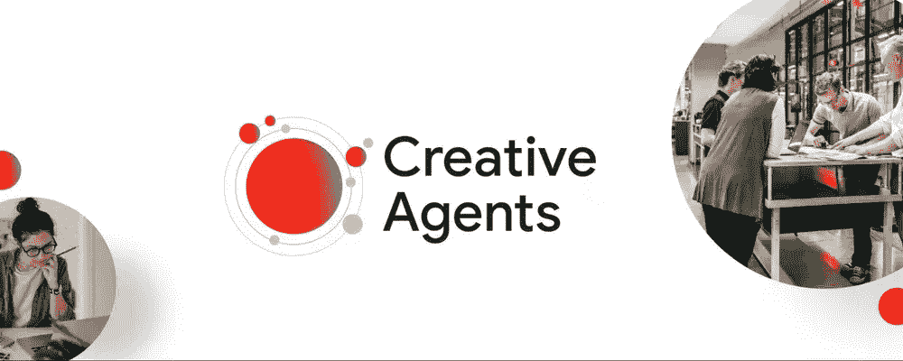

# Google发布全球 185 个各大企业的生成式 AI 实际应用落地案例

> 来源：[https://v11enp9ok1h.feishu.cn/docx/DDFudoCE3oWRpSxazoAcM9rwnOc](https://v11enp9ok1h.feishu.cn/docx/DDFudoCE3oWRpSxazoAcM9rwnOc)

Google发布了一篇文章，详细介绍了185个来自全球各大企业的生成式AI实际应用案例。这些案例展示了生成式AI在客户服务、员工管理、代码开发、数据分析、安全管理及创意领域中的广泛应用。

+   **客户代理**：公司利用AI代理优化客户体验。例如，阿拉斯加航空开发自然语言搜索，让旅客能够像与人类代理交互一样预订旅行；麦当劳则利用数据和AI技术加快创新并提升客户体验。

+   **员工代理**：AI用于提高员工工作效率、简化流程和提供即时支持。比如，Bayes Impact通过AI辅助的数字案例经理减少了25小时的工作时间。

+   **代码代理**：代码生成与管理方面，AI帮助开发者更快速、更高效地处理项目。例如，Leroy Merlin通过Vertex AI构建代码变更摘要工具，提高代码评审效率。

+   **数据代理**：数据代理帮助企业更快、更准确地分析和处理数据。例如，CME集团创建了AI驱动的商品交易平台，提供更智能的交易决策。

+   **安全代理**：安全领域，生成式AI大幅提高了威胁检测和响应速度。Palo Alto Networks使用生成式AI助理提高了平台的安全性和响应时间。

+   **创意代理**：创意生产中，AI简化了设计和内容生成过程。比如，PUMA印度利用AI自定义产品照片，点击率提高了10%。

### 所有185个具体应用案例

## 1. 客户代理（Customer Agents）

类似于优秀的销售和服务人员，客户智能体能够仔细倾听，理解您的需求，并推荐合适的产品和服务。它们能够无缝跨越多个渠道，包括网络、移动端和销售点，还可以通过语音和视频集成到产品体验中。

1.  **Alaska Airlines** 正在开发自然语言搜索功能，为旅客提供由AI驱动的对话式体验，类似与一位知识渊博的旅行代理互动。这个聊天机器人旨在简化旅行预订流程、增强客户体验，并强化品牌认知度。

1.  **Bennie Health** 使用 Vertex AI 支持其创新的员工健康福利平台，通过提供可操作的洞察并简化数据管理，提升员工和人力资源团队的效率和决策能力。

1.  **Beyond 12** 是一家致力于学生赋能的技术型非营利组织，开发了AI驱动的大学教练，为首代大学生提供可扩展的教练服务，这些服务通过短信、应用程序和网络提供。

1.  **CareerVillage** 正在开发一款名为 Coach 的应用，旨在帮助求职者，尤其是弱势群体，准备就业。该应用已包含35项职业发展活动，目标是在明年之前增加至100项。

1.  **Character.ai** 使用 Google Cloud 的完整 AI 服务堆栈，构建了其逼真的对话平台，涵盖模型训练和日常运营，能够每日无间断地管理海量对话数据。

1.  Click Therapeutics 开发了用于治疗疾病的处方数字疗法，其临床运营团队利用 Gemini for Google Workspace 将复杂的运营数据转化为可操作的洞察，以便快速找到优化患者体验的途径。

1.  **Formula E** 能够将两小时的比赛评论总结为2分钟的播客，并且支持多语言版本，播客内容结合了车手数据和赛季故事情节。

1.  General Motors 的 OnStar 使用 Google Cloud 的对话式AI技术增强了虚拟助手的功能，能够更好地识别用户的意图并提供帮助。

1.  **Gojek**，一家印度尼西亚的超级应用，推出了“Dira by GoTo AI”，这是一款使用印度尼西亚语的AI语音助手，集成在 GoPay 服务中，使客户能够通过语音命令完成诸如账单支付和资金转账等任务，无需繁琐的操作。

1.  **GroupBy** 是一家电子商务服务提供商，开发了由 Vertex AI Search for Retail 提供支持的 AI 优先搜索和发现平台。该解决方案旨在为 B2C 和 B2B 零售商优化收入、增强品牌忠诚度并推动销售增长。

1.  Hotelplan Suisse 建立了一个聊天机器人，该机器人经过训练能够实时回答客户的旅行问题，接下来还计划使用生成式AI创建旅行内容。

1.  **Justicia Lab** 正在开发一个AI驱动的助手，以简化庇护申请者和移民的法律流程。用户可以上传法律信件或文件的照片，AI助手将提取关键信息，并提供个性化的指导和后续步骤。

1.  **Mercado Libre** 在其数字购物平台中整合了语义搜索，使用来自 Vertex AI Agent Builder 的AI嵌入模型，显著改善了商品推荐和消费者发现商品的能力，服务于超过2亿拉丁美洲消费者。

1.  Motorola 的 Moto AI 利用 Gemini 和 Imagen 帮助智能手机用户实现更高水平的生产力、创造力和娱乐功能，提供对话摘要、通知汇总、图像生成和自然语言搜索等功能，并基于 Google 搜索提供可靠的响应。

1.  **mRelief** 构建了一个通过短信访问的AI聊天机器人，旨在简化美国食品援助计划（SNAP）的申请过程，该聊天机器人能够提供易于理解的资格信息并在几分钟内提供直接帮助。

1.  **Personal AI** 提供了一个“个人语言模型”，仅使用个人或品牌的数据，允许用户完全控制和拥有数据的使用方式。该模型基于用户自己的数据、事实和意见，创造了一个响应式、交互式的消息传递体验，帮助人们提高生产力并深化关系。

1.  **PODS** 与广告代理公司 Tombras 合作，使用 Gemini 创建了“全球最智能的广告牌”，该广告牌根据纽约市每个社区的数据实时调整显示内容，在29小时内覆盖了299个社区，生成了超过6,000个独特的广告标题。

1.  **Quora** 开发了 Poe，这是一个生成式AI平台，允许用户发现并与由AI驱动的机器人聊天，包括 Gemini、Anthropic 的 Claude、Meta 的 Llama 和 Mistral 的 Large 2 等，许多模型都托管在 Google Cloud 的AI基础设施上。

1.  ScottsMiracle-Gro 在 Vertex AI 上构建了一个AI代理，为消费者提供量身定制的园艺建议和产品推荐。

1.  **Snap** 在其“My AI”聊天机器人中部署了 Gemini 的多模态功能，自此，在美国范围内，用户在Snap中与 My AI 的互动次数增加了2.5倍。

1.  **Tabiya** 开发了一个对话式界面 Compass，帮助年轻人找到就业机会；该平台通过提问和请求信息，识别用户的技能和经验，并将其与合适的职位进行匹配。

1.  Telecom Italia (TIM) 实施了一个由Google驱动的语音代理，用于处理许多客户来电，效率提高了20%。

1.  **UPS Capital** 推出了 DeliveryDefense Address Confidence，这是一种使用机器学习和 UPS 数据为发货人提供地址信心评分的服务，帮助他们判断包裹成功交付的可能性。

1.  Volkswagen of America 在其 myVW 应用程序中开发了一个虚拟助手，驾驶员可以在其中浏览用户手册并提问，例如“如何更换轮胎？”或“这个仪表盘指示灯是什么意思？” 用户还可以使用 Gemini 的多模态功能，只需将智能手机摄像头对准仪表盘即可看到相关的上下文信息。

1.  **ADT** 正在构建一个客户代理，帮助数百万客户选择、订购和设置家庭安全系统。

1.  **Alaska Airlines** 正在开发个性化的旅行搜索体验，使用先进的AI技术创建超级个性化的推荐，通过生成式AI生成内容来与客户建立更早期的互动并增强客户忠诚度。

1.  **Best Buy** 使用 Gemini 推出了一款生成式AI虚拟助手，可以解决产品问题、重新安排订单、管理 Geek Squad 订阅等功能；此外，实体店和数字客户服务代表也正在使用生成式AI工具，以更好地在任何客户需要帮助的地方提供服务。

1.  **Central Texas Regiona**l Mobility Authority 正在使用 Vertex AI 现代化其交通运营，旨在提升交通效率。

1.  **Etsy** 使用 Vertex AI 训练其搜索推荐和广告模型，向买家提供更好的商品推荐，帮助卖家增加业务。

1.  IHG Hotels & Resorts 正在构建一个生成式AI驱动的聊天机器人，帮助客人通过 IHG One Rewards 移动应用轻松计划他们的下一个假期。

1.  **ING Bank** 旨在提供更优质的客户体验，开发了一个生成式AI聊天机器人，增强员工的自助服务能力并提高客户查询的应答质量。

1.  **Magalu**，巴西最大的零售商之一，将客户服务置于其AI战略的中心，使用 Vertex AI 创建了“Lu’s Brain”，为 Magalu 的品牌形象（拥有超过1400万TikTok和Instagram粉丝的3D机器人 Lu）提供交互式对话代理支持。

1.  **Mercedes Benz** 将生成式AI能力集成到其在线商店中，推出了AI驱动的智能销售助手。梅赛德斯还计划在其呼叫中心扩展对 Google Cloud AI 的使用，并使用 Vertex AI 和 Gemini 个性化其营销活动。

1.  **Oppo/OnePlus** 正在其手机中集成 Gemini 模型和 Google Cloud AI，提供创新的客户体验，包括新闻摘要、语音录音摘要、AI工具箱等。

1.  **三星** 将 Gemini Pro 和 Imagen 2 部署到其 Galaxy S24 智能手机中，用户可以利用文本摘要、组织和图像编辑等强大功能。

1.  **明尼苏达州机动车辆管理局** 通过生成式AI的双向实时翻译，帮助非英语使用者获得驾照和其他服务。

1.  Pepperdine University 的学生和教师使用多种语言，借助 Google Meet 中的 Gemini，他们可以从实时翻译字幕和笔记中受益。

1.  **Sutherland** 是一家领先的数字化转型公司，专注于将人类专业知识与AI结合，自动为其客户团队提供建议并实时生成洞察。

1.  **Target** 使用 Google Cloud 提供的AI解决方案为 Target 应用程序和 Target.com 提供支持，包括个性化的 Target Circle 优惠和 Starbucks at Drive Up（路边取货）的解决方案。

1.  **Tokopedia**，印度尼西亚领先的电子商务公司，正在使用 Vertex AI 提升数据质量，增加了平台上独特产品的销售。

1.  **US News** 在实施 Vertex AI Search 后，点击率、页面停留时间和页面访问量等关键指标实现了两位数的增长。

42-45. **IntesaSanpaolo**、**Macquarie Bank** 和 **Scotiabank** 正在探索生成式AI如何改变我们工作、生活、银行和投资的方式，尤其是在提高银行生产力和运营效率方面。

## 2. 员工代理（Employee agents）

这些生成式AI代理帮助企业员工更高效地完成工作任务，自动处理重复性任务，并加强团队合作：

1.  **2bots** 提供技术解决方案，如聊天机器人和虚拟代理，这些代理基于 Google Cloud 的AI解决方案构建，改变了公司与客户互动的方式。

1.  **Augment** 正在构建一个AI个人助手，能够增强笔记记录功能，并收集用户在日历、电子邮件、短信和社交媒体中的信息，使用户能够更快速和轻松地找到个人信息，并保持生活的有序。

1.  **Bayes Impact**** 为非营利组**织构建了AI产品，其旗舰产品 CaseAI 是一款数字案件管理系统，能够与非政府组织现有系统集成，为个案工作者提供智能行动计划建议。据估算，该系统平均每周为每位个案工作者节省了25小时的工作时间。

1.  **Bell Canada** 为其企业客户构建了自定义的呼叫中心解决方案，提**供AI驱动的虚拟代理来处**理来电，还包括 Agent Assist 功能，该功能能够在真人客服接入时，提供建议和情绪分析。AI为其客户运营节省了2,000万美元。

1.  **Best Buy** 通过 Contact Center AI 实现实时生成通话总结，让现场客服专注于了解客户并提供支持，平均通话时长和通话后工作时间减少了30到90秒。客户和客服的满意度均有所提升。

1.  **Camanchaca****，一家智**利海鲜公司，仅用六周时间开发了虚拟助手 Elon，旨在通过数字渠道提供更高效的客户服务，提升了 Camanchaca 的客户互动体验。

1.  **Certify OS** 自动化了医疗提供商的证书认证、许可和监控流程，帮助医疗网络消除重复性、耗时的信息处理任务。

1.  Mark Cuban 的 Cost Plus Drugs 广泛使用 Gemini for Google Workspace，估计员工仅通过 Gmail 的AI功能每周节省平均5小时。Gemini 还通过生成式AI简化了耗时的手动流程，如制药实验室结果或 FDA 合规文档的自动生成和格式化。

1.  Dun & Bradstreet 使用 Gemini 开发了一款电子邮件生成工具，帮助销售人员为潜在客户创建个性化沟通内容。公司还开发了智能搜索功能，帮助用户完成复杂查询，例如“找到该区域所有具有高ESG评分的公司”。

1.  英格兰足球协会 (The Football Association) 使用 Vertex AI 训练 FA 的历史和当前球探报告，生成简短的总结，帮助国家队发现未来的足球人才。

1.  **Fireflies.ai** 可以转录、总结并分析会议、录音和其他语音对话，帮助团队节省时间并提高协作和信息共享的效率。

1.  **Fluna**，一家泛非数字服务公司，利用 Vertex AI、Document AI 和 Gemini 1.5 Pro 自动化法律协议的分析和起草工作，确保数据提取的准确率达到92%，同时确保敏感信息的安全和可靠性。

1.  **Hemominas**，巴西最大的血库，与 **Xertica** 合作开发了一个全渠道聊天机器人，用于献血者的搜索和预约，简化流程并提高了效率。此AI解决方案每年有望挽救50万人的生命，吸引更多献血者并优化血液供应管理。

1.  **Hiscox** 利用 BigQuery 和 Vertex AI 创建了首个AI增强型保险承保模型，自动化并加速了复杂风险的报价流程，从三天缩短至几分钟。

1.  **LiveX AI** 提供 AI 代理，帮助加速产品教育、提升客户转化率、减少客户流失，并提供个性化客户支持，旨在为每个人提供无缝的VIP客户体验。

1.  Opportunity@Work 将生成式AI应用于其软件工具和API的扩展，帮助雇主识别通过社区学院、军队服务或在职培训等“替代途径”获得技能的求职者，解决紧缺岗位问题并扩大就业机会。

1.  **Quantum Metric** 推出了 **Felix AI**，由 Gemini Pro 提供支持，简化数字分析和决策过程。Felix AI 自动总结用户的网络或移动会话，并将最重要的时刻整合为简短、可读的摘要，以供客服人员参考。

1.  **Randstad**，一家大型人力资源服务和人才提供商，在其组织中广泛使用 Gemini for Workspace 转变其工作文化，打造更具文化多样性和包容性的工作场所，同时病假率大幅减少。

1.  **Sprinklr** 将 **Sprinklr AI+** 集成到其统一的客户体验管理平台中，为品牌提供生成式AI能力，用于客户服务、洞察、社交媒体管理和营销，且具有企业级的治理、安全性和数据隐私保障。

1.  **Thomson Reuters** 将 **Gemini Pro** 添加到其获批准的员工使用的大型语言模型套件中。该模型拥有200万上下文窗口，使某些任务的处理速度提高了10倍，并能够在上下文中处理整个文档。

1.  Warner Bros. Discovery 通过 Vertex AI 开发了一款AI字幕工具，成本减少了50%，手动字幕处理时间减少了80%。

1.  **美国空军** 建立了一个概念验证门户，帮助用户搜索、浏览和阅读电子发布的PDF文档。该门户在90天内完成开发，依赖于 Vertex AI Search 和 Conversation 提供的预构建工具。

1.  **Avery Dennison** 使用生成式AI赋能员工，实现安全、灵活且无边界的协作，提升生产力以推动增长。

1.  Bank of New York Mellon 构建了一个虚拟助手，帮助员工快速找到相关信息并回答问题。

1.  **Bayer** 正在构建一个放射学平台，帮助放射科医生进行数据分析、智能搜索，并生成符合监管要求的文档。此外，Bayer 还利用 BigQuery 和 Vertex AI 更高效地开发其他数字医疗解决方案和药物。

1.  Bristol Myers Squibb 使用 Vertex AI 和 Google Workspace 改变了临床试验文档的处理流程，从前需要数周的文档处理，现在几分钟即可生成初稿。

1.  **BenchSci** 开发了生成式AI解决方案，帮助科学家理解生物研究中的复杂关系，节省时间和财力，加快药物开发进程。

1.  **Cintas** 使用 Vertex AI Search 开发了一个内部知识中心，帮助客户服务和销售团队轻松找到关键信息。

1.  Covered California，加利福尼亚州的医疗保险市场，使用 Document AI 改善了消费者和员工的体验，自动化文档和验证流程，简化了居民申请保险的步骤。

1.  **Dasa**，巴西最大的医疗诊断公司，帮助医生更快地检测测试结果中的相关发现，优化了医疗诊断流程。

1.  **DaVita** 利用 **DocAI** 和 **Healthcare NLP** 技术，转变了肾脏护理流程，包括分析病历、发现重要患者信息并减少错误。AI 使医生能够专注于个性化护理，显著改善了医疗服务质量。

1.  Discover Financial 帮助其10,000名呼叫中心客服代表在通话过程中快速查找并整合详细的政策和程序信息。

1.  **HCA Healthcare**** 正在测**试虚拟 AI 护理助手 Cati，帮助确保护理人员换班时的工作衔接顺畅。此外，他们还使用生成式AI改善了临床文档工作流程，使医生和护士能够将更多精力放在患者护理上。

1.  **The Home Depot** 开发了一款名为 **Sidekick** 的应用程序，帮助店员管理库存并保持货架整理；尤其是视觉模型帮助店员优先处理需要的任务。

1.  Los Angeles Rams 在内容分析和球员选拔方面广泛使用AI技术。

1.  麦当劳 (McDonald's) 将在其数千家餐厅中使用数据、AI 和边缘技术，加快创新的实施，并改善员工和客户的体验。

1.  **Pennymac**，一家领先的美国国家抵押贷款机构，使用 Gemini 提供支持，帮助HR团队加快招聘、雇佣和新员工入职流程。

1.  **Robert Bosch**，全球最大的汽车零部件供应商，利用生成式AI驱动的解决方案改变了营销流程，优化了资源分配，提高了100多个部门的效率。

1.  **Symphony**，为金融服务行业提供通信平台，利用 Vertex AI 帮助金融和交易团队在多个资产类别上协作，提高工作效率。

1.  **Uber** 使用AI代理帮助员工提高工作效率、节省时间，并提高工作效果。对于客户服务代表，他们推出了新的工具，可以总结与用户的交流，并且还能提取先前互动的上下文信息，使一线员工的工作更为高效。

1.  **美国退伍军人事务部 (U.S. Dept. ****of Veterans A**ffairs) 使用AI加速癌症检测，为现役军人和退伍军人提供更高效的医疗服务。增强现实显微镜 (ARM) 已部署在全球的军事医疗设施中，帮助病理学家更快、更准确地发现癌症。

1.  **美国专利商标局 (U.S. Patent a**nd Trademark Office) 通过AI技术提高了专利和商标审查流程的质量和效率。

1.  **Verizon** 使用生成式AI帮助网络操作和客户体验团队更快地找到所需答案。

1.  Victoria’s Secret 正在测试AI驱动的代理，帮助其店员找到有关产品供应、库存、尺码建议等信息，从而更好地为客户提供个性化的推荐服务。

1.  **Vodafone** 使用 Vertex AI 搜索和理解10,000多份合同中的商业条款和条件，覆盖800多家通信运营商。

1.  **WellSky** 正在集成 Google Cloud 的医疗AI和 Vertex AI 能力，减少医生在工作时间以外完成文档工作的时间。

1.  **Woolworths**，澳大利亚领先的零售商，使用生成式AI帮助超过10,000名行政员工在 Google Workspace 产品中自信地撰写沟通内容。Gemini 还用于生成下一代促销内容，并快速帮助客服代表实时总结客户的所有历史互动。

1.  -97.Box、Typeface、Glean、花旗银行和 Securiti AI 正在讨论开发企业级 AI 应用程序，在营销、金融服务和人力资源等领域实现了可衡量的投资回报。 98-99. Highmark Health 和 Freenome 加入百时美施贵宝的行列，探索 AI 如何提高医疗服务的效率和创新，包括药物发现、临床试验计划以及加快药物上市的进程。

## 3. 代码生成（Code Agents）

帮助开发人员和产品团队更快、更好地设计、创建和运营应用程序，并能够快速学习新语言和代码库。许多组织已经看到了两位数的生产力提升，从而实现了更快的部署和更干净、更清晰的代码。

1.  **Labelbox** 开发了一个完全托管的AI模型评估解决方案，直接集成到 Vertex AI 平台中。该解决方案允许 Google Cloud 用户无缝启动人类评估作业，并设置特定的评估标准，如问答和总结。这简化并加快了高信任度、权威性的人类参与AI系统的部署。

1.  **Leroy Merlin** 是一家全球家居改善零售商，利用 Vertex AI 开发了 Pull Request Analyzer。这一生成式AI解决方案能够总结代码变更，帮助开发人员更快地理解项目并提高代码审查效率。

1.  **Linear** 是一个产品开发平台，开发了 **Similar Issues** 功能，该功能利用AI检测和防止重复或重叠的问题工单，确保数据的清晰准确。

1.  **Magic** 正在开发一个开发者平台，具有1亿个上下文窗口，允许组织上传极大规模的代码库，并通过生成式AI助手更容易地进行查询和构建。

1.  **Pinecone** 提供开发AI应用的基础设施，帮助公司构建准确、安全且可扩展的AI应用，允许公司轻松地在其专有数据中集成AI应用，例如AI搜索、检索增强生成、代码代理等。

1.  **Regnology** 利用 Gemini 1.5 Pro 开发了 Ticket-to-Code Writer 工具，自动将错误工单转化为可执行的代码，显著简化了软件开发过程。

1.  Weights & **Biases 为开**发人员构建了 W&B Weave，这是一个轻量级工具包，能够跟踪、评估和调试使用 Gemini 构建的生成式AI应用，帮助团队从演示轻松过渡到生产环境。

1.  **Capgemini** 使用 **Code Assist** 提高软件工程的生产力、质量、安全性和开发人员的体验。早期结果显示，代码工作负荷减少，且代码质量更稳定。

1.  **Commerzbank** 通过 **Code Assist** 提高了开发人员的效率，增强了其安全性和合规性功能。

1.  **Quantiphi** 在 **Code Assist** 试点项目中，开发人员的生产力提高了30%以上。

1.  **Replit** **的开发者将可以访问 G**oogle Cloud 的基础设施、服务和基础模型，通过 Replit 的软件开发AI工具 Ghostwriter。而 Google Cloud 和 Workspace 的开发者也可以使用 Replit 的协作代码编辑平台。

1.  **西雅图儿童医院（Seattle **Children's Hospital） 使用AI提升数据工程生产力，加快开发进程。

1.  **Turing**** 在其私有代码库中定制**了 Gemini Code Assist，为开发人员提供高度个性化的、上下文相关的编码建议，生产力提高了30%，使日常编码工作变得更加愉快。

1.  **Wayfair** 在 **Code Assist** 试点中，使用代码代理的开发人员设置开发环境的速度提高了55%，单元测试时代码性能提高了48%，且60%的开发人员表示，他们能够专注于更具成就感的工作。

## 4. 数据分析（Data Agents）

1.  **180 Seguros** 使用 Google Cloud AI 和 BigQuery 为员工提供数据管理平台，改进了运营指标跟踪，使查询速度提高了三倍。

1.  **Addy AI** 帮助抵押贷款机构和银行通过定制的AI模型自动化贷款流程，例如从冗长的电子邮件线程和多个附件中提取贷款机会详情。

1.  Bayer Crop Science 开发了 Climate FieldView，这是一个综合性的农业平台，包含超过250层数据和数十亿个数据点；AI驱动的推荐帮助农民设计和监控农田，提升作物产量并减少碳排放。

1.  **CME Group** 正在构建首个云端商品交易平台，内置AI工具，为 CME 的交易客户提供更深入的洞察和更智能的交易策略，并且能够快速实验新交易策略，而不会中断现有的交易流程。

1.  **Digits** 正在开发下一代面向初创公司和小型企业的会计软件；该软件使用AI驱动的记账、费用管理和财务分析，帮助企业主实现财务透明，并专注于业务增长。

1.  **Elanco** 是动物健康领域的领导者，已经实施了一个支持关键业务流程的生成式AI框架，例如药物警戒、客户订单和临床洞察。自去年推出以来，该框架已经实现了估计190万美元的投资回报。

1.  **Full Fact** 是一家总部位于英国的非营利组织，致力于与18个国家打击虚假信息，现已使用生成式AI积极监控新闻故事，其全球30家事实核查合作伙伴可以集中精力应对特定的虚假信息。

1.  **Fullstory**，一个数字行为数据平台，正在构建AI能力，分析和总结用户在网站上的行为，以创建更丰富的聊天机器人体验，提供更相关和准确的响应，最终改善虚拟代理的表现和客户体验。

1.  **Gamuda Berhad**，一家马来西亚的基础设施和物业管理公司，将 Gemini 驱动的对话代理集成到其基于云的隧道洞察平台中，加快了施工项目中的信息传递和洞察获取。

1.  Intelligencia AI 使用AI模型进行新药物研究，依赖 Google Cloud 的AI优化基础设施，提供可扩展且透明的研究，以满足医学领域的严格需求。

1.  **IPRally** 构建了一个自定义机器学习平台，使用自然语言处理技术处理全球超过1.2亿份专利文件，创建了一个准确且易于搜索的数据库，每周新增超过20万个数据源。

1.  **Ipsos** 构建了一个数据分析工具，供其市场研究团队使用，消除了向数据分析师发出耗时请求的需要，该工具由 Gemini 1.5 Pro 和 Flash 模型提供支持，并通过 Google Search 的检索增强了实时准确性。

1.  **Materiom** 是一家研究零废物、基于生物的替代产品（如塑料）的创业公司，正在开发一个生成式AI工具，使企业家能够开发新型可降解材料；AI 提供更快的研究和信息收集，加速开发进程。

1.  **Mendel** 开发了一个临床AI系统，旨在打破医疗数据的长期孤岛，提高数据的准确性、可访问性，并最终改善患者健康结果。

1.  **NeuroPace** 是一家医疗设备公司，开发了一种解决方案，能够快速识别最适合不同患者的癫痫治疗方案；通过分析脑电波模式，可以找到类似的患者并应用成功的治疗方案，简化个性化护理流程。

1.  **NotCo**，一家智利食品科技公司，与 Eleven Solutions 合作开发了一个由 Gemini 提供支持的对话式AI聊天机器人，该聊天机器人革新了数据访问方式，允许员工即时查询其 SAP 系统，并获得实时洞察，帮助做出数据驱动的决策。

1.  SURA Investments，拉丁美洲最大的资产管理公司，开发了一个AI分析模型，帮助员工更好地理解客户需求并提升客户体验和满意度。

1.  **AI21 Labs** 提供了名为 Contextual Answers 的 BigQuery 集成，允许用户以对话的方式查询数据，并快速获得高质量的答案。

1.  **Anthropic** 与 Google Cloud 合作，将其 Claude 3 模型系列提供给 Vertex AI，提供更智能、更快、更具成本效益的企业级AI模型选择。

1.  Asteroid Institute 使用AI技术从现有的天文学数据中发现隐藏的小行星。这对于研究太阳系的演化、投资和企业进行小行星飞行任务以及预防未来的小行星撞击地球非常重要。

1.  **Contextual** 与 Google Cloud 合作，为企业提供完全可定制的、可信赖的、注重隐私的AI解决方案，基于内部知识库构建。

1.  **Cox 2M**，Cox Communications 的商业物联网部门，正在使用AI驱动的分析工具，帮助企业做出更智能、更快速的业务决策。

1.  **Essential AI**，一家企业AI解决方案开发商，使用** Google** Cloud 的AI优化 TPU v5p 加速芯片，训练自己的AI模型。

1.  **Generali Italia**，意大利最大的保险公司，使用 Vertex AI 构建了一个模型评估流水线，帮助ML团队快速评估模型性能并部署模型。

1.  **Globo**，巴西**最大的媒体网络之一**，使用 Service Extensions 和 Media CDN 技术，在实时活动期间通过封锁盗版流媒体来打击盗版行为。

1.  Golden State Warriors 使用AI提升 Chase Center 应用中的球迷体验内容。

1.  **Hugging Face** 正与 Google 在开放科学、开源、云计算和硬件领域展开合作，帮助企业使用最新的 Hugging Face 开源模型和 Google Cloud 硬件和软件，构建自己的AI。

1.  **Kakao Brain**，**韩国科技公**司 Kakao 集团的一部分，开发了全球最大的韩语语言模型，拥有660亿参数。他们还开发了文本到图像生成工具“Karlo”。

1.  **Mayo Clinic** 为其成千上万的科学研究人员提供了通过 Vertex AI 搜索访问50PB临床数据的权限，加快了跨多语言的信息检索。

1.  **McLaren Racing** 使用 Google AI 获取比赛和训练期间的实时洞察，提升竞争优势。

1.  **Mercado Libre** 正在测试 BigQuery 和 Looker，以优化物流规划和运力预留，旨在加快货运速度。

1.  **Mistral AI** 使用 Google Cloud 的 AI 优化基础设施，进一步测试、构建和扩展其大型语言模型，充分利用 Google Cloud 的安全和隐私标准。

1.  **MSCI** 使用 Vertex AI、BigQuery 和 Cloud Run 的机器学习技术，丰富数据集，帮助客户洞察约100万个资产位置，管理气候相关风险。

1.  **NewsCorp** 使用 Vertex AI 帮助搜索30,000个来源和25亿篇每日更新的新闻文章，提升数据检索效率。

1.  **Orange** 在26个国家运营，要求本地数据必须保存在各个国家。他们使用 Google Distributed Cloud 上的AI技术改善网络性能，并提供高效的翻译服务。

1.  **Spotify** 利用 **Dataflow** 大规模生成机器学习播客预览，并计划继续推动数据工程和数据科学的创新，打造更好的客户和创作者体验。

1.  **UPS** 正在构建其整个配送网络的数字孪生，使员工和客户能够实时查看包裹的位置。

1.  **Workday** 正在使用 Vertex AI 中的自然语言处理技术，使数据洞察更易于技术和非技术用户访问。

1.  Woven（Toyota 投资项目） 正与 Google 合作，利用大量数据和AI技术支持自动驾驶，每天运行数千个机器学习工作负载，在支持自动驾驶的同时实现了50%的总体拥有成本节省。152-153. 佛罗里达州布劳沃德县和南加州爱迪生公司正在使用地理空间功能和 AI 来改善基础设施规划和监控，生成新的洞察，并为面临气候挑战的社区创造区域弹性。154-155. Kinaxis 和德马泰克正在构建数据驱动的供应链，以解决物流用例，包括场景建模、规划、运营管理和自动化。156-157. 美国国家海洋和大气管理局 (NOAA) 和美国国际开发署 (USAID) 是使用谷歌云 AI 解锁关键数据洞察以简化运营和提高任务成果的美国政府机构之一——所有这些都强调负责任的 AI 使用。

## 5. 安全代理（Security Agents）

生成式AI安全代理通过加快安全事件调查、自动化监控和响应来保护数据免受网络攻击：

1.  **Apex Fintech** 正在使用 Gemini in Security 加速编写复杂的威胁检测规则，将编写时间从数小时缩短到几秒。

1.  **Exabeam**** 已将生成式AI副驾驶集成到其 Ne**w-Scale Security Operations Platform 中，为安全分析师提供支持。

1.  **Fiserv**，一家金融服务技术开发公司，使用 Gemini in Security Operations 平台更快地总结威胁、找到答案，并检测、验证和响应安全事件。

1.  **NetRise** 开发了 **Trace**，这是一个为软件供应链安全提供的AI驱动的意图搜索工具，允许用户基于代码和配置背后的意图进行搜索，而不仅仅依赖签名识别方法。

1.  Palo Alto Networks 正在使用 Gemini 创建一个根植于企业数据和安全协议的AI助手，为全天候的安全平台支持提供服务，极大地提高了代理的效率和响应速度。

1.  **BBVA** 使用 Google SecOps 中的AI技术更准确、快速和大规模地检测、调查和响应安全威胁。平台现在能够在几秒钟内显示关键安全数据，而之前需要数分钟甚至数小时，并能提供高度自动化的响应。

1.  **Behavox** 使用 Google Cloud 技术和大型语言模型，为全球金融机构提供行业领先的监管合规和前台解决方案。

1.  **Charles Schwab** 将其自有情报集成到 **Google SecOps** 中，使分析师能够更好地优先处理工作并响应威胁。

1.  **Fiserv** 的安全操作工程师能够以更少的工作量创建检测和剧本，同时分析师能够更快速地获取答案。

1.  **Grupo Boticário**，巴西最大的美妆零售和化妆品公司之一，使用实时安全模型来防止欺诈，并检测和响应问题。

1.  Palo Alto Networks’ Cortex XSIAM 是一个AI驱动的安全操作平台，基于超过十年机器学习模型的经验，并拥有业界最全面、丰富且多样的数据存储。结合 Google Cloud 的先进基础设施和 AI 服务（包括 BigQuery 和 Gemini 模型），该组合提供了全球规模的实时保护，覆盖所有网络安全产品。

1.  **Pfizer** 现在能够汇总网络安全数据源，将分析时间从几天缩短到几秒。

## 6. 创意代理（Creative Agents）

提供最佳的设计和制作技能，涵盖图片、幻灯片等领域，帮助员工探索概念。许多组织正在为他们的营销团队、音频和视频制作团队，以及所有需要帮助的创意人士构建智能体。有了创意智能体，任何人都可以成为设计师、艺术家或制作人。

1.  **Adore Me** 的营销团队通过 Gemini for Google Workspace 撰写了差异化的产品描述，以前每月需要30至40小时完成的任务，现在仅需1小时即可完成。

1.  **Globo**，拉丁美洲最大的媒体集团，使用 Google Cloud 的AI技术为其流媒体用户提供超个性化内容，并创造更好的观众体验。

1.  **Higgsfield.ai**** 开发了一系列面向消费**者的文本到视频应用程序，包括 Diffuse 2.0，用户可以将照片、视频和文本与AI模型结合，创建更逼真的虚拟形象。

1.  **Jasper** 在 Google 的 AI 基础设施上训练了其创造力、写作和营销焦点的AI模型，为大中小团队快速生成符合品牌要求、数据优化的资产。

1.  **Puma** 使用 **Imagen**** 定制其网站上的产品**照片，节省时间，并确保在不同市场的本地化相关性；PUMA India 已经看到点击率提高了10%。

1.  Rad**isson Hot**el Grou**p 与 Accen**tur**e 合作，使**用 Vertex AI 和 Gemini 模型个性化广告，广告团队的生产力提高了约50%，由AI驱动的广告活动收入增长了20%以上。

1.  **Square Enix** 利用客户数据开发了AI优化的营销资产，保持玩家的互动，通过个性化电子邮件根据每个玩家的偏好推送内容，电子邮件打开率提高了20%，用户留存率提高了10%。

1.  **Urmobo**** 是一个**移动设备管理平台，开发了虚拟代理 Odin，显著改善了用户体验，并减少了支持请求，使客户能够通过自然语言与平台进行交互。

1.  世界银行 (The World Bank) 正在开发一款工具，用于从发展干预的因果影响研究文献中提取关键信息，最终目标是让决策者更有效地分配2200亿美元的年度援助和数万亿美元的年度影响投资。

1.  **Belk ECommerce** 使用生成式AI自动生成更好的产品描述，这是一项耗时但必要的任务，通常是数字零售商手动完成的。

1.  **Canva** 使用 **Vertex AI** 提供的 Magic Design for Video，帮助用户跳过繁琐的编辑步骤，仅需几秒钟即可创建可分享且引人入胜的视频内容。

1.  **Carrefour** 仅用了五周时间，通过 **Vertex AI** 部署了 Carrefour Marketing Studio，这是一个创新的解决方案，用于简化跨多个社交网络的动态活动创建。市场营销人员只需点击几下鼠标即可构建超个性化的广告活动，为客户展示他们关心的广告内容。

1.  Major L**eague Ba**seball 持续创新其 Statcast 平台，使团队、解说员和球迷能够访问实时的比赛洞察。

1.  **Paramount** 目前依赖手动流程为其 **Paramount+** 平台创建视频元数据和内容摘要。通过 VertexAI Text Bison，他们现在能够简化此流程。

1.  宝洁 (**Procte**r & Gamble) 使用 Imagen 开发了一个内部生成式AI平台，加速创建高仿真图片和创意资产，赋予市场团队更多时间专注于战略规划并为消费者提供卓越的体验。

1.  **WPP** 将 Google Cloud 的**生成式AI功能集****成到其智能营销操作系统 WP**P Open 中，赋能其员工和客户，提升个性化、创造力和效率。这包括使用 Gemini 1.5 Pro 模型来加速内容表现预测的准确性和速度。

原文：https://blog.google/products/google-cloud/gen-ai-business-use-cases