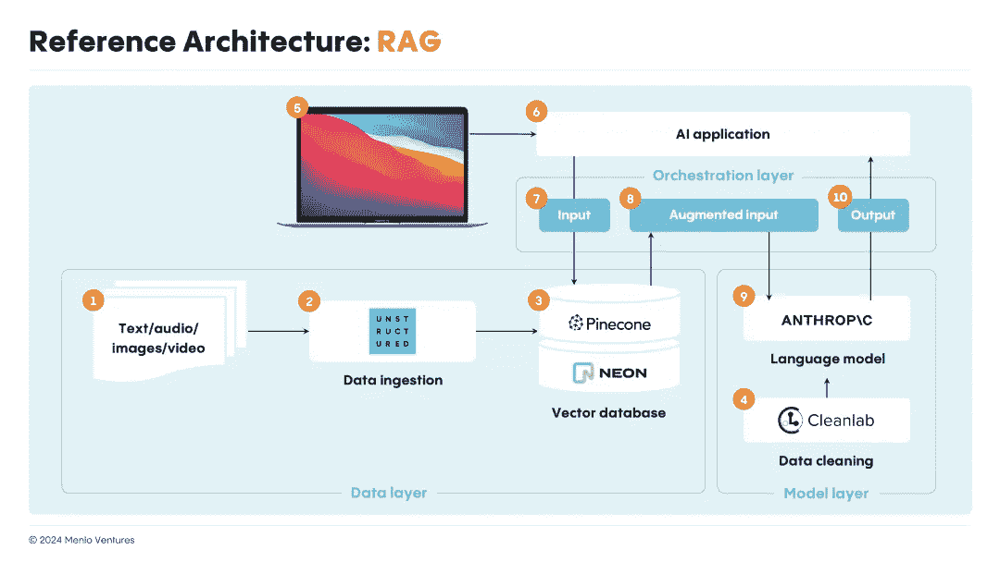
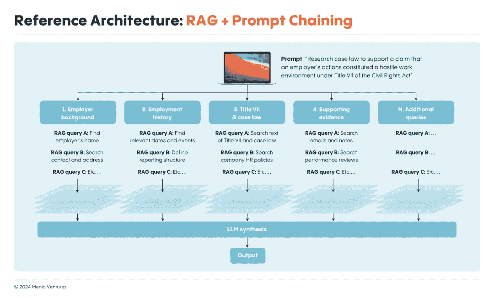
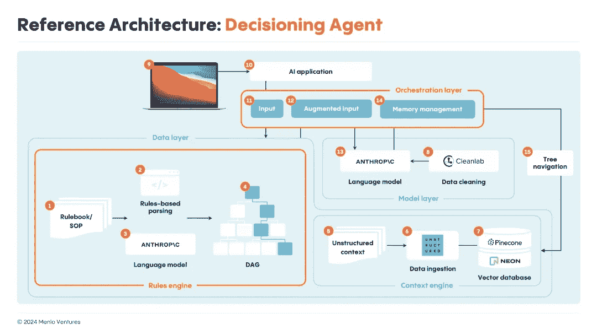
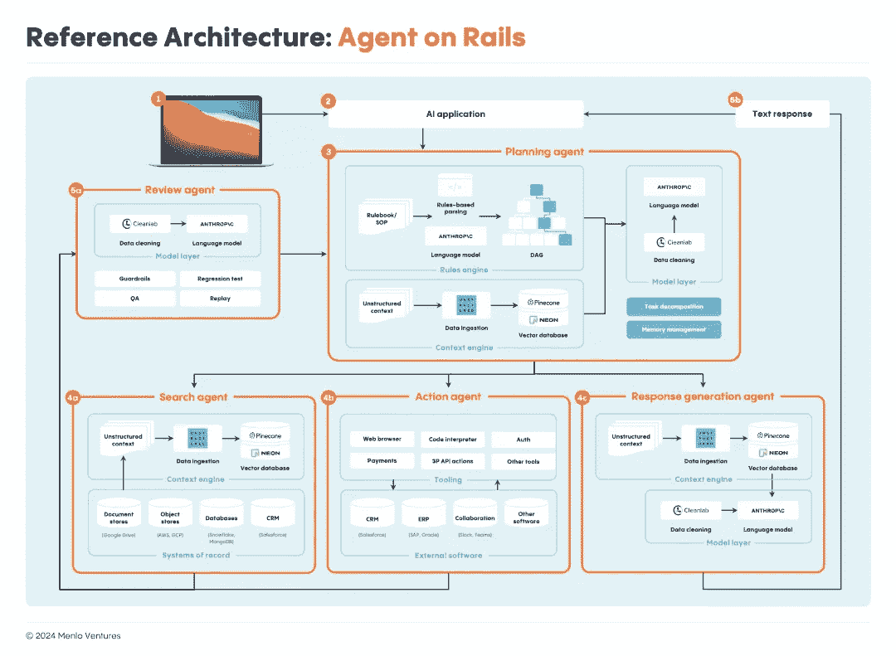

# Chatbot限制了对AI Agent的想象力——斯坦福、MENLO Ventures再论Agent市场格局！

> 来源：[https://v11enp9ok1h.feishu.cn/docx/L9wpdPVrBodQdNxcY39c8IhGnZb](https://v11enp9ok1h.feishu.cn/docx/L9wpdPVrBodQdNxcY39c8IhGnZb)

[关于AI Agent，👸号里最近涉](http://mp.weixin.qq.com/s?__biz=MzU2Njg0OTEyNQ==&mid=2247485488&idx=1&sn=09a620250c55e8ce91b802ffb7a81a65&chksm=fca7733acbd0fa2c3dc7961bd3f9808ec950d686475beedfd8cce9ce05595f8562034fd89c10&scene=21#wechat_redirect)**及**不少——

比如这是Google眼里的Agent版图：谷歌最新发布！185个头部AI应用落地案例，6大方向Agent前景一览。

再比如a16z对于Agent和Copilot的对比分析：a16z硅谷预判｜每个白领岗位都会有一个Copilot，直到被Agent取代。

今天给大家带来的是来自MENLO Ventures的最新mapping，斯坦福SAIL提供相关数据及支持。

生成式AI应用跑通PMF的，目前有三大类：搜索、合成和生成。

Menlo Ventures 投资组合中的Sana （企业搜索）、Eve （法律研究copilot）和Typeface （内容生成 AI）等公司，分别代表了每个类别的早期突破性案例，这些案例都以 LLM 的少样本推理能力为中心。

但GenAI的前景，远远超出了第一波核心用例。能够为您读写的人工智能很棒，但更令人兴奋的是能够代表您思考和行动的人工智能。

为此，我们已经看到Anterior、Sema4和Cognition等领先的应用程序构建者，在构建更自动化的解决方案，来处理以前只能由大量人类解决的工作流程。

借助多步逻辑、外部存储器以及访问第三方工具和 API 等新构建模块，下一波代理正在扩展 AI 功能的边界，实现端到端流程自动化。

在深入研究 AI 代理领域时，MENLO Ventures 针对新兴市场的观点如下——

首先定义代理是什么以及是什么使代理成为可能。将追溯现代 AI 堆栈的架构演变，从少量提示到检索增强生成 (RAG)，再到成熟的代理系统，然后在后续文章中探讨这种范式转变对应用程序和基础设施层的影响。

## AI Agent的认知架构四个构建模块

完全自主的Agent由四个要素定义，这四个要素结合起来可实现完全的代理能力：推理、外部记忆、执行和规划。

+   **推理。**在最基本的层面上，Agent必须能够对非结构化数据进行推理。基础模型（如Anthropic和 OpenAI）已经非常有效地实现了这一功能，它们将部分世界模型编码到 LLM 的预训练权重中，并利用这些权重来获取一般知识和基本逻辑。

+   **外部记忆。**除了一般知识外，代理还需要外部记忆来存储和调用特定领域的知识以及他们正在解决的问题的有界上下文，通常通过像Pinecone 这样的矢量数据库。

+   **执行。**代理使用工具来执行任务，以增强其解决问题的能力。许多早期的代理平台都提供预定义在代码中的自定义操作工具箱，供代理选择。但许多通用代理工具也开始出现，包括网页浏览、代码解释、身份验证和授权，以及与 CRM 和 ERP 等企业系统的连接器，以在这些系统内执行 UI 操作。

+   **规划。**Agent不会尝试通过单线程的下一个标记预测序列来解决复杂问题（例如一口气写完一篇文章，从第一个单词开始，直到最后一个单词才停止），而是遵循更像人类的思维过程，将工作分解为更小的子任务和计划，反思进度，并根据需要重新调整。

## 参考架构：从 RAG 到自主代理的 AI 示例

需要明确的是，未来完全自主的代理可能拥有所有四个构建模块，但今天的 LLM 应用程序和代理却没有。

例如，流行的 RAG 架构不是代理性的，而是利用推理和外部记忆作为其基础。一些设计，如OpenAI 的结构化输出，甚至支持工具使用。

然而，重要的区别在于，这些应用程序利用 LLM 作为语义搜索、合成或生成的“工具”，但它们采取的步骤（即它们的逻辑流程）仍然是由代码预先确定的。

相比之下，当你将 LLM 置于应用程序的控制流中并让它动态决定要采取哪些操作、使用哪些工具以及如何解释和响应输入时，代理就会出现。

只要这是真的，一些代理甚至不需要与外部工具交互或采取行动。

在 Menlo，我们确定了三种类型的代理，它们的主要用例和控制应用程序流程的自由度各不相同。

最受限制的一端是“决策代理”设计，它使用语言模型遍历预定义的决策树。

“轨道代理”通过为代理配备更高级别的目标，但用要遵循的 SOP 和可供选择的预定“工具”库来限制解决方案空间，从而提供更高的自由度。

最后，在光谱的最末端是“通用 AI 代理”——本质上是 for 循环，顶部几乎没有数据支架，完全依赖语言模型的推理能力进行所有规划、反思和路线修正。

下面，我们将针对每种代理类型研究五种参考架构和 AI 代理示例。

## 检索增强生成 (RAG)

设定基线：RAG 是当今大多数现代 AI 应用程序的标准架构。让我们以 Sana 的企业搜索用例为例，了解其内部工作原理。

该过程始于应用程序加载和转换企业数据孤岛（如 Google Drive 和 Notion）中的非结构化文件（例如 PDF、幻灯片、文本文件），将其转换为 LLM 可查询格式，通常通过数据预处理引擎（如Unstructured *）。

这些文件现在被“分块”成更小的文本块，以便进行更精确的检索，并嵌入为向量并存储在像Pinecone *这样的数据库中。

当用户向 AI 应用提出问题时（例如，“总结我与 X 公司开会时的所有笔记”），系统会检索语义上最相关的上下文块，并将它们折叠成一个“元提示”，并利用检索到的信息进行扩充，以提供给 LLM。

然后，LLM 根据检索到的上下文合成答案，向用户返回一个简洁、有要点的答案。

当然，该图仅展示了一个带有一个 LLM 调用的单个检索步骤。在生产中，AI 应用程序具有更复杂的应用程序流程，包含数十甚至数百个检索步骤。

这些应用程序通常具有“提示链”，其中一个检索步骤的输入会输入到下一个检索步骤中，并且多个“提示链”会针对不同类型的任务并行执行。然后将结果合成在一起以生成最终输出。

例如，法律研究副驾驶Eve * 可能会将关于 Title VII 的研究查询分解为单独的提示链，重点关注预先确定的子主题，例如雇主背景、就业历史、Title VII、相关判例法和原告案件的支持证据。

然后，LLM运行每个提示链，为每个提示链生成中间输出，并综合输出以编写最终备忘录。

## 工具使用

工具使用或函数调用通常被视为从 RAG 到代理行为的第一步，为现代 AI 堆栈添加了一个新的层。

这些工具本质上是预先编写的代码组件，用于执行特定操作。Web 浏览（Browserbase、Tiny Fish）、代码解释（E2B）和授权 + 身份验证（Anon）等流行原语已经出现。

它们使 LLM 能够浏览网页、与外部软件（例如 CRM、ERP）交互以及运行自定义代码。

系统将可用的工具呈现给 LLM，然后 LLM 选择一个，将必要的输入制作为结构化 JSON，并触发 API 执行以产生最终操作。

Omni 的Calculations AI功能就是这种方法的典型代表。它利用 LLM 将适当的 Excel 函数直接输出到电子表格中，然后电子表格执行计算并自动为用户生成复杂的查询。

话虽如此，工具的使用功能强大，但其本身不能被视为“代理”。逻辑控制流仍由应用程序预先定义。

我们将在接下来的设计中探索真正的代理，它允许 LLM 动态编写部分或全部自己的逻辑。

## 决策Agent

我们将要探讨的第一种类型的代理是决策代理，它使用代理决策来导航复杂的多步骤推理流程并做出业务决策。

与 RAG 或工具使用方法不同，这种架构首次将一些控制逻辑交给 LLM，而不是事先将所有步骤硬编码 - 但仍然处于代理自由度范围的较低端，因为代理主要充当导航一组决策树的路由器。

让我们以Anterior (fka Co:Helm) 为例。这家健康计划自动化公司开发了一个临床决策引擎，用于自动审查索赔提交。

如今，护士们根据载有条件知识的付款人规则（如世界上最无聊的“选择你自己的冒险”），手动完成这些审查。

Anterior 简化了这一流程。该公司首先使用基于规则的脚本和语言模型将付款人规则转换为有向无环图 (DAG)。

然后，他们的代理遍历这棵决策树，利用每个节点的 LLM 来根据特定规则评估相关临床文档。

对于较简单的节点，这可能涉及基本的检索增强生成 (RAG) 步骤。然而，Anterior 经常遇到需要子链的更复杂的任务，其中代理必须选择最佳方法才能前进到下一个节点。

它会根据每个决策更新其状态（在内存中管理这个中间输出），并在整个树中前进，直到做出最终决定。

Anterior 并不是唯一一家采用这种方法的公司。其他利用决策代理的公司包括Norm AI（正在构建用于监管合规的 AI 代理）和Parcha（正在构建用于 KYC 的代理）。

## Rails 上的代理

我们将要研究的下一类代理是轨道代理。与决策代理相比，轨道代理被赋予了更高层次的目标（例如，“将此发票与总账核对”、“帮助客户解决登录问题”、“重构此代码”），并被赋予更大的自由度来选择实现这些目标的方法和工具。

与此同时，这些代理仍然受到程序性知识的指导，即组织对代理如何表现的期望（“轨道”，以自然语言编写的规则手册或说明手册表示）；给定预定义的工具，以便在外部软件系统中启用设定的操作；并受到护栏和其他审查措施的约束，以防止出现幻觉。

在运行时，此设计可能会产生以下模式：

+   规划代理评估应用程序相对于运行手册的当前状态（即它当前位于 DAG 中的哪个节点）并检查该节点可用的所有动作链；

+   代理选择并执行最佳链。每个链可能包括以代码定义的预先编写的操作，甚至包括可以执行特定任务的附加代理，包括传统的 RAG；

+   在采取任何行动之前，系统都会进行审查和护栏，以确保一致性和协调性；

+   规划代理根据规则手册评估新状态，并重复该过程——从 DAG 中的新节点选择最佳链再次执行。

请注意，这种架构比以前的设计引入了另一种复杂性，可能需要额外的数据基础设施来支持，包括用于持久执行的数据基础设施；情景记忆、工作记忆和长期记忆的状态和内存管理；多智能体编排；以及护栏。

领先的代理公司，似乎正在将这种架构作为「自主性」和「控制性」之间的平衡点。

新兴的 AI 代理示例包括客户服务 + 支持领域的Sierra、Decagon、Maven AGI、DevRev和Gradient Labs ；软件开发领域的Factory AI和All Hands AI；财务后台领域的Sema4；以及销售、安全运营和供应链等领域的许多其他代理。

## 通用型AI Agent

代理设计中最后一个尚未实现的圣杯是通用人工智能代理——一种 for 循环架构，其中 LLM 的高级功能包含了以前设计的结构化“轨道”。

这个假设的代理将拥有动态推理、规划和自定义代码生成能力，使其能够在外部系统中执行任何操作，而不仅仅是预定义的系统。

自2023 年春季BabyAGI和AutoGPT问世以来，朝着这一理想的研究进展突飞猛进。

目前，最复杂的设计是语言代理树搜索(LATS)，它将蒙特卡洛树搜索（AlphaGo背后的基于模型的强化学习技术）应用于语言代理。

LATS 允许代理探索实现目标函数的多种轨迹，优先考虑高回报路径，纳入反馈并在必要时回溯。

这些前沿架构的先锋商业应用包括Reflection AI等新基础模型，以及Cognition、Nustom和OpenDevin/All Hands AI等编码代理。

## Agent的未来

生成式人工智能，正在进入Agent时代……

我们今天看到的代理架构和早期示例仅代表了更广泛的变革的开始，这种变革有望重新定义人机动态，对企业应用程序和基础设施都有影响。

更重要的是，基于AI Agent，0-1创建一款新产品、赚得新一桶金，越来越容易实现……有大量身边的、海外的故事，为大家慢慢道来。