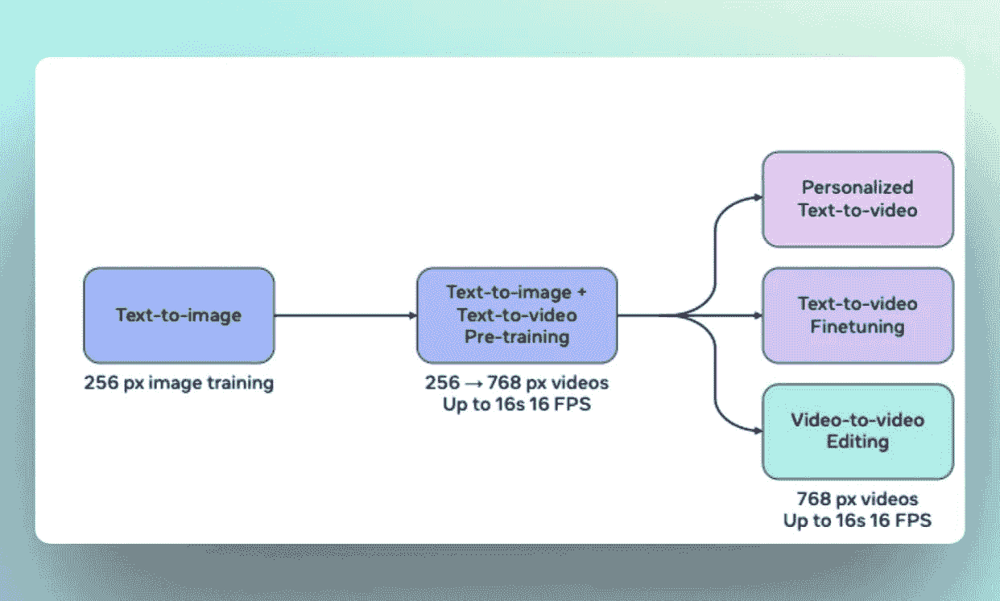

# 10🈷️7日

> 来源：[https://v11enp9ok1h.feishu.cn/docx/NzL0dOeLnoDxi4x2kmycTeBMnub](https://v11enp9ok1h.feishu.cn/docx/NzL0dOeLnoDxi4x2kmycTeBMnub)

+   《[Cursor创始团队最新访谈：如果Git](https://mp.weixin.qq.com/s/9kD3Po6Xb2ms0ppkPF2VuQ)hub整合o1，Cursor可能要倒闭了Cursor 创始团队在 Lex Fridman 的访谈中讨论了其 AI 编程工具的发展。Cursor 基于 VS Code，利用训练模型为编程提供支持，尤其在代码修改和差异显示方面具有独特优势。团队强调，未来模型将变得更智能，通过 “投机编辑” 提升处理速度，同时希望改善代码审查体验，以减轻程序员的负担。

+   《全方位超越 Sora ，Meta 最新的 AI 视频模型到底强在哪？Meta 最新发布的 AI 视频生成模型 Movie Gen 在生成效果和自定义性上超越了 Sora，能够自然逼真地生成视频，并同步生成音频。该模型具备文本到视频、个性化视频生成和精准编辑功能，能够根据用户需求进行细致调整，保证画面一致性。通过大量数据预训练，Movie Gen 在物体运动和镜头运用上表现优异，适用于自媒体和视频编辑，提供了更高的生成质量和灵活性。

