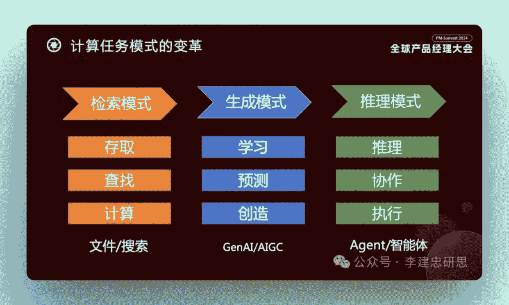

# 10🈷️8日

> 来源：[https://v11enp9ok1h.feishu.cn/docx/R4MhdWjp9oyVr8xFtOVcTWVWnzh](https://v11enp9ok1h.feishu.cn/docx/R4MhdWjp9oyVr8xFtOVcTWVWnzh)

+   《大模型驱动的产品范式创新研究与思考作者李建忠，这是他在 2024 全球产品经理大会的演讲，探讨了大模型对产品范式的创新影响，归纳为计算、开发和交互三大范式的变革。重点强调了交互范式的革新，如多模态和自然语言用户界面（LUI），将提升用户体验并打破应用间壁垒。此外，指出大模型在提高生产力方面具有显著优势，但在情感和社交领域的应用仍需人类主导。

+   《[Orange AI 的 9 月小结：AI 自媒体、AI 播客、AI 酒吧…AI浓度太高了](https://v11enp9ok1h.feishu.cn/wiki/EdeOw6AlliySINk7Yu9ceL5zntd?from=from_copylink)》他鼓励每个人建立自媒体。AI 播客方面，推出中文版 Demo 并吸引了大量参与者。同时，开设了 AI 酒吧 Bar2AGI，成为行业交流的新场所。参与了活动，包括 Demo Inn 和云栖大会，感受到了行业的快速发展和乐观的氛围。

+   《[Orange AI 的 9 月小结：AI 自媒体、AI 播客、AI 酒吧…AI浓度太高了](https://v11enp9ok1h.feishu.cn/wiki/EdeOw6AlliySINk7Yu9ceL5zntd?from=from_copylink)》国庆节期间有哪些重要的 AI 新闻呢？歸藏的 AIGC 周刊给你完整的答案。OpenAI 推出 Canvas 功能和实时 API，微软发布新版 Copilot，具备深度系统集成和实时语音功能；Meta 发布 Meta Movie Gen 视频生成模型，自动配音质量高；LiquidAI 发布非 Transformer 模型 LFMs，推理效率显著提高。此外，Sora 项目负责人离职、多个新模型和工具发布，以及 OpenAI 完成新一轮融资，估值达到 1570 亿美元。