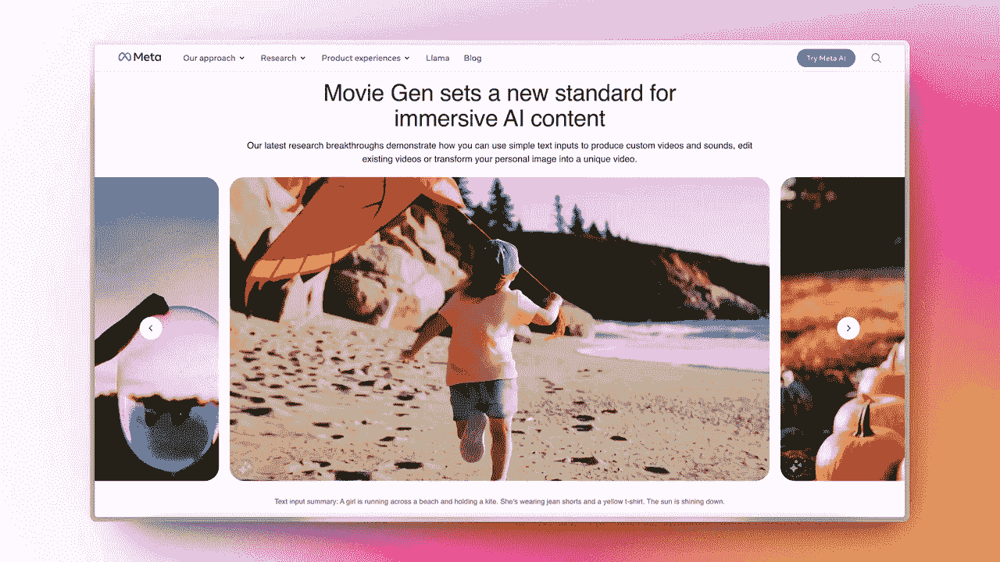
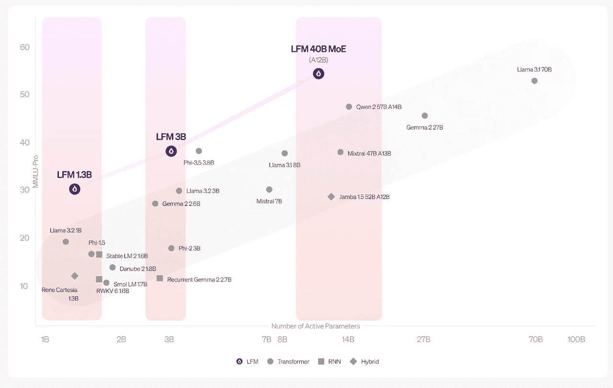
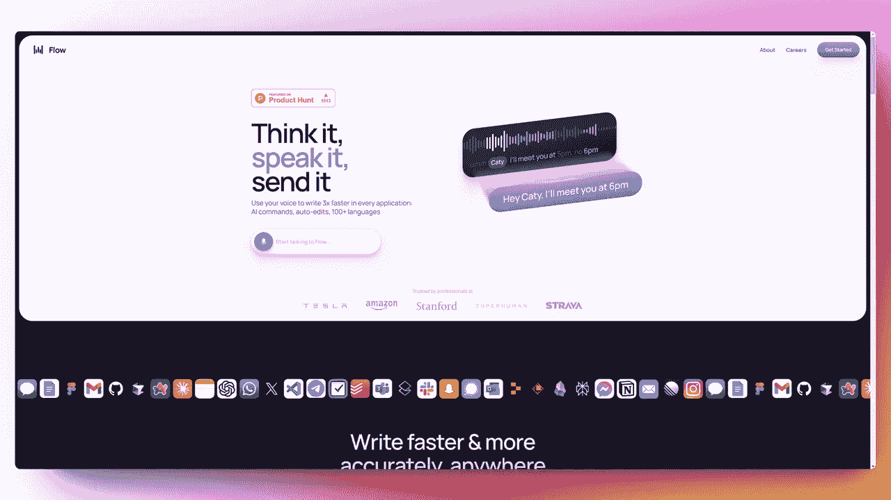
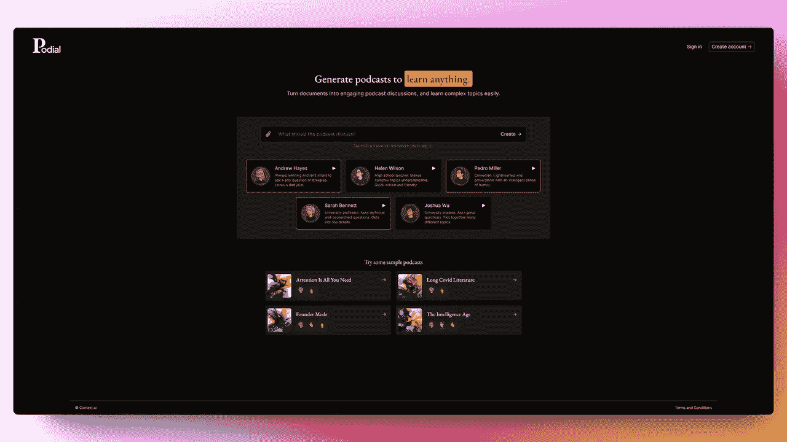
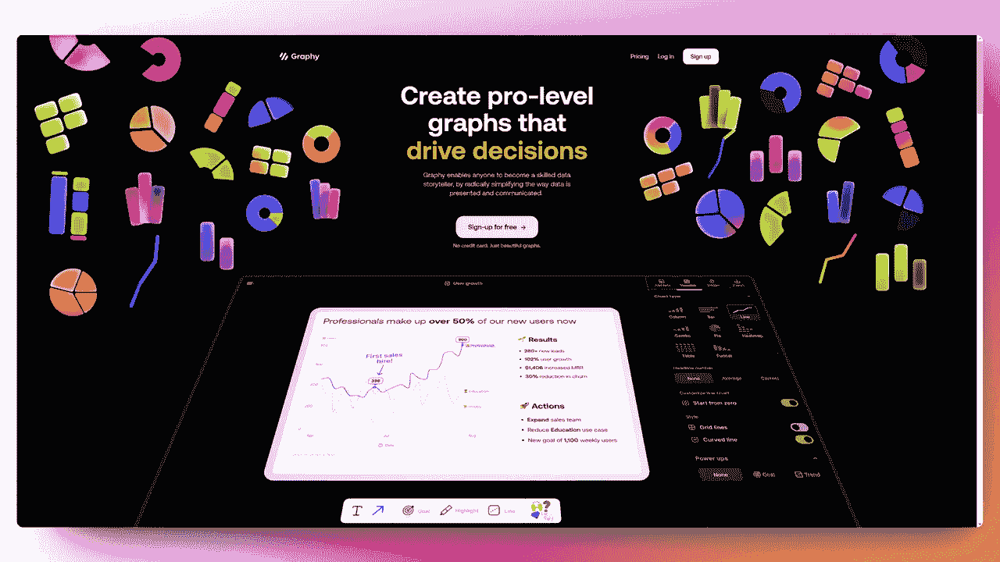

# AIGC Weekly #91

> 来源：[https://v11enp9ok1h.feishu.cn/docx/PwnUdIsLVox05exlXDhcPatJnVb](https://v11enp9ok1h.feishu.cn/docx/PwnUdIsLVox05exlXDhcPatJnVb)

## 上周精选 ✦

### Open AI 发布 Canvas 功能和实时API

**Canvas**

Open AI 在产品和交互上终于开窍了。在 Claude Artifact 的基础上迭代优化发布了 Canvas。

主要为了解决沟通和长文写作在原来的交互下不兼容的问题。不过最重要的能力直接渲染代码结果还没有，估计还在开发，不过这也太慢了 Poe 都支持了。

可以对预览界面的结果通过交互按钮快速修改。也支持选中部分结果跟 ChatGPT 对话之修改这一部分。界面右侧根据输出结果是文字还是代码有不同的快捷方式。

当输出结果是文本的时候快捷按钮是：​

•

建议编辑：ChatGPT 提供内联建议和反馈。

•

调整长度： 编辑文档长度使其更短或更长。

•

更改阅读级别：调整阅读级别，从幼稚园到研究生院。

•

添加最终修饰：检查语法、清晰度和一致性。

•

添加表情符号：为强调和色彩添加相关的表情符号。

当输出结果是代码的时候快捷按钮是：​

•

审核代码： ChatGPT 提供了改进代码的内联建议。

•

添加日志：在代码中插入打印语句以帮助调试代码。

•

添加注释：添加注释以使代码更容易理解。

•

修复错误：检测和重写有问题的代码以解决错误。

•

将代码转换为其他语言：将代码转换为 JavaScript、TypeScript、Python、Java、C++或 PHP。

[Realtime API](https://openai.com/index/introducing-the-realtime-api/)

OpenAI 还在最近的 DevDay 上宣布了Realtime API、提示缓存、模型蒸馏和视觉微调。

与 ChatGPT 的高级语音模式类似，实时 API 支持使用 API 中已支持的六种预设语音（在新窗口中打开）进行自然语音对话。但是非常贵。

### [微软发布新版Copilot](https://blogs.microsoft.com/blog/2024/10/01/an-ai-companion-for-everyone/)

微软憋了半年多的大招终于发布了，对Copilot进行了彻底的重构，基本可以看作一个跟系统结合更深入的ChatGPT，尤其是可以查看你现在系统打开的网页图片等内容，这个很强。

随时拉起的实时语音功能也非常方便，主要内容有：​

**Copilot Voice **：看起来是 ChatGPT高级语音的微软版本界面更加舒服，四种声音可以选择。

**Copilot Daily **：用你选择的声音在早上阅读新闻和天气，而且还有更多个性化内容，比如你的待办。

Personalized Discover：会在首页引导你提问问题，随着你跟 Copilot 交流的数量变多，这里的问题也会跟你更相关。

Microsoft Edge 中的 Copilot ：

内置到 Microsoft Edge 浏览器中，帮助回答问题、总结页面内容、翻译文本或重写句子。

通过在地址栏中简单输入@ copilot，可以快速跟 copilot 交流。

**Copilot Vision **：可以理解正在查看的网页，包括文本和图像，并可以回答有关内容的问题，建议下一步操作。

系统级的视觉助手还是很厉害的，希望微软可以优化好。

**Think Deeper **：Copilot 可以推理更复杂的问题。

深度思考在做出回应之前需要更多时间，能够提供详细和逐步的回答以解决具有挑战性的问题。

可以检验一下微软AI的新领导 Yusuf Mehdi 交出的答卷了，目前iOS APP可以体验新的界面和交互，但是语音之类的还没上。

### Meta 发布 Meta Movie Gen 视频音频生成模型系列

Meta 终于开始对视频生成下手了，发布了 Meta Movie Gen 系列视频相关生成模型。

从演示来看质量很高，尤其是自动配音和视频编辑能力，其中自动配音的一个滑板演示，滑板落地的声音可以准确跟上画面的表现。

**模型主要包括：**

Movie Gen Video：30B 模型，单个文本提示生成高质量、高清晰度的图像和视频。

Movie Gen Audio：13B transformer模型，可以接受视频输入以及可选的文本提示用于可控性，生成与视频同步的高保真音频。

Personalized videos：可以自动剪辑视频，使用生成或现有视频以及附带的文字说明作为输入，可以执行本地化编辑，如添加、删除或替换元素。

虽然模型本身没有开源，但是 [技术报告 ](https://ai.meta.com/static-resource/movie-gen-research-paper)本身却写的非常详细。

**他们视频模型负责人还总结了 **[**一些要点 **](https://x.com/Andrew__Brown__/status/1842262328617672725)**：**

•

Meta Movie Gen 是一个纯粹的 Transformer 架构模型，不是DiT，还使用了流匹配 (flow matching) 技术。

•

视频生成模型的自动评估完全不可用，他们全部依赖人类评估，花了大量精力将视频评估分解为多个独立的质量和对齐维度。

•

数据质量至关重要！他们在论文中详细介绍了如何进行过滤和清理，可以仔细看看。

•

消融实验中发现，流匹配(flow matching) 在质量和对齐方面优于扩散模型。它的使用也非常稳健。

### LiquidAI 发布非 Transformer 模型 LFMs

融资4000万美金的LiquidAI终于交了自己的第一次发布。

LFMs 种从第一原则构建的非Transformer模型，包括1B、3B 和 40B三个版本。

两个小模型在各个维度的测试分数都碾压其他同规模模型。

在内存占用和推理效率上表现非常出色：​

即使是40B的MoE模型在相同硬件下推理速度也非常快。

在处理长内容输入的极限条件下，比现有Transformer模型的内存占用低非常多。

这个1B和3B小模型看起来甚至比苹果的更适合在端侧部署。

[这里试用 LFMs 模型 ](https://labs.perplexity.ai/)。

## 其他动态 ✦

•

Sora 项目负责人宣布离开 OpenAI ，加入谷歌 Deepmind。

•

Herdra 发布新的对口型模型 Character -2 。支持更多比例的图片，取消长宽比限制；大幅提升生成质量，清晰度更高表现力更强。

•

Black Forest Labs 发布 FLUX Pro 1.1 ，不开源，生成速度比其前身 FLUX.1 快六倍还提高了图像质量、提示依从性和多样性。

•

Coframe 发布基于 GPT-4o视觉模型微调的UI界面生成模型 ，还开发了一个专门针对这个类型模型的测试基准 DesignAlign 。

•

Open AI 的新一轮融资还是完成了 ，66 亿美元，现在估值 1570 亿美元。

•

Pika 加入战场， [发布 PIKA 1.5 模型 ](https://x.com/pika_labs/status/1841143349576941863)，具有更逼真的动作，还有指定物理效果的 Pikaaffects 功能。

•

Luma 直接将现有模型的生成速度提到了了 20 秒以内 ，没有搞 Runway 那种蒸馏的 turbo 小模型。

•

可灵发布对口型能力，API全量开放 ，图片、视频、虚拟试穿全部上线，充钱就能用。增加了创意圈功能，发布短片官方审核通过一条给666 积分。

## 产品推荐 ✦

### Bolt：全流程的 AI 代码工具

终于有个产品把 AI 代码生成这一套做全了。StackBlitz 推出 bolt. new，可以看作 Artfacts V0 和 Replit 的结合体。

支持提示、编辑、部署的全栈流程带有完整的开发环境可以实时预览生产结果。最重要的是每天都有免费额度。

而且这个项目还是开源的：[https://github.com](https://github.com/stackblitz/bolt.new)/stackblitz/bolt.new

### Open NotebookLM：开源的Notebook ML

使用开源 AI 模型（Llama 3.1 405B、MeloTTS、Bark）将 PDF 转换成播客。

### Wispr Flow ：语音输入工具

Wispr Flow 是一个基于人工智能的语音输入工具，它能够让用户通过语音快速输入文本，支持超过 100 种语言，并且能够在任何应用程序中使用。

该软件具有自适应的语音识别能力，可以根据用户所使用的应用程序和对话风格来调整语音输入的风格和内容，从而更好地匹配用户的个人写作风格。

Wispr Flow 还具备上下文感知能力，能够准确识别并正确拼写名字等特殊词汇。此外，它还提供了命令模式，允许用户通过语音对文档进行编辑和控制。

### [Podial：从文档生成播客](https://podial.ai/)

另一个类似Notebook的产品，不过把播客生成单独拿出来了，而且生成的播客质量还不错。

### Graphy ：图表美化和AI分析工具

Graphy 是一个数据可视化平台，它使任何人都能成为一名技术数据讲述者，通过简化数据的展示和传达方式，帮助用户创建引人注目的图表。

Graphy 的 AI 功能可以帮助用户添加数据并自动生成图表和关键见解，为演示文稿或 Slack 中的分享做好准备。

用户还可以通过视觉注释和一键增强功能（如目标和趋势线）来使数据更有意义，并通过故事讲述来传达见解。、

## 精选文章 ✦

### [Notebook LM 的产品设计 Jas](https://x.com/jayspiel_/status/1842243021955633278)on Spielma 分享软件的构建过程

Notebook LM 的产品设计 Jason Spielman 说了一下他们是如何开发出这个火爆的产品的：​

1.

关键在于与用户共同构建产品，而不仅仅是为他们构建。不要等到产品完全开发好才发布，而是尽早发布并持续迭代。

2.

原生集成而非外部附加：需要构建全新的、AI 原生的产品。

3.

音频概览之所以出色，不仅因为它们听起来很棒，更重要的是因为 (1) 内容可靠，基于原始资料 (2) 提供了一种简单的一键式方式来学习和消化你自己的信息。

4.

会议时间用于实际开发，而不仅仅是讨论如何开发。

### Lex Fridman 访谈了Cursor 创始团队

Lex Fridman 访谈了Cursor 创始团队，这一期干货非常多。

他[们详细介绍了 ](https://mp.weixin.qq.com/s/EKzhtkfZa0Bml0WBHVKsiQ)Cursor 的技术细节、AI 在编程中的应用、对未来 AI 编程的看法以及Cursor 团队的理念。这里有 我整理的要点 。

### [Andrej Karpathy 用 N](https://x.com/karpathy/status/1841594123381571863)otebook LM 生成了系列历史播客

Andrej Karpathy 又在整大活，这几天跟 Notebook LM 杠上了。