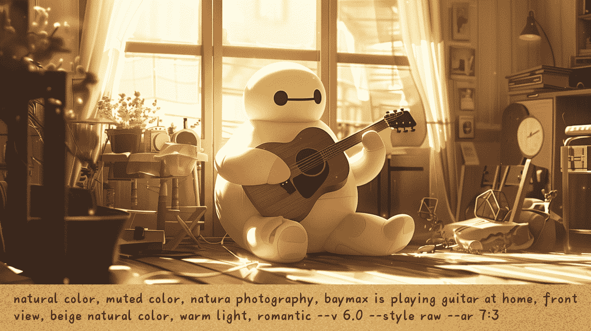
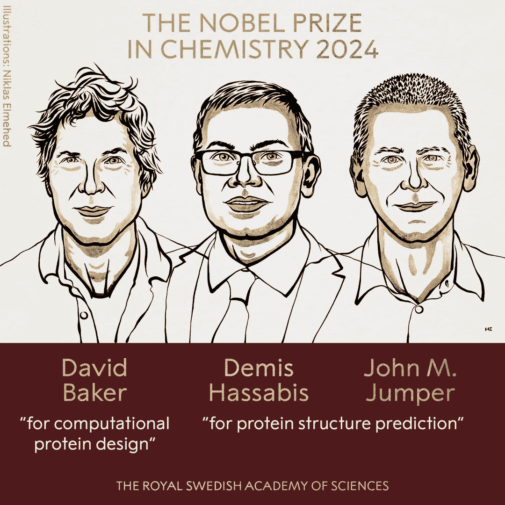

# 10🈷️11日

> 来源：[https://v11enp9ok1h.feishu.cn/docx/DaUVdcLZNoLu3DxcXuec8egOnMg](https://v11enp9ok1h.feishu.cn/docx/DaUVdcLZNoLu3DxcXuec8egOnMg)

+   《[AI音乐半年观(上) | 音乐生成有哪些实用场景和代表产品?](https://waytoagi.feishu.cn/wiki/Ks2swfO0Vi3XnckHkSVcw4ian5c)》本文探讨了 AI 音乐生成的实用场景和代表产品，主要包括视频配乐、功能型音乐、社交娱乐、业余及专业音乐创作等方面。AI 工具如 Suno 和 Udio 能够帮助创作者定制歌曲，满足个性化需求，同时提升音乐创作的效率。

+   《诺贝尔化学奖：人工智能终结了蛋白质研究吗？| 追问观察》来自追问的文章，2024年诺贝尔化学奖公布，一半授予大卫·贝克（David Baker），“以表彰在计算蛋白质设计方面的贡献”；另一半则共同授予德米斯·哈萨比斯（Demis Hassabis）和约翰·M·詹珀（John M. Jumper），“以表彰他们在蛋白质结构预测方面的成就”。本文详解AlphaFold的历史，以及它为何值得获奖。

