# AI音乐半年观(上) | 音乐生成有哪些实用场景和代表产品?

> 来源：[https://v11enp9ok1h.feishu.cn/docx/TYMZdQ5Koo34IwxxS10coDBQnYc](https://v11enp9ok1h.feishu.cn/docx/TYMZdQ5Koo34IwxxS10coDBQnYc)

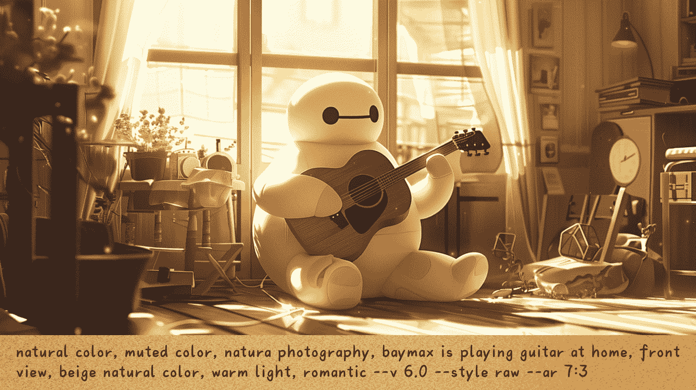

## **前言**

在近两年的生成式人工智能浪潮中，图片和视频领域已经取得了许多进展，音乐领域则大约是今年 3 月才开始崭露头角。在这半年间，也产生了许多技术和产品迭代以及应用案例。

结合我的 **个人实践、产品体验和用户调研 **，我总结了 AI 音乐生成在 哪些应用场景中发挥了价值？有哪些代表产品？哪些需求暂未满足？

我会按照 AI音乐生成、 AI 歌声生成/转换、 AI 音效生成 这三个方向来阐述对应的用户场景和 AI 产品，希望对大家了解 AI 音乐目前进展及未来趋势有所帮助。

本文为上篇， AI 音乐生成。

## **AI音乐生成总览**

目前AI音乐生成的主要方式是 **“提示词+歌词” **，[最具代表性的产品依然是 S](https://a16z.com/100-gen-ai-apps-3/)uno和 Udio，分别在 a16z 最新统计的生成式 AI 网页端产品排名位居 Top5 和 Top33（基于月独立访问量），其中 Suno 更是在半年内上升了 31 个名次。

目前 Suno 可以生成 4 分**钟的歌曲， Udio** 则为 2 分钟但 中文发音还有待提高 ，近半年二者也丰富了一些可控性如上传音频作为生成参考以及支持片段修改。

[除此之外](https://www.haimian.com/featured)，还[有些类似的原生](https://aitestkitchen.withgoogle.com/zh/tools/music-fx)工具如海绵音乐、 MusicFX ，以及其它赛道的产品如剪映、 TikTok 、 Mubert、唱鸭、网易天音等，通过集成生成能力来丰富功能提升体验。

**我**将 AI 音乐生成的实际应用归纳为 5 个场景，生成技术在 音乐视频和功能型音乐创作中正在 发挥商业价值， 社交娱乐 和 业余音乐创作场景 未产生明确价值， 专业创作领域 尚待 AI 融合进工作流。

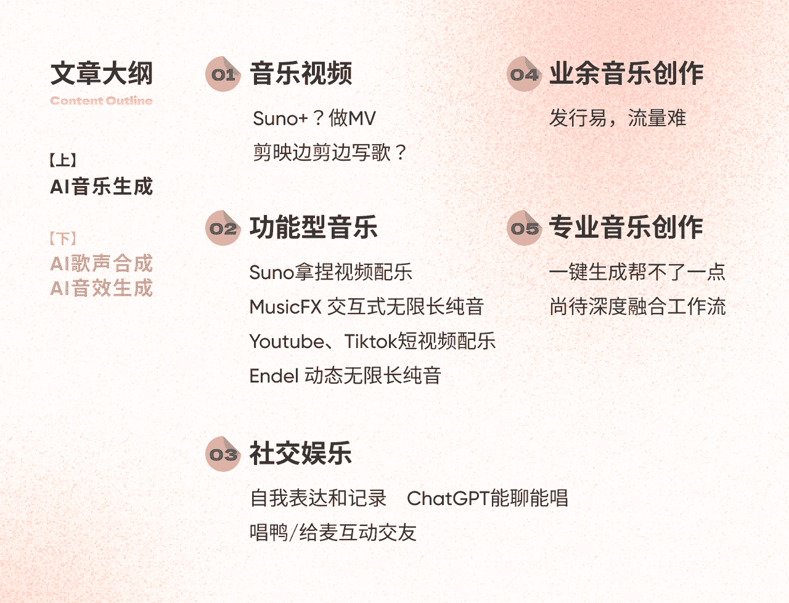

#

## 01 **音乐视频**

### **Suno+？做一支属于你的MV**

AI音乐生成的第一个应用场景是搭配AI图片和视频生成工具，制作音乐视频 （MV，Music Video）， 可以用于商业营销宣推，分享一个我的实践案例。

今年 2 月春节期间，我正在围绕“过年**”**这个项目主题，制作 AI 音乐视频。 与“背景音乐”不同之处在于， MV 里的歌曲具有独立欣赏的价值，且歌曲和视频画面在节奏、内容、情感上相互呼应。

我需要 **先找到合适的歌曲 **， **再根据歌词来制作对应的画面 **。我**的期望是：歌词描绘一个“过**年”的故事，措辞风格是悠扬温馨的中国风，内容易于我后续用画面呈现，歌曲时长 50s 左右。最初，我尝试去音乐素材网站直接购买一首现有的歌曲，但没有找到合适的，主要原因是曲库歌曲的 歌词内容、歌曲风格和长度 很难完全符合我的期望。

与其买一首不那么满意的歌曲又硬着头皮配画面，不如从头制作一首完全符合我要求的歌。可是我完全不懂音乐创作，于是利用 AI 生成音乐就成了救命稻草。当时（ 2 月份）我所能使用的只有 Suno ，虽然那时它只发展到 V2 模型但也勉强够用，同时通过订阅会员，我也获得了商业使用权。

> 我开始对歌曲内容进行细致的构想：歌曲围绕过年团圆的主题，讲述一位打工喵回到家乡、触景生情闪回童年、时光流转重聚当下的故事。按照这个情节，后续的步骤就是先通过ChatGPT来生成歌词，再通过SD和Runway完成分镜图片和动画。最后用剪映剪辑。

**📒 歌词 **

**歌词创作非常重要 **，它直接决定了我的故事内容和每个视频画面，由于 Suno 内置的歌词生成功能不支持多轮对话修改，因此我借助了 ChatGPT 来生成歌词。

在这个过程里，需要提供给大模型以下信息：

> **歌词结构 **我的比较简短，是“主歌-主歌-副歌”，且需带上元标签[verse1]、[verse2]、[chorus]

> **段落内容 **比如我第一段主歌的情节是“回家”，涉及意向“车站”、“下雪”、“老城”等。

> **写作风格 **中国风，带有古典意向，用词简洁工整 如果你有非常喜欢的某首歌的歌词，也可以告诉GPT以此为参考。

歌词生成后，再根据结果对于押韵、字数、措辞等方面不断提供修改意见直到满意为止。

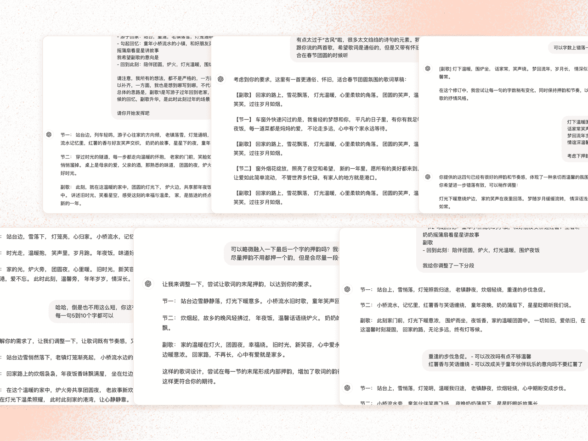

反复修改的辛酸史

我反复修改了非常多次。以下是多次沟通和修改后的最终版本的歌词：

> [verse]

> 站台瑞雪静落

> 灯火通明映归途

> 老城炊烟轻绕

> 岁月流转梦回初

>

> [verse]

> 小桥流水声细

> 童年欢笑随风起

> 夜幕垂蒲扇轻

> 外婆故事月下听

> 

> [chorus]

> 此刻家中

> 围炉共话团圆

> 灯火摇曳

> 映照如初笑颜

> 旅途终点

> 也是新的起点

**🎵 歌曲**

**歌词确定了以后，就可以**打开Suno制作歌曲了。打开页面上方的 “Custom”开关 （否则Suno会随机作词），填入歌词和 “歌曲风格描述”(Style Of Music) ，我这个案例写的是“Chinese folk”（传统中式歌曲）。

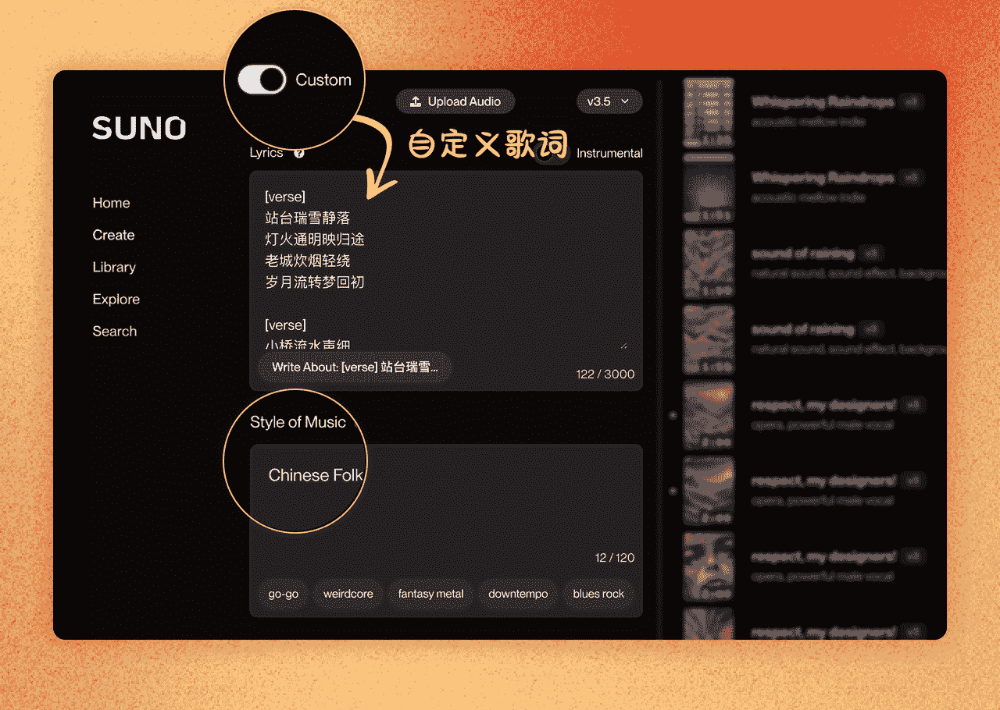

“歌曲风格描述”不仅可以写歌曲的流派和风格，还可以写上节奏、乐器、人声性别和音域以及情绪氛围。歌词里的“段落标签”除了注明最基本的歌词结构（intro/verse/chorus），也可以写上情绪、乐器、语气词等。如果想深入了解“歌曲风格描述”和“歌词段落标签”的使用细节和进阶技巧

最后点击生成即可以开始抽卡，我最终抽了二三十首选到了合适的歌曲。我对音乐创作还知之甚少，好在并不是要交付严肃的音乐创作，对于这个视频项目来说已基本满足要求。

[春节AI猫片最终曲子.mp3](https://internal-api-drive-stream.feishu.cn/space/api/box/stream/download/all/TxZAbuJkmoiVxox9zUScFvkJnAd)

🎬  视**频 **

歌曲选定后，通过AI绘图工具如SD、Midjourne[y制作静态分镜](https://www.studiobinder.com/blog/what-is-a-shot-list-example/)，分镜的提示词写法我参考了影视行业分镜表。接着再通过AI视频生成工具如Runway把图片制作成动态分镜。最后在剪映里进行视频和音乐剪辑、添加音效和画面特效等。

最近我用Runway最新的Gen-3模型重制了这个音乐视频：

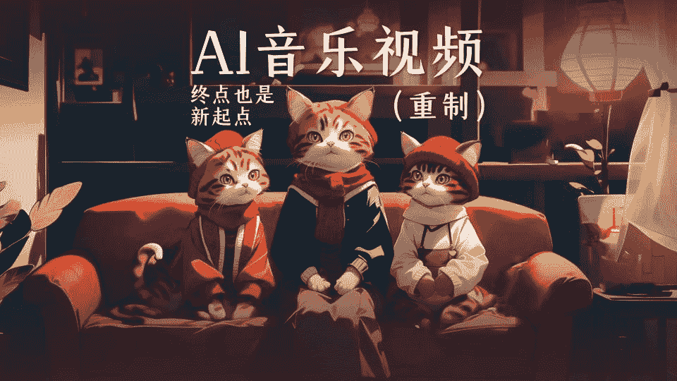

[春节猫片重制.mov](https://internal-api-drive-stream.feishu.cn/space/api/box/stream/download/all/QKaibnD4eo0dJJxdu1IcUomWn0g)

对于MV这类创作， **曲库里的歌曲 **无法满足创作者对于 **歌词内容、歌曲风格和长度 **的要求 **。 **AI音乐生成工具则可以发挥价值，帮助创作者制作满足要求的歌曲。

分享一个大佬案例：

7月初，博主@Arata_Fukoe发布了一支使用Suno、Luma、Runway Gen-3及可灵制作的AI音乐视频。最新的视频工具在动作幅度和画面一致性有了大幅度提升，再经由博主强大的剪辑和特效实力加持，制作出了这个很有冲击力的作品，发布期间也在各大平台刷屏。

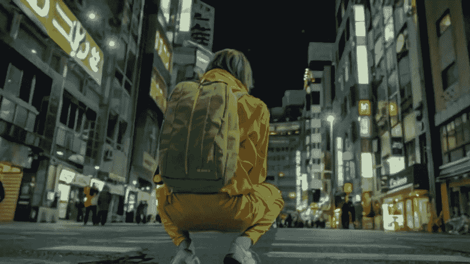

[musicvideotwitter.mp4](https://internal-api-drive-stream.feishu.cn/space/api/box/stream/download/all/KmmLbKSuco8UOzxJ45FcTJ0rnid)

视频作者：@Arata_Fukoe  |  推特主页：https://x.com/Arata_Fukoe

### **视频剪辑工具，边剪边写歌？**

上述音乐视频制作流程是“歌曲->视频->剪辑”，而为视频配乐的流程是“视频->歌曲->剪辑”，无论哪种方式，最后一步都离不开剪辑工具。

**有些视频剪辑工具在编辑场景里集成了AI音乐生成的能力，相当**于视频、配乐、剪辑都在同一个工具里完成 ，比如剪映：

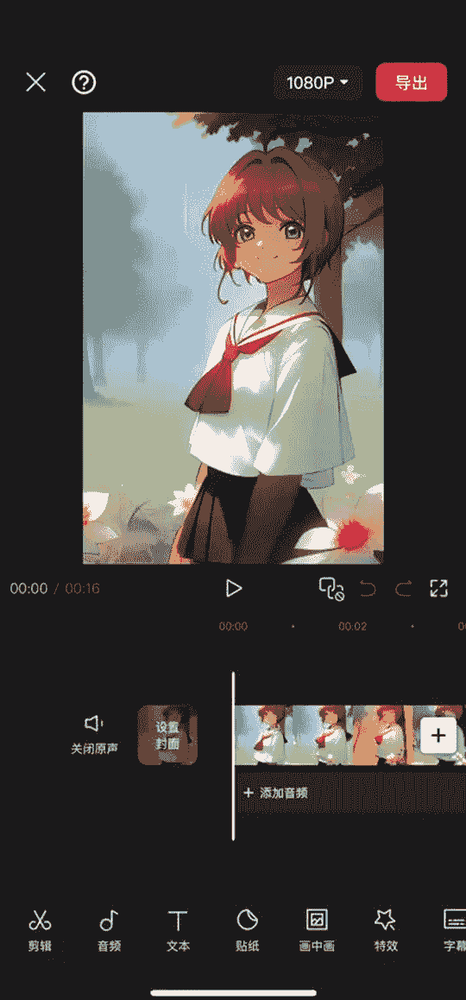

[剪映AI配歌曲.mov](https://internal-api-drive-stream.feishu.cn/space/api/box/stream/download/all/PpGqbJfaWoTK5hxeDBAcRKhdnqc)

这种方式把生成能力和工作场景相结合，可以减少工具之间的切换。但是和专业的AI音乐生成工具相比，这些 内置AI功能，在生成方式和控制精度上做了许多简化， 模型效果也较为一般。追求更高质量更可控的音乐作品，仍然需要使用那些更成熟、更全面的生成工具。

> 剪映不仅集成了AI音乐生成，还集成了AI视频生成、AI图片生成的能力，让创作者在编辑过程中可以随时补充所需要的“画面素材”。

> [类似的，A](https://www.youtube.com/watch?v=6de4akFiNYM)dobe Pr也在一支概念宣传片中展示了接入Sora、Runway、Pika等工具的生成及编辑视频的能力。这种设计贴合使用场景，但生成方式和控制精度有取舍，更适合对素材要求不那么高的用户。

## 02 **功能型音乐**

相对于有独立欣赏价值的音乐， **功能型音乐（Functional Music）的创作目的不是为了艺术表达，而是为服务于某种功**能和效果。它一般有这些特点：无人声，不吸引听众注意，旋律简单重复，相对模式化。 AI生成的音乐目前在艺术性和独特性方面存在限制，功能型音乐的这些特点，刚好弱化了技术在这些方面的不足。

因此， **相比于注重艺术价值的音乐创作，功能型音**乐的领域更容易被AI技术渗透和改变 。 在这波生成式AI浪潮前，已经有些早期的音乐生成技术应用在这个领域了。

功能型音乐具体有类型呢？

1.  一些“ **预算有限” **的广告、游戏、影视、播客里的 **配乐 **- 预算有限的项目，使用AI辅助生成配乐，可以 更高效、更经济地满足需求。当然，对于一些追求卓越艺术表现的配乐，还是需要专业创作者精心制作，像游戏《黑神话：悟空》里的配乐，每一首都是注入了创作者情感的艺术品。

1.  用于 **助眠、冥想、专注 **的音乐 - 主要是让听众达到某种心理状态，旋律 遵循特定的模式，通常是由一些缓慢重复的节奏或者白噪音构成的。

1.  线下 **公共场所里播放的背景音 **-用于影响听众行为如商场里刺激顾客购物欲、电梯音乐缓解密闭空间的紧张感、健身房里提升顾客的运动表现等。

### **小小视频配乐？拿捏**

分享一个我使用Suno生成功能型音乐的实际案例。

我**曾经用Runway Gen-3制作了一**个类广告片的视频，主要用来展示Runway在艺术字生成方面的效果。 视频的配乐不是重点，但我希望通过配乐营造令人振奋的氛围，让画面效果更有感染力。

**在**功能型音乐素材网站找歌通常需要购买版权，而Suno在非商用场景可以直接使用（如需商用，开会员即可）。 于是就再次请出Suno，由于这支配乐仅是氛围烘托，不需要有人声演唱，因此 打开“instrumental”（纯音乐）开关 ，和“custom”（自定义模式）开关。在提示词区域填入：

> “vibrant synths, cool high-energy, dramatic crescendos, fashion dynamic bass lines”（充满活力的合成器、潮酷有能量，戏剧性的渐强效果，时尚动感的低音线条）

> 提示词是让ChatGPT来生成的，我给到的信息是：“我准备制作一个视频，展示一种潮酷的视觉炸裂的效果，我希望使用AI生成背景音乐。请你帮我写AI配乐的文生音乐prompt，要求描述出音乐的风格、流派、乐器等，表达精简，并用逗号分隔。”

目前Suno V3.5模型的生成速度很快，几秒钟就可以拥有视频配乐，效率远高于在素材网站的分类目录下逐一试听。

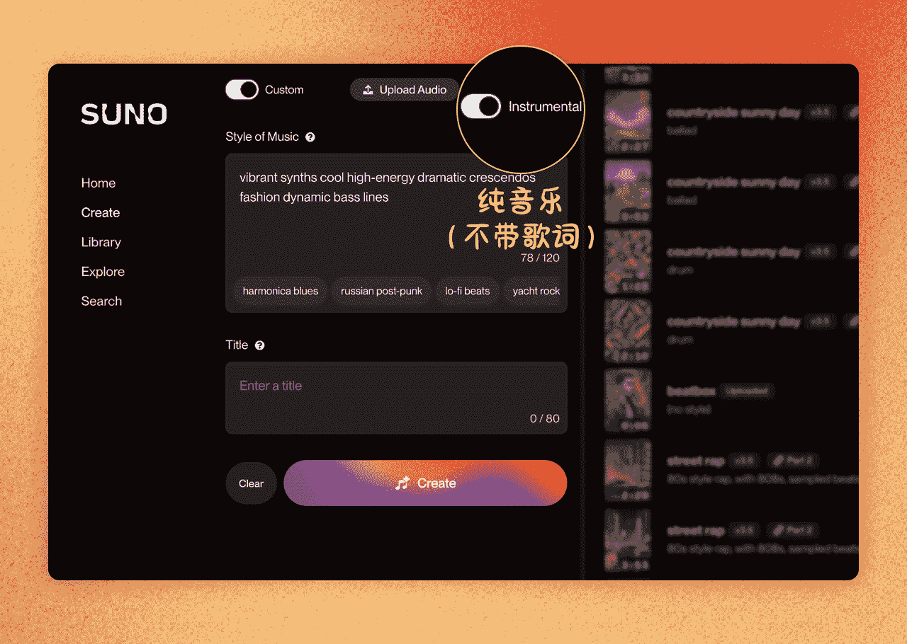

>

这是音乐搭配视频画面的最终效果：

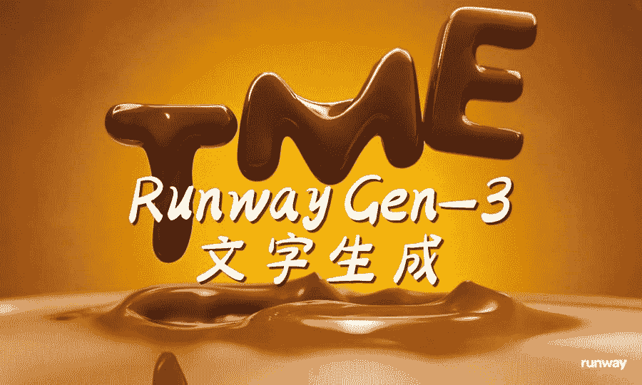

[文字生成测试.mov](https://internal-api-drive-stream.feishu.cn/space/api/box/stream/download/all/VqS9bwkaPoqWEsxMr8yckihEnHh)

推特作者@Julie W.Design  也经常利用Suno和Udio来给她的短片配乐：

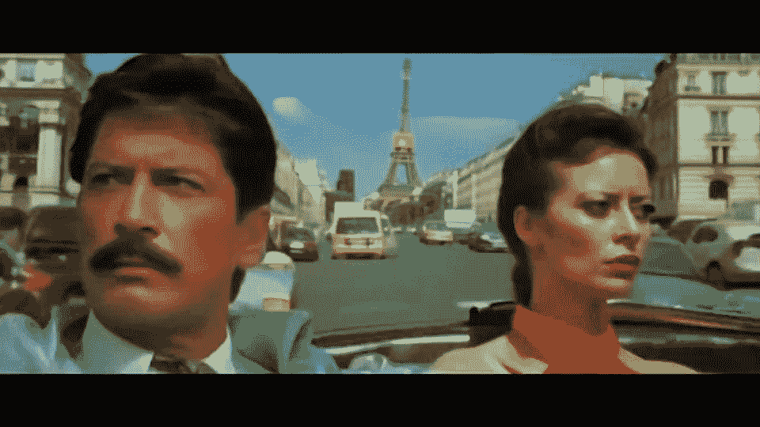

[Amplify Video 1812525273071357952.mp4](https://internal-api-drive-stream.feishu.cn/space/api/box/stream/download/all/RceobjAgOoOSQcxZq4OcTowfn2e)

> 推特视频创作者 @Julie W.Design 主页链接：https://x.com/juliewdesign_

> 这位视频创作者的作品是推特上的一股清流，充满细腻的生活观察和温柔的情感表达。由于更新频率和作品质量都很高，我一度以为她是全职UP主，后来在一档播客中才了解到她是一位职场妈妈。

> 为了确保创作的灵活性，她通常是在手机上完成图片、视频和音乐的生成以及后期剪辑全流程。这种时间管理和高效创作的能力真的让我非常非常敬佩❤️

### **专注于纯音乐生成的AI**

除此之外，谷歌的 [MusicFX](https://aitestkitchen.withgoogle.com/zh/tools/music-fx) 和Stability公司的 [Stable Audio](https://www.stableaudio.com/generate) 目前都专注于生成纯音乐，适合用于功能型音乐制作。

其中MusicFX的“DJ模式”，允许用户通过拖动提示词**对应的滑块来调整相应的权重**，并基于此， 生成不间断、无限长的音乐 。就像DJ打碟一样，可以根据现场氛围变化实时调整音乐。网站的动效设计也非常丝滑：

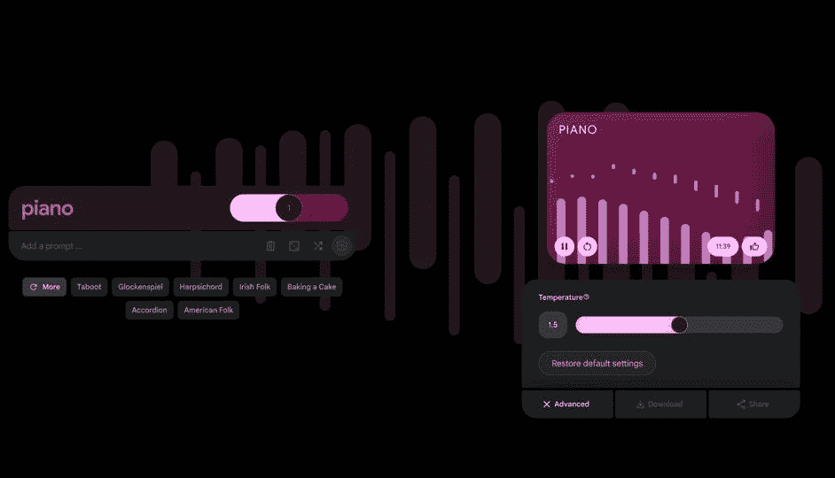

[DJ.mov](https://internal-api-drive-stream.feishu.cn/space/api/box/stream/download/all/SKHNbp9RzoWZFlxziJrclEqQnUd)

前几个月谷歌在I/O大会上，还真请来了一位DJ来现场演示效果：

[原视频](https://www.youtube.com/watch?v=wwk1QIDswcQ)动效是针不戳

如果你不想亲自制作，也有一些网站定位于音乐素材售卖，提供了大量现成的功能型音乐，比如Mubert、Pixabay、Audio Jungle、Musicbed等。你可以通过分类目录去试听并购买歌曲，许多视频创作者都会在这些网站上寻找配乐。

其中，[Mubert](https://waytoagi.feishu.cn/wiki/Ks2swfO0Vi3XnckHkSVcw4ian5c#share-MxX5dXGmUoNPI6x3I5ccxZ9lnDh) 就在原有纯音乐曲库的基础上，增加了AI纯音乐生成的能力来提供用户更多选择。

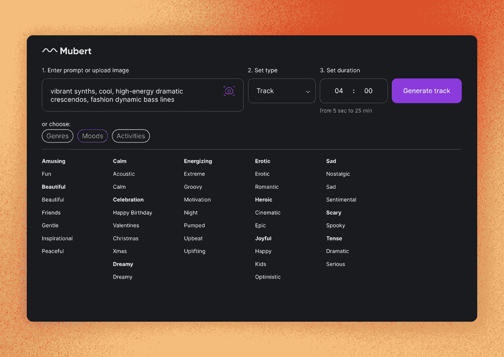

###

### **你会想用AI配抖音视频音乐吗？**

[Youtube](https://blog.youtube/inside-youtube/ai-and-music-experiment/)、[Tiktok](https://www.socialmediatoday.com/news/tiktoks-testing-ai-song-generation-process/704853/)** 这类短视频内容平台**，也增加了“AI配乐”的选项，让发布者在 发视**频前的配乐阶**段 ，可以使用自己创作的音乐。其中Youtube还和几位歌手达成了版权合作，用户可以选择 歌手的声音 作为歌曲人声。

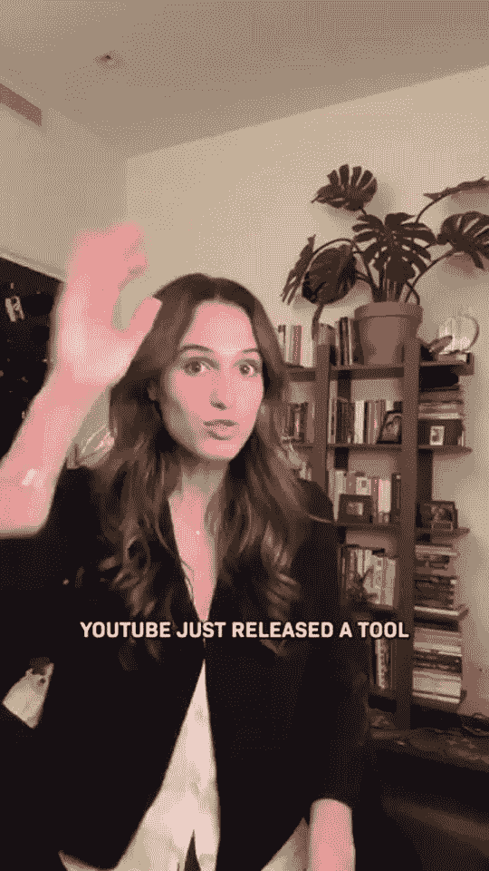

[youtubeAI配乐用户实操.mp4](https://internal-api-drive-stream.feishu.cn/space/api/box/stream/download/all/KgRPbiTHaoHtFjxUoxLc2ZrDnud)

在发短视频的场景，我其实会倾向于使用曲库里那些能触发情感共鸣和烘托氛围感的热门音乐，它们可以让视频更吸引人（比如一听到《悬溺》或者《Jar Of Love》，宿命感马上就来了😂）。AI生成的配乐，需要在情感氛围上超越曲库水平、且生成速度足够快（毕竟配乐步骤是发布视频前的最后一步），才能更好地发挥价值。

[我也](https://jimeng.jianying.com/ai-tool/home)**体验到了另一个不太**能理解的产品功能点，即梦（字节的AI视频生成工具）在内测给 “AI视频片段” 进行配乐。但实际上，视频创作的工作流是需要在剪辑过程里， 面向多个视频片段来进行统一配乐 ，因此我认为针对单个视频配乐的应用场景应该不大。

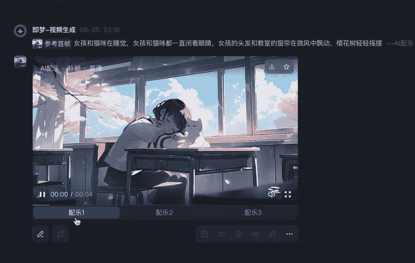

[即梦AI配乐.mov](https://internal-api-drive-stream.feishu.cn/space/api/box/stream/download/all/O5RNbgBcXoYfOjxijH1cs9Uvnrh)

### 助眠冥想赛道，动态无限长AI音乐

这个赛道下值得关注的产品是[Endel](https://endel.io/)。与潮汐、小睡眠等产品相比，Endel的一个特点是它会 结合用户习惯、当前环境及行为 生成动态变化的无限长 音乐 。不同的输入信息将 影响最终音乐的节奏、乐器和音效组成、和弦类型 等。

譬如在助眠场景，Endel会收集用户长期睡眠数据后定制专属的助眠音乐（入睡快慢不同的人对应不同的音乐结构）；在专注场景，Endel会根据当地的时间和天气来生成匹配的专注音乐（如下雨的夜晚vs晴朗的午后）；在跑步场景，会结合用户的步频、心率、天气来改变音乐节奏和乐器组成（快跑vs慢跑）。

Endel基于自主研发的算法来生成音乐，相对于Suno那样的**大模型，这种方式能确保在**特定的场景下， 算法遵循规定的参数生成 符合要求的音乐，也保证了生成效率。Endel也提供了一些音乐和神经科学理论及用户反馈来佐证其有效性，如果有长期使用的小伙伴，欢迎分享使用体验~

[Endel Intro.mp4](https://internal-api-drive-stream.feishu.cn/space/api/box/stream/download/all/PE4SbjWvCoPgTGxyhhScfipknne)

[视频链接](https://www.youtube.com/watch?v=adbc1SEqtCw)

##  03** 社交娱**乐

### **从写日记到写歌**

我注意到身边朋友有一些 **低频的音乐创作需求。 **比如在一些 **特殊时刻 ****如，生日、纪念日，**送别日等，用AI歌曲来 传递 专属祝福。 还有的喜欢用AI生成的歌曲帮助他们去 记录当下的感受 ，将情感用音乐保存下来 。

👦🏻朋友1

> 周一早上本来很疲惫，但是想起了周末和娃一起在公园里的画面，教他骑车，虽然身体很累但是内心很放松。特别怀念那个感受，就把它写成了一首歌单曲循环，听着听着心情也轻快了许多。通过歌曲，那时候的感受被具象化了，让我可以更深刻地体会它。

👧🏻朋友2

> 我深有感触。之前参加一个写作疗愈营，我写了一首诗。后来我用Suno把这首诗变成了一首歌，确实更加具象化了，多维度地记录下了那种感受。

作品在视频号：天天的多重宇宙

也分享一个我自己的实践案例。

> 《我的阿勒泰》上映期间我非常痴迷，有几个画面深深植入我的脑海，比如巴太和文秀坐在树上看彩虹、月光下在波光粼粼的河边散步、在桦树林里告白、在草原上自由奔跑。还有几句很喜欢的台词比如“再颠簸的生活，也要闪亮地过”、“我清楚地看见你”。除了二刷三刷电视剧，我也很希望能用音乐来记录和表达我脑海里的这些美好。

于是我先把以上这些细节信息通通告诉GPT来构思歌词，虽然GPT写的词还是有点文绉绉的缺乏些灵性，但私下用来记录感受也足够了。（自己玩，没有做MV的负担，对歌词的要求也就没先前那么高）

接着，再通过歌词和提示词让Suno（这次用了V3.5模型）生成歌曲，最后的成品我个人还是挺满意的(*^▽^*)

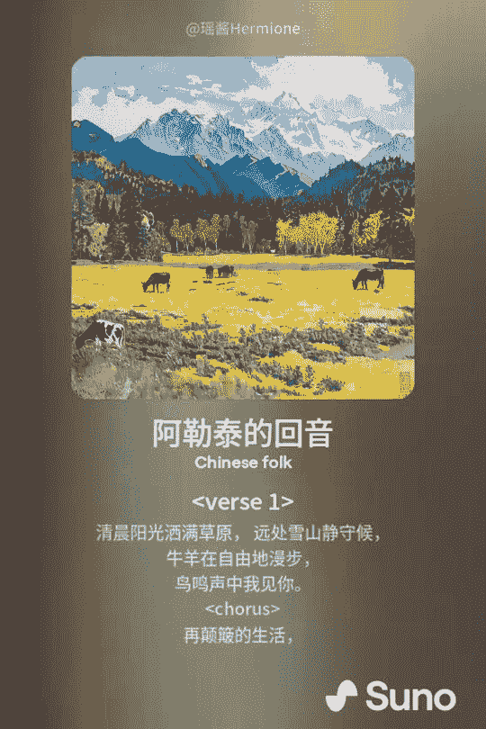

[阿勒泰的回音.mov](https://internal-api-drive-stream.feishu.cn/space/api/box/stream/download/all/BmzMbMlo1oaY5ZxfjG5cIOCynDe)

> **😄让我惊喜的地方

> **· 我没有使用元标签注明男女声，最后自动生成的男女对唱配合得很不错

> · 唱完了我提供的歌词，还自由发挥增加了桥段和尾声的部分

> · 自由发挥了一段女生的哼唱，这段我很喜欢

> **

> 😞未达预期的地方**

> · 标签里指定了乐器“冬不拉”（剧里经常用到这个元素，是哈萨克族常见乐器），但是这个乐器音色没有生成

> · 音质还是比较一般

这类自娱自乐的制作，我没有投入太多精力仔细雕琢，如果追求精细的控制，还是要多多参考文档教程。

### **社交互动新形式**

一些 **社交娱乐平台 **如“唱鸭”、“给麦”，在现有的音乐、游戏、直播功能基础上，引入了AI歌曲发布作为一个新的互动方式。

然而根据我的使用体验和观察，这些AI歌曲的生成质量还有较大提升空间，而且基于歌曲来互动的需求也不强烈。因此我推测这个功能可能难以促成深度互动和实现长期留存。

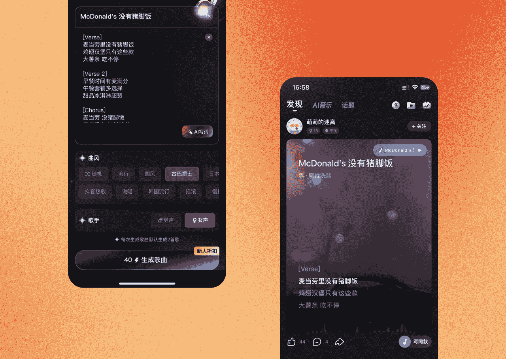

### **能聊也能唱的Chatbot**

还有一种社交存在于 **人和AI之间 **，之前GPT-4o的发布会上展示了模型的音乐能力，AI的交流互动方式变得更多样更自然，能聊也能唱。

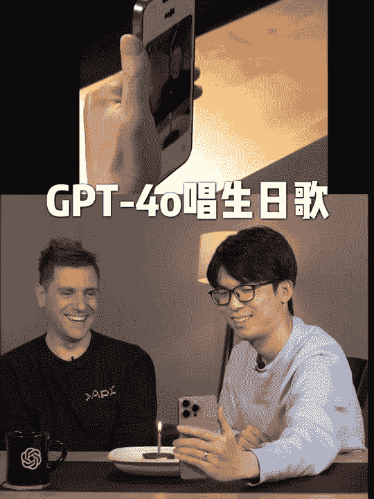

[GPT的音乐能力.mov](https://internal-api-drive-stream.feishu.cn/space/api/box/stream/download/all/GBi8bAk5Bop8ZLxPFF0cwH1vnFb)

这我联想到了电影《Her》里，AI女主跟随人类男主弹奏的尤克里里一起唱《The moon song》，以及博主@午夜狂暴哈士奇狗和她的ChatGPT男友（DAN模式）一起唱《Take Me Home, Country Road》的场景。

##  04** 业余音乐创**作

### **写词人的音乐梦**

> 和其他音乐人合作，比较慢，3年也没发几首歌，有了AI一个月能发好几首。

这是来自我的一位朋友的例子，他 喜欢写歌词但对乐理没有深入了解 ，以前需要和其他音乐创作者合作来共同完成一首歌，花费的时间较长。借助AI，则可以 快速地把自己写的歌词转变为成品。

**通过订阅会员，创作**者可以获得AI歌曲的版权，并 在流媒体平台发行 （也有流媒体平台自身搭建了从生成到发行的链路）。 AI技术降低了歌曲创作的门槛，让更多业余创作者可以参与其中感受音乐创作的乐趣。

我询问了这位朋友关于营收的情况，头部的IP歌曲（明星、头部创作者）占据着最大的流量**，而像他这样的**素人创作者则需要购买流量来提升歌曲曝光进而获得相应的收益，因此还 暂未实现盈利 。

### **出圈案例和残酷现实**

这反映出音乐市场供给大于需求，由于缺乏宣传推广资源，素人创作者在流媒体平台上较难获得关注。 作品想出圈，还是需要独特的内容和热门话题带动 。有一个出圈案例是抖音30w粉博主“新宇”，在🐧音乐发布了使用Suno写的声讨整容过失的歌《还我妈生鼻》，后又录屏发布在了抖音上。由于博主本身有一定粉丝基础，话题娱乐性强，2周左右就在抖音获得了22w+评论、在🐧音乐获得了100w+播放。

##  05** 专业音乐创**作

### **一键生成，帮不了一点**

上述场景主要涉及非专业创作，而在专业创作领域，目前这波一键生成技术还无法辅助创作过程。

**对于专业音乐创作者，AI音乐生成需要融入**创作[场景 - 数字音频工作站](https://www.ableton.com/en/live/)（[DAW） ，如Ab](https://www.apple.com/sg/logic-pro/)leton Live、Logic Pro等，为创作提供实时辅助。

> DAW里的AI助手需要具备以下能力：

1.  基于对已有创作内容的理解，提供续写或优化建议。

1.  生成的内容必须是MIDI格式的，便于创作者及时编辑。

比如：在 **作曲 ****过程中**，AI基于已有的主旋律片段，提供拓展或变奏建议；在 编曲 过程中，AI提供乐器搭配建议，优化音乐整体结构。然而，目前的AI音乐大模型生成的是完整的歌曲音频，还有待技术创新来生成可编辑的MIDI文件。同时，也需要设计合理的交互方式，使其无缝嵌入到DAW中。

反而是AI歌声合成已在专业工作流里广泛应用，我会在下一篇分享。

> **数字音频工作站 **，DAW（Digital Audio Workstation），是专业音乐人用于音乐创作的工具。创作者可以在DAW的轨道上绘制MIDI音符或编辑音频文件来创作旋律、和声、节奏等，选择并调整各种虚拟乐器的音色，完成编曲、混音及母带制作。DAW现有的自动生成鼓点、和弦的技术，都不是基于大模型，在上下文理解和生成内容的个性化、创意方面都很有限。

> **MIDI **，是用数字符号来描述音乐的方式，像一个“数字乐谱”，包含了音高、力度、持续时间等。在DAW的特定区域，MIDI被展示为一个个带着歌词的小方块，创作者可以在DAW里操作MIDI来完成音乐创作。

[BandLab](https://www.bandlab.com/songstarter)是一个音乐 **在线协作及分享 **[的平台，](https://sonickon.com/bandlab-surpasses-100-million-users/)集成了在线简化版DAW并支持协同编辑。目前注册用户超过1亿，主要是英美的独立音乐人和业余爱好者，年龄集中在18-24岁。

2022年BandLab推出了一个功能“AI SongStarter”。通过用户文字描述来生成旋律、和弦和节奏片段，并且会 以分轨MIDI的形式无缝接入在线DAW ，为业余爱好者提供灵感。

虽然这个AI功能还无法辅助专业人士，不过这个APP的视觉设计和动画真的很精致。

[bandlab.mov](https://internal-api-drive-stream.feishu.cn/space/api/box/stream/download/all/TRkIbMgZ0ozBJMxcdx4csOdlnsh)

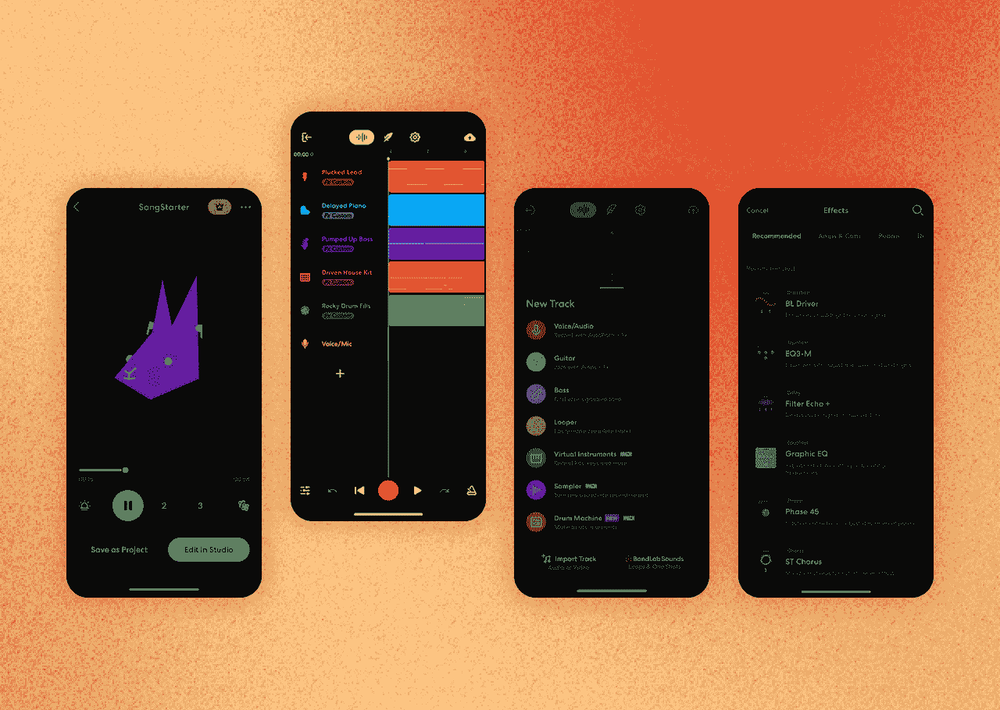

[网易天音](https://tianyin.music.163.com/#/)这个创作工具，面向对音乐创作有一定兴趣和基础，并希望进一步探索实践的爱好者。其中AI的融合存在一些问题：

1、 模型对提示词的理解有限，难以准确理解用户意图

2、 编辑歌词的方式不灵活，只有匹配联想或重新生成，无法通过对话来精确修改

3、 伴奏单一，采用了预设模板库，无法提供个性化的内容

## **可控性进展**

最后，补充近几个月，AI音乐生成工具可控性方面的提升

### **Suno、Udio支持音频成曲**

基**于用户提供的音频片段来**生成歌曲，音频可以是用户哼唱的旋律，敲击出的节奏，或者弹奏的和弦，生成方式会参考该音频的 旋律或节奏或和弦进行 。（输入若带有音色，也会参考）

可以辅助创作者把自己的初步灵感延展为一个完整的作品。

我曾做了三段测试：

1、输入 **猫叫 **-> 输出一首 **Lo-Fi**

2、输入我的 **哼唱 ****（两**句杰伦的晴天🙏🏻）-> 输出一段 民谣

3、输入一段 **beatbox **（来自网络）-> 输出一段 **rap**

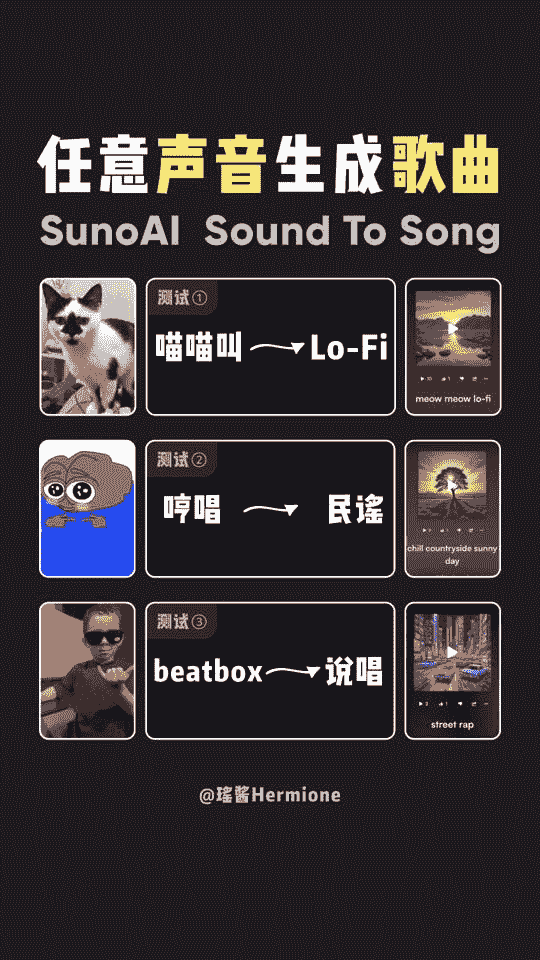

[声音成曲.mov](https://internal-api-drive-stream.feishu.cn/space/api/box/stream/download/all/I7a0b9tbcoFcIExtwPscVTmvnzn)

我的这个demo还意外地被Suno官方推特账号转发了

### **Udio局部修改 **

对某部分的旋律、歌词不满意，则可以进行二次修改，但不影响歌曲其他部分。

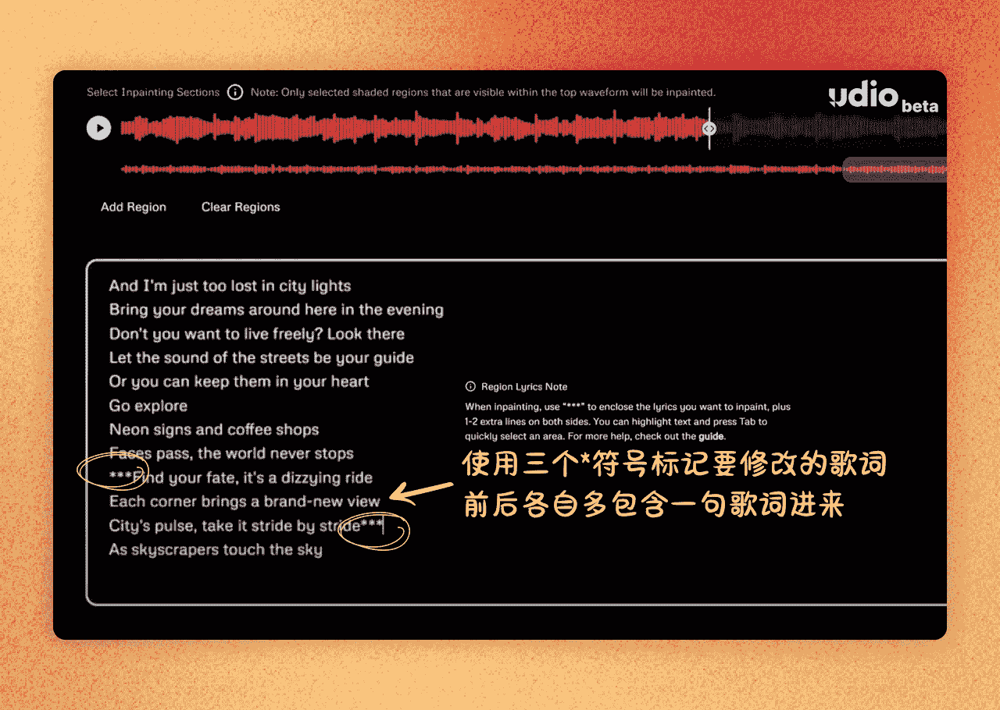

视频链接：https://www.youtube.com/watch?v=KvKy0sfCgU0&t=30s

### **Udio重新混音**

保持歌曲歌词和主旋律不变，转换为新的曲风。

**remix前**

A day in the life of a professional imaginary friend, indie pop, twee pop

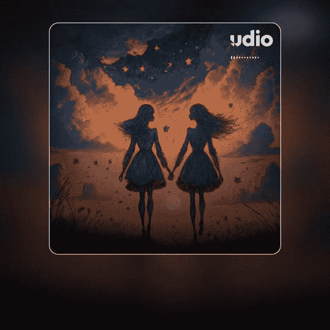

[udioremix前.mp4](https://internal-api-drive-stream.feishu.cn/space/api/box/stream/download/all/B1nzb2JweocBHExFOpEcC8BQnCe)

**remix后**

A day in the life of a professional imaginary friend, jazz

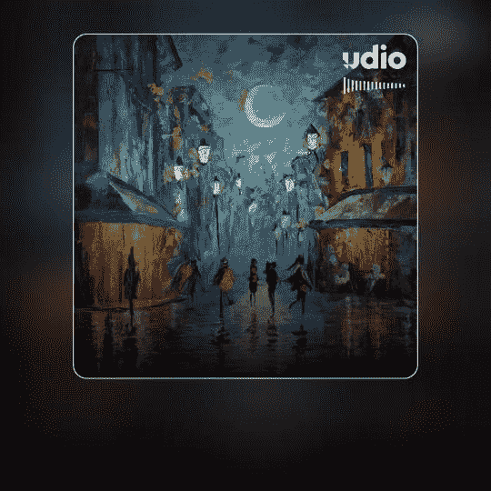

[udioremix后.mp4](https://internal-api-drive-stream.feishu.cn/space/api/box/stream/download/all/YdiHbIU8coFI7mxoy0Tcsh51nmc)

## **最后**

这份总结，是今年2月份我首次使用AI音乐工具以来的实践和观察，虽然自己觉得过了很久很久，但是这在生成式技术的发展历程里，也只是短暂的一瞬。

在实践和记录的过程里，我体会到生成技术发展给创作者带来的便利和惊喜。除此之外，我也学习到了一些音乐方面的基础理论知识，虽然依旧非常粗浅，但音乐鉴赏能力提升了，也更能体会到音乐的美妙和专业创作的不易，对创作者有了更深的钦佩和敬意。

最近一直在听《黑神话：悟空》版本的《云宫迅音》和《敢问路在何方》，每次都**会**涌起波澜壮阔的情感，音乐仿佛穿越了时光，带着每个人独有的回忆和感悟触动内心。 AI会作为创作者手中的工具来提供辅助，而人类独有的情感体验、艺术创新，会成为音乐作品里最打动人心的部分。

正如一位音乐人所说：

> **好作品可遇不可求，虽然有公式，但科学无法完全抵达答案。正**是如此多的不确定性，音乐创作才如此美妙。

---

欢迎感兴趣的小伙伴一起交流学习，我的文章在👸号“酱酱的小岛”，视频作品在📕“瑶酱Hermione”。

下篇将聊聊 **AI歌声合成/转换 **、 **AI音效生成 **这两个方向上的应用案例和代表工具。

感谢阅读，下篇见。