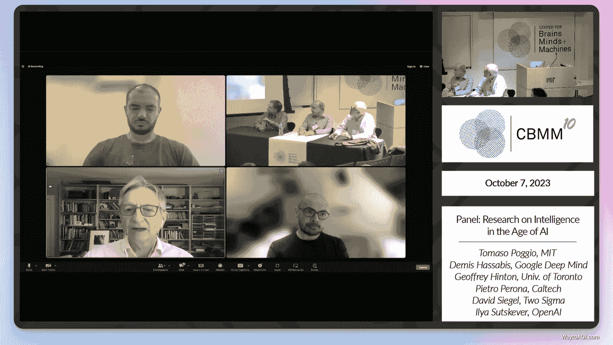

# 10🈷️13日

> 来源：[https://v11enp9ok1h.feishu.cn/docx/XVPQd54Uro26ChxtaL9cPgcenXb](https://v11enp9ok1h.feishu.cn/docx/XVPQd54Uro26ChxtaL9cPgcenXb)

+   《被忽略的微软 Copilot 大更新，我从里面挖到了有趣的东西》微软 Copilot 的更新聚焦于情感智能，特别是 Copilot Voice 和 Copilot Vision 的结合，旨在实现自然的语音对话和人机交互。这一更新不仅增强了用户体验，还通过色彩、无限画布和字体等设计元素，推动 AI 应用向人性化靠拢。设计趋势包括使用明亮的色彩、渐变效果和衬线体，以创造更温暖和舒适的环境

+   《[杰弗里·辛顿：乔姆斯基是个疯子，形式学派大错特错](https://v11enp9ok1h.feishu.cn/wiki/Zfb9wDzgdiuIOjkZ8LLcjmKcnRg?from=from_copylink)》2024年诺贝尔物理学奖得主杰弗里·辛顿在加州酒店接到来自瑞典的电话时感到意外。在采访中，他讨论了机器学习的现状，强调了对AI安全研究的迫切需求，并批评了乔姆斯基学派，认为其对语言理解的看法完全错误，称神经网络在处理语言方面远超乔姆斯基的理论。此前，辛顿在2023年的CBMM10 圆桌论坛上批评乔姆斯基学派，认为其语言理论是错误的，甚至称乔姆斯基为“来自MIT的疯子”。

