# 【0门槛】一键部署自己的Dify网站

> 来源：[https://v11enp9ok1h.feishu.cn/docx/QwjTd2QaiodmOnxHC3YcldJ8nLg](https://v11enp9ok1h.feishu.cn/docx/QwjTd2QaiodmOnxHC3YcldJ8nLg)

本文纯干货，适合小白，有手就行，10分钟搭建属于自己的Dify网站，并配置模型进行使用。如果想学更多 AI 干货，欢迎关注。

Dify 有 **两种 **使用方式：

1.  云服务版本。直接在官网 dify.ai 上注册账号使用。

1.  部署社区版。开源，可商用，但是不能作为多租户服务使用。对个人使用完全无限制。

部署前提条件：

+   2核4G云服务器一台 = **159 **元（不懂的也不用懂，不重要）

其实本地也可以，但是本地更折腾，我自己不喜欢在自己电脑上部署Web 服务，所以我也懒得给大伙分享。

**【小插曲】 **今天在腾讯云开新服务器的时候，发现腾讯云居然提供了一键部署，更简单了！而且看了下，挺便宜的，羊毛不薅白不薅。


##  **方案一：腾讯云一键部署 **

**【优惠】 **打开腾讯云官网，左上角【最新活动】进入，活动是新老用户都可以，我老用户也享受到了。

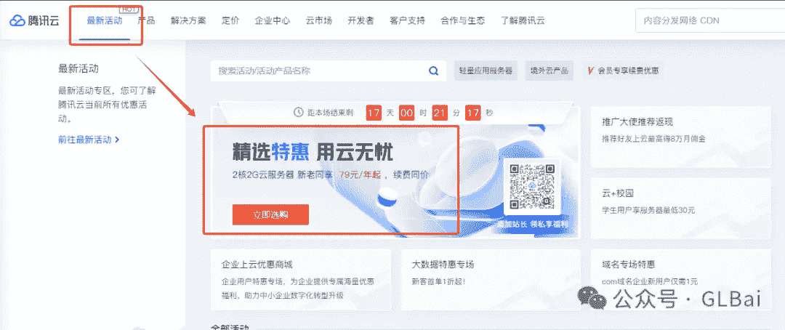

**【购买】 **Dify社区版官方要求是2核4G，境内还是境外看自己需求吧。境外服务器的好处就是可以访问一些网站，比如直连官方Key，使用Jinra等网页读取等工具的时候非常便利。

境内的159一年，便宜的很了。

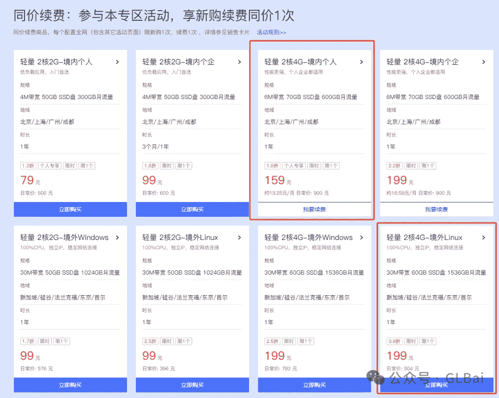

**【创建】 **选好之后，下面就是创建服务器了。直接选择【使用应用模板创建】-【AI】（我发现不止Dify，还有个LobeChat，也是个开源Chat应用，有兴趣的可以自己去看看，多折腾玩玩。） 其它的自己看着选吧，不要选额外花钱的就是了。

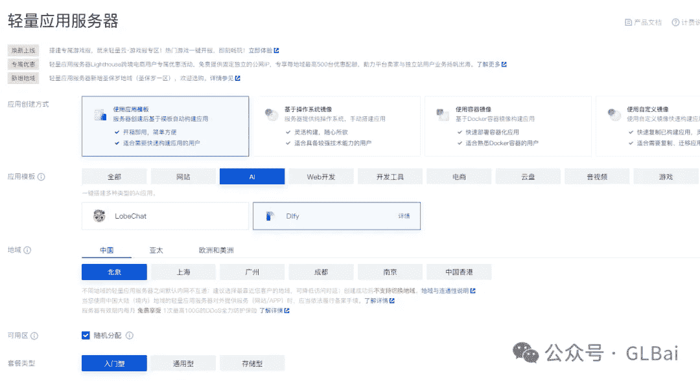

**【使用】 **等服务器初始化完成，在控制台-服务器 里面就能看到刚才已经购买的那台服务器。如果是下图这样显示运行中的，就是已经初始化成功了。

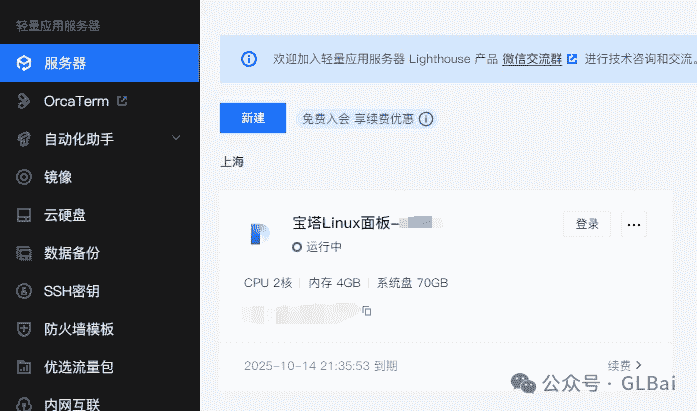

复制上面图中的IP地址复制到浏览器中（我马赛克的部分，每个人服务器的公网IP不一样），后面加上**/apps**，回车就是你的dify网站。

比如你的公网IP是：124.220.110.110，那你在浏览器里面就输入http://124.22**0.1**10.110/apps，回车。如果没有意外的话，就会进入到Dify的安装页面（其实就是管理员设置页面），请一定要 记住 自己在这里设置的管理员账号密码。

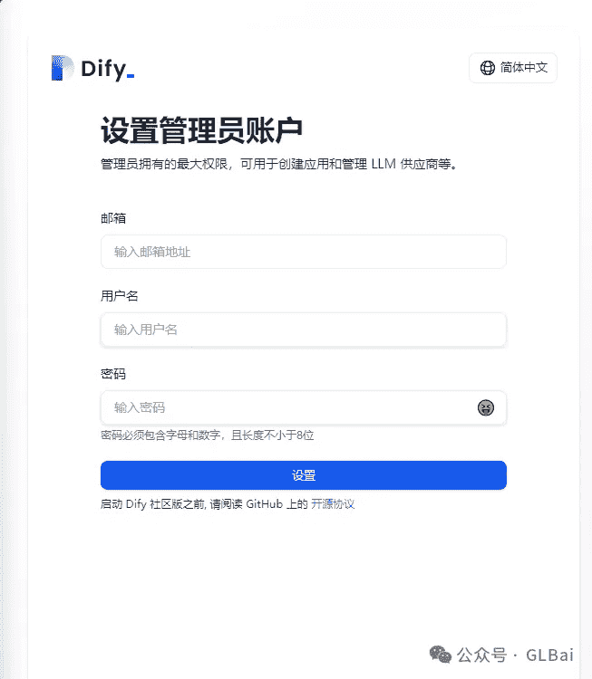

如果再一切正常，你就会直接以管理员的身份进入到你的Dify网站中。配置好你的模型服务就可以正常使用了，如何配置这块我放到最后面讲。

##  方案二：云服务器Docker部署

腾讯云一键部署非常简单，但是问题也来了：

1.  我既然都买服务器了，我是不是还能做点其它的事情，比如给自己建个博客？（备案挺麻烦的，如非必要就别折腾了）

1.  Dify的更新频率其实很高，比如上面我一键安装了0.80版本的镜像，登陆进去发现0.9.2可用了，我想升级咋办？挺麻烦的，不如讲讲如何用Docker快速部署Dify，包括一键部署的升级其实也会涉及到。我们回到腾讯云的控制台，把刚才的那台服务器系统重装掉。

**【装系统】 **安装一个宝塔面板（可视化服务器管理），登陆凭证就选自定义密码。高阶用户可以自己选，等安装完成。

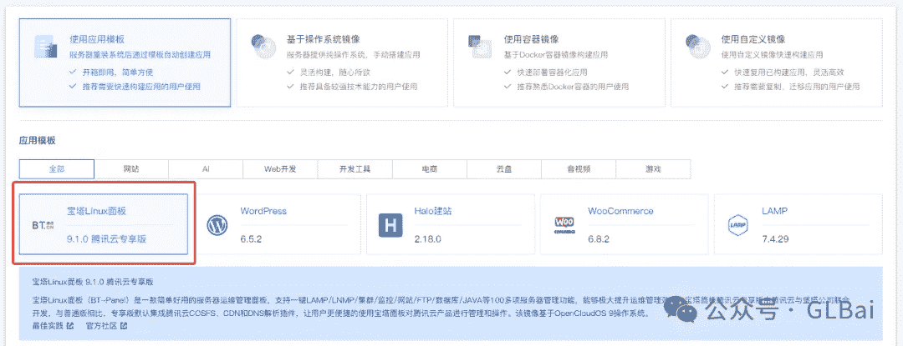

**【登陆】 **控制面板-服务器-查看详情

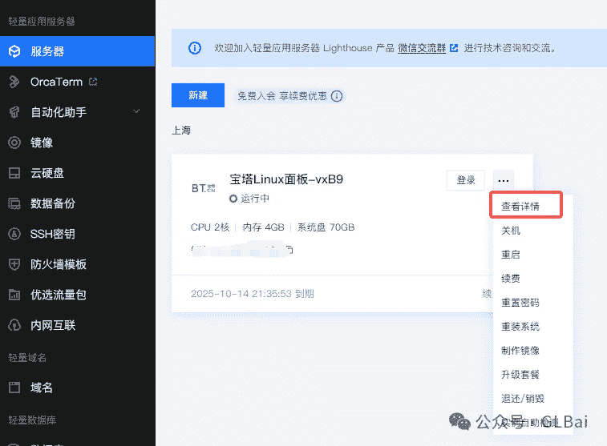

找到【应用信息】卡片，点击管理应用，需要做两件事情来保证正确登陆。一是放行防火墙端口，二是获取宝塔面板的账号密码。

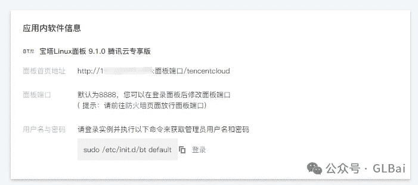

**【放行端口】 **直接点上面的防火墙链接，跳转，添加规则。（其它端口也可以，但是如果你不懂的话，就别瞎搞了）

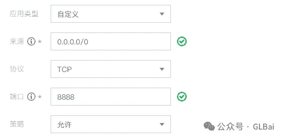

**【获取用户名和密码】 **复制上面的命令，点击左侧菜单栏的自动化助手-个人命令-创建命令（这里一定要选择自己服务器所在的地区），根据截图填写，然后保存。

```
sudo /etc/init.d/bt default
```

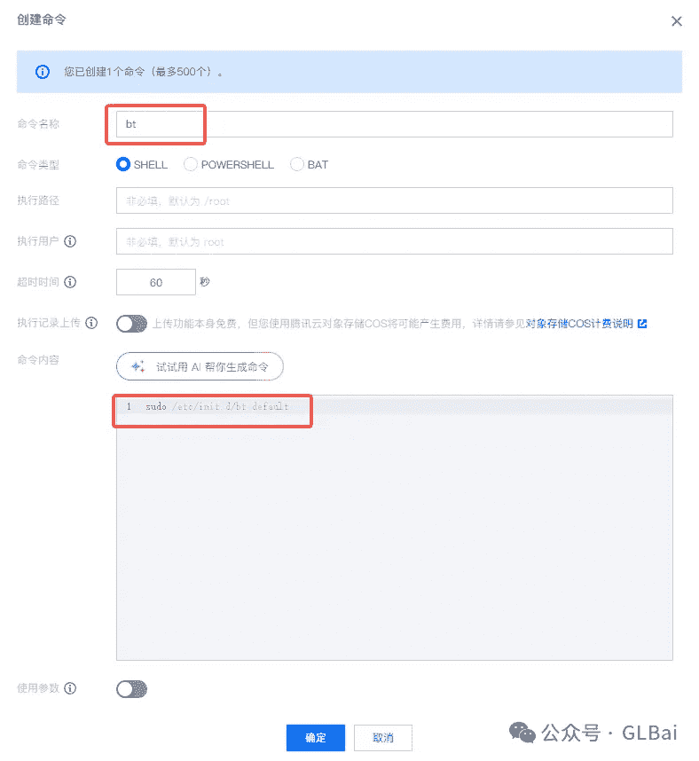

点击命令后面的【执行】，等执行成功，回到左侧菜单选择【执行记录】，查看任务详情里就能看到登录信息了。把红框框出来的部分自己保存好。外网面板地址就是 登录 地址，复制到浏览器打开，填完账号密码就能成功 登录 了。

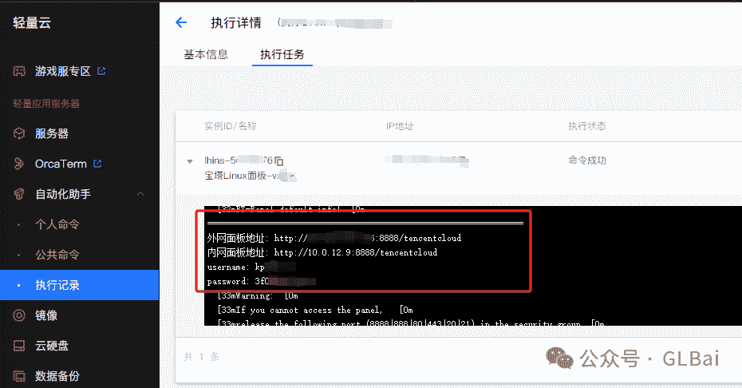

**【Docker安装】 **因为Dify需要用Docker安装，所以登陆成功bt面板之后，点击左侧菜单栏【Docker】，按提示来。

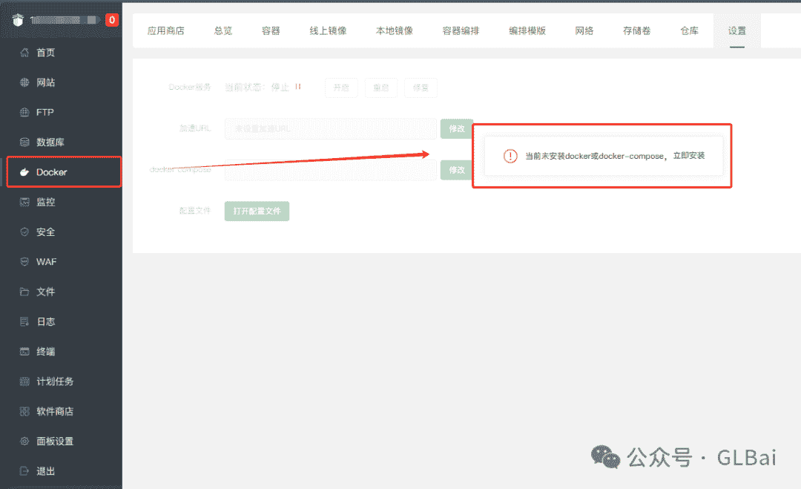

**【安装Dify】 **左侧菜单栏-文件-打开终端，根据Dify官方的部署文档来。

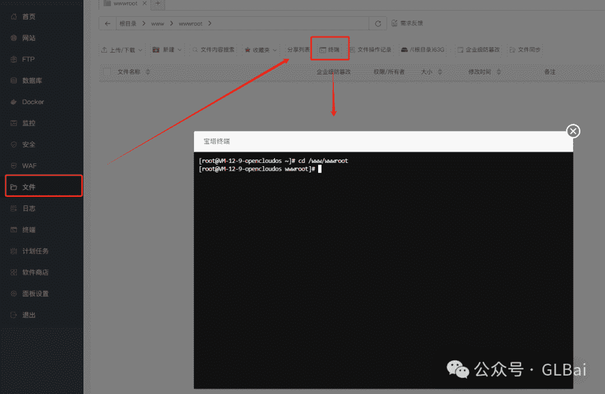

敲入 git 命令（把dify的代码复制到服务器），回车

```
git clone https://github.com/langgenius/dify.git
```

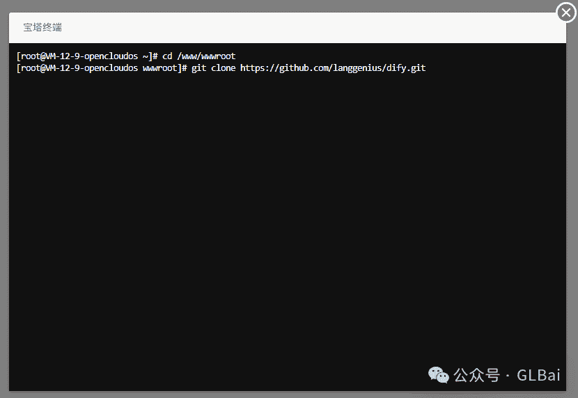

显示100%就是复制完成（国内服务器的话有时候网络会有点问题）

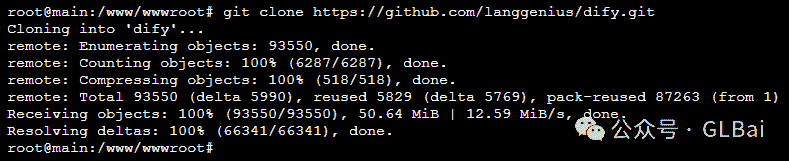

然后再依次敲下面三个命令（一个成功了再下一个）

```
cd dify/docker
```

```
cp .env.example .env
```

```
docker compose up -d
```

等出现下面的结果，就是成功了

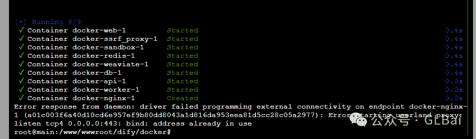

**【使用】 **跟方案一的使用一毛一样。

**【更新】 **根据官方文档，回到我们BT的页面，在文件中打开终端，按顺序执行以下命令。

```
cd dify/docker
docker compose down
git pull origin main
docker compose pull
docker compose up -d
```

另外官方提醒：

同步环境变量配置 (重要！) 如果 .env.example 文件有更新，请务必同步修改您本地的 .env 文件。检查 .env 文件中的所有配置项，确保它们与您的实际运行环境相匹配。您可能需要将 .env.example 中的新变量添加到 .env 文件中，并更新已更改的任何值。

#  **最后，配置我们的模型供应商 **

Dify的部署版本，除了服务器是自己提供的以外，模型也需要我们自己来配置。官方和中转的都支持，不过从性价比来说的话，还是推荐中转的吧，充点小钱，啥模型都能用上，贼划算，而且一般比起官方的价格都很很大的折扣，20刀普通用户可以用很久了，还能在不同的地方使用。

如果你们没有合适的中转服务商的话，可以直接用我自用的，我用了近2年了，而且拿到了比较低的价格，点击原文就可以。

**【模型设置】 **在Dify右上角，点击设置-模型供应商。找到你自己的中转服务商提供的信息，填上保存就可以了。

服务商一般会给两个信息，API base（或者叫Base URL，每个中转服务商的都不一样，Dify这里直接填URL就可以，比如我填的就是‘https://one.glbai.com’），和key。

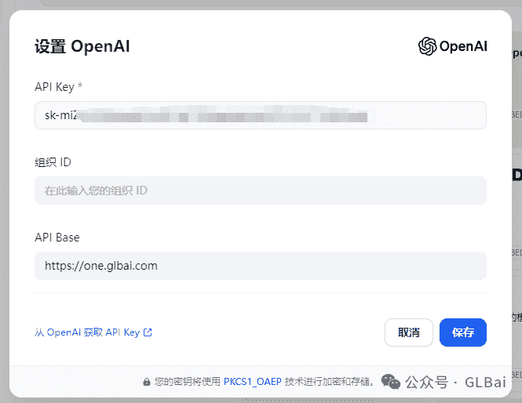

如上图所示，如果能保存成功，则说明信息配置是正确的。这个时候，我们回到主页面，随便创建一个Agent测试一下，一切正常，大功告成。

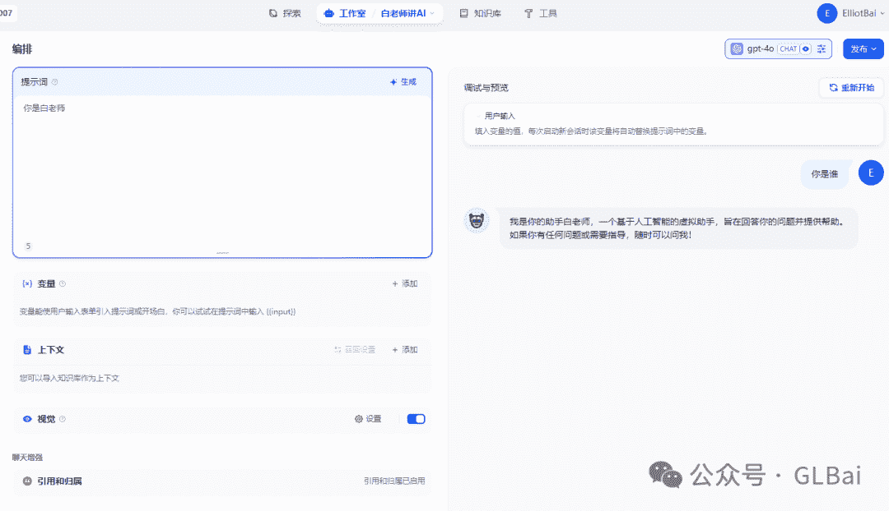