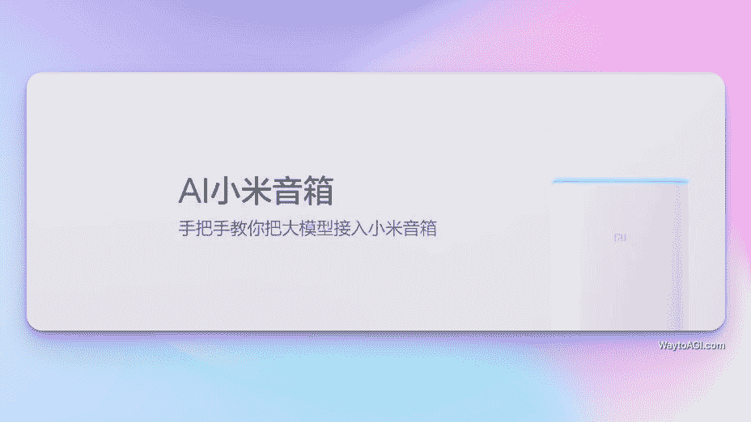

# 10🈷️21日

> 来源：[https://v11enp9ok1h.feishu.cn/docx/X96TdL2hOoRS3xx4sNZcmzjRnPe](https://v11enp9ok1h.feishu.cn/docx/X96TdL2hOoRS3xx4sNZcmzjRnPe)

《[被夺舍的小爱同学！——把大模型接入小米音箱（小白操作全步骤教程）](https://waytoagi.feishu.cn/wiki/QrqVwYgsgiNd0ikypZCclC84n1f)》本文提供了将大模型接入小米音箱的详细步骤教程，适合小白用户。教程分为两种方案：本地部署（vscode 和 node.js）。用户需准备相应软件、申请大模型 API 接口，并配置小米音箱的相关参数，如小米账号、UID 及音箱名称。具体步骤包括克隆项目、修改配置文件、安装依赖等。

