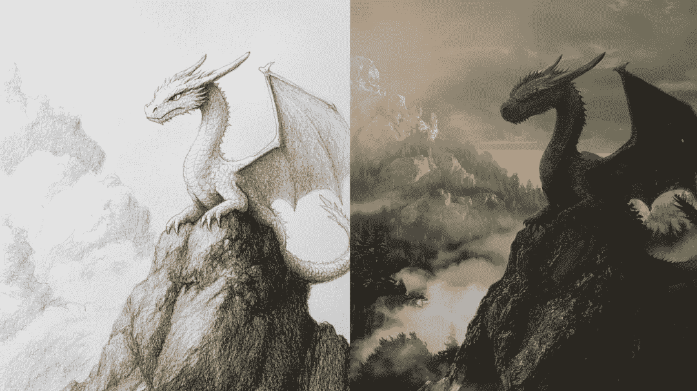
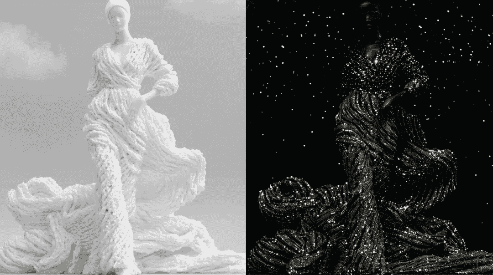
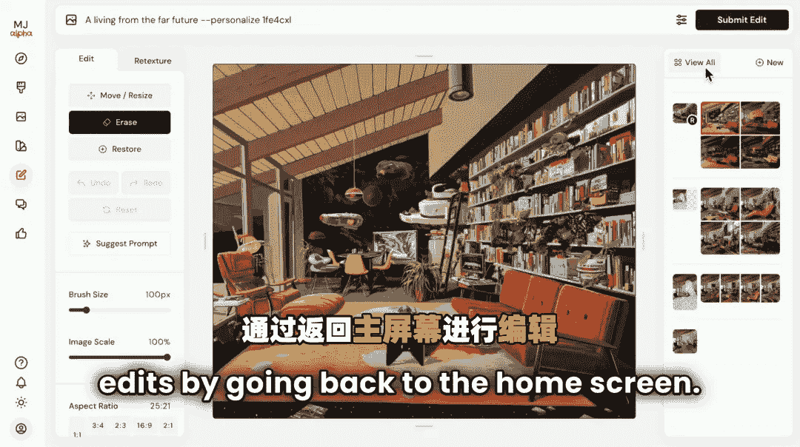
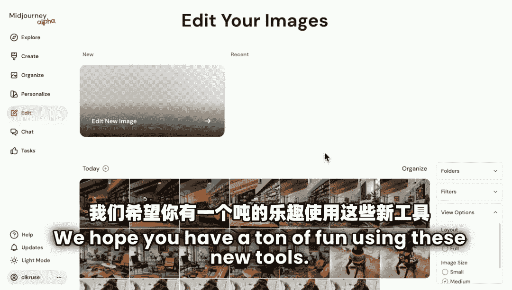
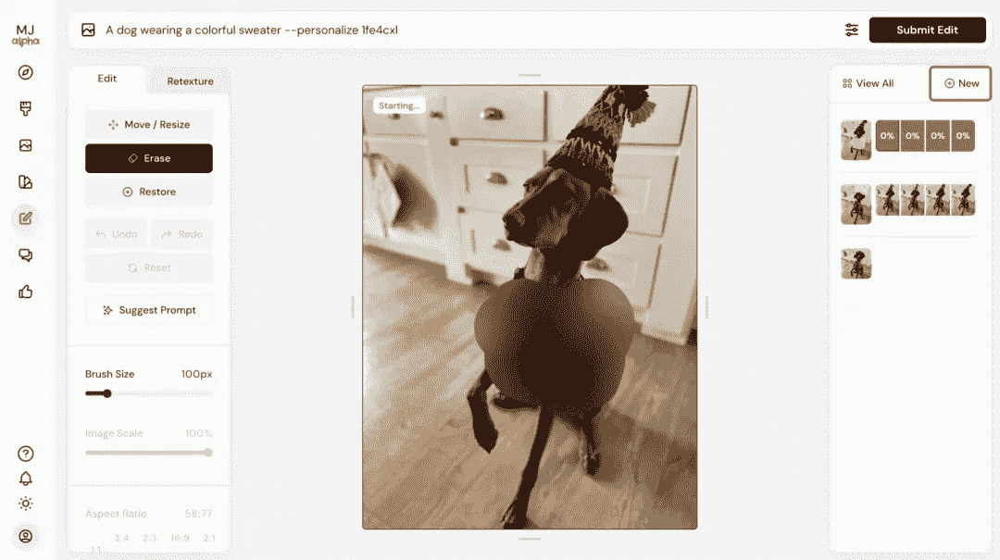
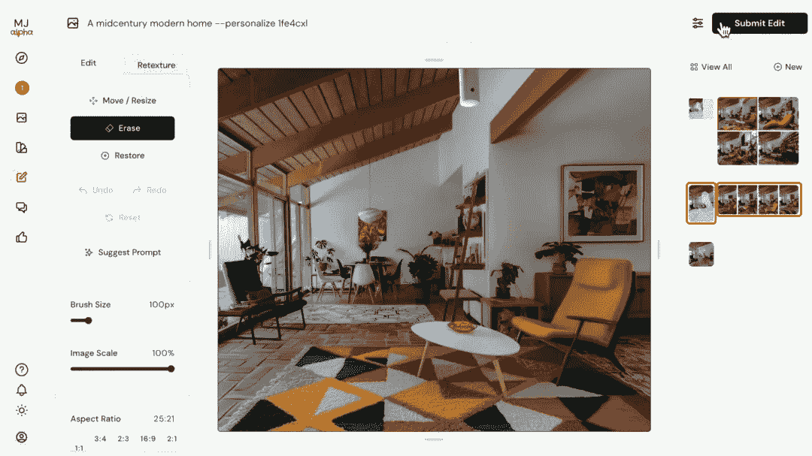
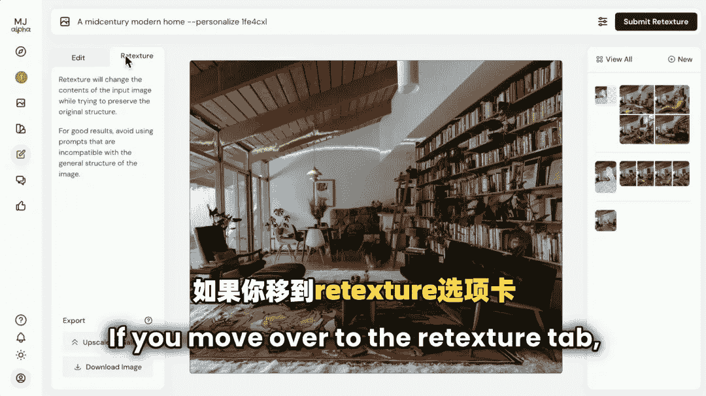
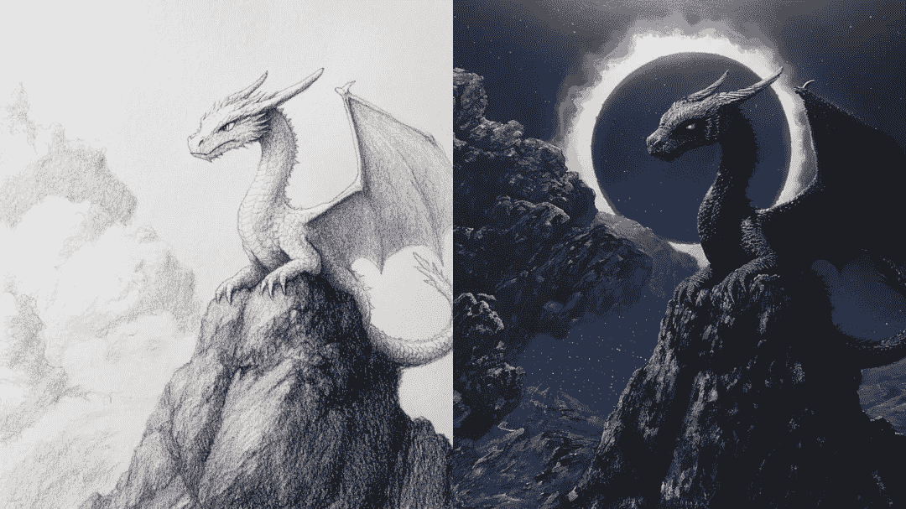
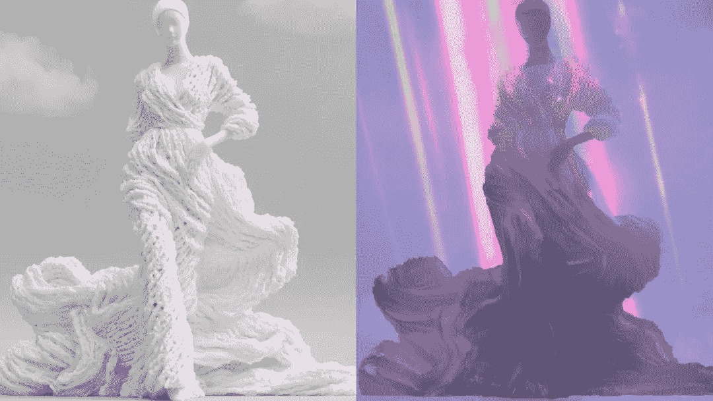
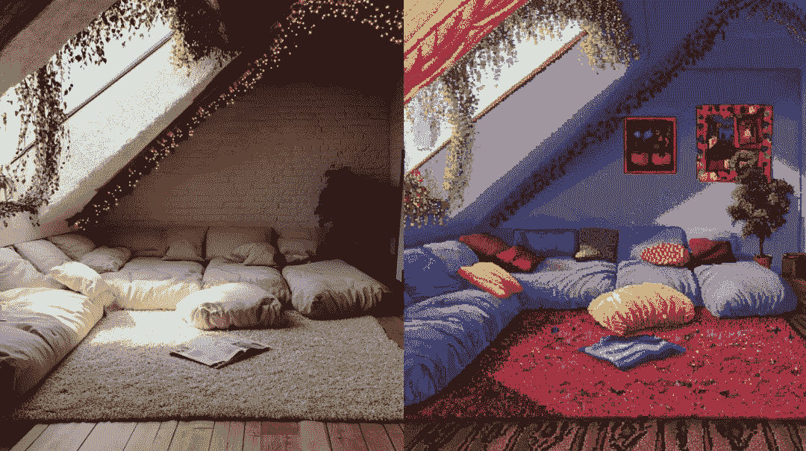

# Midjourney 最新编辑器更新，可上传图片重新绘制！！

> 来源：[https://v11enp9ok1h.feishu.cn/docx/IVDad8P1ZoKDZjxikFFc5bYAnjf](https://v11enp9ok1h.feishu.cn/docx/IVDad8P1ZoKDZjxikFFc5bYAnjf)

**今天早上3小时前 **MJ 将测试全新的 “ 外部图像编辑器 、 图像重纹理化功 ”能以及下一代 AI 审核系统，兄弟们，这代表着可以和 Adobe 重绘 磕一下「我瞎BB的，出了问题不要找我」！！

虽然早已知道这周会更新，但还是给我一种 「 纹身师一闭眼，秀了我一脸 」的赶脚，下面请看如何使用～～​

**1.图像编辑器**

允许您从计算机 **上传图像 **，然后 扩展、**裁剪、**重绘、添加或修改场景 中的 元素 。

MJ还推出了“ **图像重纹理化模式 **”，它会估算场景的形状，然后 **重新应用纹理 **，使得所有光照、材质和表面都发生变化。

所有图像编辑操作都可以通过 **文本提示和区域选择来控制 **。编辑器 兼容模型个性化、风格参考、角色参考和图像提示 功能。

**2.AI审核系统**

**MJ还在测试一个更加智**能**、更加细致的 **V2 AI 审核系统 。该审核系统将从整体上检查您的提示、图像、绘制蒙版以及生成的输出图像。这可能是目前最智能的 AI 审核系统，但它仍处于 早期测试阶段 ，MJ正在尽力优化其遵循的规则，以达到最佳效果。

**3.使用规则**

由于这些功能非常新，MJ希望给社区和人工审核团队一个缓慢适应的时间，因此在第一个发布阶段，MJ将这些功能开放给以下社区群体：​

· 已生成至少 10,000 张图像的用户， 年度会员可用。

· 过去 12 个月内一直是月度订阅用户的用户（MJ尝试做得更细致一些，但数据库处理起来有些复杂，抱歉！）​

# **问题与使用**

**1.常见问题**

· 如果您提出极其不合适的请求，或者您要求修改一个非常小的区域，可能无法得到预期的结果

· 如果您在场景中放了一个很小的头部并要求进行外绘，生成的身体可能会太大（所以请将头部放大一些）​

**2.什么是重纹理化？**

是一种 通过**使用另一张**图像来引导图像结构或构图的方法 。你将从构图引导图像开始（你在全功能编辑器中上传或链接的基础或母图像），然后使用提示词和参数来添加所需的细节。基础图像成为提示词的构图基础，或称为框架。事实上，在以前的Midjourney版本中，这种方法被称为“ 框架搭建 ”（下方还会提到一次）。

**在全新功能编辑**器中，选择一个你喜欢的一些构图元素的基础图像。 上传它或链接 。然后 编写控制该构图最终呈现的提示词 。例如，如果你有一张三颗玻璃球的图片并提交提示词“三只刺猬”，那么这些玻璃球将“变成”刺猬。

**3.右侧显示的缩略图是什么？**

显示器右侧的缩略图显示的是你 **最近几次编辑会话的记录 **。左边稍大一点的缩略图是你的 **母图 **像，即你上传或链接的图像。其他四张缩略图是子图像，展示了Midjourney根据你的提示生成的四种不同表达方式。

每次你在 不改变选择区域的情况下对母图像进行编辑时 ，会生成一个新的缩略图行，这样你对该选择区域的所有编辑都会方便地聚在一起。不过，如果你更改了提示词，新提示词对应的图像会显示在子图像中，而不会显示在母图像所在的那一行。

**4.[ **View All / **查看全部]按钮是什么？**

要在一个界面中 **查看你所有的编辑会话 **，可以使用缩略图显示上方的 [View AII/查看**全部] 按钮，**打开一个名为 “ 编辑你的图片 ” 的页面。

“ **编辑你的图片 **”页面在外观和功能上与 [组织] 页面**相似，不同之处在于页面顶部**多了一行，允 许你开始一个新的编辑会话 ，并方便地浏览你最近的编辑会话。只有经过编辑器处理过的图片才会出现在此页面中。

你也可以直接通过 https://www.midjourney.com/editor 访问此页面。

5.如何取消当前的编辑并重新开始？

**实际上没有所谓的“取消”**按钮，但你可以点击显示屏右侧的 [+]New 新建按钮 ，如图所示。这将让你从头开始。

6.我在完整编辑器中修改了提示词，修改后的内容去哪了？

父图片（最左边较大的缩略图）会保留原始提示词。子图片（父图片右侧的四个较小的缩略图）会包含修改后的提示词。

7.完整编辑器中也有“重塑纹理”功能，那是什么？

重塑纹理是一种使用另一幅图像来引导图像结构或构图的方法。你会从一个构图指导图像开始（即你 上传或链接到完整编辑器中的基础图像或母图像 ），然后使用提示词和参数来添加你想要的细节。基础图像将成为提示的构图基础——或者说是框架。在Midjourney的早期版本中，这种方法被称为“框架搭建”。

**在完整编辑器**中，首先**使用你喜欢的某些构图元素的**基本图像，将其 上传或链接 。然后 编写提示词来控制这个构图 将会变成什么样子。例如，如果你有一张包含三个玻璃球的图片，并提交提示词“三只刺猬”，你的玻璃球将“变成”刺猬。

这种方式允许你有很大的自由度去修改图像，同时保留原始构图的骨架，非常适合在已经有一定基础的画面上添加你个人的创意元素。

8.还有一些重塑纹理功能的示例

如果你使用阴影素描，它应该会表现得很好

如果你使用无纹理模型，效果也应该很棒

如 果你想要完全改造，可以试试用在室内场景上

希望大家在测试这些系统时能玩得开心，欣赏 Midjourney 魔法般的创作过程。希望它能激发您在周围环境中带来美感，无论是重新设计您的客厅，还是基于个性化模型和您喜欢的风格来构思新的时尚