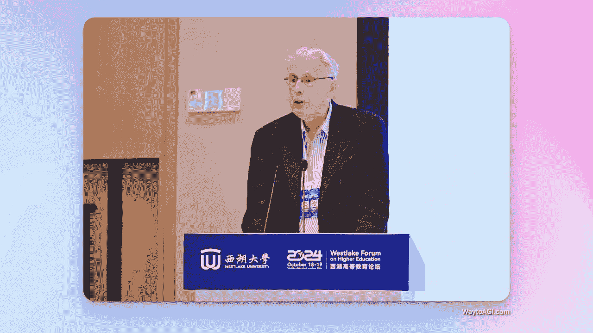
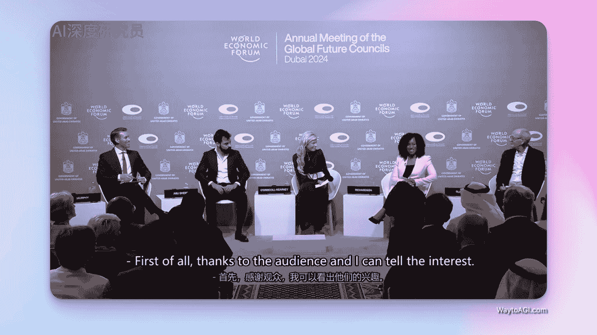

# 10🈷️26日

> 来源：[https://v11enp9ok1h.feishu.cn/docx/Ky5hdoYLxoD52WxnLe3cWE3SnZb](https://v11enp9ok1h.feishu.cn/docx/Ky5hdoYLxoD52WxnLe3cWE3SnZb)

《图灵奖得主：AI时代，我们还能教学生什么》来自图灵奖得主莱斯利・瓦利安特在西湖大学的演讲，他强调教育的核心在于帮助学生发现自己的兴趣，追求他们热爱的领域。教育不仅是传授知识，更重要的是培养思考能力、解决问题的能力和创造力。尽管人工智能将在教育中发挥辅助作用，但教师的角色仍不可替代，特别是在激发学生兴趣和关心他们成长方面。教育应鼓励学生自由探索，以培养好奇心和创新能力。

《[世界经济论坛上，伯克利Stuart Russell](https://mp.weixin.qq.com/s/U5cc0K3RExJoAiEugnUCcQ)教授的观点：AI时代你需要掌握的实用技能》在世界经济论坛的讨论中，专家们探讨了人工智能对未来工作的影响。伯克利教授 Stuart Russell 指出，未来十年，人工智能可能会超越人类能力，取代许多重复性工作。各位嘉宾认为，未来成功者将是能够适应变化、掌握人际交往和创造力等 “任务关键” 技能的人，而教育系统也需相应调整，培养这些技能，以应对即将到来的经济形态变。

