# 山姆·奥特曼传（一）：我是如何走到今天的

> 来源：[https://v11enp9ok1h.feishu.cn/docx/QbzYdtjNbonb58xkW7ccDmvGnAc](https://v11enp9ok1h.feishu.cn/docx/QbzYdtjNbonb58xkW7ccDmvGnAc)

在商业投资领域流传着这样一句话：想了解一个行业，需要了解行业中的龙头公司。而想了解一个公司，则需要首先了解它的领导。当下AI行业的佼佼者非OpenAI莫属，而山姆·奥特曼则是这家龙头公司的掌舵人。以小看大，了解其为人处事态度和原则，可洞悉这位领袖的优秀本质。以近看远，可看清其宏伟构想，掌握AI行业的理念趋势。

---

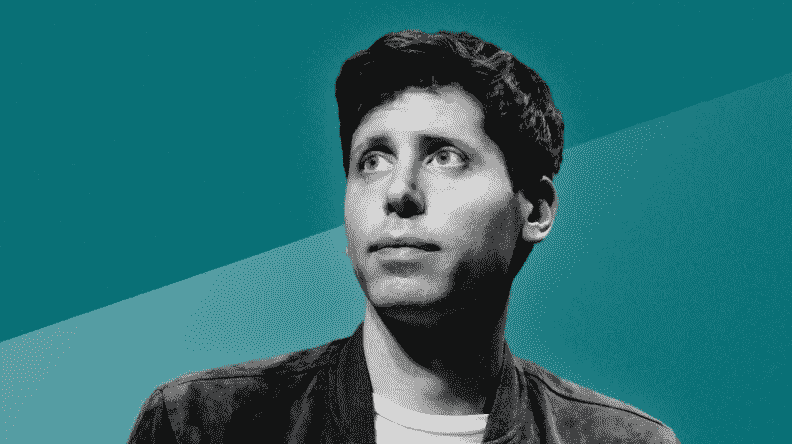

# 一、故事的开始

2023 年 11 月的一个星期三晚上，在旧金山的一家餐厅内，一场 AI 行业会议的派对正在进行。餐厅内光线昏暗，约有数十人出席。与会者三三两两地聚集交谈，服务员们穿梭其中，提供各种精致的开胃小食。就在这时，一阵低语声引起了彭博社记者艾伦·休特(Ellen Huet)的注意。

山姆·奥特曼，OpenAI 的首席执行官，出现在了餐厅门口。在过去的十多年里，奥特曼在科技创业圈内声名鹊起，其对媒体的开放态度使他成为了硅谷精神的代表人物之一。自 ChatGPT 于一年前发布以来，OpenAI 的估值已达到惊人的 860 亿美元，跻身全球最具价值的科技初创企业之列。

近半年来，奥特曼频繁出现在公众视野中。主流媒体竞相对他进行专题报道，将他誉为 "ChatGPT 之父"、"现代奥本海默" 以及 "AI 领域的领军人物"。他以 AI 技术未来大使的身份，与世界各国领导人会面，并在美国国会作证。在如此繁忙的日程中，他仍抽空参加了这场 AI 行业聚会，这着实令人意外。

艾伦注意到奥特曼站在餐厅的一角，周围已经聚集了几位与会者。她决定上前问候。他身着正装，较平日更为正式。艾伦与奥特曼握手寒暄，而后得知艾伦正在筹备一个播客节目，他对此表示了兴趣，并同意考虑接受采访的请求。考虑到其他人也在等待与他交谈的机会，艾伦简短地结束了对话。而奥特曼在派对上停留约 10 分钟后便离开了。

次日，奥特曼继续他作为 AI 领域代表人物的公开活动。他在亚太经合组织（APEC）会议上发表演讲，美国总统拜登和中国国家主席习近平均出席了这一重要国际会议。在会上，奥特曼就 AI 技术发表了以下观点：

"我相信，AI 将成为人类迄今为止发明的最具变革性和最有益的技术。在我们经历的所有重大技术革命中，AI 可能代表着最显著的飞跃。因此，我对此感到无比兴奋。我无法想象还有什么工作比这更令人振奋。能够参与其中，对我而言是毕生的职业荣耀。"

看到上面的话，如果你认为这次发言只是他的“过场演出”那就大错特错了。

“作为一个物种，人类现在正走在自我毁灭的道路上，而人工智能可能是阻止人类自我毁灭的手段。如果我们想要繁荣发展数千万年、数亿年，甚至数十亿年，我们就需要这种技术。”

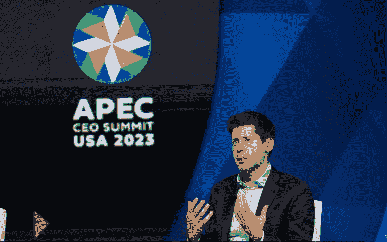

奥特曼的言论表明他坚信世界正面临巨大而迅速的变革，而这些变革与他的工作密切相关。然而，出人意料的是，在他与艾伦在派对上见面不到 48 小时后，在他在这场重要的国际领导人会议上发言不到 24 小时后，奥特曼被 OpenAI 董事会解除了首席执行官的职务。

山姆·奥特曼 被解职的消息震惊了整个科技界，这无疑是年度最引人注目的科技新闻之一，其突如其来的性质令人措手不及。这一消息于周五下午传出，立即引发了广泛关注，迫使许多媒体界人士，不得不放弃周末休息时间，全身心投入到对这一事件的跟踪报道中。

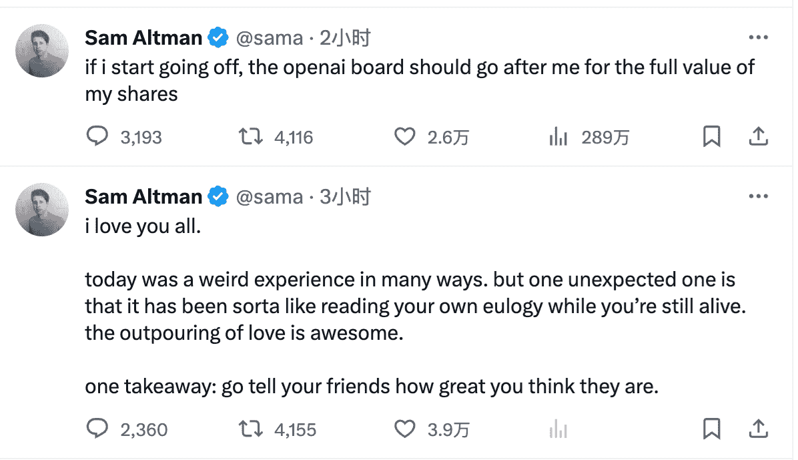

接下来的几天，事态发展如同一场新闻飓风。OpenAI 董事会含蓄地暗示奥特曼曾对他们有所隐瞒，随即宣布了新任 CEO 的任命。然而，情况急转直下，一位参与解雇奥特曼的董事会成员公开表示歉意和遗憾。与此同时，公司内部出现了复杂的局面：员工表达了对奥特曼的忠诚，并发起了抗议行动。

在这场危机中，奥特曼展现出了非凡的战略能力和影响力。他迅速采取行动，争取员工和主要投资者微软的支持，这一举动使他重新掌握了主动权。仅仅五天之后，即周二晚上，奥特曼成功重返 OpenAI，重新担任 CEO 职位。这一戏剧性的转折再次令业界震惊。

然而，对于熟悉奥特曼的人来说，这一结果并不令人意外。奥特曼的导师之一，著名投资者保罗・格雷厄姆（Paul Graham）曾评价说，奥特曼极其擅长增强自身影响力。这似乎成为了奥特曼最显著的特征。在硅谷，我们常常赞颂编程天才或专注于产品细节和设计的技术远见者。但奥特曼与众不同之处在于他掌握和运用权力的卓越能力。

# 二、成长

为了更好地理解山姆的性格和成长轨迹，我们需要回顾他的早年经历。

山姆·奥特曼在密苏里州圣路易斯市长大，出身于一个优越的家庭环境。他是四个兄弟姐妹中的长子，母亲是一名皮肤科医生，父亲则是房地产开发商。这样的家庭背景为奥特曼提供了良好的教育机会和社会资源。

山姆8岁时学会了编程，9岁收到了一台苹果电脑作为生日礼物。当他还是小孩的时候，就通过编程破解了幼儿园的系统后台信号。

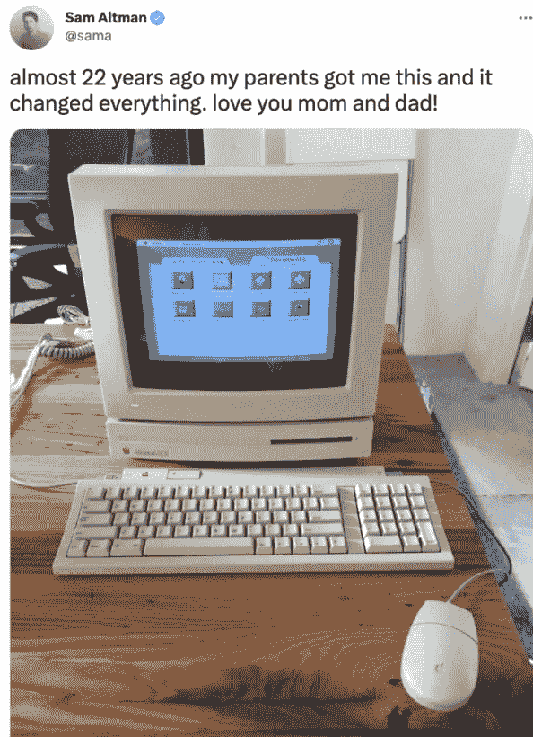

小学毕业后，奥特曼就读于约翰・伯勒斯私立高中，这是一所以学术成就著称的精英学校。在这里，山姆展现出了非凡的才智和领导能力。安迪・阿博特（Andy Abbott），奥特曼的前英语老师，现任学校校长，回忆道："山姆是一位杰出的学生，尤其在写作方面表现出色。他个性鲜明，是一个天生的领袖。"

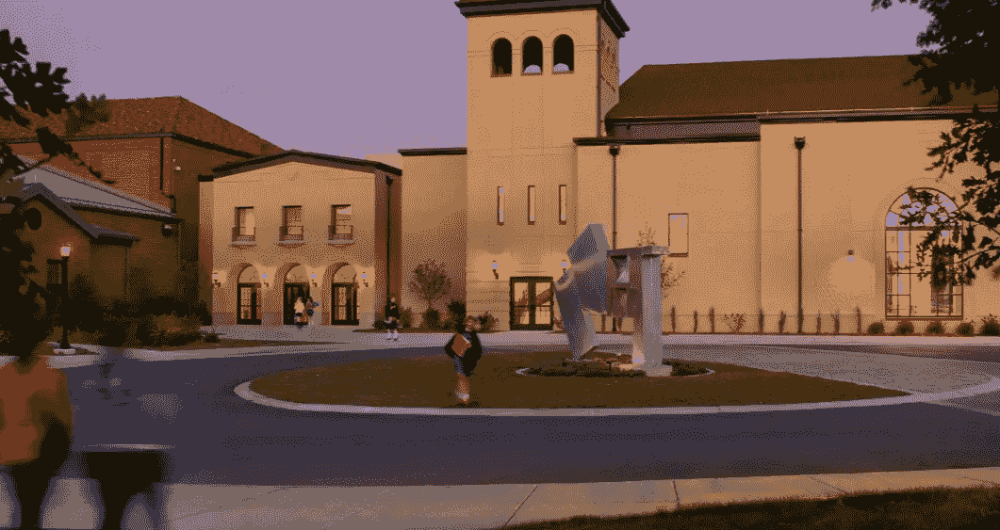

值得注意的是，山姆在十一二岁时发现自己的性取向与大多数人不同，这在保守的中西部是令人不齿的事情，在就读期间，一所教会在校园中发起反同游行，这个行为激怒了奥特曼，他写了一封公开信宣布他是一个同性恋，让学校明确它对于不同意见的态度。

好在此时不是20世纪的英国，而山姆也不是艾伦·图灵，性取向的问题并没有给他的人身安全带来什么影响，同时也没有影响他的学业。高中时期的山姆不仅学业优秀，还积极参与多项课外活动。他担任学校年鉴的编辑，代表学校参加模拟联合国活动，甚至在学校正式聘请网站设计师之前就设计了学校的网站。这些经历不仅展示了他的多才多艺，也培养了他的组织能力和技术技能。

山姆的性格特征在他的家庭关系中也有所体现。他的弟弟在《纽约客》的一篇专题报道中提到，小时候他们经常玩一种叫做 "武士" 的桌游。奥特曼总是赢，因为他宣称自己是领袖，并说 "我必须赢，我掌控一切"。这个轶事揭示了 奥特曼早期就表现出的强烈控制欲和领导欲望。

然而，山姆最小的妹妹-安妮对他的这些特质有不同的看法。安妮回忆道：“由于 9 岁的年龄差异，奥特曼经常试图像 "第三个父母" 一样行事，表现出强烈的责任感和控制欲。例如，当奥特曼13 岁时，他决定家里不再庆祝圣诞节，尽管他们是犹太人家庭”。

不光如此，在他们父亲 2018 年去世时，山姆在葬礼上规定每个兄弟姐妹可以发言的时间。她认为这种行为既有幽默的一面，也有令人不安的一面。"如果你认为你可以成为某件事情的权威，而你实际上并不是权威，那么这种行为在其他地方会如何表现出来？"

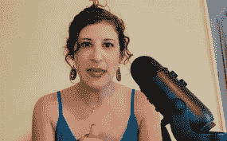

高中毕业后，他进入斯坦福大学学习计算机科学，但他读了两年后选择辍学，创办了自己的初创公司。

# 三、小试牛刀

在硅谷创业圈里，Y Combinator（简称 YC）如今已是如雷贯耳的名字。然而，回溯到 2005 年，那时iPhone还没有问世，而YC 还只是一个默默无闻的小团体。那个夏天，一群充满激情的年轻人聚集在马萨诸塞州剑桥，埋首于代码的海洋中，梦想着改变世界。谁能想到，这个看似普通的夏令营，日后会发展成为创业界最具影响力的网络之一？

在这个星光熠熠的第一批创始成员中，有 Reddit 和 Twitch 的创始人等耀眼的明星。但即便在这样的群星中，年仅 19 岁的山姆依然脱颖而出，再次深深打动了 YC 的掌舵人保罗・格雷厄姆。保罗后来回忆道："在见到山姆的短短三分钟内，我就在心里暗想，这大概就是 19 岁的比尔・盖茨吧。" 这番话，足以证明山姆的非凡才华。

当时，山姆正在开发一款名为 "Loopt" 的应用。在智能手机刚刚兴起的 2 月初，人们对手机 GPS 功能充满了新鲜感和期待。Loopt 巧妙地利用位置数据，将用户与朋友和当地商家联系起来，堪称 Yelp 和 Foursquare（两个知名应用） 的完美结合。

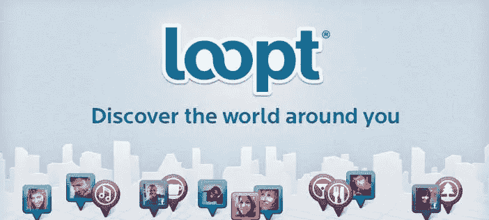

"Loopt 是关于在旅途中与人联系的，" 山姆在一次开发者大会上自信满满地介绍道，"这才是你拥有手机的主要原因。我们向用户展示朋友们的位置、他们在做什么，以及周围有哪些有趣的地方。"

然而，创业之路从来不是一帆风顺。Loopt 在早期遇到了重重困难，急需与移动运营商达成合作。当他们得知 Boost Mobile 正在寻找位置服务的合作伙伴时，山姆抓住了这个机会。

不顾一切地，山姆飞往 Boost 在加州尔湾的总部。他后来回忆道："我就这么出现在那里，在高管办公室外等待，只求一个 10 分钟的机会。"

Boost 的业务拓展负责人洛厄尔・韦纳至今仍清晰地记得那天的情景："我们距离与另一家公司签约只有一两天了。但考虑到是我们的母公司推荐的，我们决定给山姆一次机会。"

接下来发生的一幕，成为了硅谷创业传奇的一部分。洛厄尔回忆道："山姆当时可能只有 19 岁，穿着工装短裤，盘腿坐在会议室的椅子上，就开始侃侃而谈。他身材矮小，看起来就像个高中生。但一旦他开始讲解 Loopt，整个氛围都变了。"

"在会议开始的半小时内，我就确信 Loopt 和山姆是我们的最佳选择，" 洛厄尔继续说道，"虽然从视觉上看他非常年轻，但如果你闭上眼睛只听他说话，他对材料的掌握以及沟通能力，与我职业生涯中遇到的任何人都不相上下。这种反差令人惊讶。"

山姆独特的坐姿 - 像栖息的鸟一样蹲在椅子上，膝盖朝向下巴 - 成为了他的标志。这种非传统的表现方式，加上他过人的才智和沟通能力，最终说服了 Boost Mobile 在最后一刻改变决定，选择了 Loopt 作为合作伙伴。

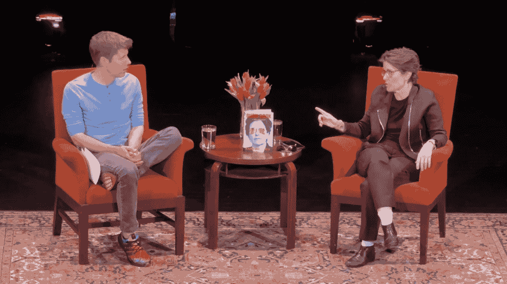

山姆的不懈努力最终得到了回报。这次经历让他领悟到一个重要的教训：完成任务的关键在于坚持不懈。这份合作为 Boost Mobile 提供了位置共享服务，并在 2006 年催生了一场引人注目的广告活动。

"你看到我在哪里了吗？是的，但我知道你在哪里。" 这句广告语生动地展示了 Loopt 的核心功能。

山姆的成功让他在YC的同僚们惊叹不已。尽管 Loopt 的商业模式并不稳定，产品也不算出众，但山姆的特殊才能开始显现。正如 YC 另一位成员 Emmett Sears 所言："显然，山姆是一个令人难以置信的谈判高手。他说服了电话公司支持他的创业公司，尽管当时产品还不成熟。这种能力令人惊讶。"

在接下来的几年里，Loopt 稳步成长。2008 年，山姆在苹果开发者大会上展示了 Loopt 的 iPhone 版本。他的演讲充满了真诚和乐观："我们对 iPhone 非常兴奋。Loopt 是关于与人联系以及发现周围有趣地方的。我们让意外相遇成为可能。"

然而，创业之路并非一帆风顺。经过几年的努力，Loopt 在 2012 年以一个适中的价格被收购。据报道，山姆从中获得了 500 万美元。虽然对大多数人来说这是一个不错的结果，但在硅谷的标准下，Loopt 被视为一次失败。

但山姆的故事并未就此结束。他已经赢得了硅谷重要人物的支持，其中包括亿万富翁投资者彼得・蒂尔。彼得不仅给了山姆一大笔投资资金，两人还因为同为硅谷知名的同性恋者而建立了特殊的友谊。

同时，山姆与 YC 负责人保罗・格雷厄姆的关系也日益密切。这种关系为山姆带来了实际利益，如参与支付初创公司 Stripe 的早期投资机会。山姆后来坦言，这可能是他最赚钱的一笔天使投资，而这完全得益于他建立的个人关系网。

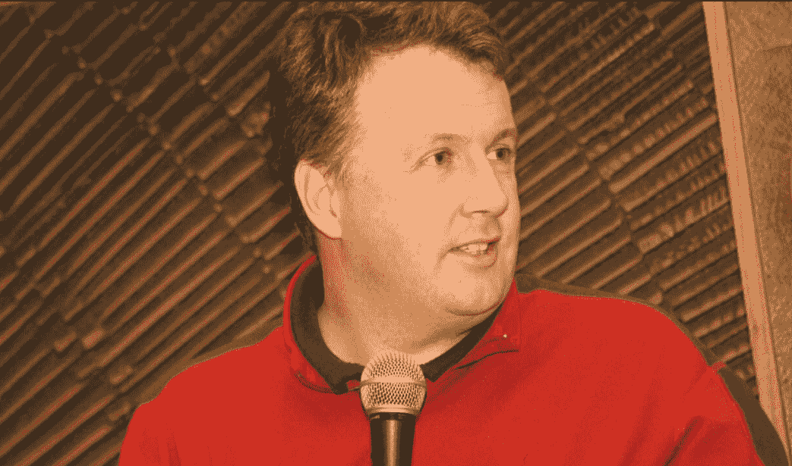

保罗经常在他的创业指导文章中赞扬山姆，鼓励年轻创业者向他学习。保罗甚至为山姆创造了一句广为流传的名言："你可以把他空降到一个充满食人族的岛上，五年后回来，他就会成为国王。" 这句话乍听像是赞美，但也引发了一些深思。

# 四、掌舵YC

YC 第一届的成功让保罗信心大增。第二年他决定把公司搬到科技中心硅谷，果然到 2013 年的冬季班，保罗收到了2000 多份申请。

原本 YC 有4个创始人，但一些核心工作，例如主面试官，为创业者提供指导，只有格雷厄姆一人能做。他渐渐感到力不从心他开始从过往的学员中寻找助手，奥特曼便是邀请的第一批。此时的山姆似乎开始效仿保罗，成为创业导师。他为 YC 的年轻创始人提供建议，并开始撰写充满哲理的文章，如 "最成功的创始人并不打算创建公司，他们的使命更接近于创造一种宗教"，或者 "有一个大秘密，就是你可以在惊人的短时间内让世界屈服于你的意志，但大多数人甚至不去尝试"。

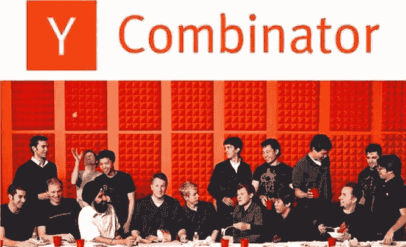

在一篇名为《如何成功》的博客文章中，山姆建议创始人要 "几乎有太多的自信"。他写道："我认识的最成功的人几乎到了妄想的地步。" 这句话不仅是建议，更像是山姆自身的写照。认识他的人都说，山姆拥有一种近乎完美的自信，似乎从不受普通人常有的恐惧或不确定感困扰。

AirBnB 的创始人布莱恩·切斯基(Brian Chesky)讲述了一个关于 奥特曼的故事。当 Airbnb 团队向山姆展示 50 万美元的种子轮融资幻灯片时，山姆鼓励他们将预计收入从 3000 万美元增加到 30 亿美元。山姆说：“把所有的 M 都变成 B。要么你不相信你在 PPT 上所说的一切，要么你感到羞耻，要么我不会做数学。”

在协助最后的晚餐的时间里，山姆积累了对产品、行业和人的判断，投资技能日益见长。2010 年时，山姆从银行卡里仅有的 17.000 美元资金中拿出了 15.000 美金投资了 YC 的一家初创公司 Stripe。而 Stripe 2015 年市值达到 35 亿美元。

2014 年，保罗更进一步，辞去 YC 总裁职务，并任命 28 岁的山姆接任。这一决定震惊了硅谷。YC 作为硅谷的核心，其领导权的交接意味深远。

保罗解释他选择山姆的原因时说："YC 已经成长为一个庞然大物。我不擅长管理如此庞大的组织，但山姆会很擅长。" 尽管当时山姆还没有管理大型组织的经验，但他很快证明了自己的能力。

而山姆的愿景远不止于创建一家成功的公司。他的目标是打造一个能够推动世界前进的万亿美元级别的企业集团。在这个过程中，山姆意识到一个关键点："没有重大科学突破，就不可能诞生万亿美元级别的企业。"

基于这一洞见，山姆在接手YC后，做出了一个大胆的决定：引入更多 "硬科技" 公司。这一举措在 2014 年引起了不小的争议。当时，投资者普遍更青睐互联网应用公司，而硬科技企业不仅需要大量资金和时间投入，风险也极高。许多人质疑 YC 这种小而快的孵化模式是否适合这类公司。

面对质疑，山姆坚持己见。他认为 YC 可以帮助硬科技公司找到一个合适规模的初始项目，只需少量时间和资金就能取得突破性进展。事实证明，他的眼光是正确的。2014 年，奥特曼成功说服自动驾驶汽车公司 Cruise 的 CEO Kyle Vogt 加入 YC。当 Cruise 遇到资金困难时，奥特曼投资了 300 万美元。仅仅两年后，通用汽车以 12.5 亿美元的价格收购了 Cruise，验证了奥特曼的远见。

在山姆的领导下，YC 迅速壮大。到 2016 年，YC 每年收到 13000 家初创公司的申请，最终录取 240 家。YC 为每家公司提供 12 万美元的启动资金，换取 7% 的股权。YC 的总市值已达约 1,500 亿美元，其投资网络覆盖 4000 多个创业园区和 1900 多家公司。

曾两次参与 YC 项目的创始人约翰・库根评论道："山姆・奥特曼时代的 YC 就是关于扩张的。YC 从一个小规模的暑期项目，发展成了一个涉足多个领域的综合性组织。"

山姆的领导风格也给人留下了深刻印象。库根描述道："他非常擅长转换话题并专注倾听。有人形容他是 ' 倾听的迈克尔・乔丹 '。" 许多人都提到山姆倾听时的强烈专注和凝视，这种专注度几乎让人感到不安。

作为 YC 的领导者，山姆展现出了卓越的问题解决能力。库根回忆道："我亲眼见过山姆在 15 分钟的电话中解决了一个价值一亿美元的问题。他总是从人性的角度思考问题，找到各方利益的平衡点。"

人一旦得到了想要的东西，往往想要更多。山姆认识到传统风险投资模式的局限性，特别是对那些需要长期研究、难以快速盈利的项目。他坚信，某些关乎全人类福祉的技术创新应该属于全人类，而不是某个特定组织或公司。

基于这一理想，他自掏腰包 1000 万美元成立了 YC Research（现OpenResearch），这是一个致力于推动人类进步的非营利创新实验室。这项的宏伟计划涵盖了从癌症治疗到核裂变，从超音速客机到人工智能等多个领域。他的终极目标是彻底改变人类的生活方式，"创造整个未来"。

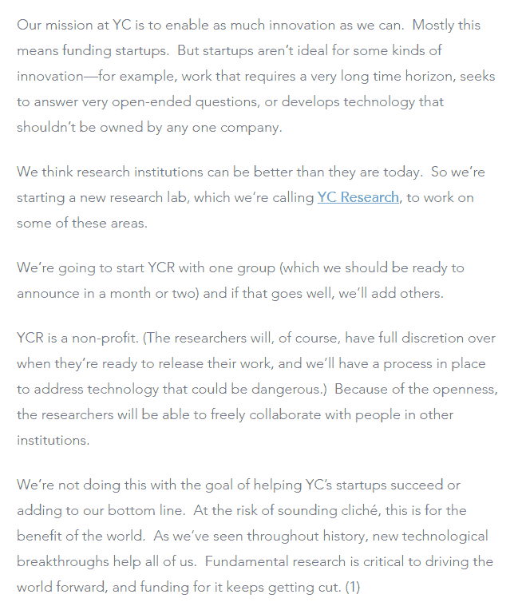

他的战略分为两个主要步骤：

1.  大力发展 AGI（通用人工智能），实现全球生产力的指数级提升。

1.  研发可控核聚变，解决地球资源短缺问题，为 AGI 的广泛应用铺平道路，使 AI 真正渗透到人类生活的方方面面。

随后，他就将这一理念应用到了人工智能领域，这将成为他职业生涯的一个重要转折点。正如他所说的，这是一次 "让世界屈服于他意志" 的尝试，而这一切都始于一场改变一切的晚宴。

# 五、OpenAI与马斯克的担忧

2015 年 7 月的一个夏夜，硅谷的精英们齐聚一堂，参加了一场注定改变人工智能格局的私人晚宴。这次晚宴汇聚了硅谷的精英，其中最关键的四个人是：埃隆・马斯克、山姆・奥特曼、伊利亚・西茨基弗（一位前谷歌 AI 研究员）和格雷格・布罗克曼（Stripe 的核心人物之一）。而场晚宴的主人正是山姆。

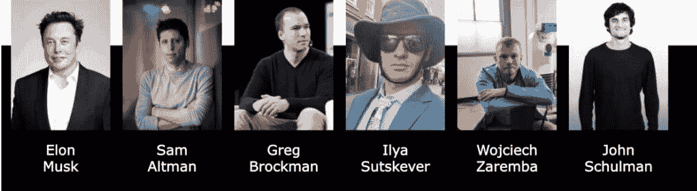

这场晚宴的背景颇具戏剧性。不久前，谷歌刚刚收购了一家总部位于伦敦的神经网络初创公司 DeepMind。在业内人士看来，DeepMind 是最有可能率先开发出通用人工智能（AGI）的公司。这一收购引发了科技界的震动和忧虑：如果谷歌成功开发出 AGI，它可能会垄断这项潜力无限的技术，进而掌控人类的未来。

谷歌的领先地位让马斯克感到不安。他担心 AI 可能会变得过于强大，尤其是如果 AI 开始自我改进。在 CNBC 的一次采访中，马斯克回忆道："我曾经和拉里・佩奇是好朋友。我们经常在他家里彻夜长谈，讨论 AI。我不断敦促他警惕 AI 的潜在危险。但他似乎对此漠不关心，这让我感到非常沮丧。"

马斯克的担忧在当时看来有些言过其实。许多专家认为，AI 离威胁人类还很遥远，因为它甚至还难以准确区分吉娃娃和蓝莓松饼的照片。但对埃隆来说，这是一个真实存在的威胁。在一次与沃尔特・艾萨克森的对话中，他表现得异常严肃，甚至有些惊慌："我不认为大多数人意识到机器智能发展的速度有多快。如果出现了一个数字超级智能体，特别是如果它能够自我改进，而且其优化目标与人类利益相悖，那将会产生灾难性的后果。"

然而，马斯克的警告在当时并未得到广泛认同。在一次公开演讲中，当他表达这些担忧时，观众甚至发出了嘲笑。

彭博社记者艾什莉・凡斯（Ashley Vance），同时也是马斯克传记的作者，对他的动机有着更深入的洞察："2013 年的埃隆与我们今天认识的那个人大不相同。虽然他已经取得了一定的成功，但还远不是世界首富。与此同时，他的朋友们，谷歌的创始人拉里・佩奇和谢尔盖・布林，已经建立了庞大的软件和 AI 帝国。我怀疑埃隆对 AI 的担忧部分源于嫉妒，尽管他永远不会公开承认这一点。"

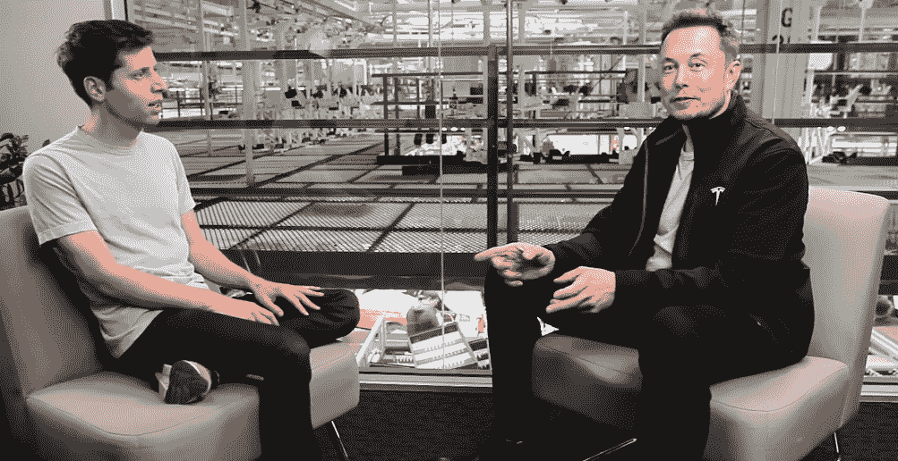

在晚宴上，他们深入讨论了 AI 的潜在风险和如何建立一个能与谷歌抗衡的 AI 研究机构。每个人都带来了独特的优势：伊利亚的 AI 专业知识，格雷格的运营经验，众多大佬的资金支持，而山姆则是这一切的策划者。

就在那个晚上，9 位个人和机构总共捐出了 10 亿美元作为启动资金，并提出了一个名字：OpenAI。正如马斯克后来在 CNBC 上解释的那样："OpenAI 代表开源。它是谷歌的对立面 - 一个开源的非营利组织，而谷歌是一个封闭源代码的营利性公司。我们认为，追求利润可能会带来潜在的危险。"

为了体现这个机构的公益性质和重要地位，奥特曼和马斯克共同出任 OpenAI 的联席董事长。值得注意的是，他们选择不持有 OpenAI 的任何股份，这一决定凸显了他们对于推动 AI 技术公平发展的承诺，而非追求个人利益。

这就是 OpenAI 的诞生故事。它最初的愿景是成为一个公开分享研究成果的实验室，专注于开发对人类有益的安全 AI，而不是追求商业利益。然而，这个崇高的理想很快就面临了现实的挑战。OpenAI 的创始人们很快发现自己陷入了权力斗争，并不得不紧急筹集数十亿美元的资金。

而这一切是如何发生的？让我们下期揭开谜底。

未完，待续。

> 笔者：由于我早些年写过一些人物传记，所以对这方面还算是比较熟悉，特开此坑。素材来源包括但不限于播客、文章等。如果由于我个人疏忽导致没有标注出处来源，在此深表歉意。

> 资料来源：

1.   播客——Foundering: The OpenAI Story

1.  人物-Sam Altman(https://blog.naaln.com/2023/06/sam-altman/)

1.  ChatGPT之父大婚：16岁就出柜 刚经历OpenAI内乱(https://www.sohu.com/a/751452536_430392)

1.  首富推荐游戏系列(https://www.bilibili.com/video/BV1sf4y1k7w6/?spm_id_from=333.788.recommend_more_video.1&vd_source=3c8d8365ab9c662aac6d009c662bd0dd)