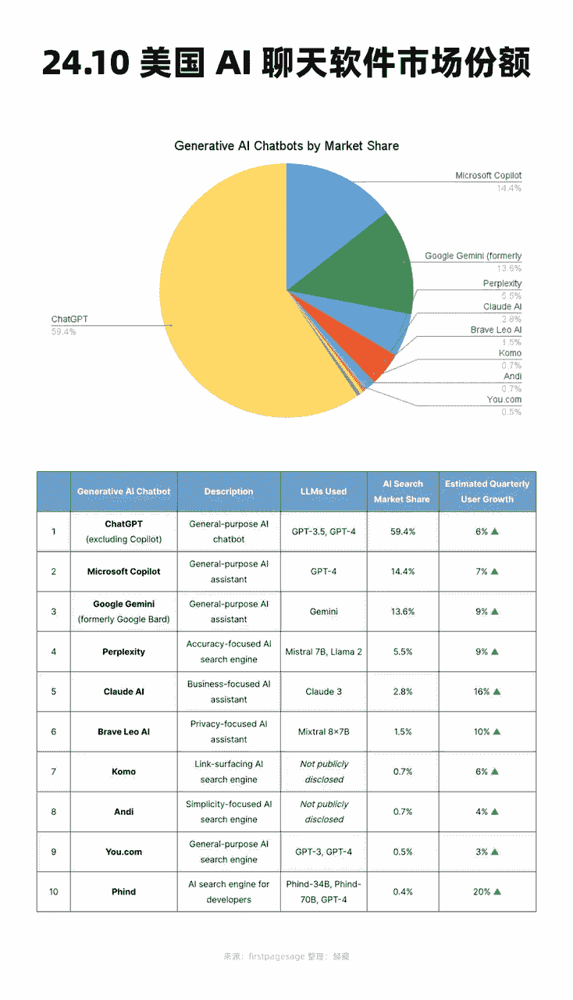

# 11🈷️1日

> 来源：[https://v11enp9ok1h.feishu.cn/docx/IPWYdVHd2ome5kxbFtHcstf3n1g](https://v11enp9ok1h.feishu.cn/docx/IPWYdVHd2ome5kxbFtHcstf3n1g)

《10 月份美国 AI 机器人市场占有率报告》来自歸藏，10 月份美国 AI 聊天机器人市场报告显示，ChatGPT 仍是市场领导者，但份额逐渐下降。谷歌和微软在争夺第二的位置，Perplexity 和 ClaudeAI 则实现高速增长，正在从 ChatGPT 和 Gemini 手中蚕食市场份额。总体来看，专业 AI 工具的增长势头强劲，而初创公司的用户获取相对缓慢。

