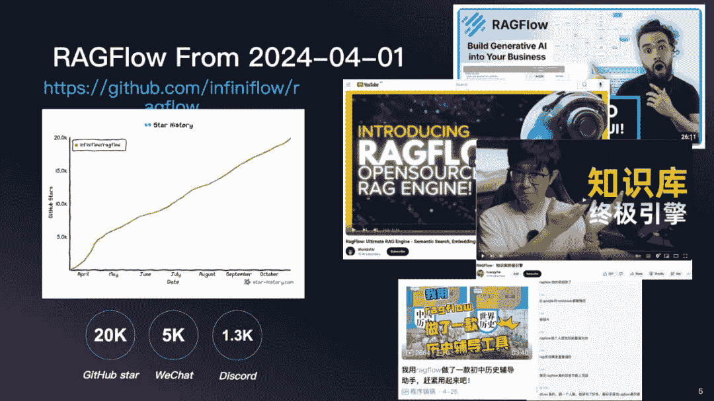

# 11🈷️2日

> 来源：[https://v11enp9ok1h.feishu.cn/docx/Yv8nduBKcodwBHxw2uacv4x7nMQ](https://v11enp9ok1h.feishu.cn/docx/Yv8nduBKcodwBHxw2uacv4x7nMQ)

《RTE年度场景三强专访：实时语音、多模态Agent，创业机会在哪里？》2024 年 RTE 年度场景评选中，Infiniflow、聊会小天和 Traini 脱颖而出。Infiniflow 专注于 AI Agent 与 RAG（检索增强生成）技术，提升企业文档处理能力；聊会小天提供 24 小时 AI 心理咨询服务，解决年轻人的心理压力；Traini 聚焦宠物互动情感需求。各团队面临商业化挑战，强调技术与用户需求的结合，未来将不断提升产品和服务。

