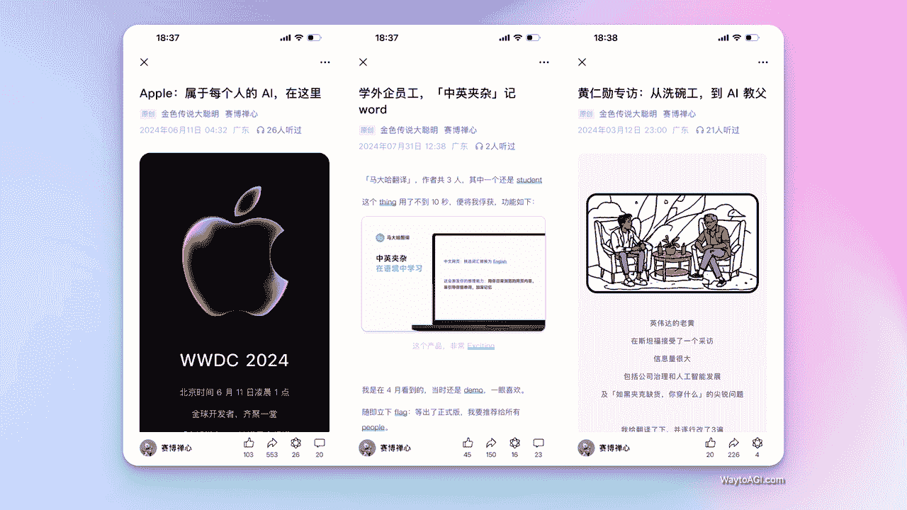

# 11🈷️3日

> 来源：[https://v11enp9ok1h.feishu.cn/docx/T0fXdROfhoc6slxgLG2c0n1OnSe](https://v11enp9ok1h.feishu.cn/docx/T0fXdROfhoc6slxgLG2c0n1OnSe)

**11 🈷️ 03 日**

《社区孵化了一款排版工具，20秒就可以完成公众号排版》由开发的公众号排版工具，旨在简化微信公众号排版流程。用户只需申请链接并在飞书中添加该小组件，即可一键将公众号文章排版到飞书，支持多种格式和样式模板。未来计划上线更多主题模板和功能，同时欢迎用户反馈与交流

