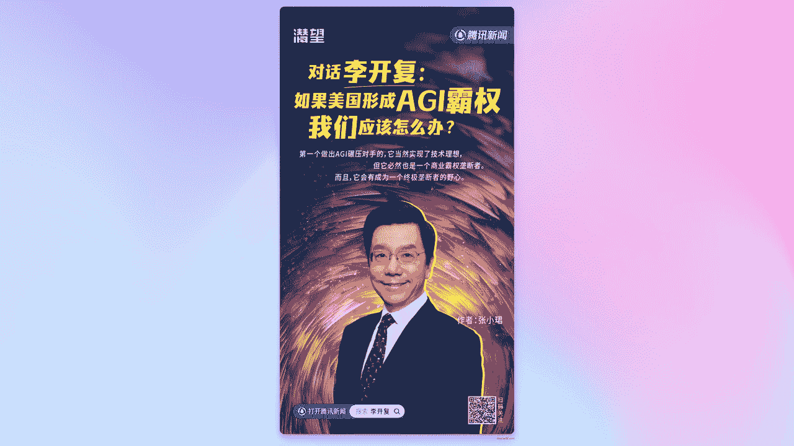

# 11🈷️6日

> 来源：[https://v11enp9ok1h.feishu.cn/docx/ZD2MdOx3QoIqVmxJZBvcggf9nGb](https://v11enp9ok1h.feishu.cn/docx/ZD2MdOx3QoIqVmxJZBvcggf9nGb)

**11 🈷️ 06 日**

《对话李开复：如果美国形成AGI霸权，我们应该怎么办？》李开复在采访中表达了对 AGI（通用人工智能）霸权的担忧，指出如果美国形成 AGI 垄断，将对全球科技生态产生深远影响。他认为，中国在研发廉价模型和推理引擎方面具备优势，尽管技术上可能落后，但在应用和落地速度上可与美国竞争。他强调，追求 AGI 的同时，中国应寻找另一条生态护城河的发展路径，确保多样化应用和更广泛的市场参与。

