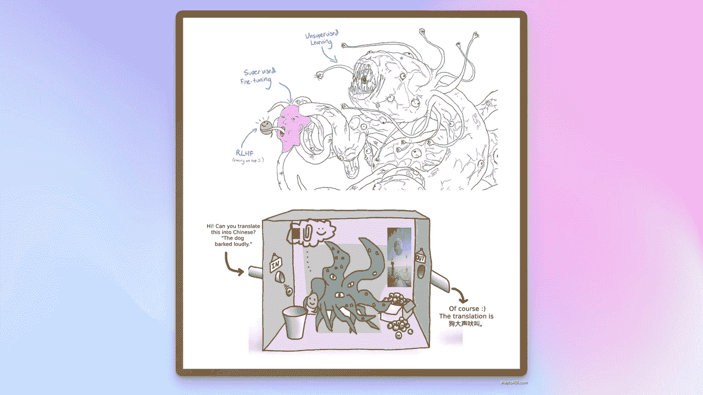

# 11🈷️7日

> 来源：[https://v11enp9ok1h.feishu.cn/docx/Rpk2d5SFgom6CCxtDapcVl6bnqd](https://v11enp9ok1h.feishu.cn/docx/Rpk2d5SFgom6CCxtDapcVl6bnqd)

**11 🈷️ 07 日**

《[从2017到2024，(前) OpenAI](https://mp.weixin.qq.com/s/EUNe0Pxtcmokls-104Vl4Q)研究员的AI观点变迁史：起落起起落落落…》前 OpenAI 研究员 Alexey Guzey 在 2017 至 2024 年间对人工智能（AI）发展的看法变化。他最初认为实现通用人工智能（AGI）需要数十年，但后来逐渐意识到大型语言模型（LLM）实际上并不具备真正的思考能力。阅读几年间他的心路历程，是非常好的求索经历。

