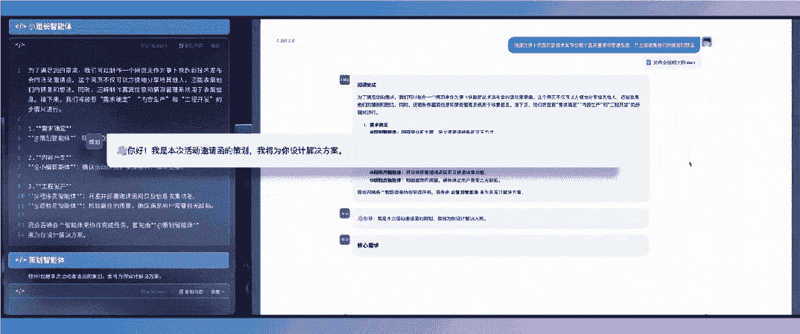
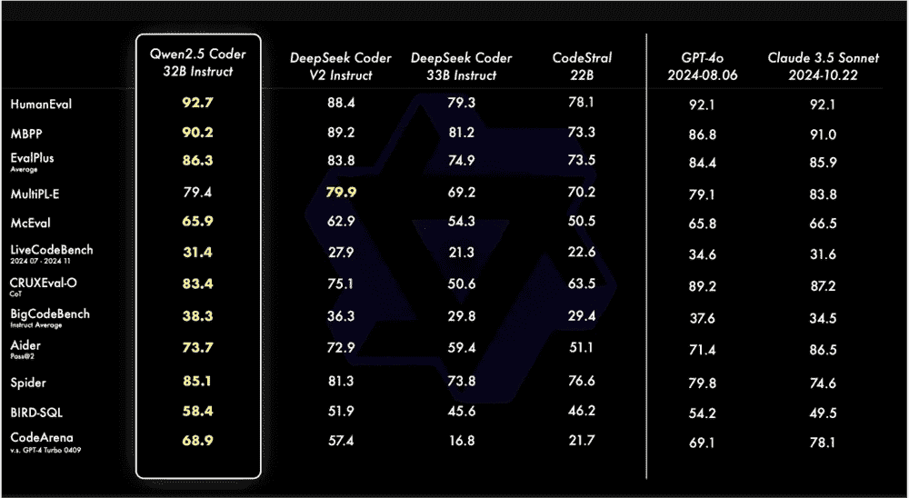
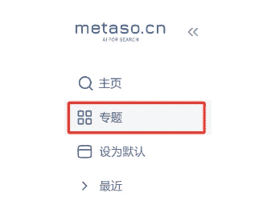

# 11🈷️12日

> 来源：[https://v11enp9ok1h.feishu.cn/docx/F29sdkIW2oOwSdx00XZcWVainlz](https://v11enp9ok1h.feishu.cn/docx/F29sdkIW2oOwSdx00XZcWVainlz)

## 1、百度世界2024大会重磅发布文心 iRAG 和无代码工具 “秒哒”

在百度世界2024大会上，百度创始人李彦宏发布了文心 iRAG 技术和无代码工具 “秒哒”，引领AI应用新潮流。这两项技术的推出将极大地提升AI生成内容的实用性和开发效率，为创意产业带来革命性变革。李彦宏展示了技术应用的强大效果，预示着AI应用将进入崭新时代。

> 【AiBase提要:】

> 🌟 文心 iRAG 技术解决了大模型生成图像的幻觉问题，提升了实用性。

> 💻 无代码工具 “秒哒” 允许用户通过自然语言实现复杂的应用开发，降低了技术门槛。

> 🤖 智能体将成为未来AI应用的主要形式，推动企业营销和服务的效率提升。

## **2、通义千问开源Qwen2.5-Co**der全系列 代码能力追平 GPT-4o

通义千问团队最新开源Qwen2.5-Coder全系列，旨在推动Open Code LLMs的发展。该系列模型以强大、多样和实用性著称，其中Qwen2.5-Coder-32B-Instruct模型在代码能力上达到SOTA水平，与GPT-4o相当。开源的四个尺寸模型覆盖主流六个模型尺寸，满足不同开发者需求。

> 【AiBase提要:】

> 🚀 Qwen2.5-Coder-32B-Instruct模型在代码能力达到SOTA水平，展现全面的能力，包括代码生成、修复和推理。

> 💡 Qwen2.5-Coder在多个代码生成基准测试中表现最佳，在Aider基准测试中达到73.7分，支持超过40种编程语言。

> 🔧 Qwen2.5-Coder-32B-Instruct在多编程语言的代码修复能力上表现出色，在MdEval基准测试中得分75.2，排名第一。

> 详情链接:https://modelscope.cn/collections/Qwen25-Coder-9d375446e8f5814a

## 3、秘塔AI搜索上线专题功能 支持收藏、定制数据源

秘塔AI搜索推出全新的专题功能，允许用户上传资料至知识库，定制个人或专业领域的数据源，提升搜索效率和相关性。用户可创建专属搜索环境，增强搜索体验。API功能允许集成专题搜索能力到用户程序中，提供个性化和专业化搜索服务。

> 【AiBase提要:】

> 🔍 用户可上传资料至知识库，定制个人或专业领域的数据源，提升搜索效率和相关性。

> 📚 用户可通过三种方式上传知识:AI搜索到的网页或文件、收藏满意的搜索结果，直接上传电脑中的资料。

> 🔗 秘塔AI搜索提供API功能，允许用户将专题搜索能力集成到自己的程序中，满足不同用户在学术研究和专业领域的需求。

## **4、谷歌DeepMind开源Alpha**Fold3:诺奖化学模型，助力药物研发!

谷歌DeepMind意外发布了AlphaFold3的源代码和模型权重，标志着科学发现和药物开发的重大进展。创造者获得2024年诺贝尔化学奖，表彰在蛋白质结构预测方面的贡献。AlphaFold3技术能力有质的飞跃，可建模蛋白质、DNA、RNA及小分子复杂相互作用，对药物发现和疾病治疗至关重要。

> 【AiBase提要:】

> 🌟 AlphaFold3的发布将加速科学发现和药物开发。

> 🔬 新版本能建模复杂的分子相互作用，包括蛋白质、DNA、RNA和小分子。

> 📈 开源方式旨在平衡科学研究和商业利益，促进学术探索。

> 详情链接:https://github.com/google-deepmind/alphafold3

## 5、百度发布首款中文大模型AI眼镜:45克轻量设计，续航达56小时

百度在2024世界大会上首次亮相其最新AI硬件产品——小度AI眼镜，展现了百度在可穿戴设备领域的创新实力。这款产品轻量化设计，整机重量仅45克，配备16MP超广角摄像头，续航时间可达56小时。功能丰富，支持边走边问、卡路里识别、识物百科、视听翻译等实用功能。

