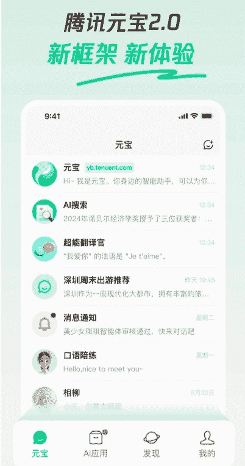

# 11🈷️15日

> 来源：[https://v11enp9ok1h.feishu.cn/docx/C6CYddgbeo9zsGxzi0JclaE0nWe](https://v11enp9ok1h.feishu.cn/docx/C6CYddgbeo9zsGxzi0JclaE0nWe)

# 腾讯元宝APP 2.0版上线：混元模型升级 支持多种模态理解和生成

> 腾讯宣布，其旗下的智能助手产品腾讯元宝2.0版本正式焕新上线。在新版本中，对话列表经过重新设计，使用户能够更轻松地查找历史对话和使用过的智能体，无论是回顾信息还是继续未完的交流都变得更加方便。

>

> 腾讯元宝2.0版本还推出了AI应用专属板块，集结了AI搜索、AI阅读、创意绘画、灵感图库、AI美照五大应用，满足用户在搜索、阅读、写作、绘画等多维度的创作需求。此外，新版本还提供了“应用广场”，让用户能够一键添加丰富多样的智能体到自己的AI应用页面。

> 在AI搜索方面，腾讯元宝2.0版本除了整合🛰️👸号内容外，还新增了🛰️视频号、🐧音乐等特色信息资源，提供更加智能、便捷的搜索服务。混元模型架构也得到了升级，基于新一代大模型“混元turbo”，性能大幅提升，训练和推理效率提升一倍，使得回答更快更准。同时，腾讯元宝2.0版本支持多种模态理解和生成，是国内首个自研MoE多模态大模型，支持任意长宽比及最高7K分辨率图片的理解分析。

>

> 腾讯元宝2.0版本还将融入腾讯文档、电脑管家、搜狗输入法等生态产品，实现更原生的场景融合。用户在使用AI写作生成文章后，可以无缝衔接到腾讯文档编辑环节，使用AI文档助手进行优化调整。在电脑上阅读内容时，用户可以划选关键词，点击“解释”、“翻译”或“AI搜索”，腾讯元宝会立刻提供所需信息。搜狗输入法与元宝的联合，为用户提供了搜索资讯、研读文档等各种工作生活需求的AI助力，通过快捷键、划词或点击AI功能入口，快速唤起智能侧边栏，元宝即可随时为用户提供服务。

# 彩云小梦V3.5上线！突破性提升Transformer效率

> 彩云科技日前在北京举办"From Paper to App"主题沟通会，正式发布基于DCFormer架构的通用大模型"云锦天章"，并宣布旗下AI RPG平台彩云小梦升级至基于DCFormer的V3. 5 版本。这标志着人工智能领域在模型架构效率方面取得重大突破。

>

> 在AI领域，Transformer架构一直是ChatGPT、Gemini等主流大模型的核心技术支撑。今年，彩云科技在国际顶级会议ICML上发表的论文《Improving Transformers with Dynamically Composable Multi-Head Attention》首次提出DCFormer架构。测试显示，基于该架构开发的DCPythia-6.9B模型在性能上实现了对传统Transformer模型1.7- 2 倍的显著提升。

>

> 对于AI发展面临的能源挑战，彩云科技CEO袁行远指出，根据预测，到 2050 年全球AI耗电量可能达到目前地球发电能力的 8 倍。英伟达CEO黄仁勋更形象地表示，按目前发展速度，未来可能需要" 14 个行星、 3 个星系、 4 个太阳"来为AI提供能源支持。

>

> 针对这一困境，彩云科技选择从改善模型底层架构入手。DCFormer通过引入可动态组合的多头注意力（DCMHA）机制，解除了传统多头注意力模块（MHA）中注意力头的固定绑定，实现了更灵活的动态组合，从而大幅提升模型表达能力。该创新使彩云科技在ICML会议上的三篇论文获得平均 7 分的高分，并成为国内仅有的两家受邀在维也纳ICML2024 登台演讲的企业之一。

>

> 作为DCFormer架构的首个落地产品，新版彩云小梦展现出卓越性能：支持 1 万字的长文本输入，故事背景设定长度可达 1 万字，整体流畅性和连贯性提升20%。这意味着AI能够更好地维持剧情连贯性，保持人物性格一致性，并具备情节反思和修正能力。

>

> 彩云科技作为国内最早涉足大语言模型的企业之一，目前已拥有彩云天气、彩云小梦、彩云小译三款盈利性AI产品。公司表示将继续加大对DCFormer的研发投入，致力于打破"国外技术层、国内应用层"的传统格局，推动国产AI技术在全球竞争中占据优势地位。

>

> 通过这次技术突破，彩云科技不仅展现了中国企业在AI底层架构创新方面的实力，更为解决AI发展中的能源瓶颈提供了新思路，有望加速AI技术的可持续发展。