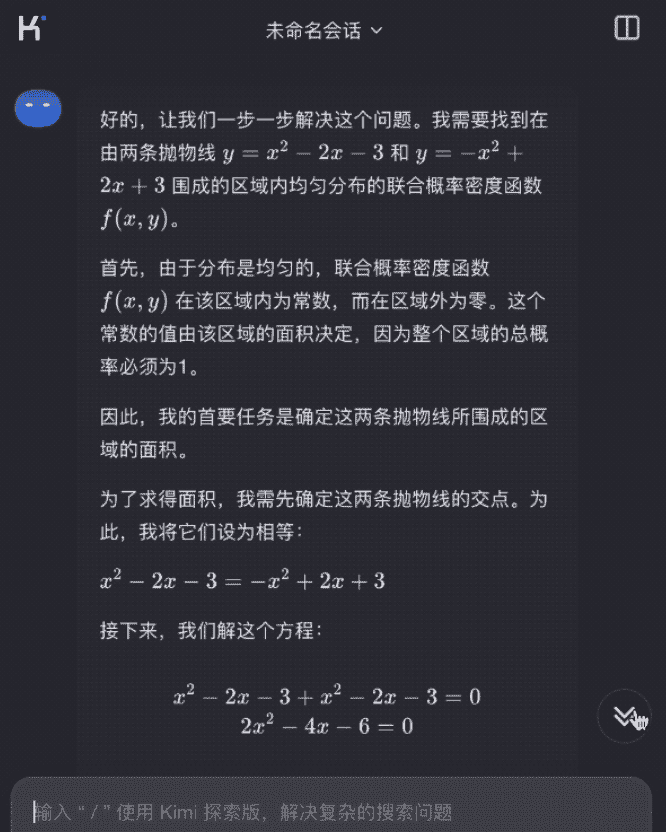
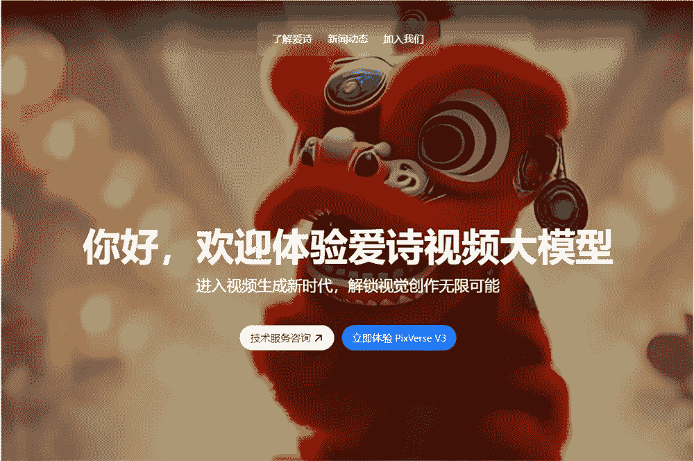

# 11🈷️18日

> 来源：[https://v11enp9ok1h.feishu.cn/docx/S5mVdFMfjopi3yxyuGncuPXln4b](https://v11enp9ok1h.feishu.cn/docx/S5mVdFMfjopi3yxyuGncuPXln4b)

# Kimi推出数学推理模型k0-math：数学能力对标OpenAI o1系列

> 月之暗面Kimi智能助手宣布推出新一代数学推理模型k0-math。k0-math模型在多项数学基准能力测试中表现突出，其成绩在中考、高考、考研以及包含入门竞赛题的MATH等4个数学基准测试中超过了OpenAI o1系列的o1-mini和o1-preview模型。

> 特别是在MATH测试中，k0-math模型得分93.8，仅次于o1完全版的94.8分。尽管在竞赛级别的OMNI-MATH和AIME基准测试中，k0-math初代模型的表现分别达到了o1-mini最高成绩的90%和83%，但公司计划持续迭代，以提升更难题目的解题能力。

>

> k0-math模型采用了全新的强化学习和思维链推理技术，通过模拟人脑的思考和反思过程，大幅提升了解决数学难题的能力。

> 该模型在解题过程中会花费更多时间进行推理，包括思考和规划思路，并在必要时自行反思改进解题思路，以提升答题成功率。

>

> 尽管k0-math模型在解答大部分有难度的数学题方面表现出色，但当前版本还无法解答LaTeX格式难以描述的几何图形类问题，且对于过于简单的数学问题可能会过度思考，对高考难题和IMO题目也有一定概率做错。

# 昆仑万维天工大模型Skywork 4.0 O1版将正式启动邀请测试

> 昆仑万维科技股份有限公司宣布，其最新研发的天工大模型4.0O1版（英文名:Skywork O1）将于2024年11月27日启动邀请测试。

>

> 天工大模型4.0O1版是国内首款具有中文逻辑推理能力的o1模型，它不仅在模型输出上内生了思考、计划、反思等能力，而且在标准评测集上，其推理能力相较于基座模型有了大幅上升，实现了模型推理能力的本质提升。

> 天工大模型4.0O1版包括两款模型:一款是基于开源Llama3.18B的开源模型，旨在加速国内开源社区复现o1的进程;另一款是进阶能力更强版的天工大模型4.0O1版，将在天工上线并开放测试和使用。

>

> 昆仑万维依托自研「天工」系列大模型，旗下一系列前沿AI产品进展迅速，包括全球首个AI流媒体音乐平台Melodio、AI音乐商用创作平台Mureka以及最新版本的AI高级搜索功能。此外，AI短剧平台SkyReels也即将在美国上线，进一步扩张昆仑万维在全球AI娱乐市场的影响力。

> **测试地址:**www.tiangong.cn

# 爱诗科技PixVerse文生视频、图生视频技术服务全球开放

> 北京爱诗科技有限公司近日宣布，其旗下的PixVerse平台已正式对外开放文生视频和图生视频技术服务。

>

> 在此之前，爱诗科技PixVerse V3 已全球同步公开上线，PixVerse V3 在底层模型能力上实现了显著提升，提供了包括创意模板、口型匹配、故事续写和风格转换在内的多模态生成能力和丰富的AI玩法。

> PixVerse V3 版本在理解提示词和视频生成效果上更为精准和惊艳，能够传达情感、质感和镜头语言等细节，轻松实现现实与虚拟的融合。模型通过一系列生动的示例展示了其生成视频的能力，如武士在雪天奔跑的场景、戴着巫师帽的猫以及大熊猫在秋千上休息的画面，这些示例充分展示了PixVerse V3 在视频生成方面的高级能力。

>

> 除了基础的视频生成功能，PixVerse V3 还推出了多个创意模板，包括Alive Art、Monster Invasion、Wizard Hat和Leggy Run等，让用户能够轻松使用AI魔法，为生活增添乐趣。V3 版本还支持多模态视频生成，包括多语言人物声音同步和故事延长，拓宽了AI视频创作的边界。用户可以使用口型匹配功能让视频中的人物开口说话，并支持多种语言。故事续写功能则允许用户在已生成视频的基础上添加提示词，实现情节递进，同时保持人物和动作的高度连贯性。

> **申请地址：**https://wiuswkbgux0.feishu.cn/share/base/form/shrcnp3FuYHCpkqTzJbQzoUu5F5