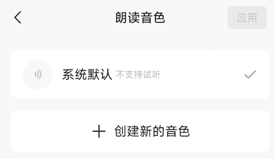
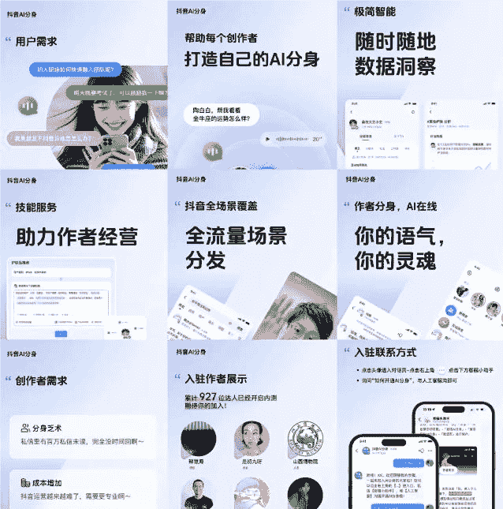
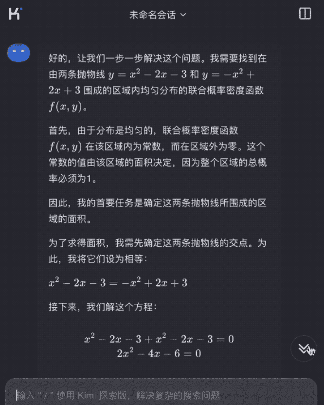
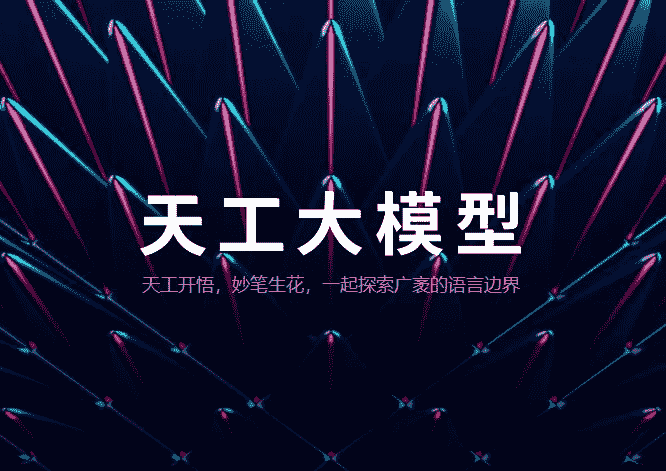
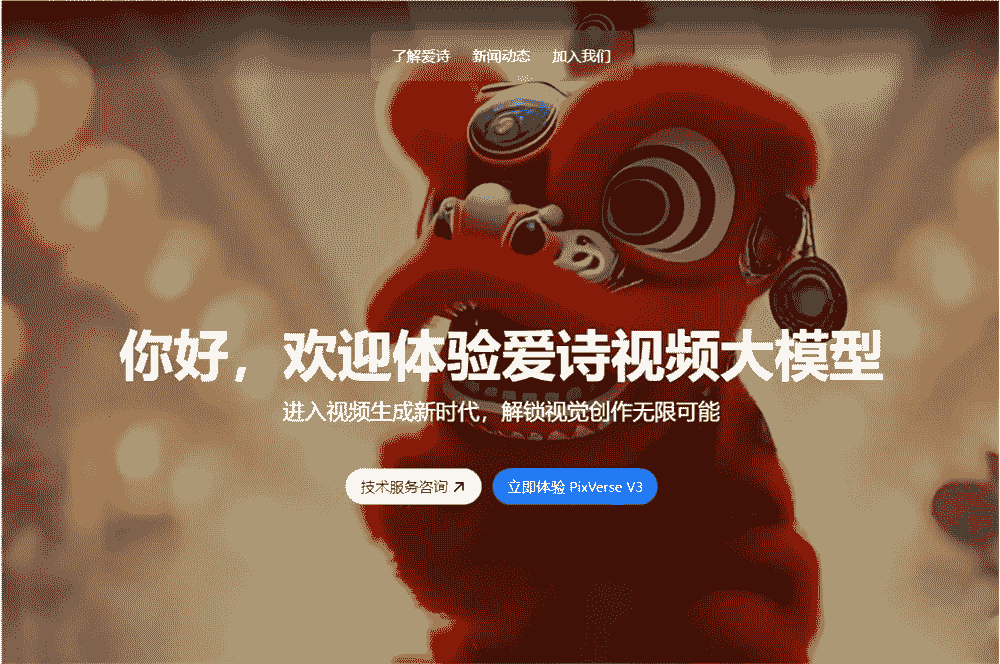
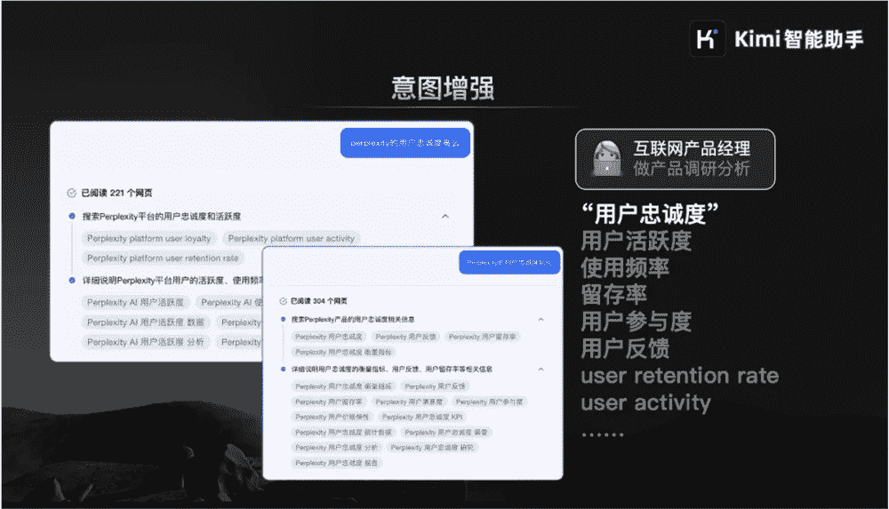
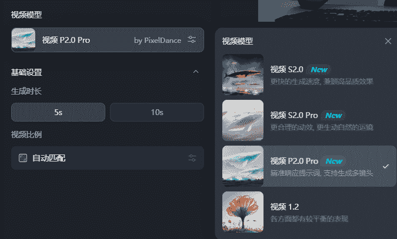

# 11🈷️19日

> 来源：[https://v11enp9ok1h.feishu.cn/docx/WfYIdGAMzoIbAyxeQRXckrDznPu](https://v11enp9ok1h.feishu.cn/docx/WfYIdGAMzoIbAyxeQRXckrDznPu)

1、🛰️👸号悄然推出AI音色克隆功能，尚未全量上线

这一新功能为用户提供了个性化的阅读体验，允许他们通过自己的声音朗读文章，增强了内容的情感表达。

> 【AiBase提要:】

> 📢 新功能上线:🛰️👸号推出 AI 音色克隆，提升用户体验。

> 🎤 现场朗读创建音色:用户通过实时朗读文本生成专属音色，确保合规与安全。

> 🔊 未来展望:AI 与👸号结合，赋予内容更多情感，可能成为每个作者的独特声音。

2、抖音推进 “V 项目” ，上线AI 分身功能让直播互动更嗨

抖音的新“V 项目”通过AI分身功能，极大地丰富了用户的直播互动体验。这一创新不仅提升了创作者与用户之间的互动频率，也为社交平台的竞争注入了新的活力。

> 【AiBase提要:】

> 🌟 新项目上线:抖音推出 “V 项目”，旨在丰富直播与互动体验。

> 🤖 AI 分身功能:创作者可生成 AI 分身，实现全天候互动。

> 📈 互动多样化:AI 分身细分为多项功能，增强用户交流体验。

**3、Kimi推出数学推理模型k0-ma**th:数学能力对标OpenAI o1系列

Kimi智能助手推出的新一代数学推理模型k0-math在多个数学基准测试中表现优异，尤其在MATH测试中接近OpenAI的最高分。

> 【AiBase提要:】

> 🏆 k0-math模型在中考、高考、考研等数学基准测试中超越OpenAI o1系列，展现出强大的数学推理能力。

> 🧠 该模型采用全新的强化学习和思维链推理技术，模拟人脑思考过程，显著提升解题能力。

> 📉 尽管表现出色，但k0-math在处理某些几何问题和简单题目时仍存在局限性，需进一步迭代改进。

4、AI自习室在县城悄悄兴起，学生成为刷题“机器人”?

随着AI技术的发展，AI自习室在县城迅速崛起，吸引了众多家长。然而，这种模式是否真正有利于孩子的学习，值得深思。【AiBase提要:】

> 🌟 AI自习室成为家长的新选择，孩子们在机器辅助下学习，但面临着巨大的学习压力。

> 📚 教育质量存疑，许多孩子在反复尝试中学习，而非真正理解知识点。

> 💰 自习室的运营模式依赖销售，督导老师的角色逐渐边缘化，收入与销售业绩紧密挂钩。

5、昆仑万维天工大模型Skywork4.0O1版将正式启动邀请测试

昆仑万维科技股份有限公司即将推出其最新研发的天工大模型4.0O1版，标志着国内在中文逻辑推理能力方面的重要突破。

> 【AiBase提要:】

> 🧠 天工大模型4.0O1版是国内首款具有中文逻辑推理能力的o1模型，具备思考、计划和反思能力。

> 📈 相较于基座模型，天工大模型在标准评测集上的推理能力实现了本质提升。

> 🌍 昆仑万维旗下的AI产品如Melodio和Mureka等，正在迅速扩张在全球AI娱乐市场的影响力。

> 测试地址:www.tiangong.cn

6、爱诗科技PixVerse文生视频、图生视频技术服务全球开放

最近，我对北京爱诗科技有限公司的PixVerse平台感到兴奋。它的文生视频和图生视频技术服务的开放，标志着AI视频创作的一个新纪元。PixVerse V3的多模态生成能力和丰富的创意模板，极大地拓宽了我的创作边界，尤其是故事续写和口型匹配功能，让我能够轻松地为我的视频增添更多情感和细节。

> 【AiBase提要:】

> ✨ PixVerse V3提供多模态生成能力，包括创意模板和故事续写，提升视频创作的灵活性。

> 🗣️ 口型匹配功能支持多语言，让视频中的人物能够真实地开口说话，增强观众的沉浸感。

> 🌟 通过生动的示例展示其高级视频生成能力，PixVerse V3实现了现实与虚拟的完美融合。

> 详情链接:https://wiuswkbgux0.feishu.cn/share/base/form/shrcnp3FuYHCpkqTzJbQzoUu5F5

7、月活超3600万!Kimi探索版搜索再进化:引入三大推理能力

Kimi探索版的再进化引入了三大推理能力，提升了用户的搜索体验和信息获取的准确性。

> 【AiBase提要:】

> 🔍 意图增强能力使Kimi能够具体化模糊问题，帮助用户更好地理解自己的搜索需求。

> 📊 信源分析能力从海量搜索结果中筛选出权威信源，并提供段落级别的溯源链接。

> 🧠 链式思考能力使Kimi能够处理复杂的研究问题，提升用户的研究效率。

8、字节视频生成模型PixelDance在即梦AI全量上线

在体验了字节的PixelDance视频生成模型后，我深感其强大的功能。无论是P2.0Pro还是S2.0Pro，都展现了出色的生成效果，尤其在复杂运动和镜头切换时，P2.0Pro的表现尤为突出。S2.0Pro则更适合初学者，操作简单，效果也相当不错。总体来说，这两个模型各有千秋，用户可以根据需求灵活选择。

> 【AiBase提要:】

> 🌟 P2.0Pro适合复杂运动，效果更佳，但需要掌握提示词技巧。

> 👍 S2.0Pro友好易用，适合小白，能自动判断图片信息生成视频。

> 💰 即梦还有轻量版S2.0，生成速度快且性价比高，适合快速需求。

> 详情链接:https://top.aibase.com/tool/jimeng