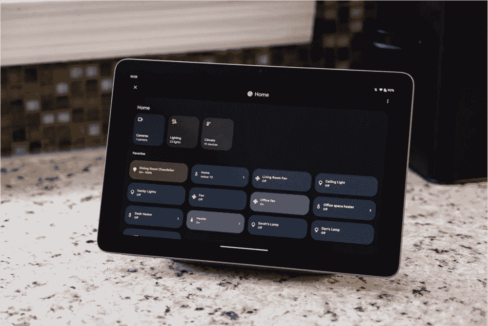
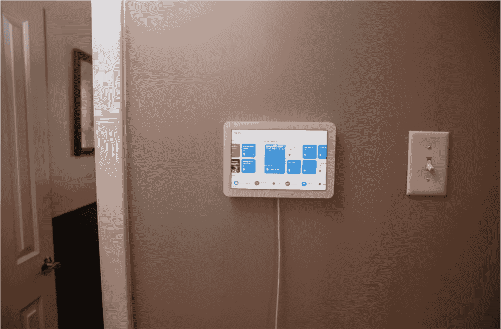

# 11🈷️25日

> 来源：[https://v11enp9ok1h.feishu.cn/docx/P0M6diOgDo7AkjxroYJcBdDenve](https://v11enp9ok1h.feishu.cn/docx/P0M6diOgDo7AkjxroYJcBdDenve)

# 苹果将推出“AI墙面平板电脑”:挑战智能家居界面问题

苹果计划于明年推出一款名为“AI墙面平板电脑”的新设备，目标是解决智能家居界面复杂性的问题。新产品将成为Apple Home平台的核心，具备控制灯光、锁、安全系统和摄像头等智能设备的功能，力求为家庭自动化带来更加直观和高效的操作体验。

尽管智能家居市场不断增长，现有设备的复杂性仍然是用户的痛点。许多智能显示器，如Echo Show和Nest Hub，虽具备语音控制和触摸屏，但操作体验仍不尽如人意，尤其是在控制智能家居设备时。这些设备经常面临设置繁琐、界面不友好以及语音助手响应不准确的问题，令许多用户选择放弃，转而使用传统的墙壁开关。

据报道，苹果的“AI墙面平板电脑”HomePad将采用六英寸的方形设计，能够安装在墙上或与扬声器连接，具备内置安全摄像头和传感器，支持触摸和语音双重控制。HomePad的设计将以直观简洁的用户界面为核心，融合iPhone和watchOS的元素，并使用代号为Pebble的新的homeOS系统。用户不仅可以通过语音控制设备，还能通过触摸屏轻松调整设置。

这一设备可能会面临与现有智能显示器相同的挑战，但苹果的优势在于其成熟的HomeKit框架和本地控制技术，这意味着HomePad将能够无缝连接并控制家中的智能设备，而不依赖于云服务。这一优点将使其在竞争中脱颖而出。

尽管苹果在硬件和界面上有所创新，但其语音助手Siri仍然是一个亟待改进的领域。当前，Siri的语音识别能力和智能家居控制功能远不如竞争对手的Alexa和Google Assistant。为了弥补这一差距，苹果正在开发一款基于大型语言模型（LLM）的更强大的Siri，预计将在2026年推出。如果Siri能够具备更强的上下文理解能力，能够根据语境做出智能反应(例如，“Siri，我冷”自动调节温度)，将极大提升用户体验。

# 纽约法官允许美国一新闻网站针对OpenAI的版权诉讼继续进行

近日，纽约的一名联邦法官作出裁决，允许美国新闻网站The Intercept 继续对 OpenAI 提起的部分诉讼。这起诉讼指控 OpenAI 在训练其人工智能模型时，违反了《数字千年版权法》（DMCA），涉及到的核心问题是 OpenAI 在创建 ChatGPT 的训练数据时，移除了新闻文章中的版权管理信息，比如标题和作者姓名。The Intercept 认为，这种做法侵犯了对作者身份的保护。

负责此案的法官杰德・S・拉科夫（Jed S. Rakoff）驳回了部分诉讼请求，特别是对微软的所有指控，但允许针对 OpenAI 的主要 DMCA 投诉继续审理。对此，The Intercept 的律师马特・托皮克(Matt Topic)表示:“这一决定展示了 DMCA 为新闻机构提供了重要的保护，防止人工智能公司对其内容的侵占。” 他还称这一判决为 “首创性决策”，并认为可能会带来更广泛的影响。

目前，法院在如何将现有版权法律适用于使用受保护材料进行训练的人工智能系统方面，面临着巨大的挑战。此前，另一名纽约联邦法官曾驳回过一起类似的诉讼，该诉讼同样是针对 OpenAI 的，原告为新闻网站 Raw Story 和 AlterNet。该案中，法官指出，问题并不在于版权信息的移除，而在于 OpenAI 在未获得赔偿的情况下使用了原告的文章。

在这起案件中，拉科夫法官认为，The Intercept 可能会证明由于版权信息的移除而造成了具体损害，因此这一问题将进入进一步的法律审查。The Intercept 在今年2月提起了诉讼，正是随着越来越多的媒体公司因 AI 开发中的各种版权问题而对 OpenAI 和微软采取法律行动，这场官司的起诉潮愈演愈烈。此次初步裁决可能标志着一场围绕使用版权内容进行 AI 模型训练的较长法律斗争的开始。

> 划重点:

> 📄 The Intercept 获准继续诉讼 OpenAI，指控其违反 DMCA。

> ⚖️ 法官驳回对微软的指控，但允许对 OpenAI 的主要投诉审理。

> 🔍 法院面临如何将现有版权法应用于 AI 系统的挑战，案件结果或影响更广泛的版权法律。