# 12🈷️4日

> 来源：[https://v11enp9ok1h.feishu.cn/docx/PN9gds2aeolo7DxX4Z8caCsxnGf](https://v11enp9ok1h.feishu.cn/docx/PN9gds2aeolo7DxX4Z8caCsxnGf)

# 21天在AI视频破局行动都在这里了，小白入门必备

# 写在前面

**现**实和理论都告诉我们：懂得百点不如改变一点、真正的成长不在于自己懂了多少道理，而在于自己改变了多少。反思加行动是进步的最快方式。

本次的复盘是以学习与实践落地的角度去写的，希望对大家有所帮助。如果这篇文章对你有触动，点个小小的赞,感谢大家的支持～

>

> 随着人工智能技术的飞速发展，AI 视频创作工具的出现，为视频内容的制作带来了革命性的变化。然而,面对这些强大的工具，许多创作者可能会感到迷茫和不知所措，不知道如何有效地利用AI来提升自己的视频创作能力。

>

> 在AI时代，视频创作不仅仅是技术的展示，更是创意与智能的结合。

>

> AI视频包括但不限于文本到视频的转换、图片到视频内容的生成等。目前很多AI工具的出现都让文生视频、图生视频成为了常态，比如:可灵、luma、runway、即梦等。也让A视频成为了一个AI的重要赛道。

>

> 本次AI视频保姆级教程，会从AI视频工具的使用，AI视频实战全流程，视频的剪辑几大部分，帮助你从零开始入门AI视频。

>

> **你将获得**

>

+   了解AI视频的各种工具

+   熟悉AI视频的全流程制作

+   掌握视频常用的剪辑方法

+   多类型视频案例的详尽SOP

>

## 手册目录

> 一、实操安排

> 二、软件入门

> 三、案例拆解

> 四、AI工具箱

# 一、实操安排

布置的作业都是一个参考，大家可以结合自己的产品进行制作AI视频，有些无法用产品制作的视频，可以用素材进行操作，以下布置的作业目的就是让大家都熟悉掌握AI视频的操作方法。

> Day 01

> 熟悉并使用Dreamina的基本功能，包括文生图、图生视频、首尾帧等功能完成两张图片的生成，并使用首尾帧功能，转成视频。

> Day 02

> 熟悉并使用可灵 web 端文生图，图生视频,首尾帧等功能。

> 并使用文生图功能，体验一下可灵中文文字的理解能力，例如∶一只可爱的小猫，举着牌子，上面写着"XXXXX"

> Day 03

> 尝试 dreamina 即梦的镜头控制及首尾帧测试，感受各种运镜操作及运镜幅度区别。

> Day 04

> AI声音克降练习

> 使用睿声、elevenlabs、Dubbing×等声音克隆工具，进行一段声音克隆练习。

> Day 05

> AI音乐生成练习联系

> 使用Suno、Udio、天工AI 等AI 音乐工具，生成一段AI音乐练习。

> Day 06

> 复活老照片项目

> 实操参照「案例」篇章的第一部分「复活老照片」中的老照片SOP。

> Day 07

> 镜头控制及首尾帧测试

> 实操参照「案例」篇章的第二部分，dreamina即梦的镜头控制及首尾帧测试，感受各种运镜操作及运镜幅度区别。

> Day 08

> 短视频练习

> 独立做出一个服饰视频，不少于15秒。

> Day 09

> 长视频练习

> 独立做出一个产品广告片，不少于35秒。

# 二、AI软件入门

## **1、即梦**

https://jimeng.jianying.com/ai-tool/home

Dreamina 工具是一款由字节跳动旗下的剪映平台推出的AI创作工具，它结合了人工智能技术与创意设计，为用户提供了一个全新的视觉作品创作空间。

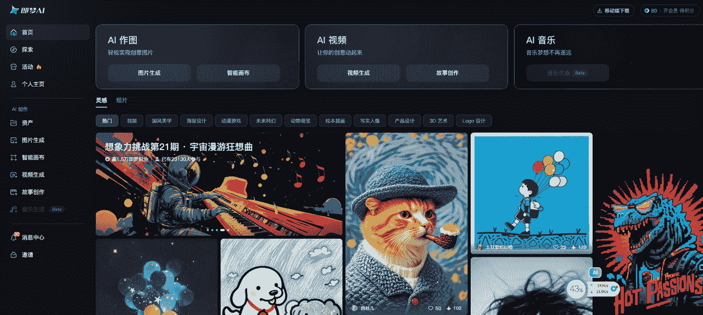

通过Dreamina，用户可以轻松地将他们的创意转化为引人入胜的图片、视频和故事内容。这款工具适合所有需要创作视觉内容的人群，无论是专业设计师、营销人员、内容创作者、教育工作者还是业余爱好者，都能在这个平台上找到适合自己的创作工具和灵感。

#### 文生图

输入文本描述,生成对应场景图。

在这里图片生成中，可以填入想绘画的提示词。

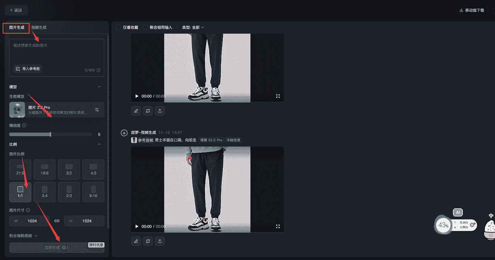

这里可以选择绘画的模型，分别为通用模型、影视模型等等，可以选择精细度，精细度越高，画出来的细致程度越高。

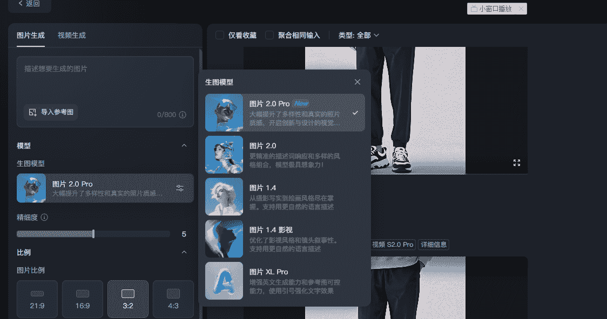

#### 生成视频

图生视频

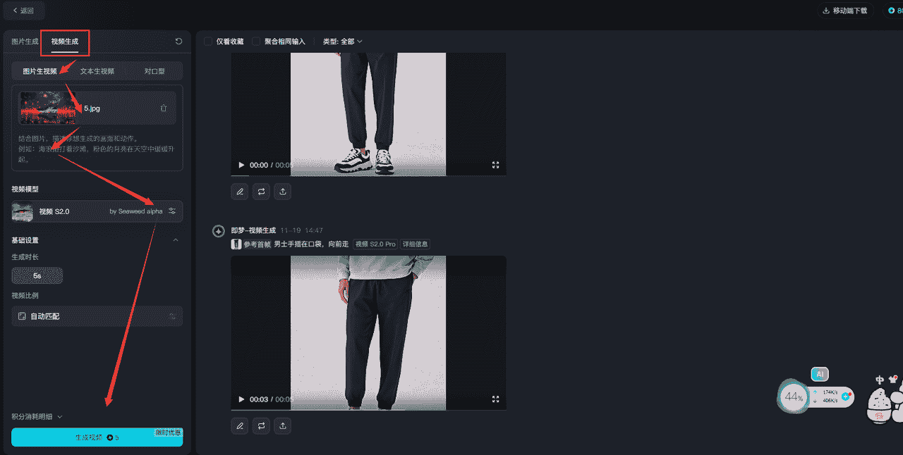

越新的视频版本，质量效果越好，当然所需要的积分也多。

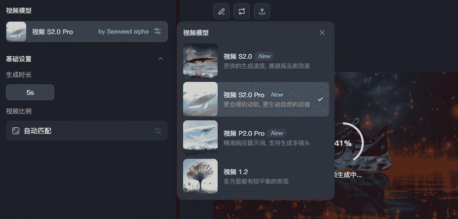

**不同版本的视频生成对比**

| 视频 S2.0 Pro | 视频 S2.0 Pro |
| --- | --- |
|  |  |

[imageinput_2024-11-21 10_37_23.mp4](https://internal-api-drive-stream.feishu.cn/space/api/box/stream/download/all/A8Z7bxpOjoBA1DxhT9bccEtpnaf)

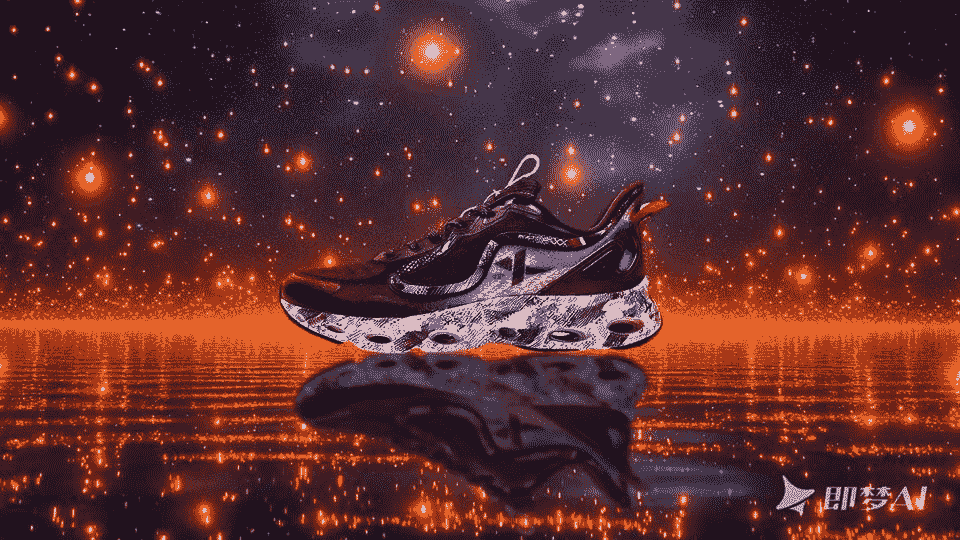

[imageinput_2024-11-21 10_38_40.mp4](https://internal-api-drive-stream.feishu.cn/space/api/box/stream/download/all/ZqJRbf5X0ov362xKrM9ci5donZf)

生成的视频，视频下方还有4个功能，这里我们介绍下

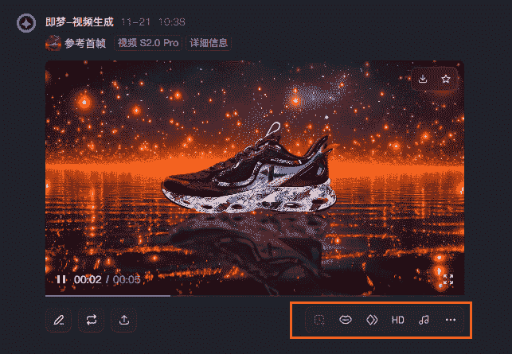

>

> 【视频延长】:可进行2次延长，支持续写prompt，延长时长可在生成的视频模式内多选（标准模式/流畅模式)，最高可支持36s的视频延长;

> 【对口型】:针对清晰单人视频，输入音频源，或输入台词选择音色进行对口型生成;

> 【补帧】:可选24fps，30fps，60fps，如视频内像素颗粒较为明显建议选择24fps/30fps 补帧;

> 【HD】:二倍超分

#### 探索

在探索页面这里，可以查看别人的画，点进去后可以看到别人的提示词，可以直接复制过来使用。

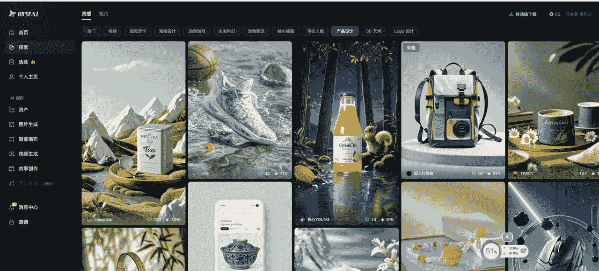

生成结果如下:

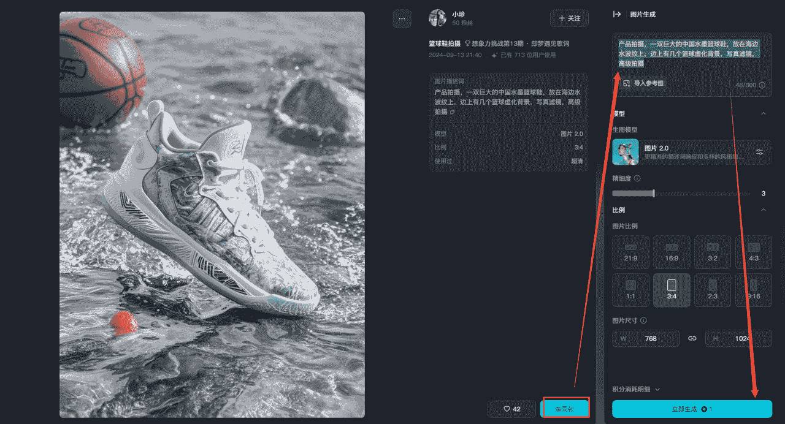

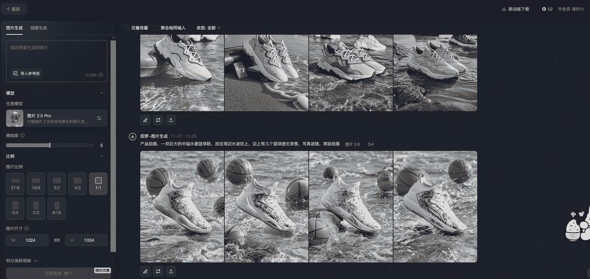

### 1)提示词写法

> 在AI视频生成中，prompt是直接描述或引导视频生成的文本或指令;类似给AI 的提示，包含主体、运动、风格等信息，用户借此控制和指导生成内容;Prompt 在 AI视频生成中作用十分重要，是表达需求的方式，影响视频内容和质量;如果上述过于抽象，您可以理解Prompt 为︰将您输入的文字变成对应的画面和运动形式。

提示词结构

你详细描述了什么，什么就能最大限度的保持稳定

【主体A】＋【外观描述】＋【运动】

【主体B】＋【外观描述】＋【运动】

【主体C】＋【外观描述】＋【运动】

**1、简单明了**

prompt应避免使用长难句，古诗词等。应该尽可能应用简单明了的语句。

例如:一个白色的小狗在水里游泳

[一个白色的小狗在水里游泳_2024-11-21 11_33_00.mp4](https://internal-api-drive-stream.feishu.cn/space/api/box/stream/download/all/VuGrb6uFKofYMXxSHgacYywznlc)

**2、细节尽可能描述完全**

prompt 应该尽可能具体，,提供足够的细节，但需要清楚简单好理解，目前生成时长为35，因此你应该给到35内可

以实现的画面的指令，太长的运动指令，模型可能不能完全覆盖哦。

例子：一个白色的小狗在湖里游泳，背景是花海，花瓣落到湖中。

[一个白色的小狗在湖里游泳，背景是花海，花瓣落到湖中_2024-11-21 11_34_14.mp4](https://internal-api-drive-stream.feishu.cn/space/api/box/stream/download/all/WRTDbbFHXoBM8CxJxO5crxmEnec)

**3、自然语言描述**

prompt应该避免歧义和抽象，确保即梦可以正确理解你的意图。

**4、加入少量的情感元素**

prompt可以加入情感元素，让即梦生成更加生动和符合情绪预期的视频。

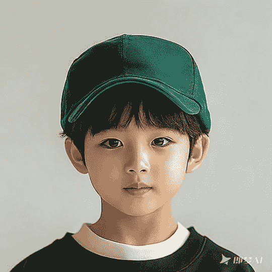

[imageinput_小男孩开心的大笑_2024-11-22 17_39_42.mp4](https://internal-api-drive-stream.feishu.cn/space/api/box/stream/download/all/UhATbLG1vo5vPOxwRp0cwVNpnhO)

### 2)首尾帧

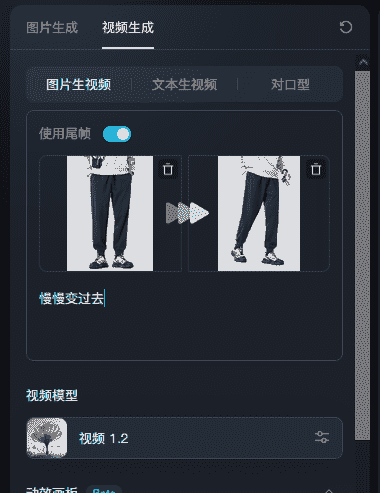

首尾帧顾名思义是两张图片，一张是开始的图片，一张结尾的图片，提示词输入的内容是你希望如何从开始的图片过渡到结尾的图片。

**这里要注意的是：首尾帧的使用要选择<视频模**型-1.2>，其他版本已经取消这个功能。

>

> 在AI 视频生成中，「首尾帧」功能，是以用户利用「首帧图片」、「尾帧图片」，以及 prompt(最好填上)的输入,来生成过渡效果的功能;

> 「首尾帧」可以通过用户输入的「首帧」和「尾帧」图片，来更好地保持主体的一致性;「首帧」︰视频的第一帧，视频的开头的图片「尾帧:视频最后―帧」

>

> [prompt/文字指令」︰简单明了告诉模型，您希望【什么主体】在【什么场景下】进行【怎样的过渡】

> 简单来说，就是【主体】+【过渡运动】

>

**首尾帧-变换变化效果**

| 首帧 | 尾帧 | 提示词 | 生成视频效果 |
| --- | --- | --- | --- |
|  |  | 慢慢变过去 |  |
| 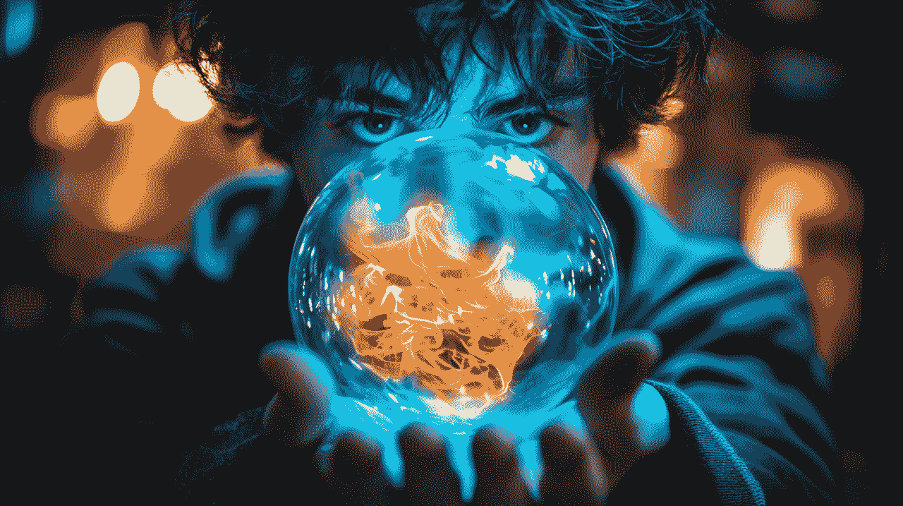 |  | 蓝色水晶球切换至火焰水晶球 |  |

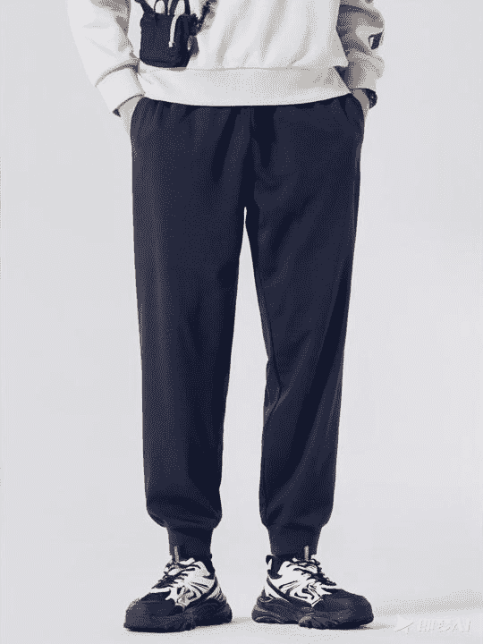

[imageinput_慢慢变过去_2024-11-21 11_42_59(1).mp4](https://internal-api-drive-stream.feishu.cn/space/api/box/stream/download/all/XTl1b2HydoT2mmxC1TzcC7jEnkc)

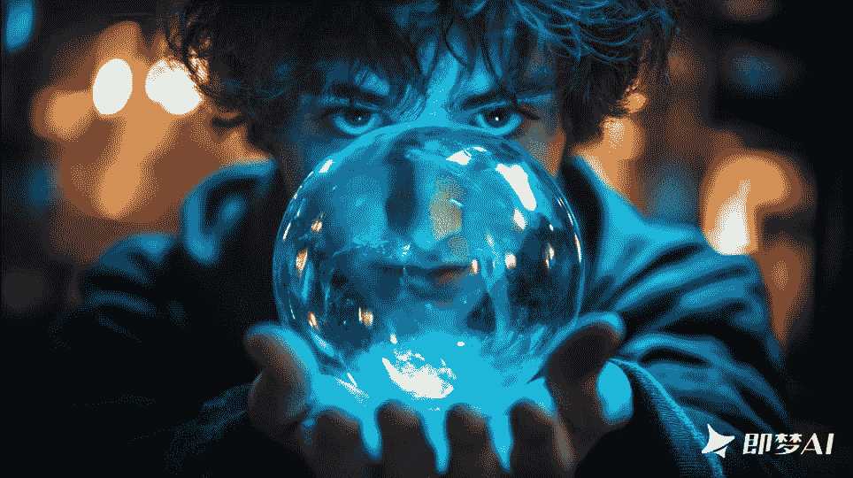

[imageinput_蓝色水晶球快速变成火焰水晶球_2024-10-29 16_35_24.mp4](https://internal-api-drive-stream.feishu.cn/space/api/box/stream/download/all/EJDUbcnh3oBMmyxUwSqcn2Crnxe)

**以上哈利波特的水晶球由MJ生成**

1.MJ生图：**Harry Potter has a blue cryst**al ball in his hand

2.局部重绘：**vary region**

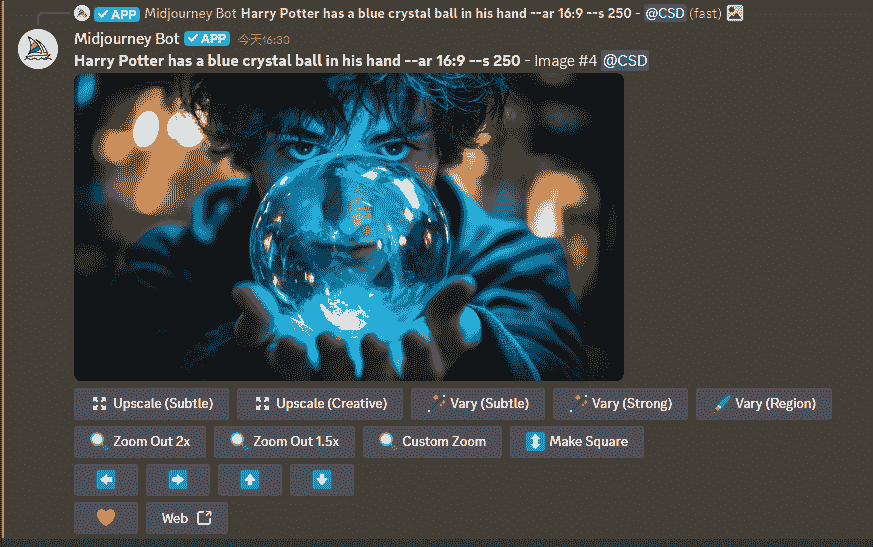

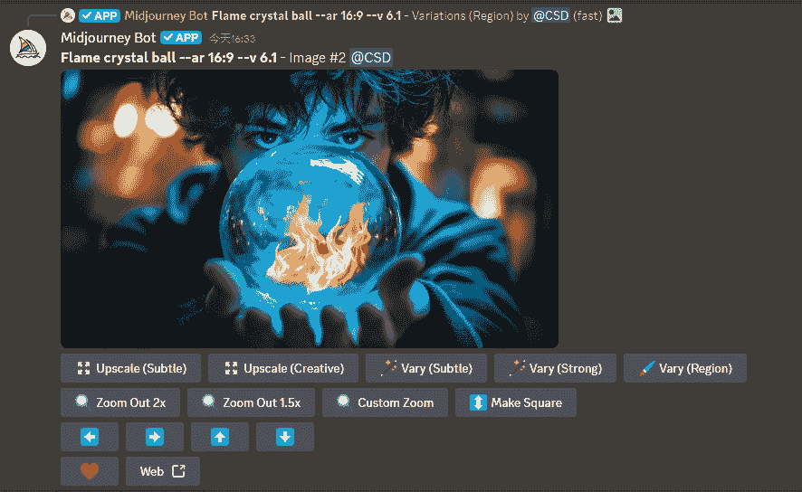

### 3)动效画板曲线轨迹运动

3.即梦选择【图生视频】，尺寸必须为：16:9

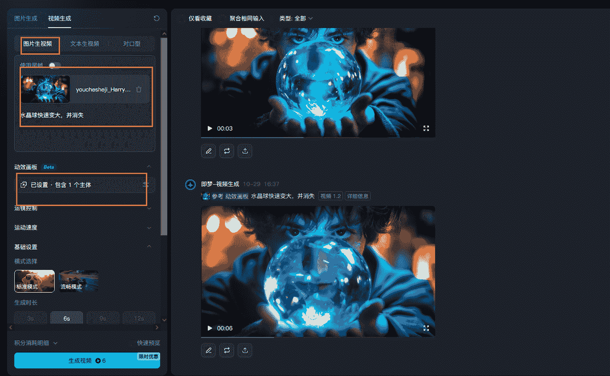

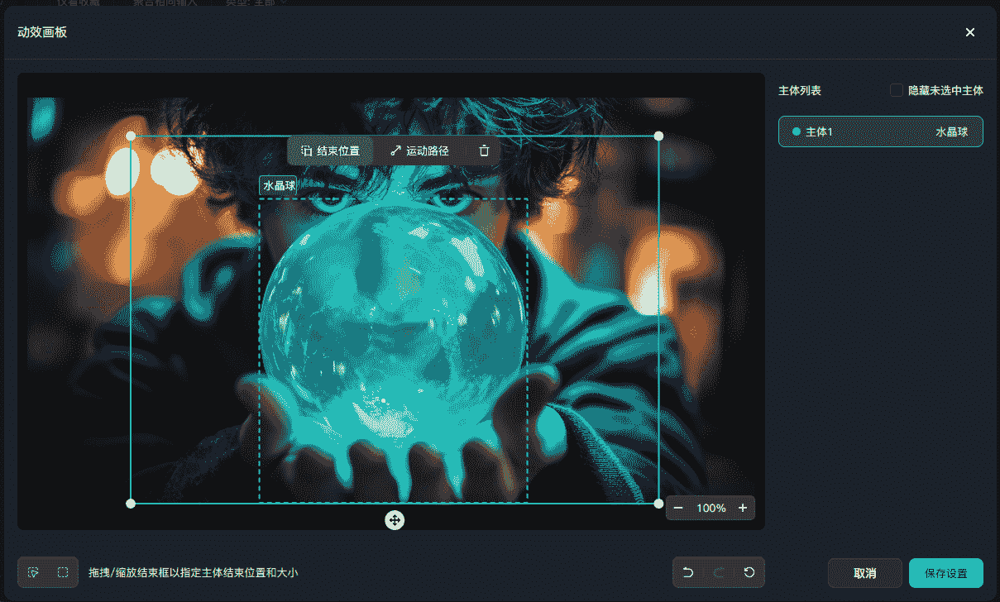

**生成效果**

[imageinput_水晶球快速变大，并消失_2024-10-29 16_37_46.mp4](https://internal-api-drive-stream.feishu.cn/space/api/box/stream/download/all/PdQRbduzGod0OOxetJjc0F6bnUb)

## **2、可灵**

官网链接:https://klingai.kuaishou.com/

可灵(Kling)是由快手大模型团队自研打造的视频生成大模型，现已支持文生视频、图生视频、视频续写、运镜控制、首尾帧等多个能力，让用户轻松高效地完成艺术视频创作。

### 1）基础功能

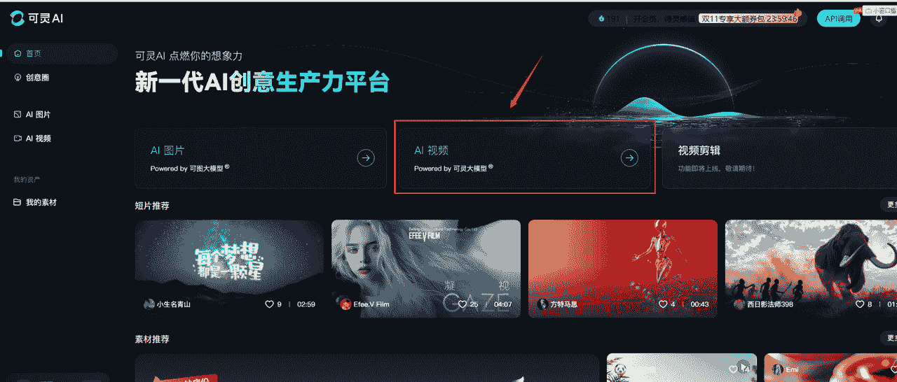

#### 01.文生视频

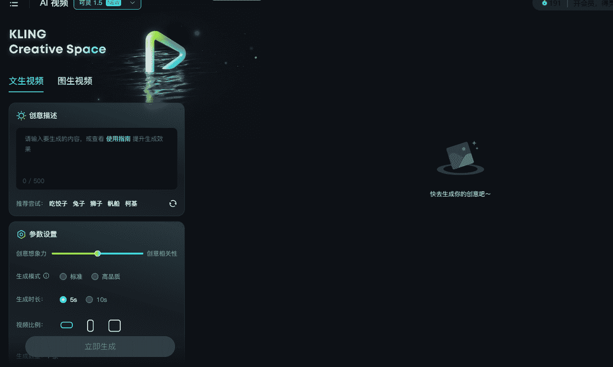

输入一段文字，可灵大模型根据文本表达生成5s或10s视频，将文字转变为视频画面。

>

> **提示词****=****主体****(主体描述)＋****运动****＋****场景**(场景描述)＋(镜头语言＋光影＋氛围)——括号里的内容可选填

>

> **主体:**主体是视频中的主要表现对象，是画面主题的重要体现者。如人、动物、植物，以及物体等;

>

> **主体描述:**对主体外貌细节和肢体姿态等的描述，可通过多个短句进行列举。如运动表现、发型发色、服饰穿搭、五官形态、肢体姿态等;主体运动:对主体运动状态的描述，包括静止和运动等，运动状态不宜过于复杂，符合5s视频内可以展现的画面即可;

>

> **场景:**场景是主体所处的环境，包括前景、背景等;

>

> **场景描述:**对主体所处环境的细节描述，可通过多个短句进行列举，但不宜过多，符合5s视频内可以展现的画面即可。如室内场景、室外场景、自然场景等。镜头语言:是指通过镜头的各种应用以及镜头之间的衔接和切换来传达故事或信息，并创造出特定的视觉效果和情感氛围。如超大远景拍摄，背景虚化、特写、长焦镜头拍摄、地面拍摄、]顶部拍摄、航拍、景深等;(注意:这里与运镜控制作区分)

>

> **光影:**光影是赋予摄影作品灵魂的关键元素，光影的运用可以使照片更具深度，更具情感，我们可以通过光影创造出富有层次感和情感表达力的作品。如氛围光照、晨光、夕阳、光影、丁达尔效应、灯光等;

>

> **氛围:**对预期视频画面的氛围描述。如热闹的场景、电影级调色、温罄美好等

**—些使用小技巧**

1.  尽量使用简单词语和句子结构，避免使用过于复杂的语言;画面内容尽可能简单，可以在5s到10s内完成;

1.  用“东方意境、中国、亚洲"等词语更容易生成中国风和中国人;

1.  当前视频大模型对数字还不敏感，比如"“10个小狗在海滩上”，数量很难保持一致;

1.  现阶段较难生成复杂的物理运动，比如球类的弹跳、高空抛物等。

#### 02.图生视频

输入一张图片，可灵大模型根据图片理解生成5s或10s视频，将图片转变为视频画面;输入一张图片加文本描述，可灵大模型根据文本表达将图片生成一段视频。

对图生视频来说，控制图像中的主体运动是核心，我们为大家提供了以下公式，可供参考:

> **提示词=****主体****＋****运动****，****背景****+****运动****……**

>

> **主体:**画面中的人物、动物、物体等主体;

> **运动:**指目标主体希望实现的运动轨迹;

> **背景:**画面中的背景。

**举例：一只白色的小猫穿着白色外套，在**月球上行走，旁边有很多的气球，月球背景。

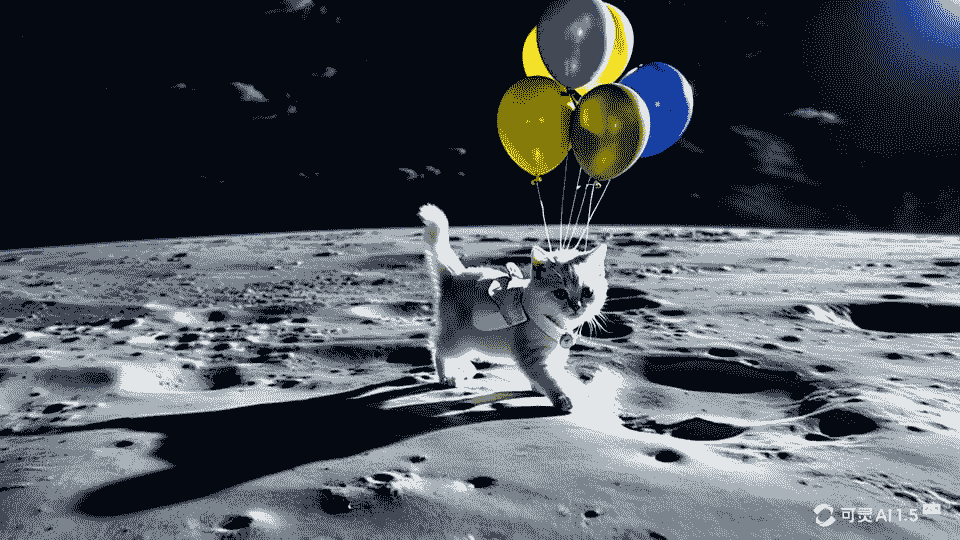

[高品质_16x9_一只白色的小猫穿着白色外套_在月球上行走_旁边有很多的气球_月球.mp4](https://internal-api-drive-stream.feishu.cn/space/api/box/stream/download/all/SBC6buJpJoxZWqxh4vIcMOt2nng)

#### 03.视频延长

对AI生成后的视频可续写4~5秒，支持多次续写(最长3分钟)，可通过微调提示词进行视频续写创作。

视频延长功能位于视频生成后左下角Tab，有“自动延长”与“自定义创意延长”两种模式，“自动延长”是指无需输入Prompt，模型根据对视频本身的理解进行视频续写，“自定义创意延长”是用户可以通过文本控制延长后的视频，这里Prompt需要与原视频相关，写明原视频的“主体+运动”，才能尽量实现延长后的视频不崩坏，我们为大家提供了以下公式，可供参考:

> **提示词(Prompt)=****主体****＋****运动**

> **主体:**指上传图片中希望运动的主体，为了保证较好的文本响应能力，选一个主体效果会好一些;

> **运动:**指目标主体希望实现的运动轨迹。

举例：

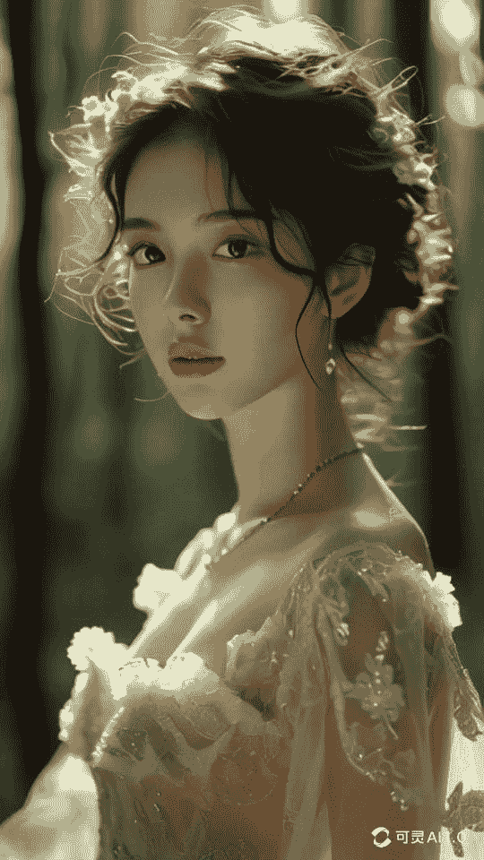

[原视频.mp4](https://internal-api-drive-stream.feishu.cn/space/api/box/stream/download/all/KgVpbRecGoMYLmxQgaMc07cineg)

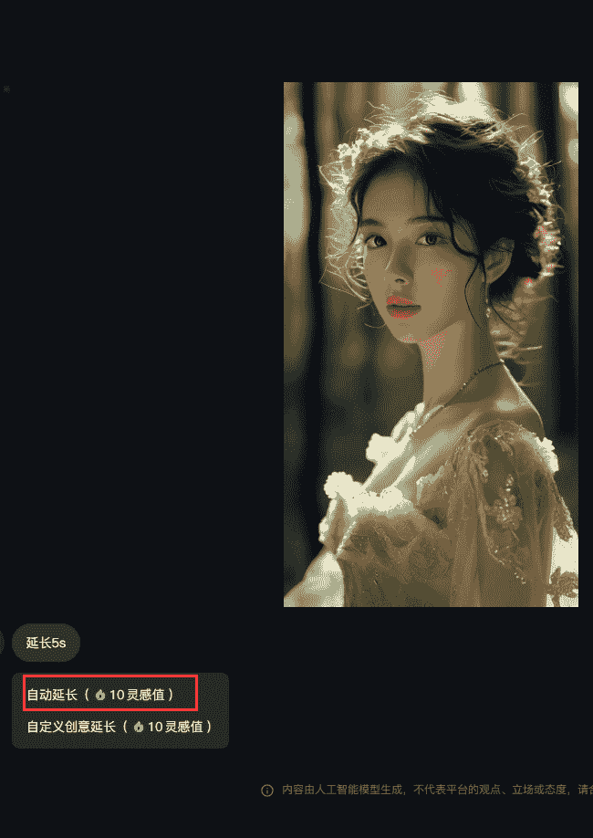

[延长视频.mp4](https://internal-api-drive-stream.feishu.cn/space/api/box/stream/download/all/TyQbbXR1Roc2P9xPuINcUkZMnKd)

### 2）进阶功能

#### 1.运镜控制

运镜控制现已支持包括“水平运镜、垂直运镜、推进/拉远、垂直摇镜、旋转摇镜、水平摇镜”6个基本运镜，以及“左旋推进、右旋推进、推进上移、下移拉远”4个大师运镜，帮助创作者生成具有明显运镜效果的视频画面。（只限定文生视频）

案例测试：（词汇的合理性很重要，这个视频的小猫就出现了问题）

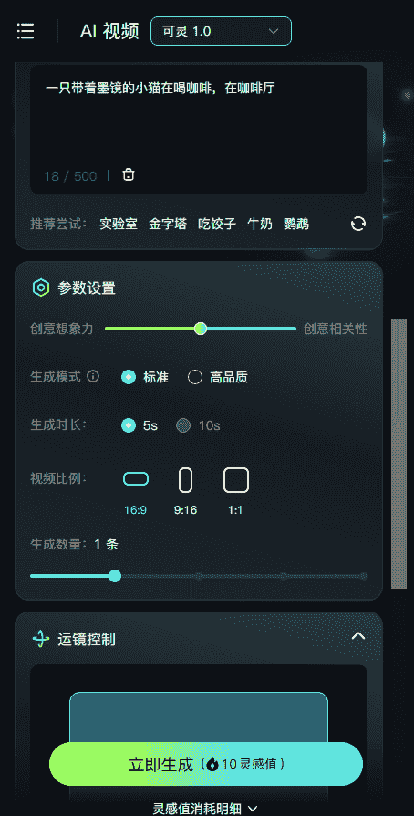

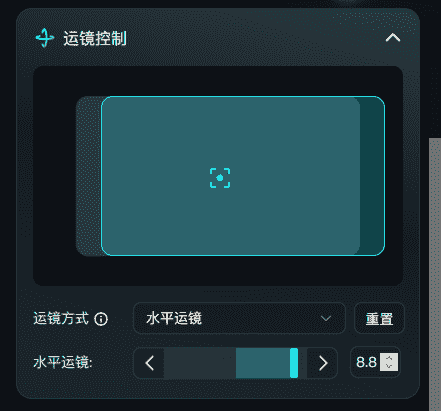

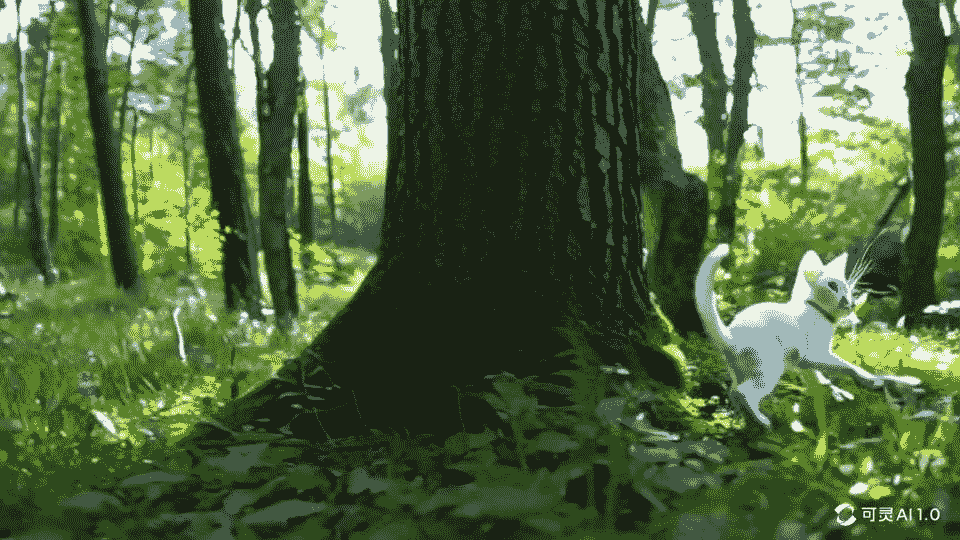

[标准_16x9_一只带着墨镜的小猫在森林弹吉他-_.mp4](https://internal-api-drive-stream.feishu.cn/space/api/box/stream/download/all/Coexb1IUMoDGCqxkeX3cwGbtnMc)

#### 2.首尾帧能力

首尾帧功能，即上传两张图片，模型将这两张图片作为首帧和尾帧生成视频，通过点击「图生视频」功能右上角的「增加尾帧」进行体验。

首尾帧功能可以实现对视频的更精细控制，现阶段主要应用于视频创作中对首帧尾帧有控制要求的视频生成，能够较好实现预期生成视频的动态过渡，但需要注意的是，首帧尾帧视频内容需要尽量相似，如果差别较大会引起镜头切换。

> **—些tips**

+    尽量选择两张相同主题且近似的图，这样模型容易在5s内进行流畅衔接，如果两张图片相差较大，可能会触发镜头切换;

+   很多创作者会通过图像生成来进行相似图片的选择，随后利用首尾帧能力进行视频生成。

| 可灵AI图片 | 选择两张图片 | 点击生成 |
| --- | --- | --- |
| 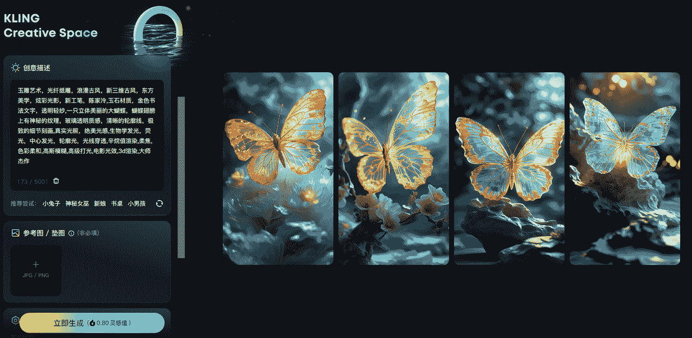 | 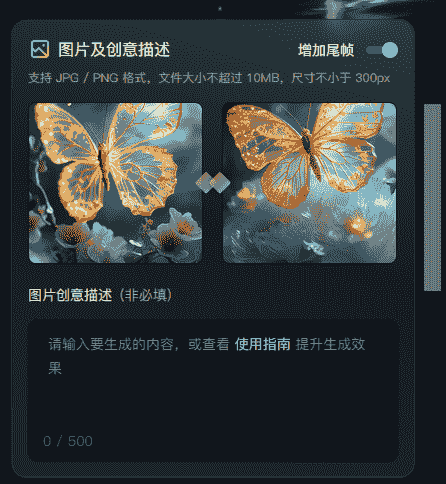 |  |

[标准_生成视频--.mp4](https://internal-api-drive-stream.feishu.cn/space/api/box/stream/download/all/B7qlbjjw3oush9x95pIcj7VInPg)

#### 3.运动笔刷能力

运动笔刷功能，即上传任意一张图片，用户可以在图片中通过“自动选区”或者“涂抹”对某一个区域或主体进行选中，添加运动轨迹，同时输入符合预期的运动Prompt (主体+运动)，点击生成后模型将为用户生成添加指定运动后的图生视频结果，以此来控制特定主体的运动表现，补足进阶的图生视频可控生成。

**案例展示**

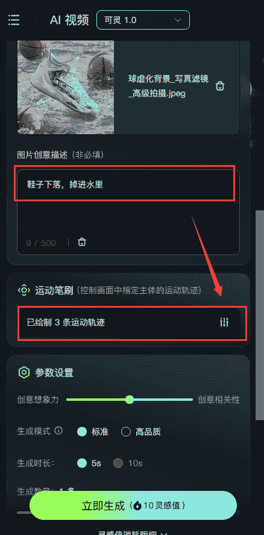

提示词：鞋子下落，掉进水里

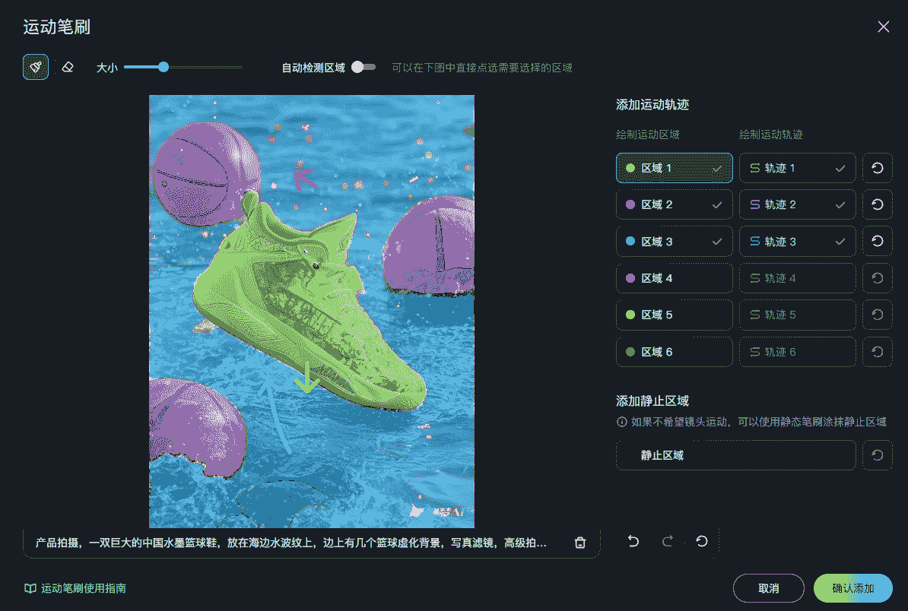

操作图片

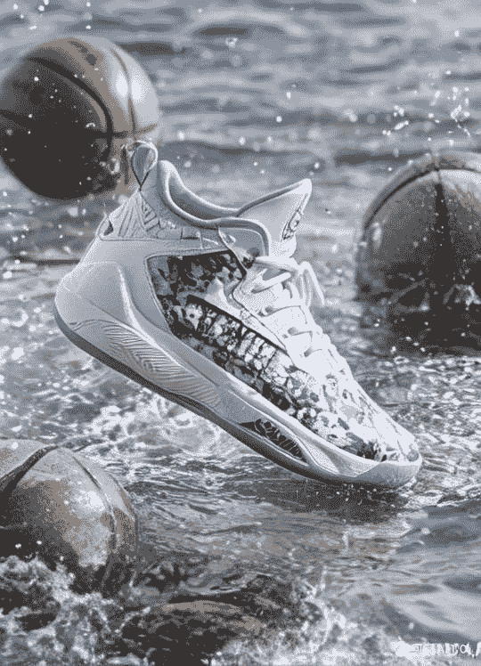

[篮球标准_生成视频.mp4](https://internal-api-drive-stream.feishu.cn/space/api/box/stream/download/all/Dux1bodQxoAfOXxdVJNcBBb4nfg)

生成效果

#### 4.对口型

「对口型」功能，支持你在可灵A生成人物视频后，上传本地配音/歌唱文件，或者通过文本朗读功能在线生成配音。

**使用方法:**

01.使用可灵Al，生成包含完整的人物面容的视频;点击预览视频下的「对口型」;

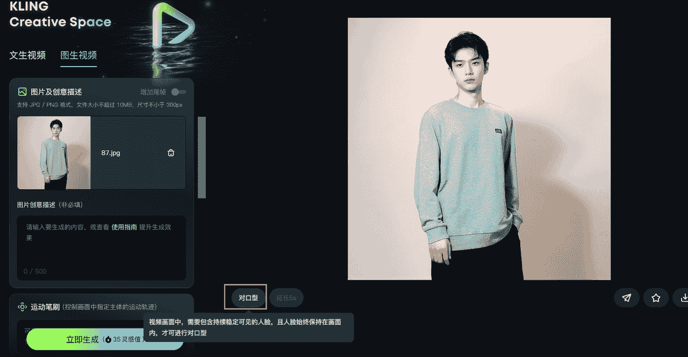

02.在打开的对口型弹窗内，使用文本朗读生成配音，或者上传本地配音/歌唱文件

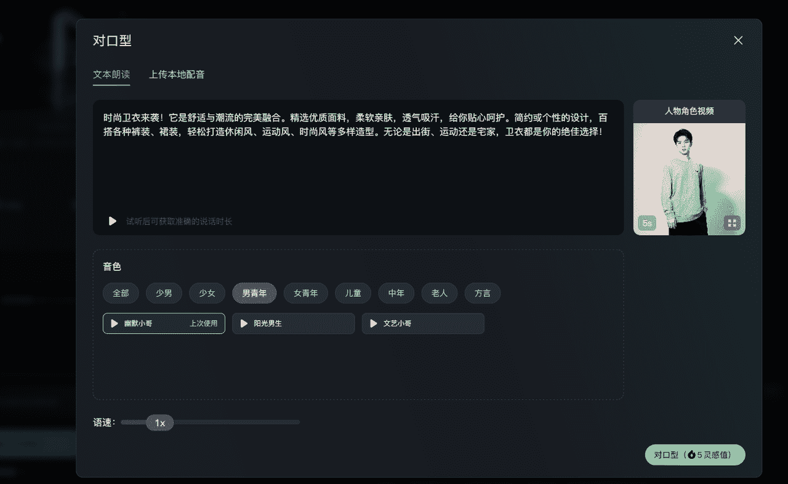

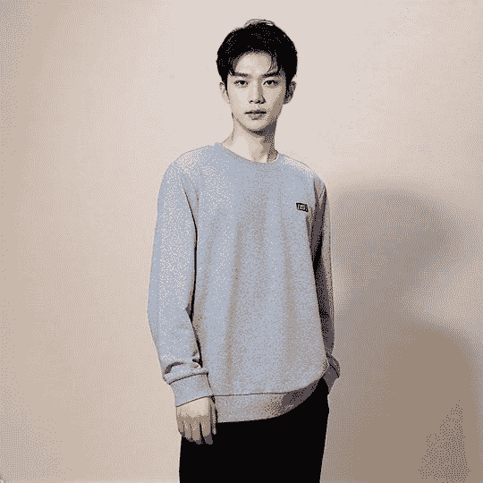

[作品.mp4](https://internal-api-drive-stream.feishu.cn/space/api/box/stream/download/all/K5DYb2J43oDrnTxWoItcx5x4n6c)

## 3、海螺

地址链接：https://hailuoai.com/video

操作方式与可灵一样，输入文案然后上传图片即可。

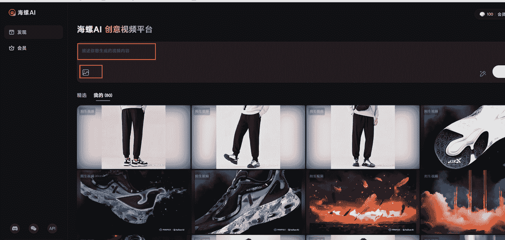

## 4.SUNO音乐

链接地址：https://suno.com/create

SUNO需🪜

### 1）、制作轻音乐的方法

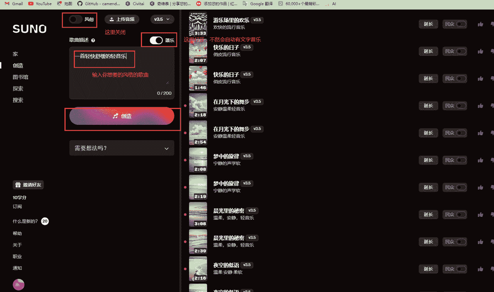

> 注意点：

> 1.轻音乐乐器必须关闭，不然会默认有人声唱歌。

> **2.可以加入风格进行生成。**

### 风格

> 嘻哈Hip HopR&B R&B/Soul

> 古风音乐Traditional/Chinese Style

> 后摇Post-Rock

> 古典音乐 Classical Music

> 爵士乐Jazz

> 摇滚乐Rock

> 流行音乐Pop

> 说唱音乐Hip Hop/Rap

> 电子舞曲Electronic Dance Music(EDM)

> 乡村音乐Country

> 民谣音乐Folk蓝调音乐Blues

> 灵魂乐Soul

> 重金属音乐Heavy Metal

> 朋克摇滚Punk Rock

> 放克音乐Funk

> 雷鬼音乐Reggae

>

### 2）、制作歌词音乐

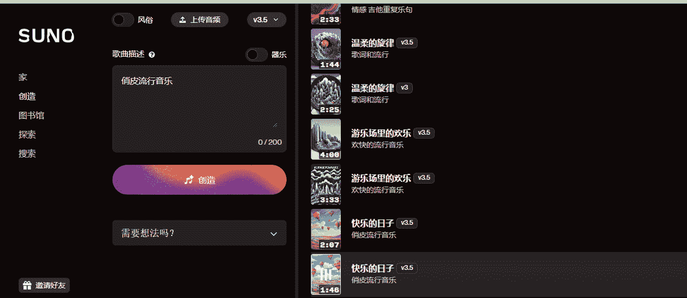

> 注意点

> 1.不能写明星的名字进行生成歌曲，系统不让生成

> 2.简单的提示词也可以生成歌曲，和抽盲盒很像

### **3）、自己创作音乐**

##### 01.打开GPT输入指令https://openai.com/index/gpt-4/

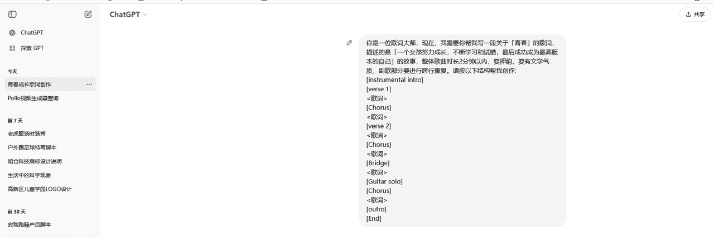

##### 02.GPT生成的歌词

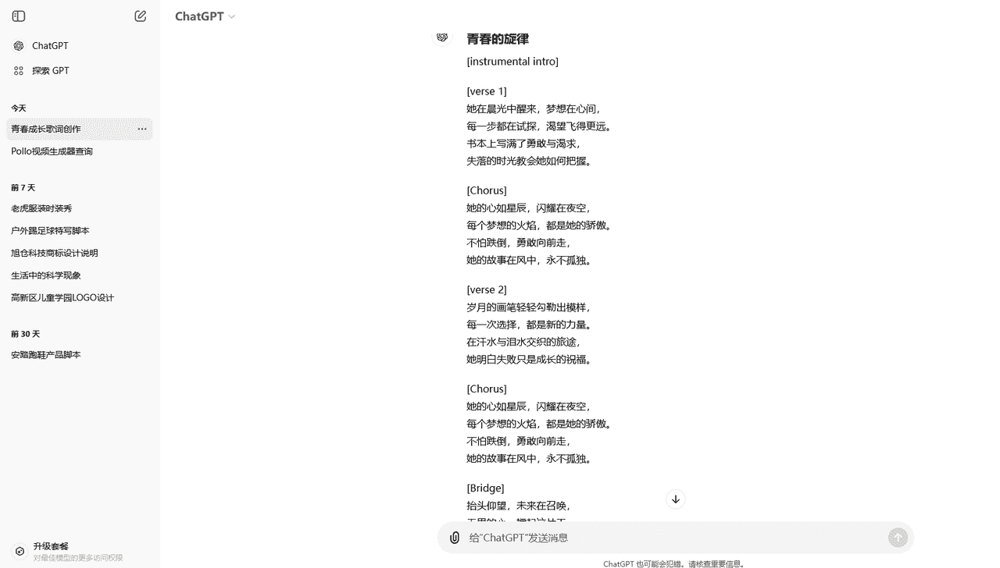

##### 03.要求GPT继续优化prompt

##### 04.生成最终的prompt

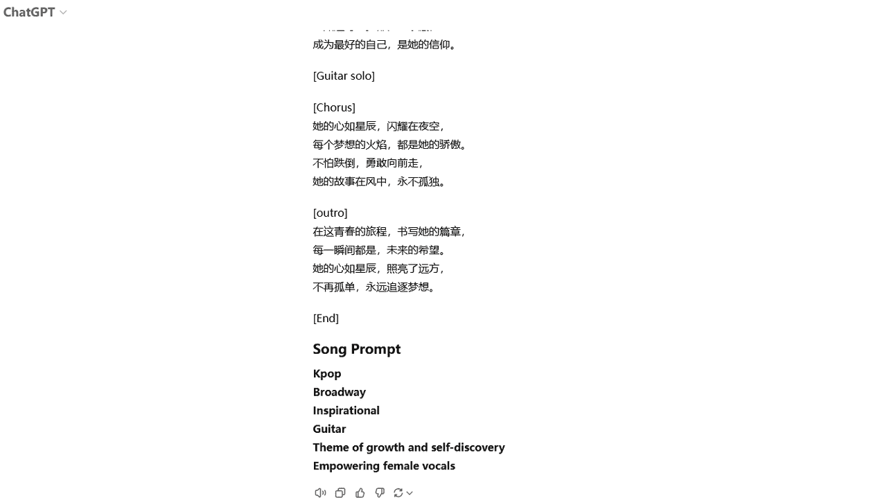

##### 05.打开SUNO,把歌词、风格、标题输入进去

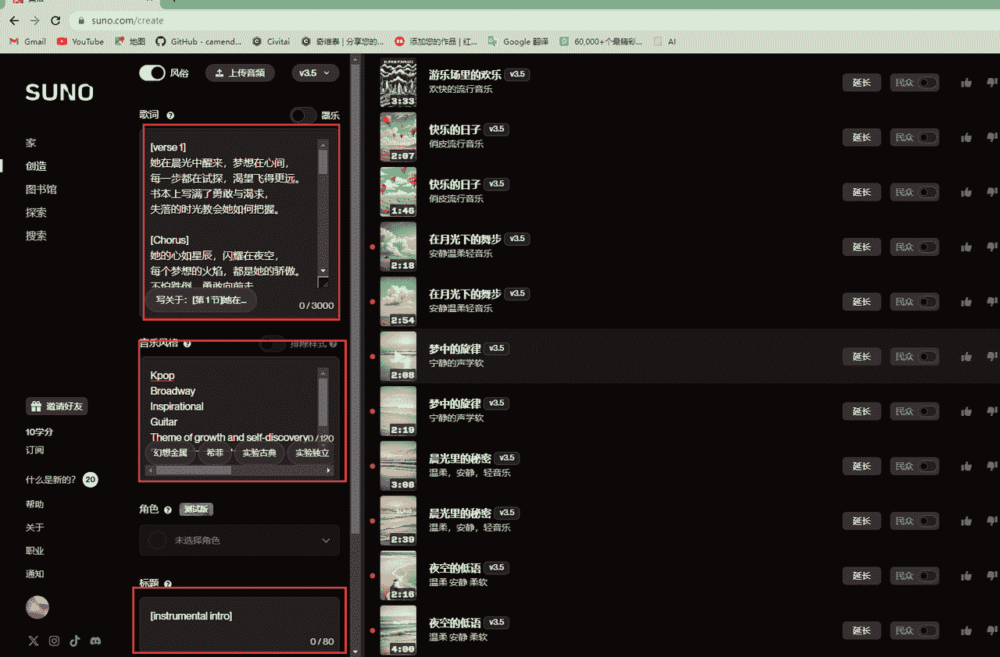

##### 06.SUNO指令模板

### SUNO指令模板

> **你是**一位歌词大师，现在，我需要你帮我写一段关于「青春」的歌词，描述的是「一个女孩努力成长，不断学习和试错，最后成功成为最高版本的自己」的故事，整体歌曲时长2分钟以内，要押韵，要有文学气质，副歌部分要进行跨行重复。请按以下结构帮我创作:

> [instrumental intro]

> [verse 1]

> <歌词>

> [Chorus]

> <歌词>

> [verse 2]

> <歌词>

> [Chorus]

> <歌词>

> [Bridge]

> <歌词>

> [Guitar solo]

> [Chorus]

> <歌词>

> [outro]

> [End]

> ...

> 输出歌词以后，再根据歌词和故事内容，以英文词组的形式再给出歌曲的prompt。请按以下格式帮我输出英文prompt:

> <音乐流派（如Kpop、Heavy Metal)

> <音乐风格（如Slow、Broadway) >

> <情绪（如悲伤、愤怒)>、

> <乐器（如钢琴、吉他)>

> <主题或场景>

> <人声描述（如愤怒的男声、忧伤的女声)

### **完成效果**

1.轻音乐

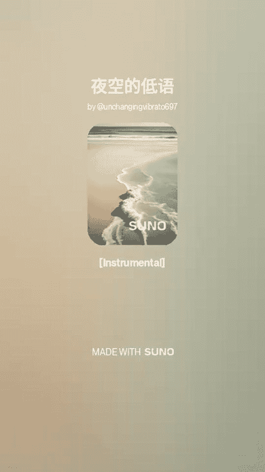

[夜空的低语.mp4](https://internal-api-drive-stream.feishu.cn/space/api/box/stream/download/all/Fa44bUuxvoyQgBxdRHbcwHPPnzf)

2.简单制作歌词音乐

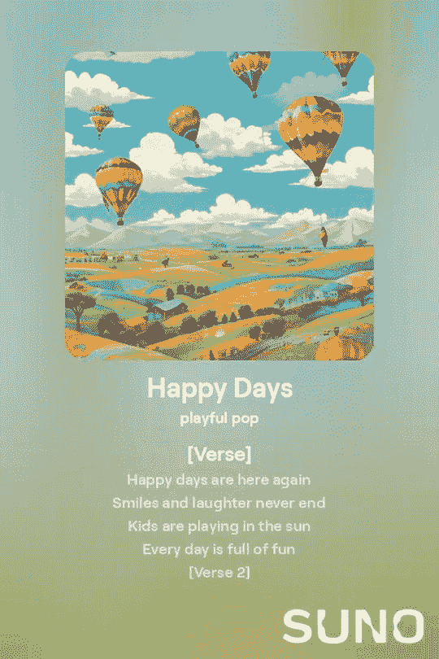

[Happy Days.mp4](https://internal-api-drive-stream.feishu.cn/space/api/box/stream/download/all/EQVWbit45orxdxxabuKcSnJMnCb)

3.GPTAI辅助写歌

[青春的旋律.mp4](https://internal-api-drive-stream.feishu.cn/space/api/box/stream/download/all/GplAbut2WoB5JIxF9SEctS3dnuc)

## 5.声音克隆-睿声

网页地址：https://dash.reecho.ai/

（需要🪜）

### 01.点击语音生成--创建新角色

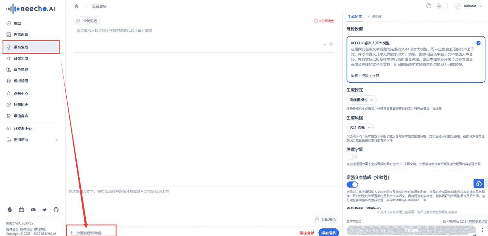

### 02.添加角色-记得用手机的【语言备忘录】录一段自己的声音，我录制了30秒左右

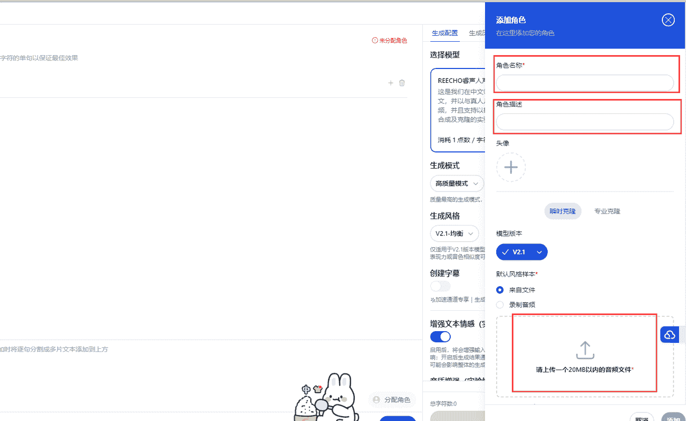

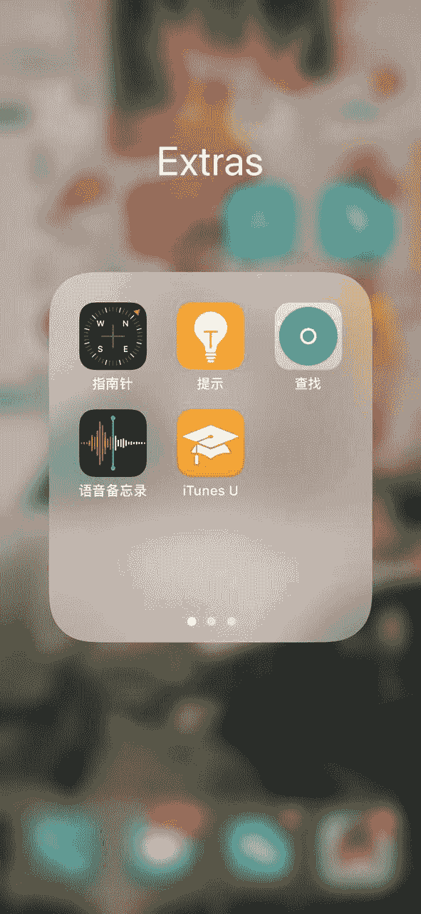

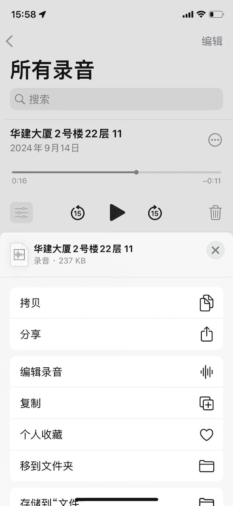

### 03.输入文字进行克隆

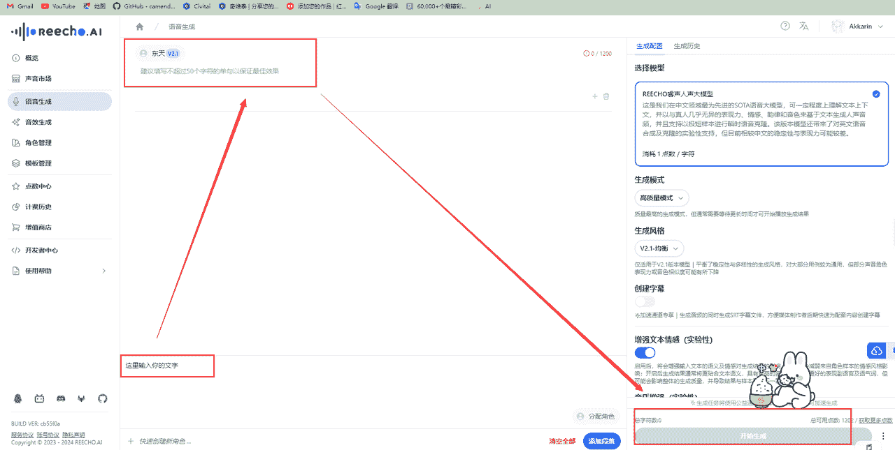

### 05.生成完成，点击下载

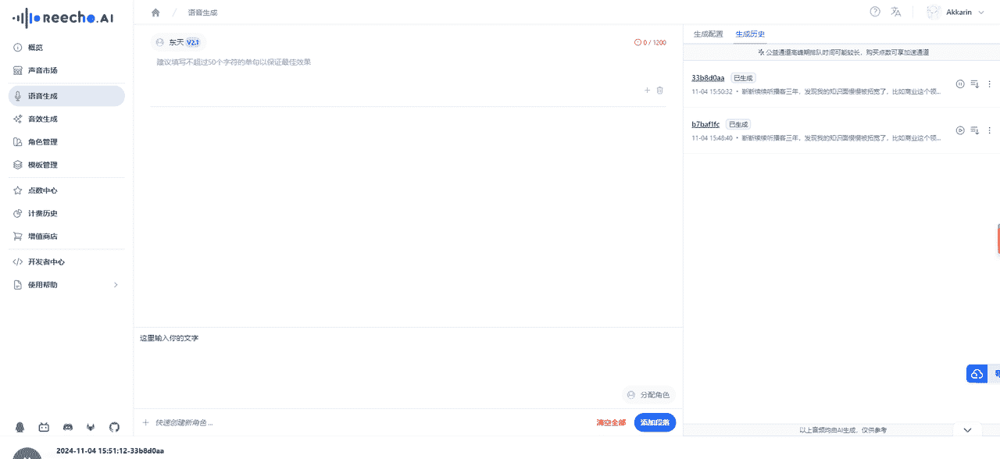

# 三、案例教程

## 1.老照片复活

### **完成效果**

[10月31日 (1)(1).mp4](https://internal-api-drive-stream.feishu.cn/space/api/box/stream/download/all/PcWBbFClzoqGqQx70VAcGrVZnfK)

**普通版本**

[10月31日 (1)(2).mp4](https://internal-api-drive-stream.feishu.cn/space/api/box/stream/download/all/ABIlb8wGYo8oTMxwU7Fc1wZwnjf)

**添加复古效果与文字版**

### **1）、midjourney生图**

打开midjourney（https://discord.com/）

> **midjourney参考文本**

> 1、A photo of a young girl and her grandfather in rural China in the 1980s --ar 16:9

> 2、A photo of a young girl and her grandmother in rural China in the 1980s --ar 16:9

> 3.The Chinese countryside in the 1980s, the family photo, brother,sister,sister, brother, panoramic view --ar 16:9

> 4.Chinese brother and sister playing in the yard,early 2000s,flash photography, polaroid. --ar 16:9

### 2）、海螺AI与即梦AI进行生成视频。

海螺与可灵人物的效果不错，海螺相对速度快些。

| 提示词 | 原图 | AI工具 | 完成视频 |
| --- | --- | --- | --- |
| 老爷爷和小女儿看着镜头笑 |  | **海螺AI** |  |
| 两个人相互拥抱，并微笑 |  | **海螺AI** |  |
| 小女孩和老奶奶看着镜头笑 |  | **海螺AI** |  |
| 老爷爷和小女孩在拍手 |  | **海螺AI** |  |

[1730361328685394161-video_watermark_9ceb23bdd2f174e4fb86d82491650bf2_308301817984847874.mp4](https://internal-api-drive-stream.feishu.cn/space/api/box/stream/download/all/KcI5bhEV3ohcsnxTdemcXiSon3g)

[1730361716983058034-video_watermark_553c37e34df08672f7837615ed884502_308303414286614531.mp4](https://internal-api-drive-stream.feishu.cn/space/api/box/stream/download/all/NZ8HbB6eyoC7n5xWqi0cUomFnHh)

[2.mp4](https://internal-api-drive-stream.feishu.cn/space/api/box/stream/download/all/Y2rVbyubOo8BI9xctUbc5r8lnXb)

[4.mp4](https://internal-api-drive-stream.feishu.cn/space/api/box/stream/download/all/AyzXbw5froHVrExCP0DcfJL3n9e)

### **3、剪映剪辑**

> **注意点：**

1.  歌曲可以选择暮色回响剪辑版，这个是爆火的歌曲，爆的还会爆，非常合适

1.  上下分块,上面是静态老照片，下面是AI视频，更有对比感

1.  左上角标注是AI视频,用户才会有AI视频的需求

1.  可以使用卡点工具，让视频卡音乐的点，观感更好

1.  添加特效，让视频更有怀旧的味道，选择特效-画面特效-复古-胶片框，拖动特效到编辑区，对齐音视频。

## 2.丝滑美女变装-镜头控制及首尾帧测试

#### 最终总效果：

[确定版视频.mp4](https://internal-api-drive-stream.feishu.cn/space/api/box/stream/download/all/DOTjbs50jo5VfHxpDMacv8IwnHe)

### 1）、即梦生成图片

> 即梦地址：https://jimeng.jianying.com，

打开即梦把文案输入到图片生成中生成，并下载适合的图片。

1.  对图片的要求是**正脸最好。**

1.  要点击高清后下载，保证后续出的图的高清度。

> 提示词：

> 一个可爱漂亮的女孩穿着白色裙子，看着镜头。房间装饰着各种植物，营造出梦幻的氛围。长长的黑色头发，明亮的阳光照在她的脸上，营造出梦幻的氛围。她五官精致，大眼睛，长睫毛，淡淡的妆容，粉嫩的嘴唇，高高的鼻梁。半身，超高清，原始摄影风格。

>

### 2）、用GPT进行古代女性服饰的名称。

> GPT地址：https://chatgpt.com

### 3）、根据GPT生成的古代名称，用即梦进行垫图生成图片。

1.基础文案不变，只要修改文案中服饰名称即可。

2.导入参考图，选择人物长相。

3.尺寸选择9:16，保持图片一致性

### 4）、生成图片后选择与垫图大概一致的构图，高清下载即可。

### 5）、用可灵进行生成视频

> 可灵地址：https://klingai.kuaishou.com

1.这边要注意的是要把图片命名好，这样才会根据朝代进行生成。

2.人物脸部的角度不要有太大的差异，会形成视频崩坏的情况，浪费了积分。

3.人物前景不要有很多的遮挡物，不好生成。

| 角度差异过大 | 遮挡物太多 | 遮挡物太多 |
| --- | --- | --- |
|  |  |  |

1.文案部分写：慢慢变过去

### 6）、剪映剪辑

01.用剪映把全部视频导入，并拖下去排序；

02.全选视频把整个视频进行1.5倍的加速；

03.最后选择一个适合的音乐即可。

### 7）、去除水印-腾讯智影

## 3、AI视频儿童卫衣实操流程

#### 最终总效果：

[AI调色中国儿童.mp4](https://internal-api-drive-stream.feishu.cn/space/api/box/stream/download/all/UWnobv4iqoohBSxfpLlcNOPInLb)

这边给大家操作下如何使用AI工具从0-1制作AI儿童卫衣的视频。在制作儿童衣服相关内容时，我们首先得明晰以下几个关键要点：

**1. 把握衣服版型**

**2. 确定儿童的年龄与外貌特征**

**3. 规划视频环境背景**

#### 1）、了解你的衣服版型

仔细剖析衣服版型是首要任务。当拿到一款儿童服装时，必须精准判断其版型类别。就卫衣而言，通常可分为宽松版、标准版、落肩版这几种常见类型。此次我制作的这款卫衣是标准版与落肩版相结合的版型。

#### 2）、儿童的年龄以及外貌

这对于制作内容的针对性和吸引力有着重要意义。明确目标儿童群体的年龄范围以及外貌特点，能够更好地展现服装的穿着效果。

#### 3）、视频在什么环境背景

视频背景环境的选择至关重要，合适的环境能更好地烘托服装主题，增强视觉效果，提升观众对儿童服装的感知度。

> 当确定好上述三个要点后，我们就能清晰地知晓理想中儿童模特的相貌特征以及背景画面的样子了。接下来，我们便可以在淘宝上搜寻与这款童装相似款式的商品信息。

### 具体操作步骤

#### 1）、选择适合的图片

淘宝寻找一张与儿童卫衣相似的版型、儿童年龄相仿的淘宝图。主要的作用就是生成提示词，然后反推提示词。

#### 2）、MJ生成模特图

##### 01. 生成提示词

上传图片到MJ，生成提示词

##### 02.确定关键词

找到最适合的提示词然后再进行修改提示词，生成我们要的模特图。

### **原英文提示词**：

> 可爱的韩国男孩穿着一件深绿色圆领毛衣，上面印着白色的英文文字“太阳是如此自信”，头戴黑色棒球帽，坐在运动衫上印有浅灰色帐篷设计的小盒子上。这是一张动感摄影，正视中心拍摄，摄影棚灯光，白色背景，以3/4角拍摄。

>

### 修改后**提示词**：

> 可爱的韩国男孩身穿黑色运动衫，头戴绿色帽子，内搭白色衬衫。这是一张以室内白底为背景的全身照片，高水平的细节和柔和的灯光，索尼相机摄影 。

##### 03.放大扩图

最后选择了这个小男孩，目前只是半身照，所以我们要进行了放大扩图。

> ZOOM OUT 2X（扩图2倍的意思）

> ZOOM OUT 1.5X（扩图1.5倍的意思）

##### 04.局部重绘

下面这个扩图后整体效果比较满意，但手的位置不是很正确，所以需要局部重绘。

##### 05.完成下载

局部重绘多次后，U3的效果比较满意了，然后选择放大保存。

> Redo Upscale (Subtle) 高清放大

#### 3）、PS调整版型与颜色

修改模特图的版型与颜色，让图片和原始服饰相似。

> PS基本教程

[11月11日.mp4](https://internal-api-drive-stream.feishu.cn/space/api/box/stream/download/all/CuPBbARxzo1jKWxqNZvcibQmndc)

### PS的主要步骤

> 1.使用液化调整版型

> 2.钢笔工具把衣服的扣出来

> 3.用渐变映射调整服饰的颜色

> 4.把衣服的LOGO放上去

#### 4）、可灵生成视频

> **注意点：**

> 1.可灵必须要选择最新的**可灵1.5**的模式，**可灵1.0**的模式效果不理想，以下是对比。

> 2.模特效果好需要35灵感值，建议冲一个19元会员，时间和效率上会提升很多。

| ### **可灵不同版本对比视频** | ###  | ###  |
| --- | --- | --- |
| 提示词 | 可灵1.0 | 可灵1.5 |
| 小男生向前走 |  |  |

[高品质_小男生向前走.mp4](https://internal-api-drive-stream.feishu.cn/space/api/box/stream/download/all/RGADbLyw2omMtTxfO4BcOO32n7f)

[高品质_小男生酷酷的表情_向前走.mp4](https://internal-api-drive-stream.feishu.cn/space/api/box/stream/download/all/RAngblvqjoxwxZxLf5qcaZFbnPb)

**这**里我的描述词都很简单，比如“小男孩看着镜头向前走”  “小男孩微笑”，有的不写提示词，剩下我们来看看效果。

| 提示词 | 可灵1.5 | 可灵1.5 |
| --- | --- | --- |
| 小男孩看着镜头向前走 |  |  |
| 小男孩看着镜头向前走 |  |  |

[高品质_镜头缓缓前推_拍摄到模特的衣服_然后_后退_模特微笑看镜头.mp4](https://internal-api-drive-stream.feishu.cn/space/api/box/stream/download/all/Ao2LbxLbEofTglx9ojpc49aonqg)

[高品质_小男孩向镜头前走.mp4](https://internal-api-drive-stream.feishu.cn/space/api/box/stream/download/all/WGnkbAA8Oo6IkaxcChKckaamnLg)

[高品质_小男孩向镜头前走-.mp4](https://internal-api-drive-stream.feishu.cn/space/api/box/stream/download/all/Q6FabDy7uoZgj8xOJPycHregnUf)

[高品质_小男孩看着镜头正在摆拍动作_然后向前走.mp4](https://internal-api-drive-stream.feishu.cn/space/api/box/stream/download/all/GHxvbKPNXoH1uZx7kfecUBUOnVg)

#### 5）、背景音乐

链接地址：https://suno.com/

现在，各大音乐平台上的轻音乐都受到版权保护。我们可以使用 AI 音乐 SONO 来生成一段轻快的音乐，用于背景音乐。若要将其用于商业用途，购买会员后即可正常使用。这样一来，既能够获得合适的音乐，又能避免版权方面的问题。

#### 6）、剪映剪辑

在完成所有视频素材的生成后，我们需要使用剪映将视频片段拼接起来。在此过程中，要留意色差问题，有存在色差的地方，需对其进行调整。

同时，我们可以加入产品实拍细节，可以丰富整体内容。

最后，从已生成的音乐中选择一个合适的 AI 音乐作为背景音乐即可。

## 4、特步减震旋跑鞋广告片

#### 最终总效果

[979219111159AI广告版--1.mp4](https://internal-api-drive-stream.feishu.cn/space/api/box/stream/download/all/S5xRb2CaXoydZmxINTccO0hrnrd)

制作产品广告片最主要的就是**脚本与风格**。如果直接使用GPT生成的脚本会出现风格上无法判定。所以，做稳妥的方式就是先找到与产品相似的广告片进行拆解，最后把视频内的元素替换成与自己产品相对应的即可。

**制作所使用软件：**

1.  绘图：midjourney、PS

1.  **视频：即梦、可灵、海螺**

1.  **剪辑：剪映**

以下是特步减震旋的AI视频制作流程。

#### 1）了解产品的特点：

### 特步减震旋跑鞋的特点

> 1.鞋面：透气织面

> 2.中底：减震旋科技

> 3.大底：橡胶耐磨防滑

> 4.鞋身：轻便

#### 2）豆包生成脚本：

### 请写一个有关跑鞋的35秒左右视频脚本：

> 1.故事内容：一个宇航员在月球上发现了一双特步跑鞋，

> 2.展示跑鞋的特点：鞋面：透气织面，中底：减震旋科技，大底：橡胶耐磨防滑，鞋身：轻便

**根据豆包生成的剧本，我们大致知道了视频方向，但也要考虑到具体的视频生**成问题，所以脚本很大一部分是起到参考的作用，视频内容要根据我们的实际情况来制作。

### 具体操作流程

#### 1）、找到类似的广告片

[378f6520844be0dca92f1031bf8634c9.mp4](https://internal-api-drive-stream.feishu.cn/space/api/box/stream/download/all/FKFib8B8zoCW43xa2z5cX0nBnZf)

#### 2）、拆解图片

把参考视频下载到电脑上，打开剪映进行拆分视频的具体图片，这样我们就可以得到这个视频所需要用到的镜头。

#### 4）、midjourney生成图片

把需要用到的镜头图片使用midjourney进行生图，由于两款产品的色调有明显的差异，所以我们需要对文案进行调整，这样生成的图片才会与我们想要的效果相符，当然也可以选择使用PS进行色调调整。

MJ生成的原图

#### 5）、PS修改图片

PS图像处理注意点：

1.  色调一致：参考原图色调，融合度要高；

1.  角度一致：避免图片效果不理想；

1.  光影一致：鞋子的光影要符合原图；

1.  构图合理：部分产品细节需要与背景做好处理。

| MJ原图 | PS修改图片 |
| --- | --- |
|  |  |
|  |  |
|  |  |
|  |  |

**PS完成图**

#### 6）、AI视频生成

把生成的图片使用AI视频工具进行生成视频片段，很多视频片段需要切换不同的软件生成才能出适合的效果。

使用AI视频工具：可灵、海螺、即梦

| 图片 | 提示词 | 生成视频 |
| --- | --- | --- |
|  | 鞋子里面喷出白色的烟雾 |  |
|  | 宇航员向前走 |  |
|  | 鞋子颜色不变，背景光束向下 |  |
|  | 风轻轻吹过，一根白色羽毛轻轻地落在月球表面 |  |
|  | 无 |  |
|  | 镜头慢慢推近，宇航员拿起跑鞋 |  |

[高品质_鞋鞋面喷出白色的烟雾.mp4](https://internal-api-drive-stream.feishu.cn/space/api/box/stream/download/all/T0mEbJxoTo6QkExsVbKcqnM5nie)

[000高品质_宇航员向前走.mp4](https://internal-api-drive-stream.feishu.cn/space/api/box/stream/download/all/HgFmb58tpoWS15x5fSCcWhbMn1d)

[imageinput_慢慢过度过去_2024-11-12 16_55_36(1).mp4](https://internal-api-drive-stream.feishu.cn/space/api/box/stream/download/all/WE03bjFmmo6CsVx6YX1c5LEKnBg)

[313354756729925636.mp4](https://internal-api-drive-stream.feishu.cn/space/api/box/stream/download/all/McWPbZaoXo6hiGxnRWicGdnPnmf)

[313361611970752517.mp4](https://internal-api-drive-stream.feishu.cn/space/api/box/stream/download/all/RfT0brryioemdyxULrecpy8Mn6d)

[高品质_镜头慢慢推近_宇航员拿起跑鞋.mp4](https://internal-api-drive-stream.feishu.cn/space/api/box/stream/download/all/AzoVbsQ7ToBCo7xjzNQcbw0onke)

#### 7）、音乐生成

链接地址：https://suno.com/create

SONO每天有50积分，可生成10条音乐。

##### 01.上传音乐

必须是6到60秒长的原始音频，检测到人声的音频将被设置为仅限私人。

##### 02.延展音乐

##### 03.下载音乐

##### 04.音乐下载对比

[上传使用的音乐.MP3](https://internal-api-drive-stream.feishu.cn/space/api/box/stream/download/all/X7FVb0pfToPpE5xvyMhcn3mZnnb)

[宏伟.mp3](https://internal-api-drive-stream.feishu.cn/space/api/box/stream/download/all/Ay4ib5iQWoNiLqxRpWNcviOmnFh)

#### 8）、剪映剪辑

##### 01、把生成的视频按照顺序排列

##### 02.把视频片段放入剪映中

##### 03.添加音乐

添加节拍，调整视频片段到合适的地方，不适合的地方需要裁剪和拼接。

##### 04.添加文案

填写文案，选择适合产品的字体

文字添加动画效果

把所有的文案都添加到适合的位置

##### 05.**添加音频特效**

##### 06.**下载导出视频**

# 四、AI工具链接

### 教程链接

##

## **案例教程**

> **可灵教程**

> https://docs.qingque.cn/d/home/eZQCVn9335hPHMla4Mv3IWuDG

>

> Ai视频如何让转场更流畅之一一中间帧生成

> https://vwk4xgjlcg1.feishu.cn/docx/J1fGdw7KeoGVRPxrxdhcPlm6n2I

>

> 高清工具-topazvideoai安装教程

> https://www.bilibili.com/video/BV193tSedELo/?spm_id_from=333.337.search-card.all.click&vd_source=d13f07bea273bcc1721eb589a29afa92

>

> **Vidu AI教程**

> https://www.bilibili.com/video/BV1L1noewEz9/?spm_id_from=333.337.search-card.all.click&vd_source=d13f07bea273bcc1721eb589a29afa92

>

> Vidu1.5 正式上线！全球首个支持多主体一致性的多模态大模型！

>

> Vidu-1.5支持人物、物体和环境等主体的一致性，颠覆了传统的单点微调方法如Lora。同时在镜头理解、特效画面、动漫风格等方面实现模型能力的全面升级！清晰度新增支持720p和1080p。

>

> 快来体验吧！https://www.vidu.studio/zh

> 更多玩法详见：https://c.aiiz.cn/nKJphC

>

>

### **AI地址**

> 可灵AI

> https://klingai.kuaishou.com/

>

> 即梦AI

> https://jimeng.jianying.com/ai-tool/image/generate

>

> Pika（需要魔法）

> https://pika.art/login

>

> 海螺

> https://hailuoai.com/video

>

> vidu-一个月80积分，可以免费做20个视频（4秒）

> https://www.vidu.studio/create/img2video

>

> Luma （需要魔法）-人物一致性强

> https://lumalabs.ai/dream-machine/creations

>

> RUNWAY（需要魔法）

>

>

> 艺映（转绘）

> https://www.artink.art/

>

> MJ提示词大师：

> https://www.coze.cn/store/agent/7348315711699189771?bid=6e8msbfj42g0r&panel=1

>

> pollo.ai（每天20积分）

> https://pollo.ai/text-to-video

>

> SeedEdit

> https://team.doubao.com/en/special/seededit

>

>

# 结语

21天的收获真的太大了，再次感谢洋哥以及 AI 破局社群平台，也感谢AI 绘画和视频的教练们的讲授。后续的路程需要我们每个人自行行走，但我相信我们要拥有长期主义的信念。

累积探索可迁移能力➕找到人生目标➕持续坚持学习=你想拥有的人生

找到人生使命或许并没有那么简单，如果目前还没有找到的话，那就努力累积可迁移的能力。AI视频也许就是你的一个出入点。