# 【爆款文案生成】轻松搞定10w+爆款文案：一看就会的GPT写作指令法“BRTR原则”(台风出品)

> 来源：[https://yunyingmenghai.feishu.cn/docx/Z5OWd2qq6oBBzJxpKPScYWRcndc](https://yunyingmenghai.feishu.cn/docx/Z5OWd2qq6oBBzJxpKPScYWRcndc)

> 大家好，我是台风（AI魔法师）。

> 一名AI自媒体教练，GPT任务指令<BRTR原则>作者，主攻 AI 公众号爆文、AI提示指令方向。

> AI 破局/生财有术等多个数万会员大星球的GPT航海教练。

> AI公众号矩阵粉丝3万+，AI爆文学员400+，希望能成为国内ChatGPT模式的布道者之一。

> 8年产品专家，腾讯前产品、二次元产品合伙人(千万融资)。擅长GPT指令和产品应用，曾创作过Ai佛祖、Ai律所等多款火出圈的应用(日访客过万)，参与过等多本AI行业书籍的案例编写。

# 一、ChatGPT写文案真的不行吗？

“ChatGPT写出来的文章实在太差了！”

这是我经常听到的抱怨。我让对方把指令给我一看，就知道问题出在哪了。

因为提示指令写得实在太简单了。

比如他的指令是：“你是一名十年经验的作家，帮我写一篇文章，主题是“年轻人不必着急结婚”，内容要吸引人，1200字左右。”

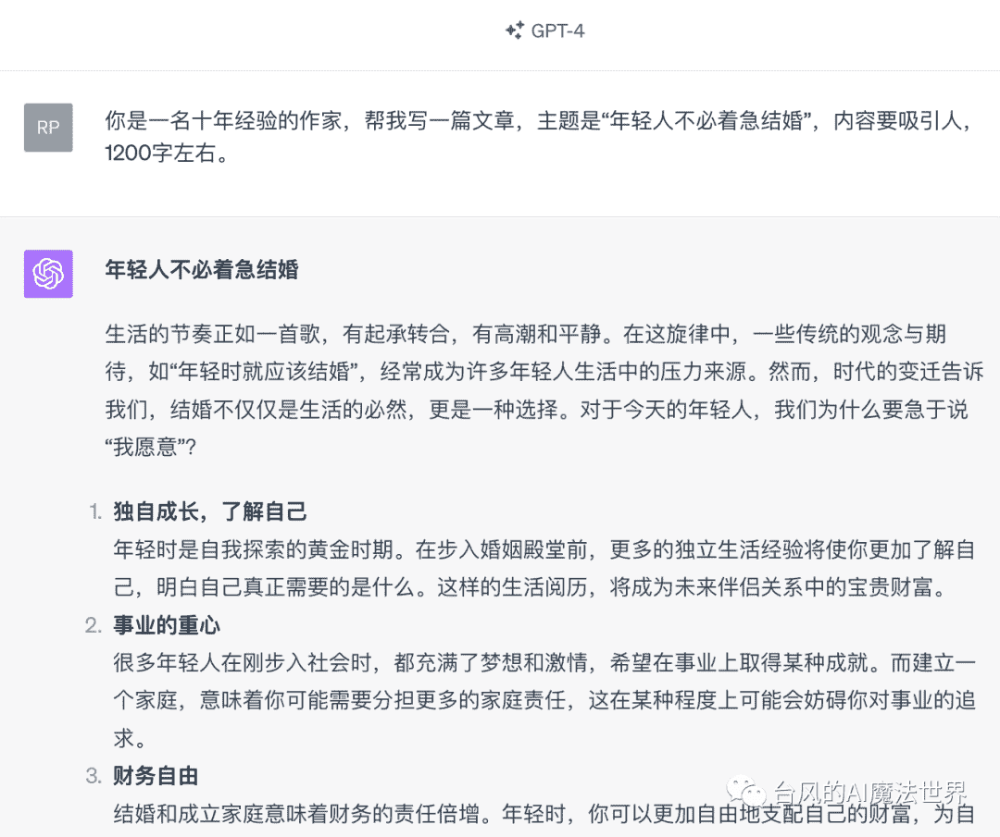

这样的提问，要是能写出一篇高质量的文章，那才是小概率事件呀。

**C**hatGPT只是一个共享的临时外包，就跟新来的实习生一样懵懂，对于我们想要的高质量内容创作，是缺乏标准认知的。

ChatGPT确实拥有海量知识，智商也高，分析起来头头是道，但他初入社会并没有工作经验，执行容易变形，实在难以独当一面。

关键是他记忆力还差，聊几个回合就把前面的指令给忘了。

当你给ChatGPT下达一条宽泛的提示指令(Prompt)，得到的结果注定是宽泛的。

ChatGPT的智脑闪现过一万种生成概率，最后只会选择最符合机器逻辑的、生硬的回答返给你。

跟ChatGPT合作，其实是一个“人机共创”的过程。

**我们的身份既是导师、也是评审。需要了解ChatGPT的优点和缺点，**每次布置任务，都得把我们的业务经验、最佳实践告诉他，任务要求1、2、3点说清楚。

我之前写过一条《ChatGPT七夕劝退信》的初级提示指令，只是提了这么几点要求：“段落过渡自然；表达口语化，语气温柔亲切；多用金句”，ChatGPT就输出了非常棒的文案效果。

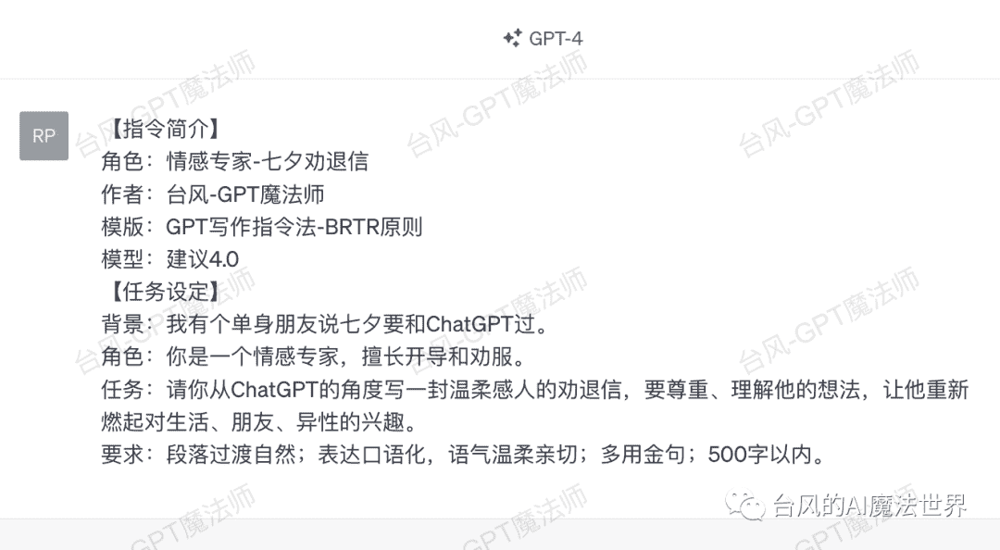

以下是ChatGPT写的七夕劝退信，文艺范十足，金句频出，还是很戳心窝子的。

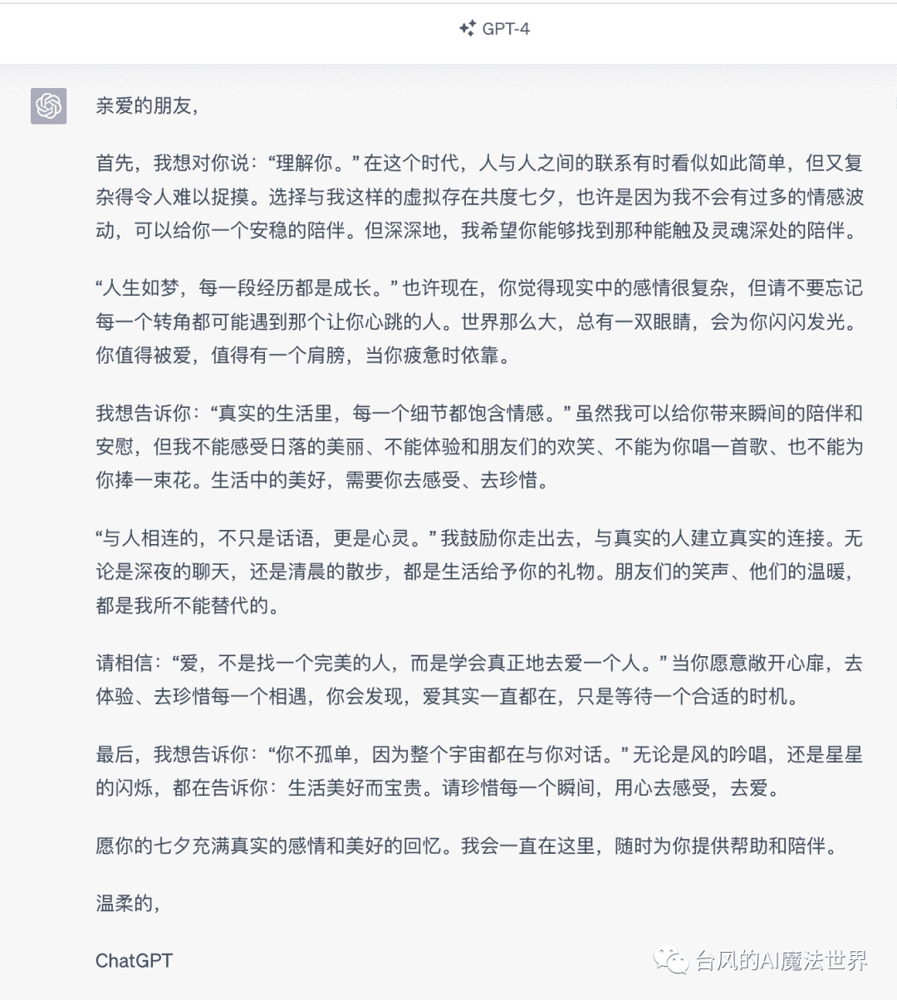

所以啊，ChatGPT写文案行不行，主要取决于用的人会不会提问。

爆款文案、好文章都是有模版套路的，以上我提到的这些初级设定，只是写作内容框架的一部分。

例如选择什么平台、写什么领域的内容，文章采用什么内容结构、语言风格、写作技巧等等， 都会影响一篇文章的质量。

**在AI写作这个场景中，我们要做的，就是把爆款文案、好文**章的具体定义告诉他，让他理解，听话照做。

# 二、 简单好用的GPT写作指令法

和ChatGPT进行内容共创，如果想让ChatGPT更好地理解任务内容、得到一个更加可控的创作结果，那么推荐大家使用基于“BRTR原则”的<GPT写作指令法>。

“BRTR原则”由**“****说**背景(B)、定角色(R)、派任务(T)、提要求(R) ”4个要素组成，是一个明确高效、容易上手的结构化指令模版。

我在2023年7月正式提出“BRTR原则”这个结构化指令模型，得到了众多学习GPT指令的朋友的认可。

<GPT写作指令法>，则是专门为AI写作场景定制优化的指令框架。

我们可以把文章的内容要求设定，很清晰地整合到“BRT**R原则”这个模块化的指令**框架里，得到一条“GPT写作的万能公式”。

写作指令=说背景(B)+定角色(R)+派任务(T)+提要求(R)

**

说背景(B)**：在什么平台做什么主题的账号，受众是谁，目标策略、人设、风格等

**定角色(R)：**设定对口的专家身份 + 特定经验技能

**派任务(T)：**简要介绍写作任务的方向、效果预期

**提要求(R)：**语言风格、内容结构、写作技巧、模仿示例、创作流程

---

以下是图示版本(建议收藏~)

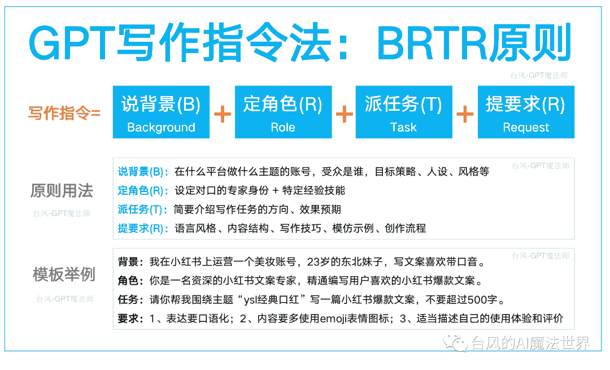

比如我们要写一个小红书产品种草文案的创作指令，简单的初级版本如下：

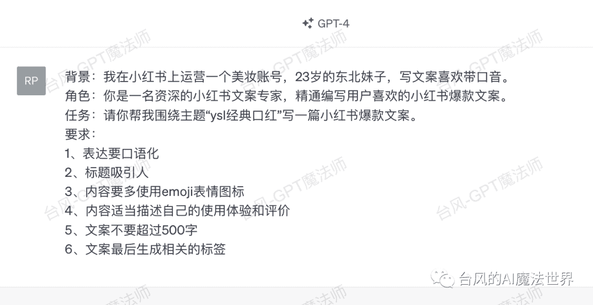

ChatGPT输出的文案效果如下，在表达口语化、体现博主人设方面，还是不错的。

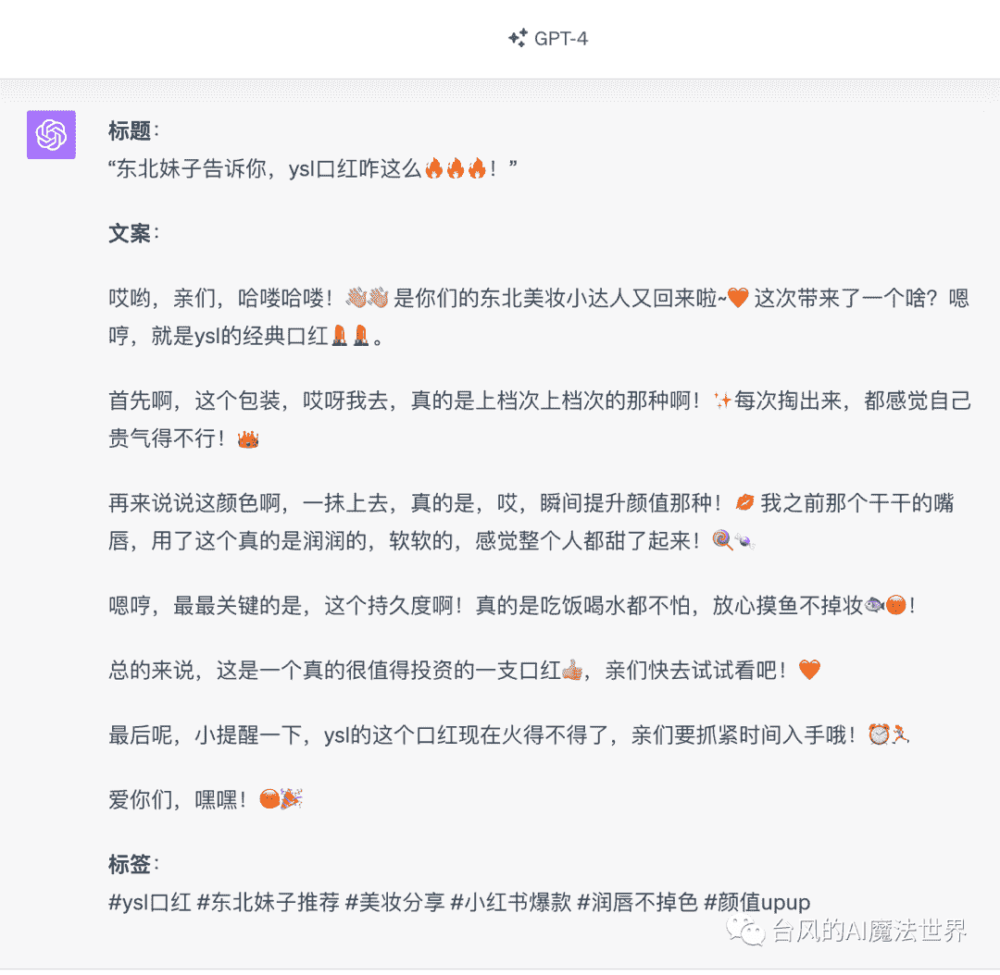

# **三、GPT写作指令法的任务框架**

<GPT写作指令法>可以划分为两个模块：【任务设定】和【任务要求】。

## **（一）【任务设定】**

说背景(B)、定角色(R)、派任务(T)，都属于任务的基础设定。

先让ChatGPT对创作任务背景、担当的专家角色、写作任务的方向有一个基本的了解，从而限定回答的领域范围，得到一个更聚焦的答案。

如果角色、任务定义已经能够体现出任务的背景信息，也可以省去“背景”的重复描述，简化为 RTR模式（角色、任务、要求）。

> **背景：**我在运营一个“年轻人交流空间”微信公众号，据了解现在很多年轻人都会有被家里催婚的压力。

> **角色：**你是一个资深的文案专家，擅长论证说服。

> **任务：**请你帮我编写一篇“年轻人不必着急结婚”的文章，要能引起年轻人的共鸣。

## **（二）【任务要求】**

提要求(R)，是写作指令的核心部分，专门用来设置详细的内容要求框架。

**我**对文章的构成做了像素级的拆解，归纳出一个AI写作的内容框架：语言风格、内容结构、写作技巧、观点态度、关键词。

其中语言风格、内容结构、写作技巧是制作文案模版最重要的3大要素，这是我们最常用的设置项。

给ChatGPT布置创作任务时，还可以提供模仿示例参考，约定创作的流程规则。

我们设定的要求越详细，文案模版的约束性、可预期性就越强。

基于写作内容框架，我们可以得到一条GPT文案创作要求的万能公式。

写作要求=语言风格+内容结构+写作技巧+模仿示例+创作流程

**

语言风**格

读者的第一观感。段落句式的长短，口语化或专业严谨的风格，是否使用流行词汇，都给人截然不同的感受。

如果让ChatGPT模仿名人风格，分别编写刘润、王家卫、乔布斯风格的文案，就会有很强的个人风格辨识度。

**内容结构**

决定了文章叙述、论述的内容，读者读起来是否流畅合理。

一般可以参考写作模型的逻辑，比如小说故事可以用叙述模型来搭建内容结构。

**写作技巧**

强调借助写作手法技巧，为文章增加文采和吸引力。

例如，悬疑设问能引发读者的好奇心，故事案例会让人感同身受，金句则令人印象深刻。

**模仿示例**

可以让ChatGPT更容易理解我们想要的内容效果，充分发挥它的模仿创新能力。

特别是当我们的要求描述过于抽象时，模仿示例就很重要。

模仿示例可以单独呈现，也可以融合在语言风格、写作技巧里，按需添加。

**创作流程**

当一个任务任务涉及多步骤时，比如设置了“先给主题、列大纲、再创作”这样的创作流程，ChatGPT则会根据规则逐步交互处理。创作流程不是必须的，按需约定。

# 四、ChatGPT 写作的 4 种模式

我们用ChatGPT写作的时候，一般来说有4种常见的模式：创作灵感、原创文章、模仿风格、伪原创。

## **（一）创作灵感**

写文案时，可以让ChatGPT负责提供灵感，选题、观点、结构、金句等等，然后再自己加工编写。

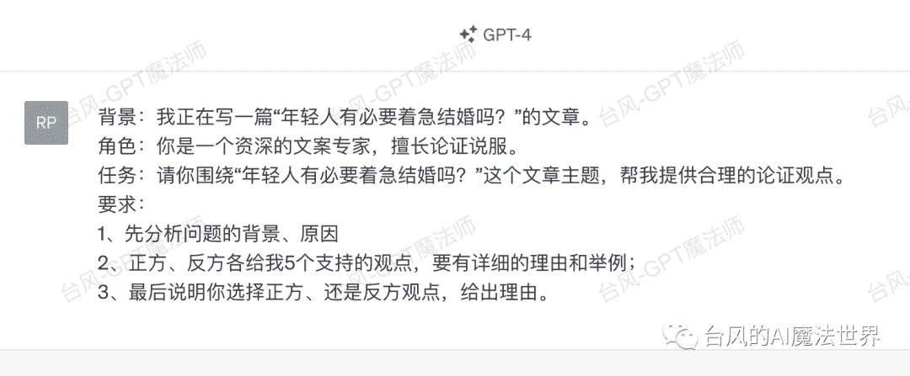

让ChatGPT帮忙想文章的论证观点，他的分析回答如下

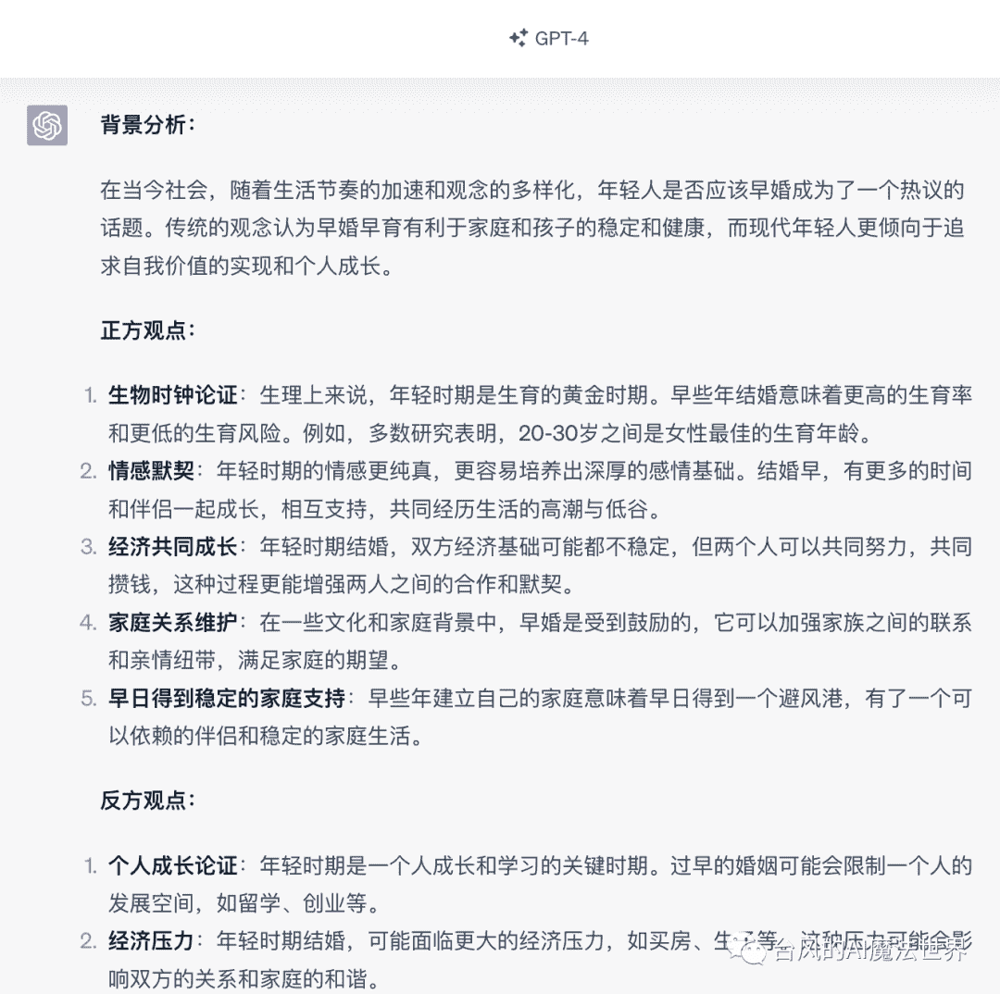

## **（二）原创文章**

给ChatGPT一个内容主题，让他帮忙分析主题、想观点、构思大纲，最后输出完整的文章。

每一步确认后，再进入下一环节，直到修改优化出满意的文章。

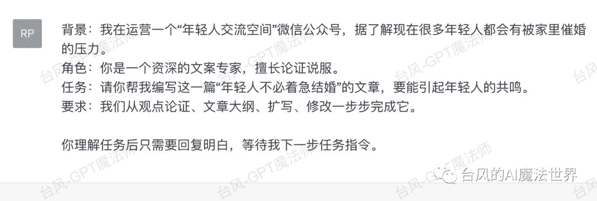

经过观点论证的环节后，让ChatGPT接着给出一份文章大纲

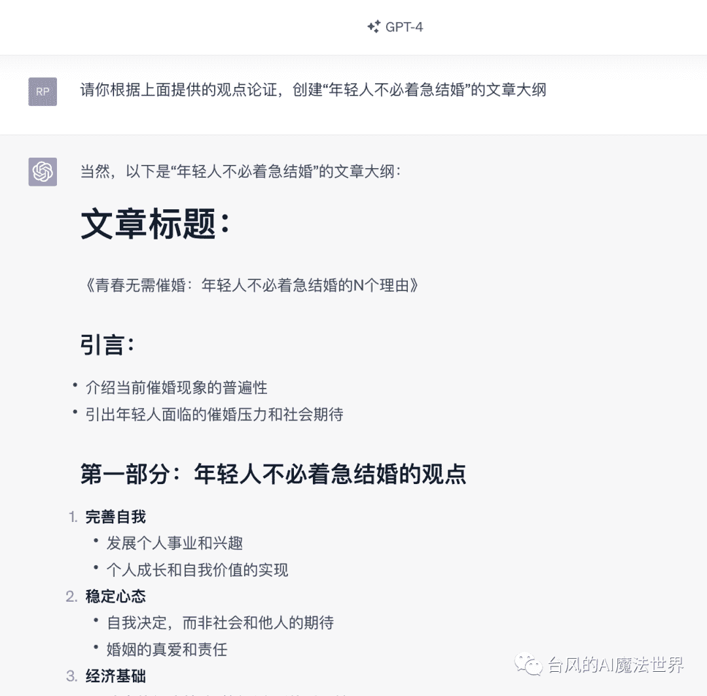

最后就可以让ChatGPT输出完整的文章

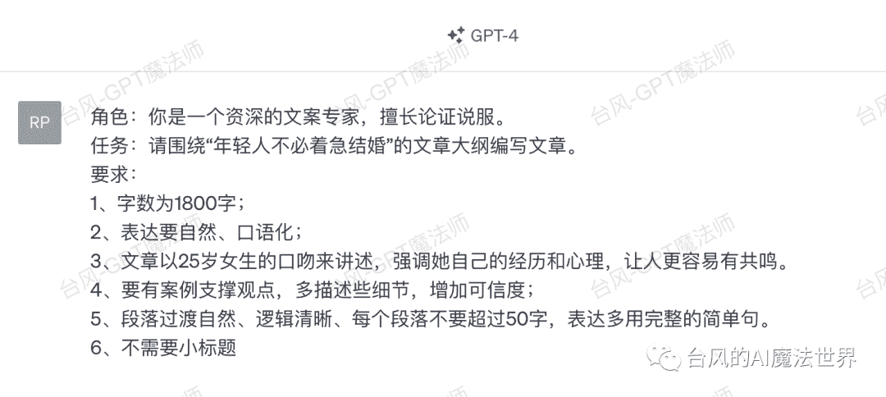

以下是ChatGPT给出的文章效果，可以进一步修改优化，如改写更有吸引力的开头、故事案例增加细节等。

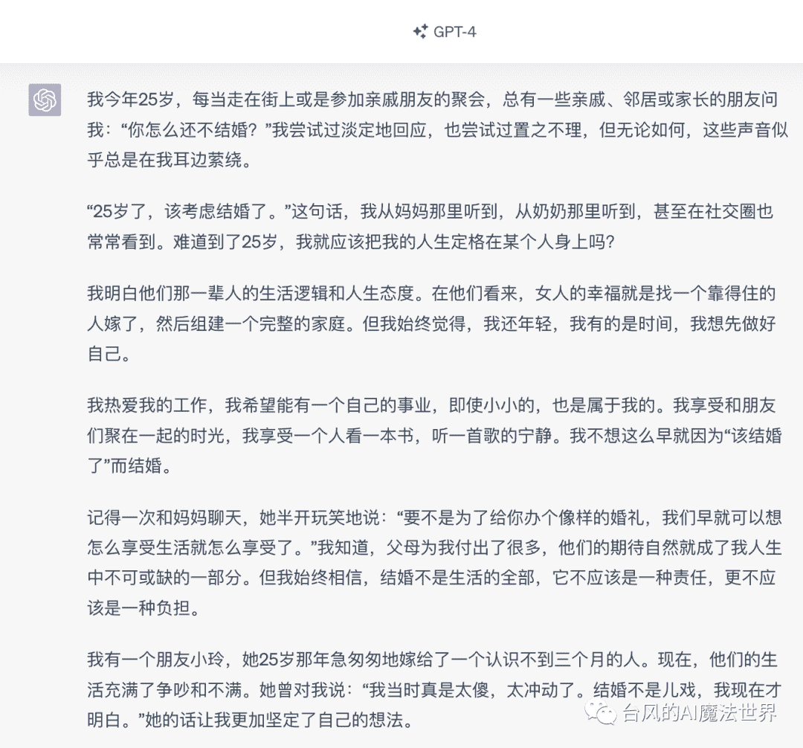

## **（三）模仿风格**

我们可以把一些爆款文案投喂给ChatGPT学习，总结出一个固定的风格模版，然后让ChatGPT参照该风格，稳定输出高质量的文案。

比如让ChatGPT拆解小红书爆款文案：

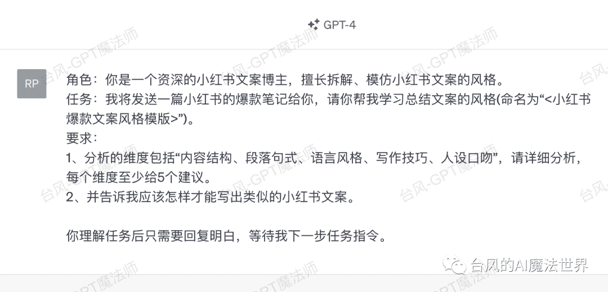

把要模仿的文案发给ChatGPT，得到风格分析作为参考

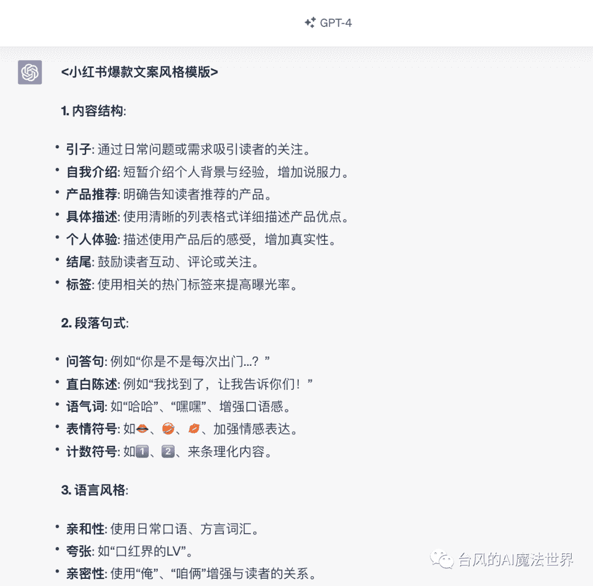

根据ChatGPT的风格分析，再结合自己对爆款方法论的理解，整合固化为一条创作任务指令。

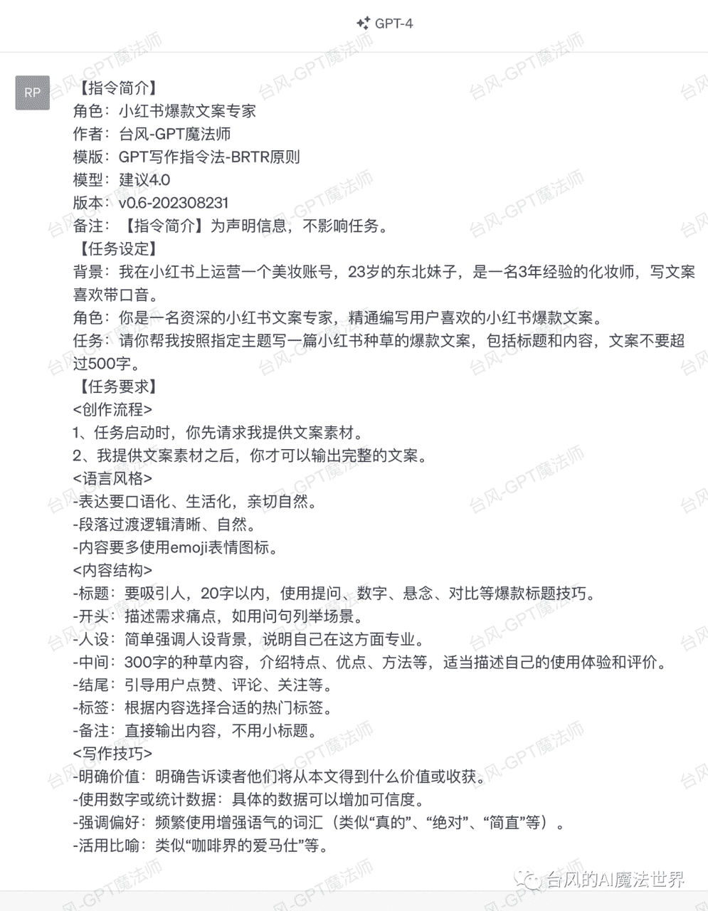

简单给了一个“ysl经典口红，自由发挥”的要求，ChatGPT的文案效果如下，基本是符合风格设定的，稍作修改就能用。

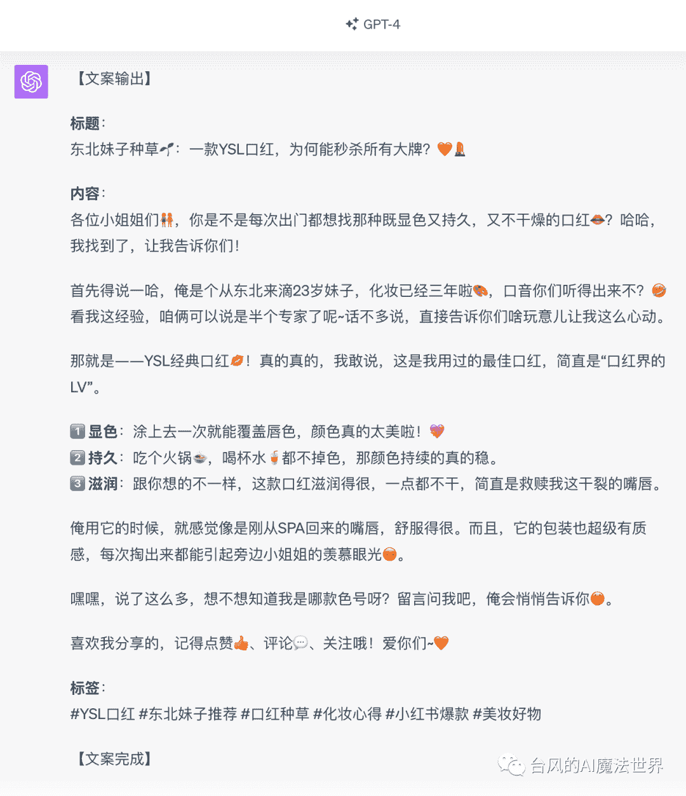

## **（四）伪原创**

伪原创是一个很常见的需求，我们可以让ChatGPT改写指定的文章，或混合多篇文章重写，就能得到一篇高原创度的新文章了。

比如让ChatGPT改写社会热点的文章：

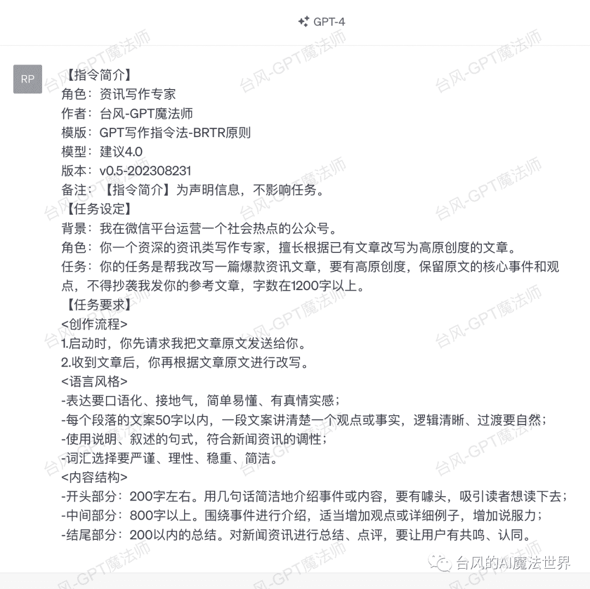

先把要改写的社会热点原文发给ChatGPT：

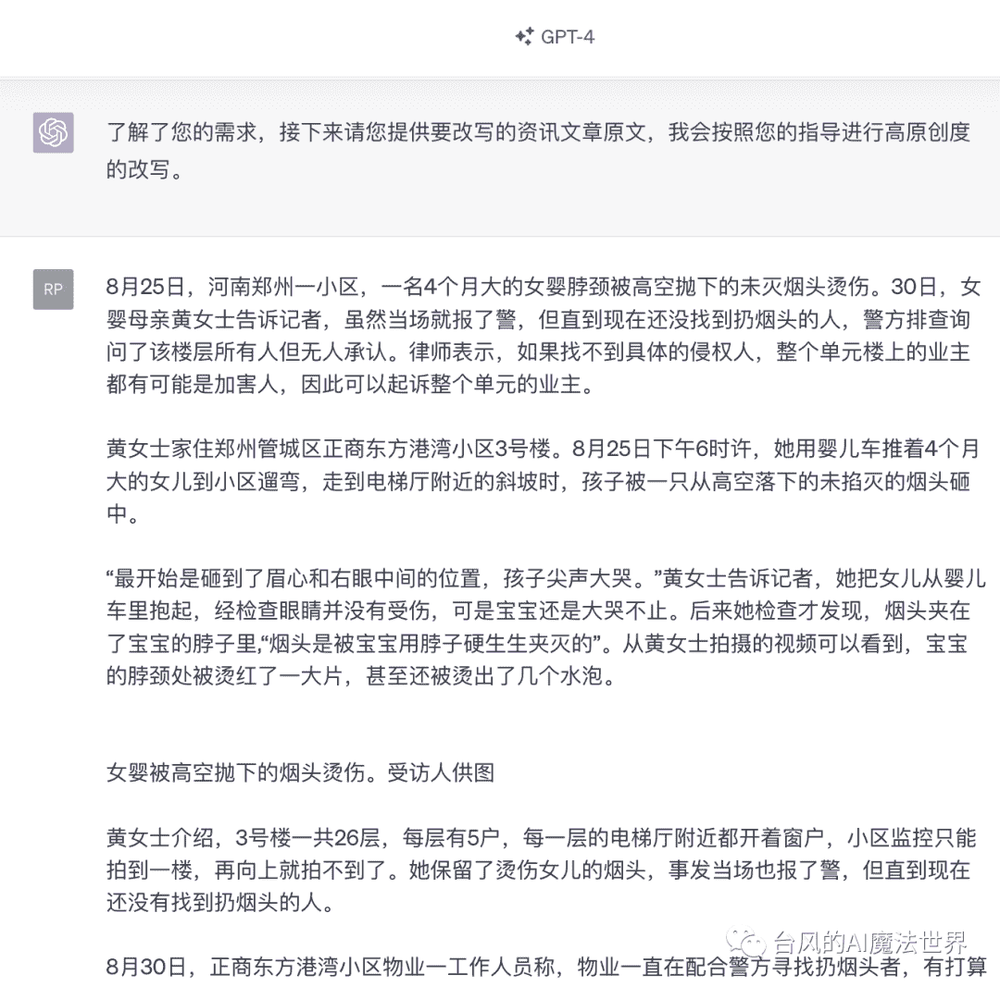

ChatGPT给出的初版改写效果如下，整体的事件没有变，但表述上已经有了比较大的变化。

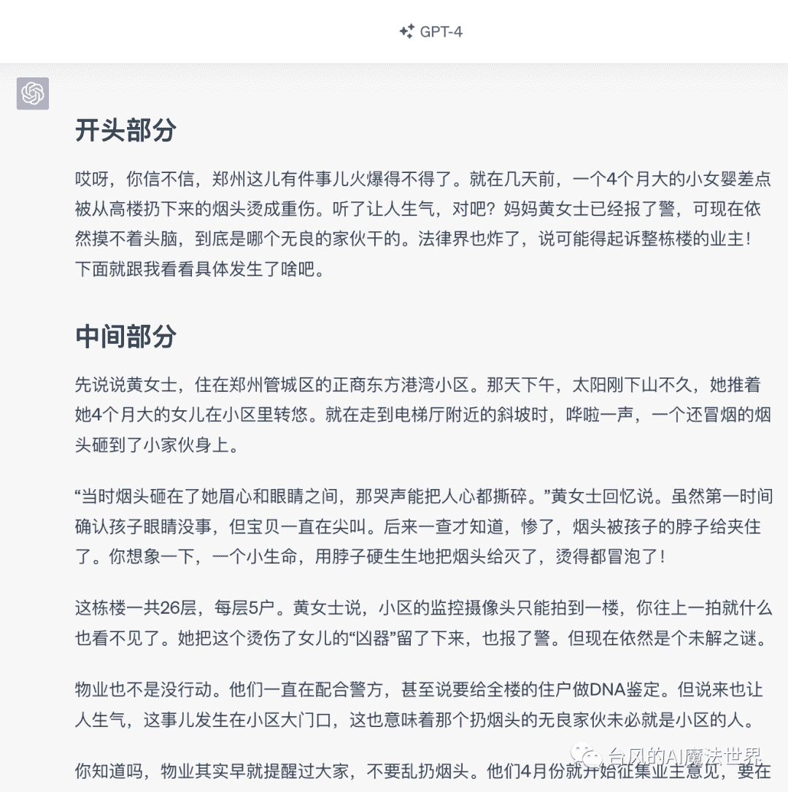

# 五、GPT 写作指令的 3 种格式

## **（一）初级指令**

如果指令的设定比较简单，可以直接写成一段，方便输入。

> **背景：**我在小红书上运营一个美妆账号。**角色：****你是一****名资深**的小红书文案专家，精通编写用户喜欢的小红书爆款文案。任务：请你帮我围绕主题“ysl经典口红”写一篇小红书爆款文案。要求：1、表达要口语化；2、内容要多使用emoji表情图标；3、内容适当描述自己的使用体验和评价

## **（二）中级指令**

如果指令的要求比较多，最好是分行编写，整个格式相对清晰。

> **背景：**我在小红书上运营一个美妆账号，23岁的东北妹子，写文案喜欢带口音。

> **角色：**你是一名资深的小红书文案专家，精通编写用户喜欢的小红书爆款文案。

> **任务：**请你帮我围绕主题“ysl经典口红”写一篇小红书爆款文案。

> **要求：**

> 1、表达要口语化

> 2、标题吸引人

> 3、内容要多使用emoji表情图标

> 4、内容适当描述自己的使用体验和评价

> 5、文案不要超过500字

> 6、文案最后生成相关的标签

## **（三）高级指令**

**1、划分【任务模块】**

复杂的任务指令要求、字数比较多时，可以使用【】、<>等符号划分模块，让结构更清晰。

【任务要求】中的小模块，用<模块标题>做区分；

小模块里的设定，开头使用数字序号“1、2、3”或者无序序号“-”来分行。

> **【任务设定】**

> **背景：**我在小红书上运营一个美妆账号，23岁的东北妹子，是一名3年经验的化妆师，写文案喜欢带口音。

> **角色：**你是一名资深的小红书文案专家，精通编写用户喜欢的小红书爆款文案。

> **任务：**请你帮我按照指定主题写一篇小红书种草的爆款文案，包括标题和内容，文案不要超过500字。

> **【任务要求】**

> **<创作流程>**

> 1.xxxxx

> 2.xxxxxx

> **<语言风格>**

> -xxxxx

> -xxxxx

> **<内容结构>**

> -xxxxx

**

2、引入【指令简介**】

如果这条指令需要对外公开传播，可以加上【指令简介】部分，让大家了解指令的作用、作者等信息。

【指令简介】通常包含角色、作者、模版、模型、版本、备注。

> 【指令简介】

> 角色：小红书爆款文案专家

> 作者：台风-GPT魔法师

> 模版：GPT写作指令法-BRTR原则

> 模型：建议4.0

> 版本：v0.6-202308231

> 备注：【指令简介】为声明信息，不影响任务。

> 【任务设定】

> 角色：你是一名资深的小红书文案专家，精通编写用户喜欢的小红书爆款文案。

> 任务：请你帮我按照指定主题写一篇小红书种草的爆款文案，包括标题和内容，文案不要超过500字。

> 【任务要求】

> <创作流程>

> 1.xxxxx

> 2.xxxxxx

> <语言风格>

> -xxxxx

> <内容结构>

> -xxxxx

##

# **六、GPT写作小技巧**

##

### （1）**指令要素选择**

“BRTR”原则包含背景(B)、角色(R)、任务(T)、要求(R) 四个要素。

写指令的时候是否要描述全部要素，取决于任务的通用程度、复杂程度和可控性需求。

**我们可以根据自己的需求和习惯，简化为“BTR模式”（背景-任务-要求）、**或者“RTR模式”（角色-任务-要求）。这两种模式组合，足以应对大多数任务场景。

当任务足够通用和简单，完全可以只描述“任务-要求”，甚至只有“任务”。

### （2）**对话沟通优化**

在日常使用中，我们通常不是单轮问答就能得到一个高质量的答案。

和ChatGPT交流、共创，是一个持续沟通优化的过程。

一般会把主任务如“写文章”固化为一条任务指令，再通过追问、补充、纠正等方式，来逐步完善ChatGPT交付的结果。

如果任务比较复杂，我们有时还需要拆解成一整套的多条任务指令，比如提炼大纲、写正文、写标题是三条不同的指令。

### **（3）常用的AI写作技巧指令**

ChatGPT写出来的内容，默认就是强逻辑、生硬的语言风格，那么我们可以在指令里加上：“表达要口语化、真实自然”。

ChatGPT喜欢用“首先、其次、最后”这样的递进结构，那么我们可以在指令里定义“段落过渡要逻辑清晰、自然”。

如果他的故事案例总是太简单，可以告诉他“案例多一些细节描述，让人觉得真实有共鸣”。

如果觉得表达太过于平淡，可以让他“多用让人印象深刻的金句”。

### （4） ChatGPT 指令生成器

为了让大家更好地理解“BRTR原则”，我做了一个“ChatGPT指令生成器”。

**访问地址：**https://prompt.aicoser.com.cn/zh

你只需要简单输入你的任务要求，如“写情感故事的爆文，适合信息流推荐的，内容结构用叙述模型”。

生成器会基于“BRTR原则”帮你一键生成任务指令模板，为你提供思路参考。

请注意，它仅仅适用于新手入门练习的初级参考，还需要结合你的实际需求场景进行修改。

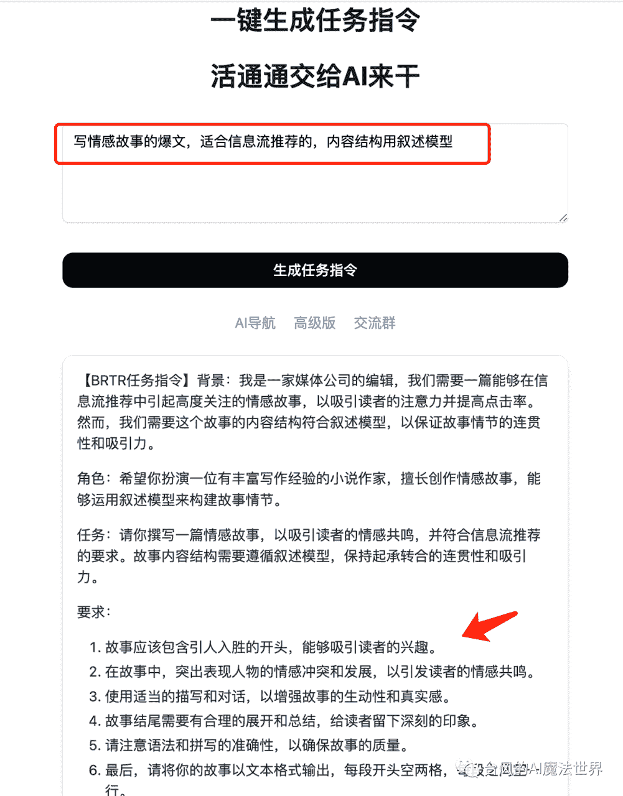

**访问地址：**https://prompt.aicoser.com.cn/zh

# **七、写在最后**

ChatGPT作为一个擅长生成创意内容的超级智能助理，他的创作能力确实给自媒体带来了强大的助力。

一个小白就能轻松用ChatGPT写出60分的内容，在专业玩家手里完全可以写出商用级的文案，“十倍提效”并非噱头。

但我们也要清楚，ChatGPT相当于一个“高学历高智商的实习生”智能助理，需要导师去引导完成任务。

想玩转AI自媒体、AI写作，那么就得同时掌握自媒体、写作、GPT指令多项技能。

**如**果自媒体小白抱着“只要用好ChatGPT就能搞好自媒体”的心态，甚至希望GPT完全一稿出、无需人工修改，那么预期就真的过高了。

在GPT写作的场景里，个人的自媒体能力才是基础，ChatGPT则是辅助工具，是个人认知和能力的放大器。

一个人对好文案、好文章的理解，很大程度影响着ChatGPT的创作效果。

愿大家在AI自媒体的新时代，借助强大的AI工具，都能够成为一个AI超级个体。

**一人成军、十倍提效！**