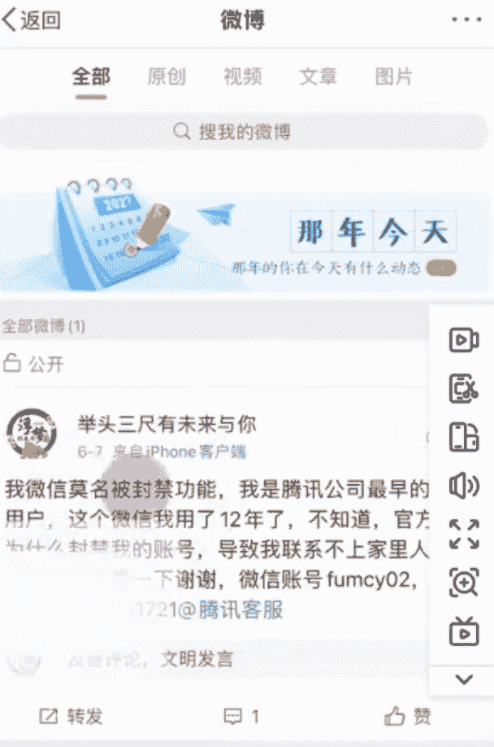
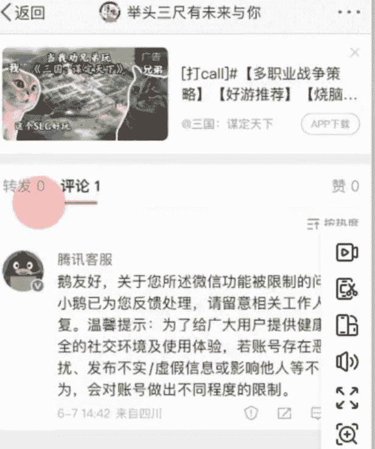
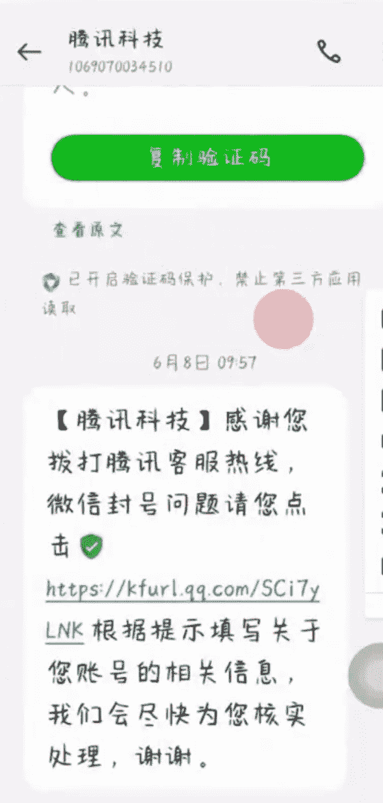

# 微信永久封号解封玩法包含短暂封号教程【揭秘】

> 来源：[https://yunyingmenghai.feishu.cn/docx/LwfOdKoqOoZFI5xRR91cwxU9nqe](https://yunyingmenghai.feishu.cn/docx/LwfOdKoqOoZFI5xRR91cwxU9nqe)

# 利用微博@官方来规避封号

利用微博@官方来规避封号，主要是借助微博平台与官方客服的沟通渠道，通过合理的申诉和解释，尝试解除或避免账号封禁。具体操作如下：

## 编写申诉内容：

在微博中编写一篇包含自己账号被封禁的详细情况、使用历史、以及为何认为账号不应被封禁的申诉内容。内容应真实、客观，避免夸大或虚假描述。

## @官方客服：

**在申诉内容**中，使用“@”符号艾特 腾讯客服 的账号，确保官方能够注意到你的申诉。

发布微博：将编写好的申诉微博发布出去，等待官方客服的回应。

## 跟进与沟通：

如果官方客服给予回应，根据他们的提示和要求，提供进一步的信息或进行必要的沟通。

需要注意的是，这种方法并不能保证一定能够解封账号，因为账号封禁通常涉及多种因素，包括账号行为、违规程度等。同时，如果账号确实存在违规行为，即使通过微博艾特官方，也可能无法解封。

因此，避免封号的关键还是在于日常使用账号时遵守平台规则，不进行违规操作。如果账号被封禁，应先自查是否存在违规行为，再进行合理的申诉。

