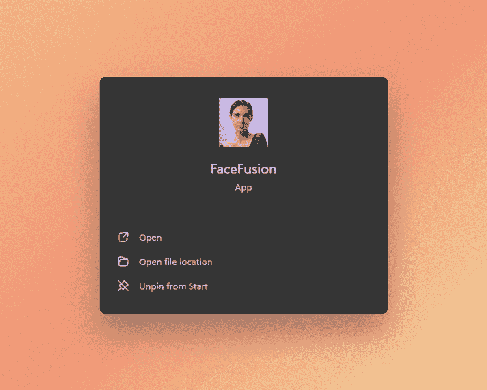

# AI换脸FaceFusion v3.1.1

> 来源：[https://yunyingmenghai.feishu.cn/docx/Cpxqdpa8loZukyxMnnicnNwvnJ2](https://yunyingmenghai.feishu.cn/docx/Cpxqdpa8loZukyxMnnicnNwvnJ2)



# 项目地址：

https://github.com/facefusion/facefusion

## 安装说明：

https://docs.facefusion.io/installation

「AI换脸FaceFusion v3.1.1整合包」

链接：https://pan.quark.cn/s/80f412b8bb2b

要在 Windows 沙盒上安装 WinGet 的稳定版本，

请从 Windows PowerShell 命令提示符执行以下步骤：

```
$progressPreference = &#x27;silentlyContinue&#x27;
Write-Host &quot;Installing WinGet PowerShell module from PSGallery...&quot;
Install-PackageProvider -Name NuGet -Force | Out-Null
Install-Module -Name Microsoft.WinGet.Client -Force -Repository PSGallery | Out-Null
Write-Host &quot;Using Repair-WinGetPackageManager cmdlet to bootstrap WinGet...&quot;
Repair-WinGetPackageManager
Write-Host &quot;Done.&quot;
```

若要在计算机范围内安装 PowerShell 模块

准备：

```
#所需软件：
winget install -e --id Git.Git
winget install -e --id Anaconda.Miniconda3 --override &quot;/AddToPath=1&quot;
winget install -e --id Gyan.FFmpeg
#K-Lite Codec Pack 是一款功能强大的编解码器集合软件，支持多种音视频
winget install -e --id CodecGuide.K-LiteCodecPack.Basic
https://codecguide.com/download_k-lite_codec_pack_basic.htm
```

显卡：

```
conda create --name facefusion python=3.12
#cuda
conda install conda-forge::cuda-runtime=12.4.1 cudnn=8.9.2.26 conda-forge::gputil=1.4.0
conda install conda-forge::zlib-wapi
```

onnxruntime==1.20.1

### ONNX Runtime-gpu

onnxruntime==1.18.0

```
conda install conda-forge::cuda-runtime=12.6.3 conda-forge::cudnn=9.3.0.75 conda-forge::gputil -y
conda install -c conda-forge cuda-runtime=12.6.3 cudnn=9.3.0.75 gputil -y
```

```
git clone https://github.com/facefusion/facefusion
cd facefusion
pip install torch torchvision torchaudio --index-url https://download.pytorch.org/whl/cu124
#说明 install.py [-h] --onnxruntime {default,cuda,openvino,directml} [--skip-conda] [-v]
python install.py --onnxruntime cuda
python install.py --onnxruntime cuda
python facefusion.py run --open-browser
```

> default 适用于cpu

> TensorRT适用于高性能 NVIDIA 显卡

> CUDA兼容 NVIDIA 显卡

> OpenVINO适用于 Intel Arc 显卡

> directml适用于AMD显卡

## 实时换脸，进入摄像头换脸界面：

```
python3 facefusion.py run --ui-layouts webcam
```

启动后自动从.huggingface下载40个模型（8.92G）

模型路径：facefusion\.assets\models

页面适配中文:


[wording.py](https://internal-api-drive-stream.feishu.cn/space/api/box/stream/download/all/CP4nbtzpsohpBQxgQDscAW3Jnce)

修改:

"E:\facefusion_v3.1.1\facefusion\facefusion\uis\components\about.py" 页面按钮