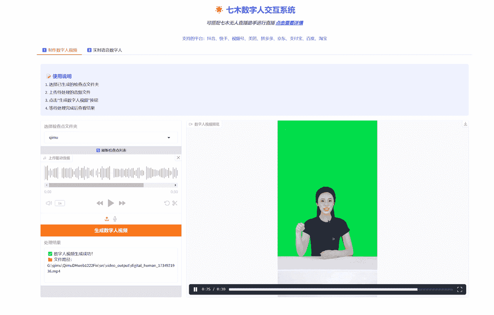
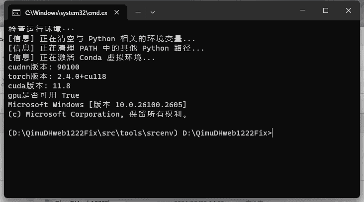
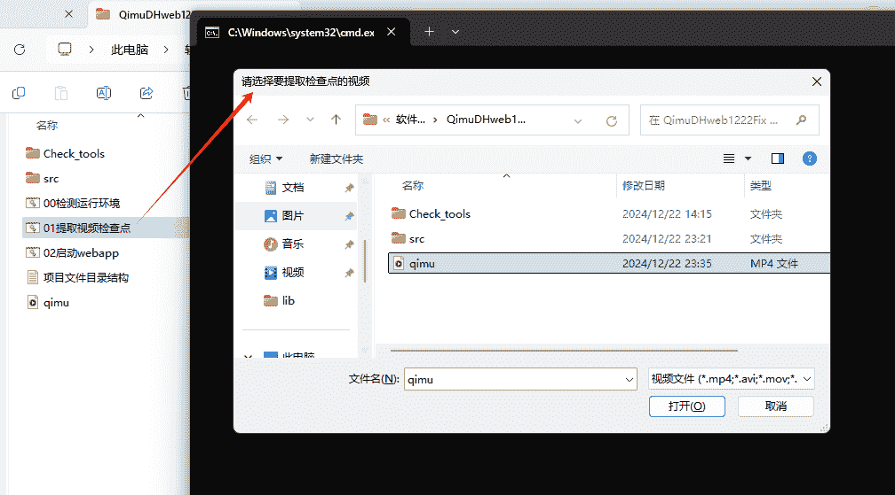
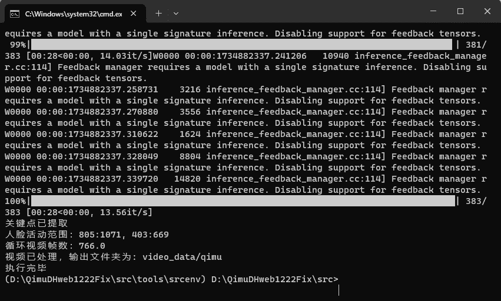
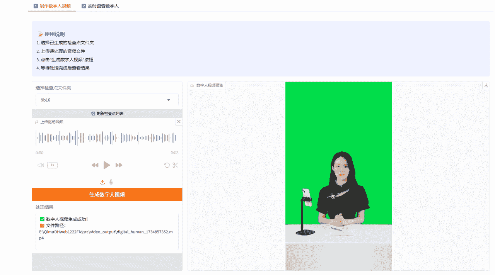
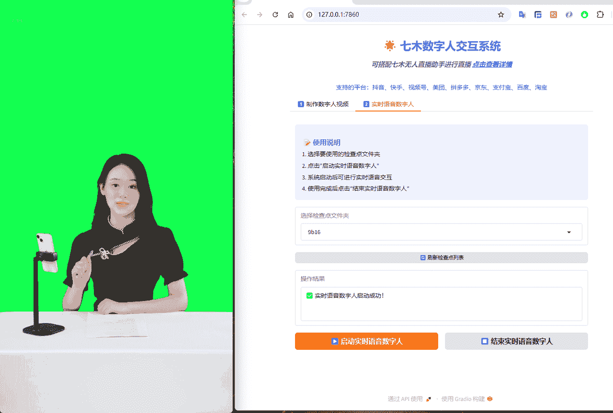
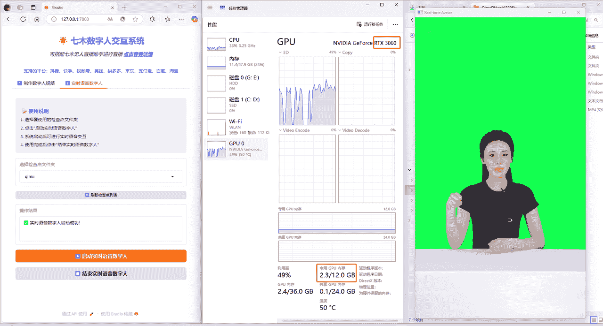
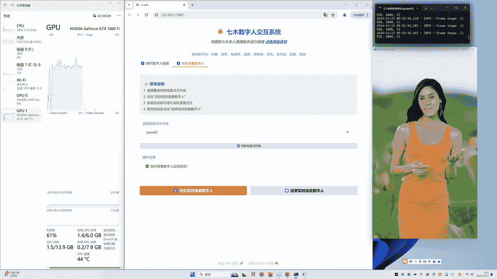

# 开源数字人直播DH_live web整合包免训练使用教程

> 来源：[https://yunyingmenghai.feishu.cn/docx/Cnh0dY1Rvoq5Mkxxi6GcBJIJnkd](https://yunyingmenghai.feishu.cn/docx/Cnh0dY1Rvoq5Mkxxi6GcBJIJnkd)

# [资源导航首页](https://yunyingmenghai.feishu.cn/wiki/Y6BWwtKvXiGJr5kXb81c4GYLnVe)

> QQ交流群: **1034472934**

> 点击链接加入群聊【七木数字人】：https://qm.qq.com/q/z72DxEkOdi

# 项目地址

基于开源项目:[DH_live](https://github.com/kleinlee/DH_live)做的web交互系统

主要实现:免训练数字人视频制作和实时语音数字人

可搭配一些直播场控软件的语音 驱动数字人进行直播




# 整合包下载

「数字人(可直播用+数字人视频制作)」

链接：https://pan.quark.cn/s/2e06a0249917


优化内容:

+   web页面可实时交互

+   实时数字人窗口显示优化

+   一些小的修改

# 使用教程

+   下载后解压,解压到D盘根目录,注意路径不要有中文/空格

+   推荐使用** **[**7-Zip**](https://pan.quark.cn/s/20dca3a7fc22)** **解压缩(https://pan.quark.cn/s/20dca3a7fc22)

+   压缩包为exe自解压文件，如双击不能执行，可右键7z解压到当前目录

+   检测运行环境

+   Check_tools下脚本

```
python -c &quot;import torch; print(&#x27;cudnn版本:&#x27;, torch.backends.cudnn.version()); print(&#x27;torch版本:&#x27;, torch.__version__); print(&#x27;cuda版本:&#x27;, torch.version.cuda); print(&#x27;gpu是否可用&#x27;, torch.cuda.is_available())&quot;
```

+   需要英伟达显卡4G以上显存

+   实时语音数字人需要麦克风/耳机或声卡/虚拟声卡



+   脚本部署的环境

+   Python 3.11.11

+   torch版本: 2.4.0+cu118

+   cuda版本: 11.8

+   运行

+   01提取视频检查点.bat

+   双击启动后选择要准备的视频，建议1080*1920 帧率25 1分钟以内



+   等待视频处理完成



+   输出的检查点名称同视频名



+   02启动webapp.bat

+   双击启动后选择检查点

+   可上传音频，制作数字人视频

+   可启动实时数字人，通过音频驱动来进行直播

+   直播推荐搭配七木直播助手APP

+   **支持的平台：**抖音、快手、视频号、美团、拼多多、京东、支付宝、百度、淘宝

+    点击查看详情：https://yunyingmenghai.feishu.cn/wiki/BlOowMOQ4iZAW3kxLI3cIjFFn8b



# 显存占用测试

## 3060显卡



## 1660 Ti



# 常见报错：

+   启动实时数字人报错：Audio processing error: Error querying device -1

原因：未连接音频设备，可插上耳机或耳麦

+    找不到指定的模块。 Error loading "D:\QimuDHweb1222Fix\src\tools\srcenv\Lib\site-packages\torch\lib\fbgemm.dll" or one of its dependencies.

+   下载libomp140.x86_64.dll把它放到报错文件的同一级目录下

+   QimuDHweb1222Fix\src\tools\srcenv\Lib\site-packages\torch\lib\

+   下载: https://yunyingmenghai.feishu.cn/wiki/OVRNwb3AdiCWEdkNtKYcwsEKnXU