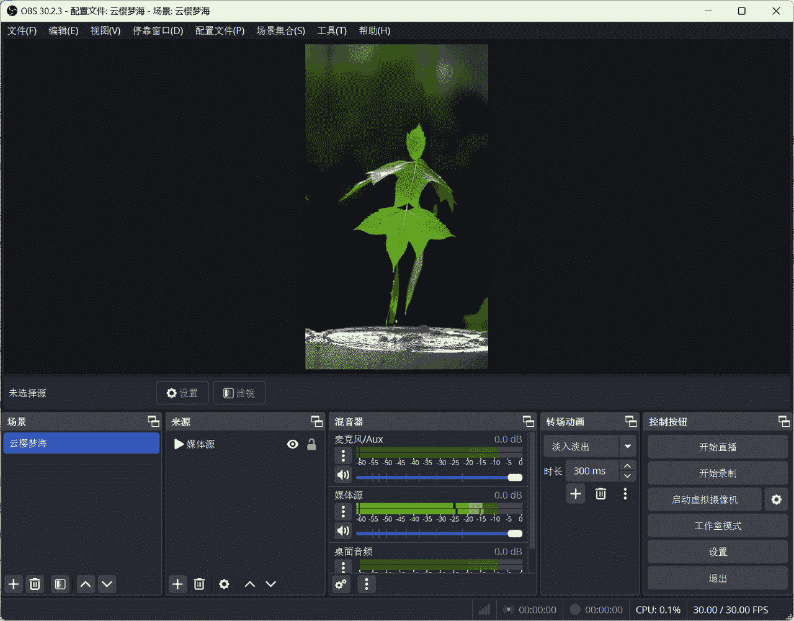
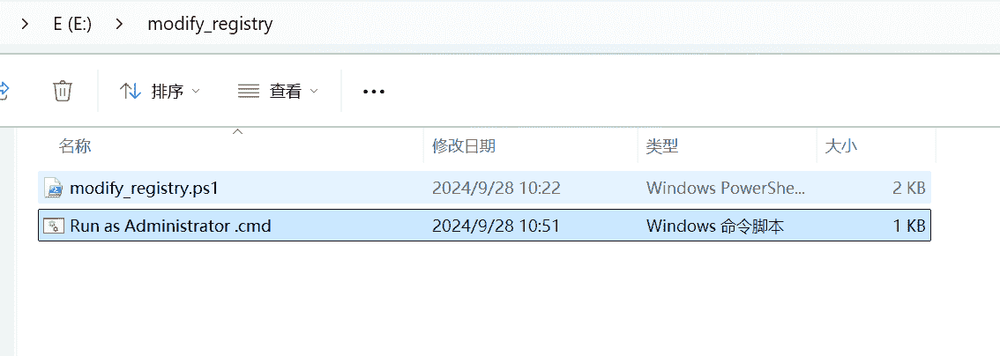
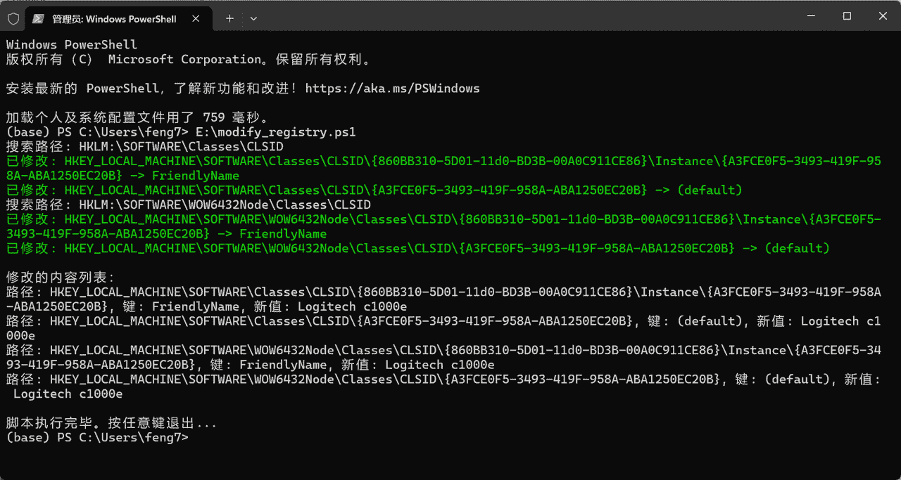

# 快手OBS虚拟摄像头直播被误判录播如何修改注册表

> 来源：[https://yunyingmenghai.feishu.cn/docx/RKQ2dJjAfoWYWFx25XKcya4wnOe](https://yunyingmenghai.feishu.cn/docx/RKQ2dJjAfoWYWFx25XKcya4wnOe)

# 使用OBS虚拟摄像头容易被检测为录播解决办法参考

+   **增加视频内容的动态性**：

+   在OBS中使用多个视频源，如实时摄像头画面、屏幕共享、图像幻灯片等，并且定期切换这些源，以模拟真实直播时的操作。

+   **使用摄像头捕捉真实画面**：

+   将真实摄像头捕捉到的画面作为OBS的一个场景，这样可以提供实时的动态视频流。

+   **调整视频参数**：

+   在OBS中调整视频的分辨率、帧率和比特率，使其更接近真实摄像头的输出参数。

+   **避免使用循环播放的视频**：

+   循环播放的视频很容易被检测出是录播，尽量使用非循环的视频内容。

+   **使用OBS的动态滤镜和效果**：

+   应用一些动态的滤镜和效果，如图像扭曲、颜色校正等，增加视频的实时感。

+   **定期更新视频内容：**

+   如果你必须使用预先录制的视频，确保定期更新视频内容，避免长时间播放相同的视频片段。

+   修改注册表中的 OBS Virtual Camera

# 修改注册表中的虚拟摄像头

## 手动修改注册表

+    win11 首先输入命令进入注册表界面，

+   win+r 后 输入 regedit 打开注册表编辑器

+    Ctrl+f 搜索 OBS Virtual Camera 。

+   将所有能搜到的值都改成 Logitech c1000e 或其他型号即可

## 使用脚本修改注册表

OBS直播修改虚拟摄像头名称脚本

我用夸克网盘分享了「modify_registry.exe」，点击链接即可保存。

链接：https://pan.quark.cn/s/a296afcca52e

解压后 以管理员身份运行：Run as Administrator .cmd

注：文件路径不要有中文

如果cmd脚本闪退，可手动打开 终端管理员 PowerShell 输入modify_registry.ps1文件路径执行

