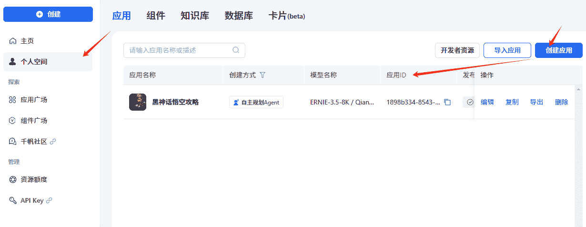
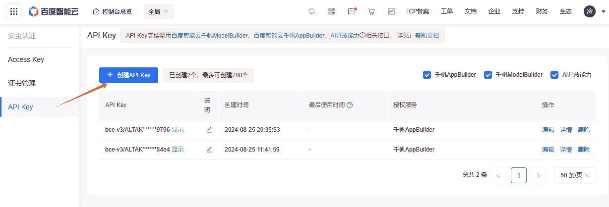
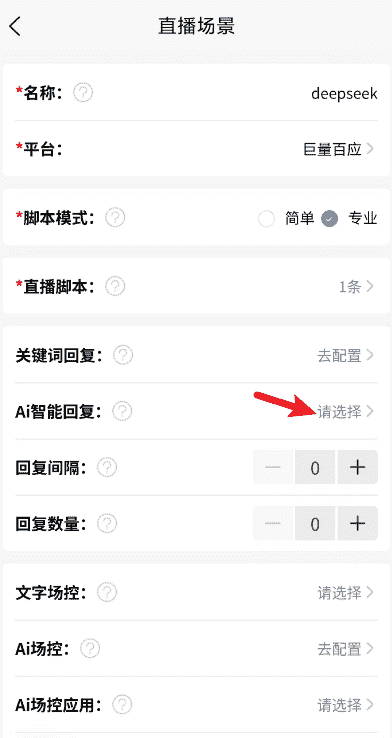
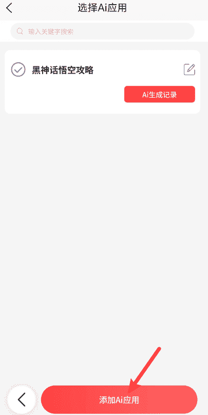
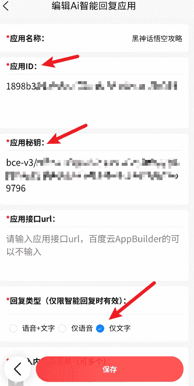

# Ai智能回复-七木APP

> 来源：[https://yunyingmenghai.feishu.cn/docx/BPhrdStLioeVbZxzVWYcsyJznLh](https://yunyingmenghai.feishu.cn/docx/BPhrdStLioeVbZxzVWYcsyJznLh)

#### [七木无人直播助手](https://yunyingmenghai.feishu.cn/wiki/BlOowMOQ4iZAW3kxLI3cIjFFn8b)

Ai知识库智能回复功能

百度云AppBuilder AI原生应用开发平台配置的应用Api进行回复

> Ai智能回复--直播时,将观众的评论输入知识库进行文字回复

> AI场控--直播时定时自动发送由AI处理后的内容

> 注意AI回复内容限制下字数,太长会回复失败(抖音公屏回复限制字数)

## 使用说明:

## 百度云AppBuilder

https://console.bce.baidu.com/ai_apaas/dialogHome

### 01创建应用-复制应用ID

### 创建应用秘钥

https://console.bce.baidu.com/iam/#/iam/apikey/list

## APP端

添加直播场景

直播场景--AI智能回复--添加AI应用

填入应用ID/应用秘钥

选择回复类型

