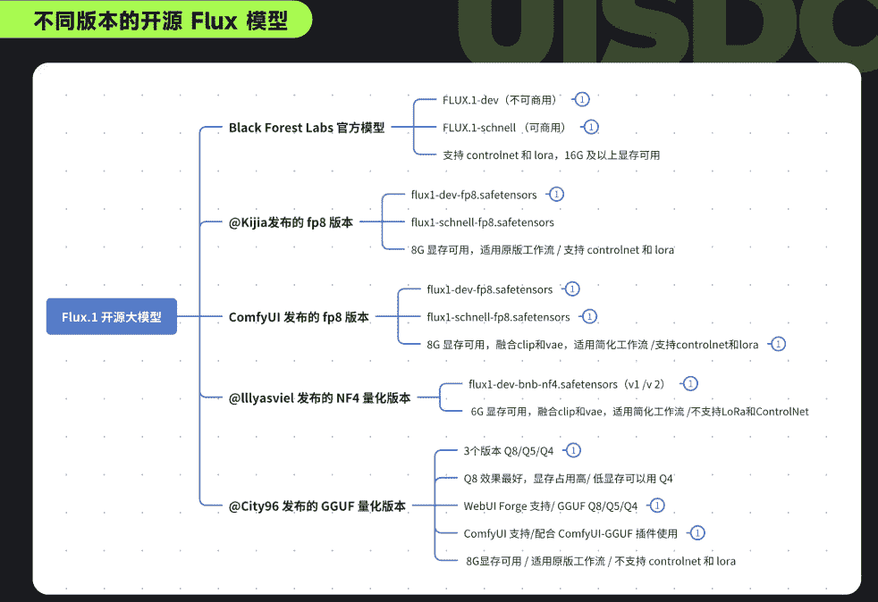
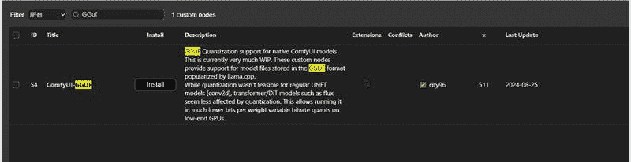
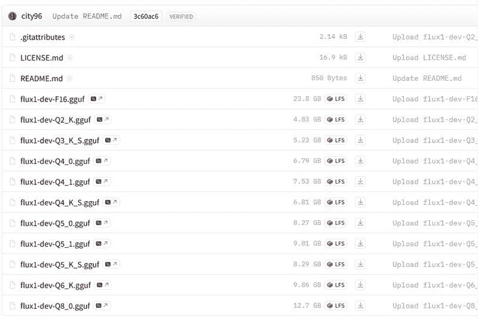
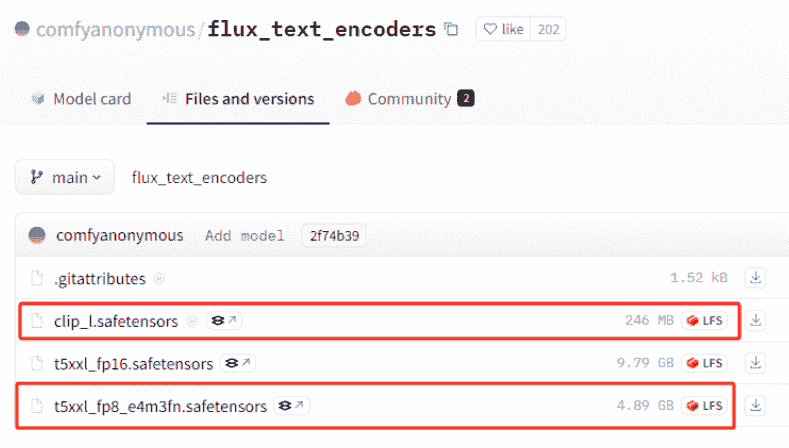
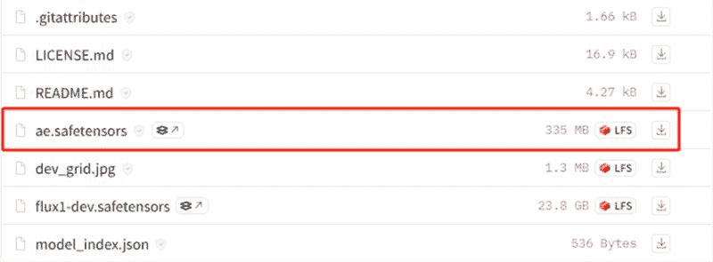
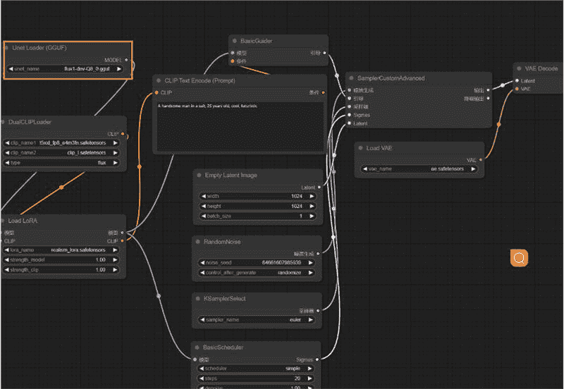

# Flux NF4过时了？最新量化版GGUF来了，6G显存也能跑

> 来源：[https://yunyingmenghai.feishu.cn/docx/ThFLdPCYkoU8QSxFvlscjHPench](https://yunyingmenghai.feishu.cn/docx/ThFLdPCYkoU8QSxFvlscjHPench)

如何在本地部署Flux.1 dev GGUF工作流。

Flux.1 dev GGUF工作流

下载链接：https://pan.quark.cn/s/9b9ca6344856

1.  如果你有 16G 以及以上的显存，那么官方模型肯定是最好的选择，它们的性能和生图质量是最好的；

1.  其次是 fp8 模型，比原版模型小很多，8G 显存可运行，且关键的文本、细节生成质量没有明显下降；

1.  然后是 @lllyasviel 张吕敏大神发布的 NF4 量化版本。模型变得更小了，生成速度更快，如果在 WebUI forge 中使用共享模式运行，6G 显存也能带动。目前有 v1 和 v2 两个版本，v2 在细节和速度上更优；

1.  最后是 @City96 开发的 3 个 GGUF 量化版本。其中 Q8 的出图效果、速度都优于 fp8，需要 12GB 以上的显存；而 Q4 版本 8G 显存就能带动，生成质量比 NF4 好一些。

1.  注意：这些量化版本的使用许可与原版模型是一致的，即 Dev 不可商用，Schnell 可以商用。

1.  目前开源社区有两个 fp8 模型，它们的名称一样，但大小和加载方法是不一样的：一个由 @ kijai 开发，11.9 GB，在comfyui 中加载时需要配备 clip、vae等模型，适合原版工作流；另一个是 ComfyUI 官方开发的，17.2GB，融合了 clip、vae 等模型，可直接作为普通大模型使用，工作流更简单。为了方便区分，大家最好下载后重新命名，比如 flux1-dev-fp8-kijai 和 flux1-dev-fp8。

## 一、GGUF简介

GGUF，全称GPT-Generated Unified Format，是一种为大型语言模型设计的二进制文件格式。由llama.cpp创始人Georgi Gerganov提出，优化了数据结构和编码方式，显著提升了模型文件的存储效率和加载性能。

下载地址：https://github.com/XLabs-AI/x-flux-comfyui

在Github上，XLabs-AI官方也推荐在低内存环境下使用GGUF格式。

## 二、Flux.1 dev GGUF工作流部署

以一个典型的ComfyUI Flux.1 dev GGUF工作流为例，详细说明部署步骤。

+   插件安装

插件地址：https://github.com/city96/ComfyUI-GGUF

可以手动安装或者在管理器安装

+   模型下载

下载地址：[https://github.com/XLa](https://github.com/XLabs-AI/x-flux-comfyui)bs-AI/x-flux-comfyui

https://huggingface.co/city96/FLUX.1-dev-gguf/tree/main

但是首页上这么多模型我们该下载哪个呢，经过网络上各个大佬的测评得出的比较推荐的有Q40和Q80的两个模型

将模型放置在ComfyUI/models/unet目录下。

+   CLIP模型下载

地址：https://huggingface.co/comfyanonymous/flux_text_encoders/tree/main

下载所需文件放置在ComfyUI/models/clip目录下。

之前有本地部署过Flux的应该都已经下过了。

+   VAE模型下载

地址：https://huggingface.co/black-forest-labs/FLUX.1-dev/tree/main

下载文件放置在ComfyUI/models/vae目录下。

这个之前部署过的小伙伴肯定也不陌生

+   LORA模型下载（可选）

地址：https://huggingface.co/XLabs-AI/flux-lora-collection/tree/main

下载所需LORA模型放置在ComfyUI/models/loras目录下。

## 使用工作流

启动ComfyUI，修改我们之前Flux官方工作流文件，把模型加载器换GGUF的模型加载器即可使用。

注意：Flux.1 dev和Flux.1 dev GGUF工作流的主要区别在于使用的节点不同。感兴趣的小伙伴赶紧去安装吧

参考:https://www.uisdc.com/flux-1-2#post_download