# 小米pad6 pro 刷机aospa-uvite-unofficial-liuqin

> 来源：[https://yunyingmenghai.feishu.cn/docx/NAjLdY5oKoxqlGxDJwGcEBFmnIi](https://yunyingmenghai.feishu.cn/docx/NAjLdY5oKoxqlGxDJwGcEBFmnIi)

参考文档：https://xdaforums.com/t/unofficial-paranoid-android-uvite-xiaomi-pad-6-pro.4617981/

# 下载ROM：

https://sourceforge.net/projects/paranoid-android/files/Xiaomi-Pad-6-Pro/

How to install:

## **解锁引导**：

https://xiaomiui.net/zh-CN/how-to-unlock-xiaomi-bootloader-and-install-custom-rom-7098/

+   社区等级需达到5级

## **解锁工具下载：**

https://www.miui.com/unlock/index.html

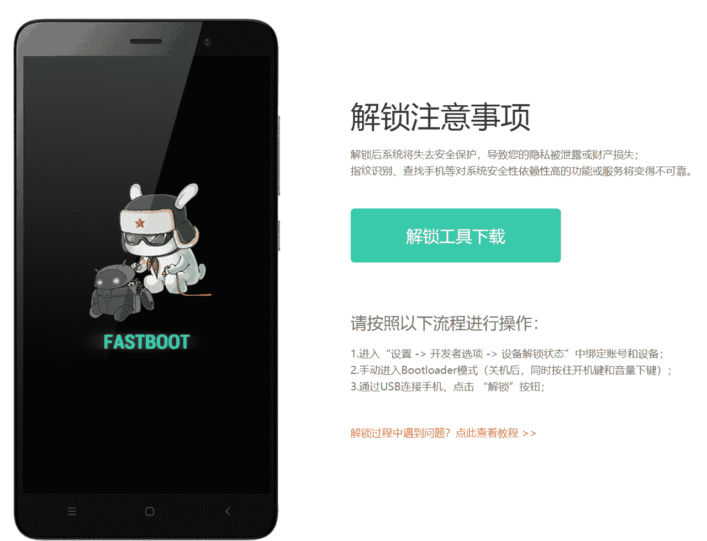

+   Install any MIUI/HyperOS firmware based on Android 14 (optional)

+   Reboot to Bootloader (orange Fastboot)

+   [fastboot update aospa-uvite-](https://sourceforge.net/projects/paranoid-android/files/Xiaomi-Pad-6-Pro/aospa-uvite-unofficial-liuqin-20240906-image.zip/download)unofficial-liuqin-20240906-image.zip

+   Reboot to Recovery and wipe (only on first install)

|> 1.0 退出设备的谷歌账号登录

这个没啥好说的，但是如果在登录了谷歌账号的情况下刷入类原生，后面激活会稍稍麻烦点

|> 1.1 重启到fastboot模式

这个不需要多说吧，关机状态下 开机键+音量下键

|> 1.2 刷入

打开你电脑上的ADB工具，输入 fastboot update ，然后把刚刚下载好的rom直接拖进去，会自动生成文件路径，再回车

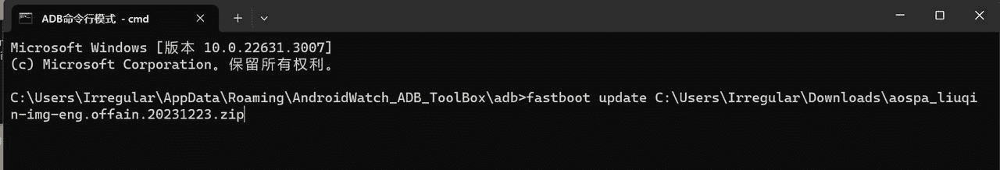

这个时候差不多要等两三分钟

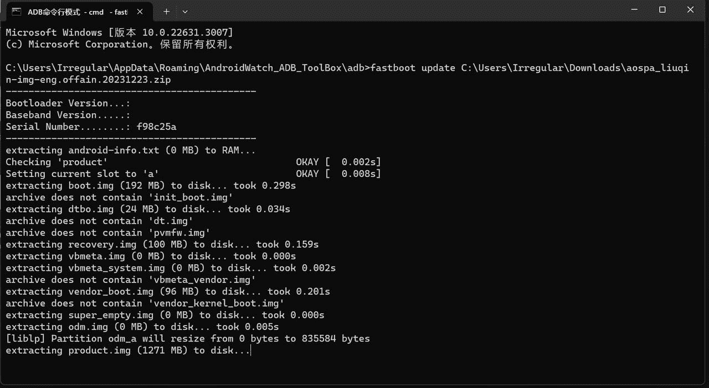

等待平板开机，但是此时不会重启到系统，个人感觉这里是因为类原生和MIUI/澎湃OS的系统数据不同造成的（？），这里直接恢复出厂设置就行

按音量下键切换至"Factory data reset"，再按下电源键

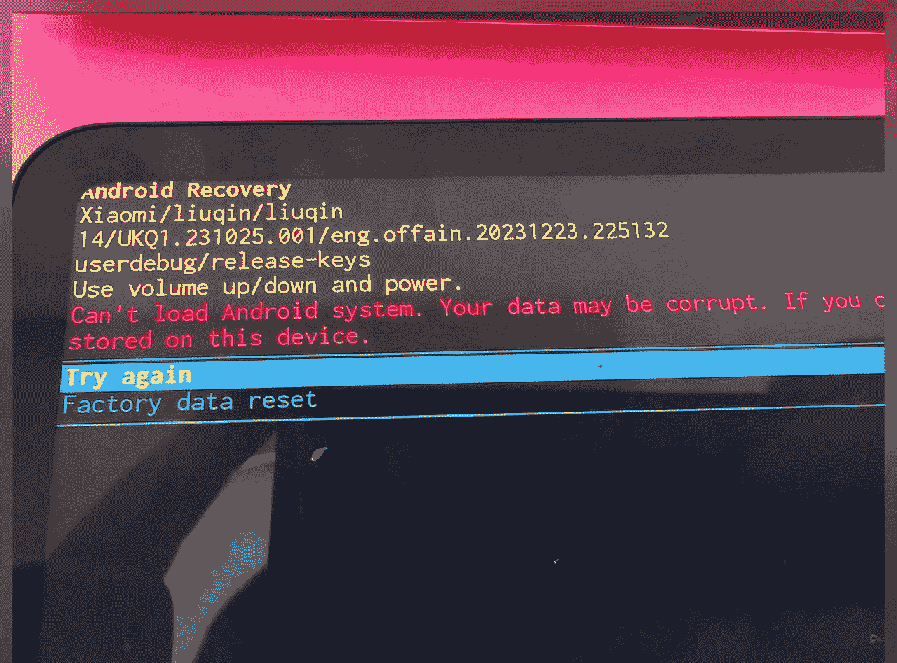

然后会让你再确认一次，这里依然音量下键切换"Factory data reset"之后按下电源键

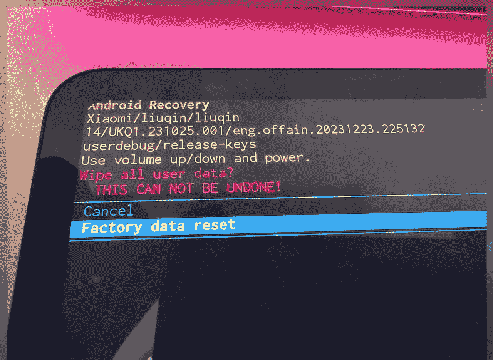

之后平板会闪一下，然后就进入开机状态了

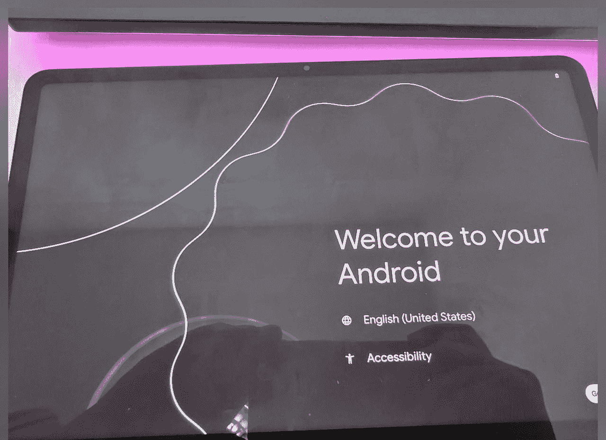

|> 1.3 激活

激活只有这个联网要说一下

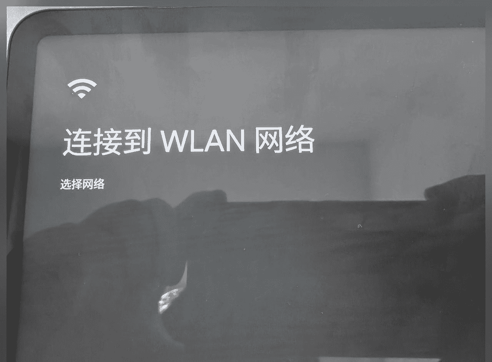

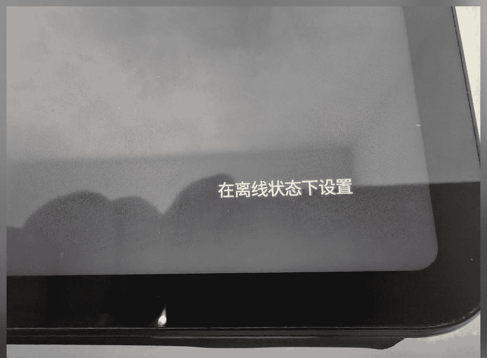

这里如果你的平板有"在离线状态下设置"，就建议直接离线设置，因为如果联网，他大概率就会说你这个网有问题啥啥啥的

如果你的平板这里根本没有这个选项，大概率是因为你在MIUI14/澎湃OS的时候没有退出谷歌账号，那么就需要你做另外一些事

重启平板到fastboot模式，然后打开ADB命令行，输入"fastboot erase frp"之后回车，再输入"fastboot reboot"开机，这样再激活应该就可以离线设置了

|> 1.4 简要优化

因为时间问题，这一段我就写简明一点了

+   刷入Magisk，安装LSPosed

这个简单吧，我在上面的链接中也附带了修补好的boot镜像，直接进入fastboot模式之后输入"fastboot flash boot"，再拖入已经修补过的boot镜像即可

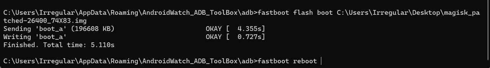

+   关闭selinux宽容

这个问题我不太清楚具体原因，但是如果不关闭，酷安是不能正常用的

这个时候，需要我们下一个"爱玩机工具箱"，在这个软件里面可以关闭selinux宽容，顺带就把救砖模块也装了，还解决了原包的安装包程序无法正常使用的问题

（Tips：顺带建议安装MT管理器，那个用来安装apk也挺好用的）

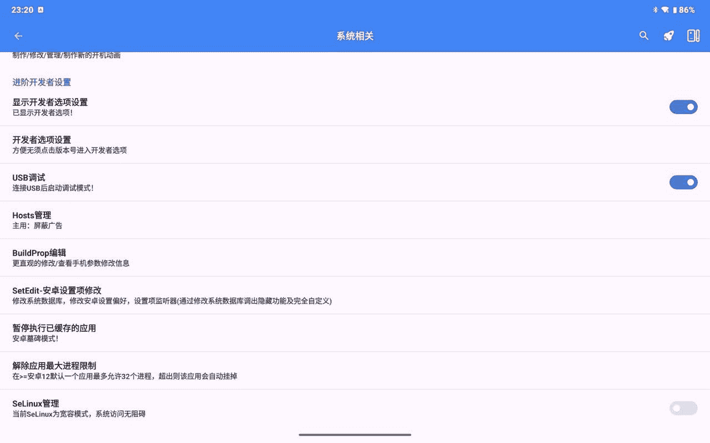

+   连接二代笔

将笔吸附于平板上之后，打开设置中的蓝牙，点击"与新设备配对"

但是如果要正常用笔的话，还需要设置一下

首先在关于中狂击"Build号"打开开发者设置

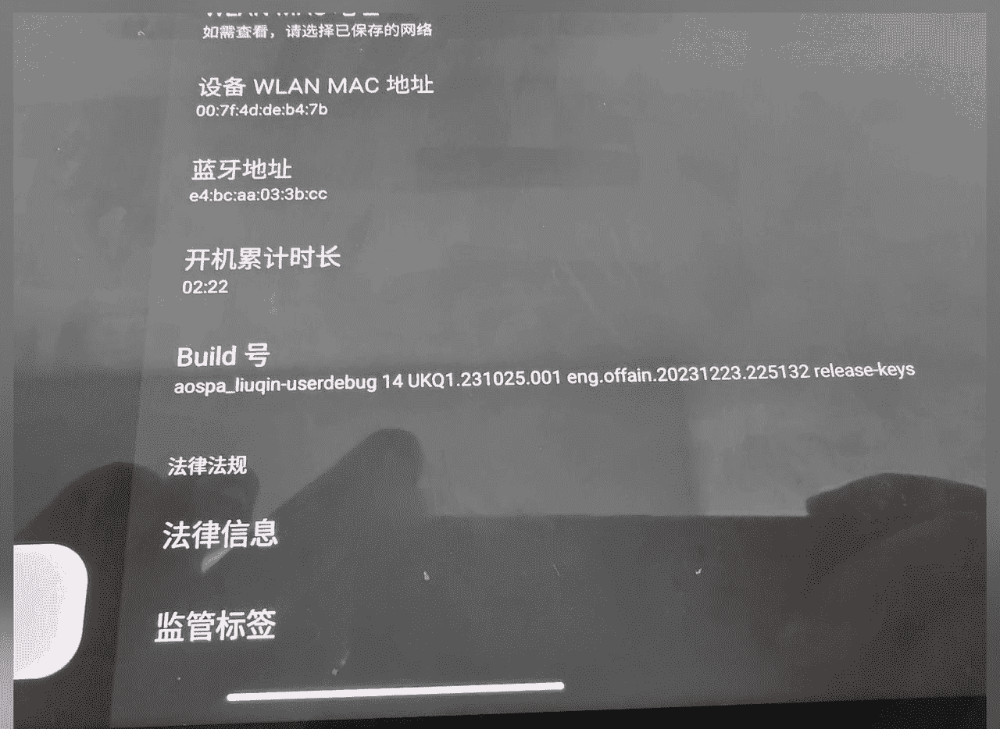

在开发者设置中首先关闭"触控笔手写功能"这个选项，这个设置在开发者设置的最后一栏，直接翻到底就能找到

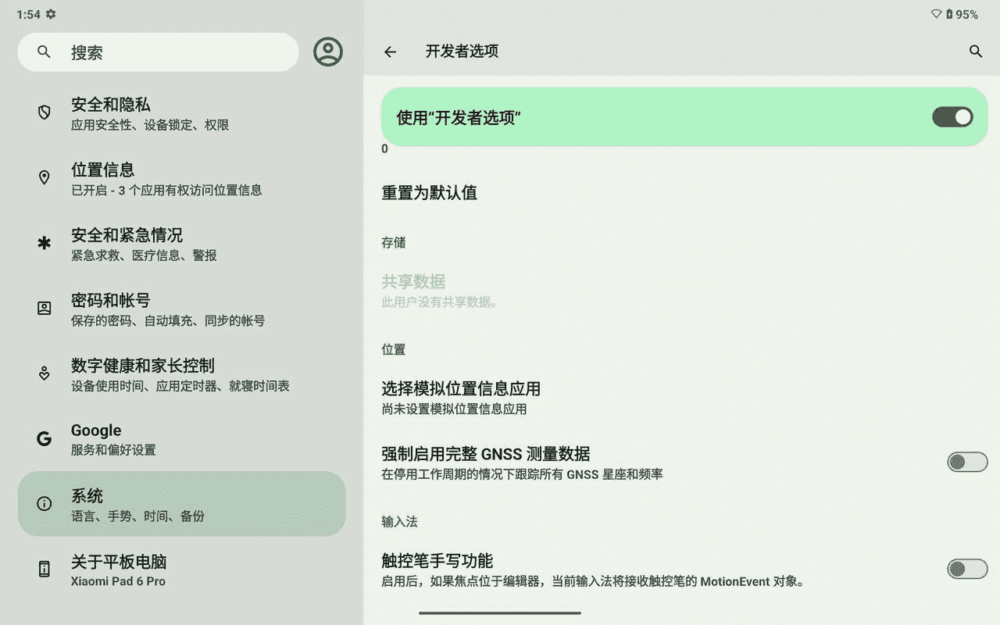

另外，还要打开"停用HW叠加层"这个设置，除了让笔正常使用，还可以有效防止某些软件闪退

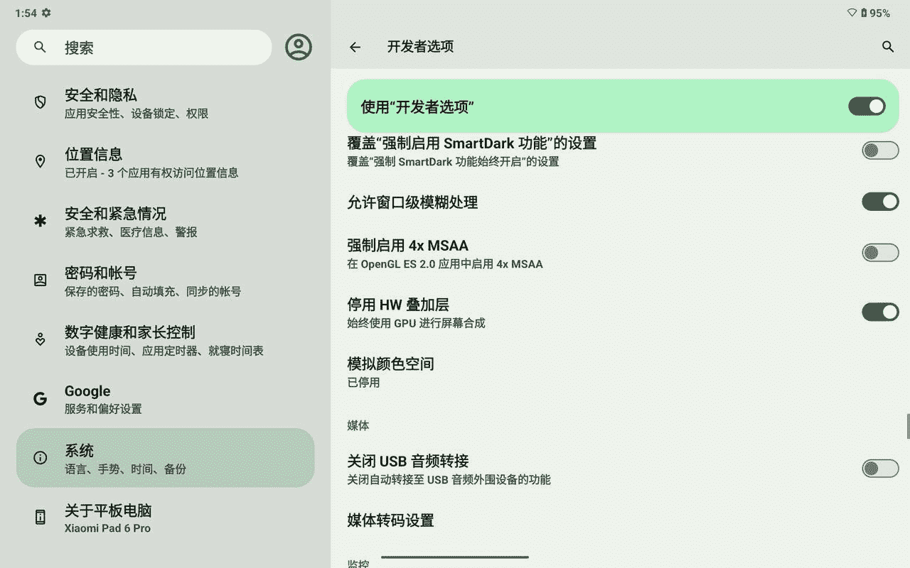

+   显示大小调整

这个类原生的显示大小调整我个人感觉有点问题，调大一点就太大了，这个可以去开发者设置里面改最小宽度来解决，我个人感觉835挺合适的

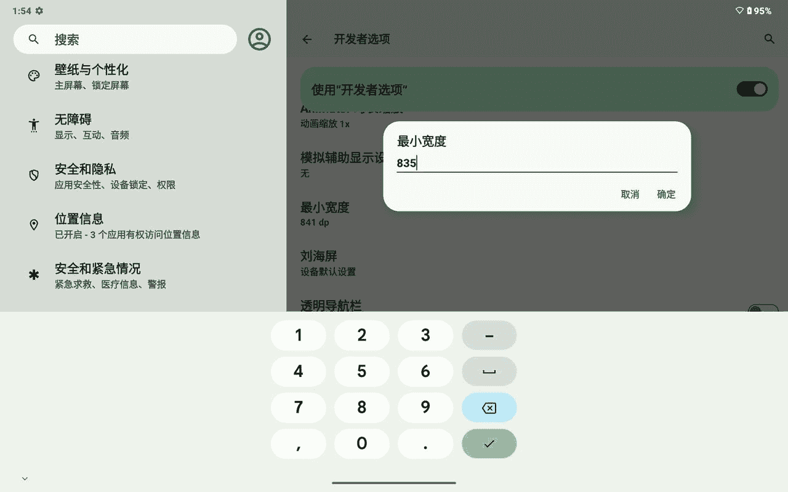

+   切记更新系统软件

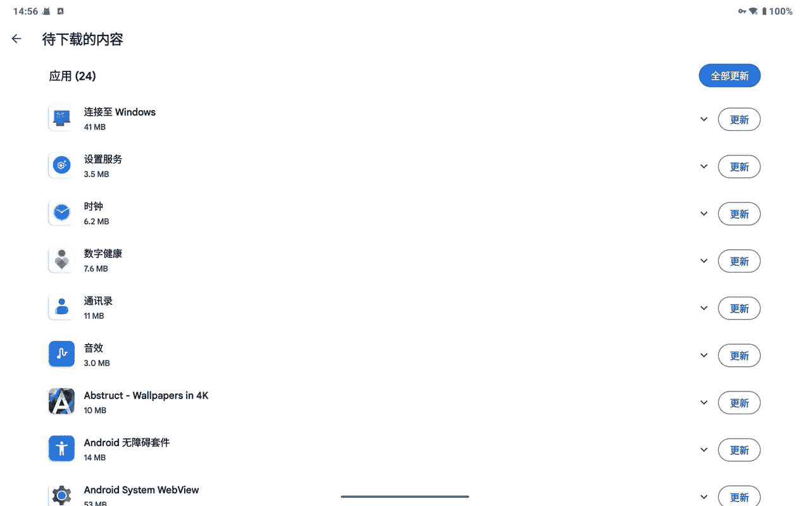

+   连wifi的时候注意勾选下那个"对于此网络不再询问"

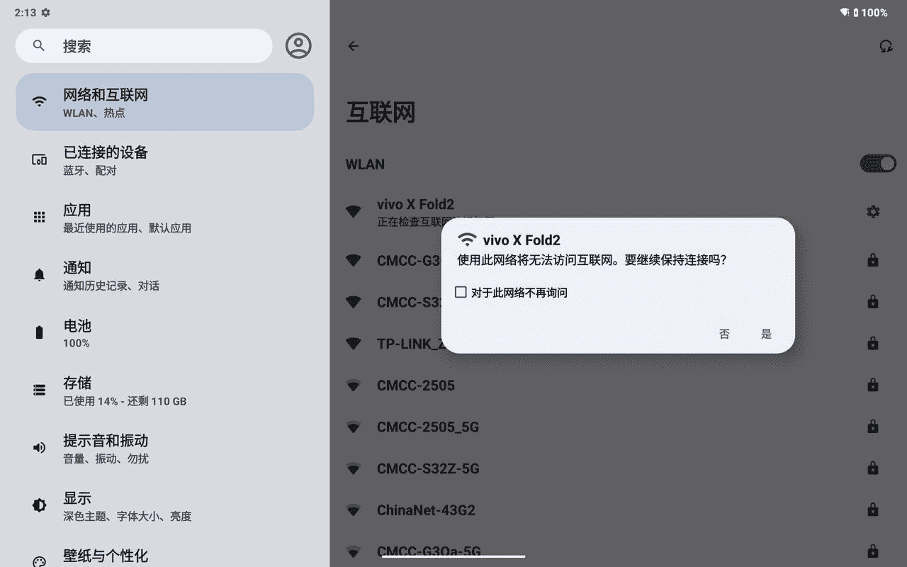