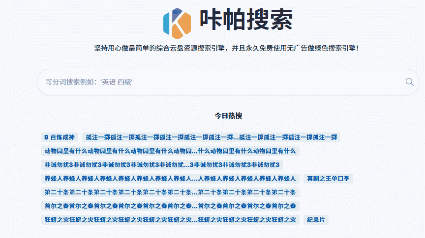
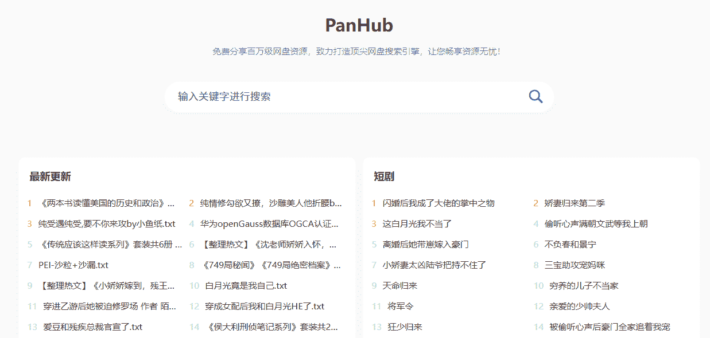

# 2024 六大网盘搜索引擎合集推荐

> 来源：[https://yunyingmenghai.feishu.cn/docx/XegvdMqQhogky4x08SwcUAQunKf](https://yunyingmenghai.feishu.cn/docx/XegvdMqQhogky4x08SwcUAQunKf)

# 咔帕搜索

https://www.cuppaso.com/

坚持用心做最简单的综合云盘资源搜索引擎，并且永久免费使用无广告做绿色搜索引擎！

# 盘搜

https://panso.pro/

探索无尽的学习资源，开启您的知识之旅！

# 爱盘搜

https://aipanso.com/

支持的网盘:夸克、百度云、115网盘、360云盘、华为网盘、新浪微盘

# PanHub

https://xn--b9wp0p59gf4o.com/

每日更新短剧资源,同步TG频道Quark_Share_Channel资源

# 皮卡搜索

https://www.pikaso.top/

学习资源较多

# 猫狸盘搜

https://www.alipansou.com/

**💥干净无广告**

#### 大力盘：网盘搜索引擎

**网址：** https://www.dalipan.com/

大力盘支持百度网盘、阿里网盘、夸克网盘和迅雷网盘等多种网盘资源的搜索。它提供了一些搜索小技巧，帮助用户更精准地找到所需资源。