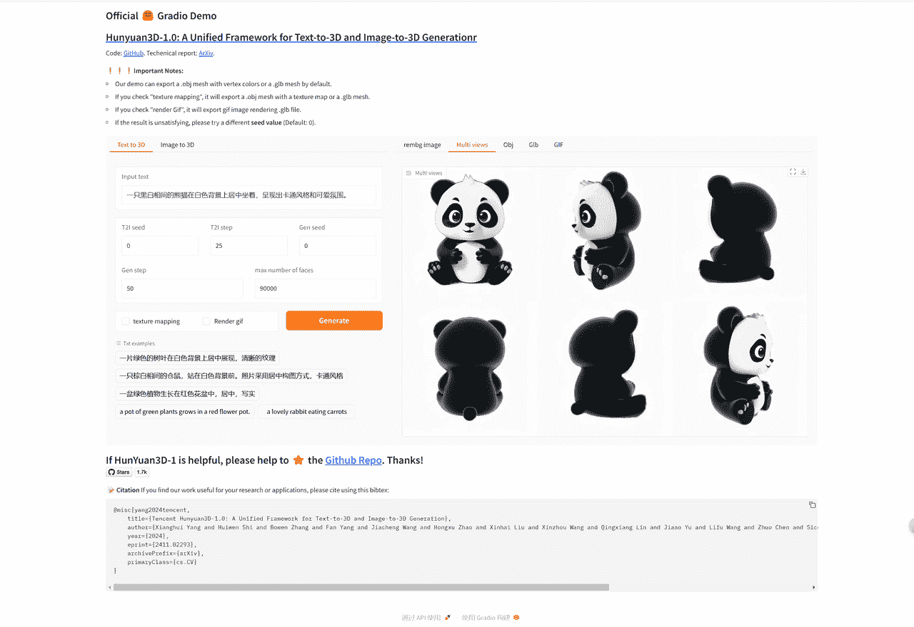
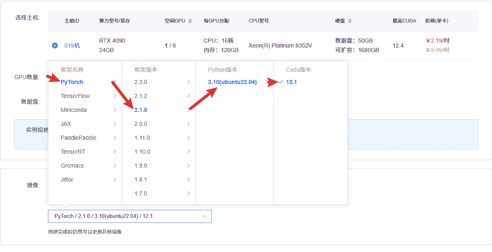
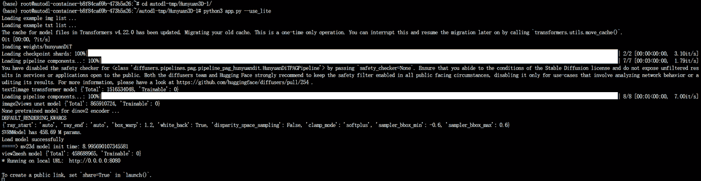

# AutoDL部署腾讯混元Hunyuan3D-1.0

> 来源：[https://yunyingmenghai.feishu.cn/docx/Fwpzd76sxoZV7dxxKMhcj0GGnyf](https://yunyingmenghai.feishu.cn/docx/Fwpzd76sxoZV7dxxKMhcj0GGnyf)



# 社区镜像

觉得麻烦的直接用这个,已安装所需依赖

https://www.codewithgpu.com/i/Tencent/Hunyuan3D-1/Hunyuan3D-1.0

项目地址：[https://github.com](https://github.com/Tencent/Hunyuan3D-1)/Tencent/Hunyuan3D-1

+   推理Std 标准版需要 30GB VRAM，4090单卡是24GB，如使用标准版推理需要租用2张显卡

+   推理 Lite版需要 22GB VRAM（18G VRAM 和 --save_memory） 。

+   注意：--save_memory 会增加推理时间

# 硬件配置:

+   系统: Ubuntu

+   GPU 名称: NVIDIA GeForce RTX 4090 D

+   系 统 盘/               ：30G

+   数 据 盘/root/autodl-tmp：50G

+   内存：60 GB

# 软件:

+   Python 版本: 3.10

+   PyTorch 版本: 2.1.2+cu121

+   CUDA 版本: 12.1



```
#开启**学术加速**
**source** /etc/network_turbo
#取消学术加速
unset http_proxy &amp;&amp; unset https_proxy
```

```
#查看剩余空间
source ~/.bashrc
```

```
source /etc/network_turbo
conda init
#激活当前环境
conda activate /root/miniconda3
```

# 安装pytorch3d

说明文档：https://github.com/facebookresearch/pytorch3d/blob/main/INSTALL.md

「pytorch3d-0.7.5-py310_cu121_pyt210-linux_x86_64.whl」

下载链接：https://pan.quark.cn/s/69791f03dced

```
pip install pytorch3d-0.7.5-py310_cu121_pyt210-linux_x86_64.whl
```

```
pip install --no-index --no-cache-dir pytorch3d -f https://dl.fbaipublicfiles.com/pytorch3d/packaging/wheels/py310_cu121_pyt210/download.html
```

```
#检查cuda可用性
python -c &quot;import torch; print(f&#x27;PyTorch 版本: {torch.__version__}&#x27;); print(f&#x27;CUDA 是否可用: {torch.cuda.is_available()}&#x27;); print(f&#x27;CUDA 版本: {torch.version.cuda if torch.cuda.is_available() else &quot;N/A&quot;}&#x27;); print(f&#x27;GPU 数量: {torch.cuda.device_count()}&#x27;); print(f&#x27;GPU 名称: {torch.cuda.get_device_name(0) if torch.cuda.is_available() else &quot;N/A&quot;}&#x27;)&quot;

#返回示例
PyTorch 版本: 2.1.2+cu121
CUDA 是否可用: True
CUDA 版本: 12.1
GPU 数量: 1
GPU 名称: NVIDIA GeForce RTX 4090 D

#检查cuda驱动版本
nvcc --version
#返回示例
nvcc: NVIDIA (R) Cuda compiler driver
Copyright (c) 2005-2023 NVIDIA Corporation
Built on Mon_Apr__3_17:16:06_PDT_2023
Cuda compilation tools, release 12.1, V12.1.105
Build cuda_12.1.r12.1/compiler.32688072_0
```

# 项目部署过程:

```
#由于模型文件约28[G 需在数据盘部署
cd /root](https://github.com/Tencent/Hunyuan3D-1)/autodl-tmp

git clone https://github.com/Tencent/Hunyuan3D-1

cd Hunyuan3D-1/
#删除 pip install git+https://github.com/facebookresearch/pytorch3d.git
vim env_install.sh
#删除整行
dd
#保存退出
Esc
:wq

bash env_install.sh

pip install tbb
```

# 下载模型

我用夸克网盘分享了「腾讯混元Hunyuan3D-1.0模型文件weights.7z」，点击链接即可保存。

链接：https://pan.quark.cn/s/bf4ba82fb483

```
pip install &quot;huggingface_hub[cli]&quot;
#设置镜像加速
export HF_ENDPOINT=https://hf-mirror.com

mkdir weights\hunyuanDiT
huggingface-cli download tencent/Hunyuan3D-1 --local-dir weights

huggingface-cli download Tencent-Hunyuan/HunyuanDiT-v1.1-Diffusers-Distilled --local-dir weights/hunyuanDiT

```

# 运行

单显卡小于30GB请使用 --use_lite --save_memory

```
python3 app.py --use_lite --save_memory
```

显卡大于30GB使用

```
python3 app.py
```

We have also prepared scripts with different configurations for reference

我们还准备了不同配置的脚本供参考

+   Inference Std-pipeline requires 30GB VRAM (24G VRAM with --save_memory).
推理标准管道需要 30GB VRAM（带有 --save_memory 的 24G VRAM）。

+   Inference Lite-pipeline requires 22GB VRAM (18G VRAM with --save_memory).
Inference Lite-pipeline 需要 22GB VRAM（18G VRAM 和 --save_memory）。

+   Note: --save_memory will increase inference time
注意：--save_memory 会增加推理时间

```
bash scripts/text_to_3d_std.sh 
bash scripts/text_to_3d_lite.sh 
bash scripts/image_to_3d_std.sh 
bash scripts/image_to_3d_lite.sh 
```

If your gpu memory is 16G, you can try to run modules in pipeline seperately:

如果你的GPU内存是16G，你可以尝试在管道中单独运行模块：

```
bash scripts/text_to_3d_std_separately.sh &#x27;a lovely rabbit&#x27; ./outputs/test &gt;= 16G
bash scripts/text_to_3d_lite_separately.sh &#x27;a lovely rabbit&#x27; ./outputs/test &gt;= 14G
bash scripts/image_to_3d_std_separately.sh ./demos/example_000.png ./outputs/test  &gt;= 16G
bash scripts/image_to_3d_lite_separately.sh ./demos/example_000.png ./outputs/test &gt;= 10G
```

####

#### 使用 Gradio

We have prepared two versions of multi-view generation, std and lite.

我们准备了两个版本的多视图生成，std 和 lite。

```
# std 
python3 app.py
python3 app.py --save_memory
# lite
python3 app.py --use_lite
python3 app.py --use_lite --save_memory
```

Then the demo can be accessed through http://0.0.0.0:8080. It should be noted that the 0.0.0.0 here needs to be X.X.X.X with your server IP.

然后可以通过http://0.0.0.0:8080访问该演示。需要注意的是，这里的0.0.0.0需要XXXX加上你的服务器IP。

