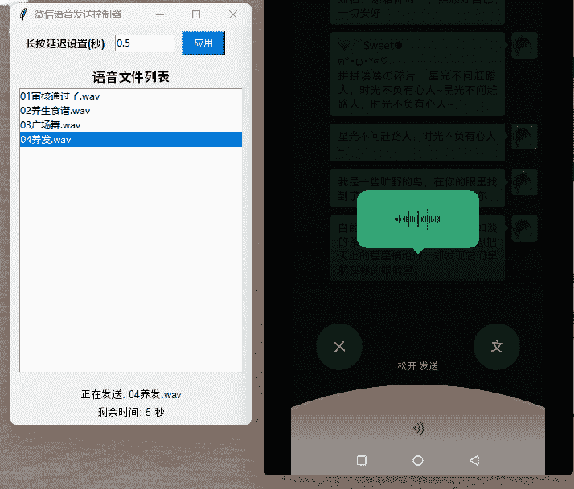
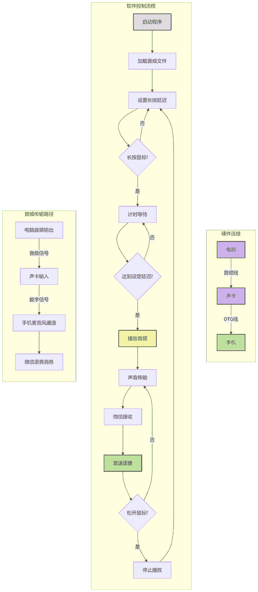

# Python实现微信语音发送自动化工具 - 内录播放控制系统

> 来源：[https://yunyingmenghai.feishu.cn/docx/Waacd9fytozPCuxvJ20cHezPndj](https://yunyingmenghai.feishu.cn/docx/Waacd9fytozPCuxvJ20cHezPndj)



Python实现微信语音发送自动化工具 - 内录播放控制系统

## 前言

本文将介绍一个基于Python的解决方案，通过声卡内录配合无线反控手机实现自动化语音发送功能。

搭配:[开源scrcpy手机无线投屏脚本反控手机](https://yunyingmenghai.feishu.cn/wiki/LiQQwuh3niyI3nkq8zLc5Dcdn7q)

### 应用场景

+   微信客服较多重复的语音回复场景

+   用语音回复怕被封

### 技术架构

1.  音频控制层：Python + SimpleAudio

1.  界面展示层：Tkinter GUI

1.  硬件交互层：声卡内录 + 无线反控手机

1.  事件监听层：鼠标长按0.5秒触发



### 环境配置

```
# 所需Python库
pip install tkinter  # GUI界面
pip install pynput   # 鼠标监听
pip install simpleaudio  # 音频播放
```

### 硬件要求

1.  声卡设备（支持内录功能）

1.  无线反控器（用于控制手机,不能连无线的可以手机共享热点）

1.  支持音频输入输出的PC设备

### 核心代码实现

```
import tkinter as tk
from tkinter import messagebox, ttk
from pynput import mouse
import simpleaudio as sa
import os
import threading
import time
import wave

class AudioController:
    def __init__(self):
        self.audio_directory = &quot;audio&quot;
        self.play_obj = None
        self.is_playing = False
        self.press_delay = 0.5  # 默认长按延迟时间
        self.press_time = None  # 按下时间记录
        self.start_time = None
        self.total_duration = 0
        self.setup_gui()
        self.setup_mouse_listener()

    def setup_gui(self):
        self.root = tk.Tk()
        self.root.title(&quot;微信语音发送控制器&quot;)
        
        # 设置窗口样式
        self.root.geometry(&quot;300x450&quot;)
        self.root.configure(bg=&#x27;#f0f0f0&#x27;)
        
        # 创建延迟设置框架
        self.create_delay_settings()
        
        # 创建文件列表
        self.create_audio_list()
        
        # 创建状态显示
        self.create_status_display()

    def create_delay_settings(self):
        &quot;&quot;&quot;创建延迟设置部分&quot;&quot;&quot;
        delay_frame = tk.Frame(self.root, bg=&#x27;#f0f0f0&#x27;)
        delay_frame.pack(pady=5, padx=10, fill=tk.X)

        # 标题标签
        tk.Label(delay_frame, 
                text=&quot;长按延迟设置(秒)&quot;, 
                font=(&#x27;Arial&#x27;, 10, &#x27;bold&#x27;),
                bg=&#x27;#f0f0f0&#x27;).pack(side=tk.LEFT, padx=5)

        # 创建验证函数
        def validate_input(text):
            if text == &quot;&quot;: return True
            try:
                value = float(text)
                return value &gt;= 0
            except ValueError:
                return False

        vcmd = (self.root.register(validate_input), &#x27;%P&#x27;)

        # 输入框
        self.delay_entry = tk.Entry(delay_frame, 
                                  width=10, 
                                  validate=&#x27;key&#x27;, 
                                  validatecommand=vcmd)
        self.delay_entry.insert(0, str(self.press_delay))
        self.delay_entry.pack(side=tk.LEFT, padx=5)

        # 应用按钮
        apply_button = tk.Button(delay_frame, 
                               text=&quot;应用&quot;, 
                               command=self.apply_delay,
                               bg=&#x27;#0078d7&#x27;,
                               fg=&#x27;white&#x27;,
                               padx=10)
        apply_button.pack(side=tk.LEFT, padx=5)

    def create_audio_list(self):
        # 文件列表框架
        list_frame = tk.Frame(self.root, bg=&#x27;#f0f0f0&#x27;)
        list_frame.pack(pady=10, padx=10, fill=tk.BOTH, expand=True)
        
        # 标题标签
        tk.Label(list_frame, 
                text=&quot;语音文件列表&quot;, 
                font=(&#x27;Arial&#x27;, 12, &#x27;bold&#x27;),
                bg=&#x27;#f0f0f0&#x27;).pack()
        
        # 列表框
        self.audio_files = [f for f in os.listdir(self.audio_directory) 
                          if f.endswith(&#x27;.wav&#x27;)]
        self.audio_var = tk.StringVar(value=self.audio_files)
        self.audio_listbox = tk.Listbox(list_frame, 
                                      listvariable=self.audio_var,
                                      height=10,
                                      selectmode=&#x27;single&#x27;,
                                      bg=&#x27;white&#x27;,
                                      selectbackground=&#x27;#0078d7&#x27;)
        self.audio_listbox.pack(fill=tk.BOTH, expand=True)

    def create_status_display(self):
        # 状态显示框架
        status_frame = tk.Frame(self.root, bg=&#x27;#f0f0f0&#x27;)
        status_frame.pack(pady=5, padx=10, fill=tk.X)
        
        # 状态标签
        self.status_label = tk.Label(status_frame, 
                                   text=f&quot;长按鼠标左键 {self.press_delay} 秒开始发送语音&quot;,
                                   bg=&#x27;#f0f0f0&#x27;,
                                   font=(&#x27;Arial&#x27;, 10))
        self.status_label.pack()
        
        # 倒计时标签
        self.countdown_label = tk.Label(status_frame, 
                                      text=&quot;剩余时间: 0 秒&quot;,
                                      bg=&#x27;#f0f0f0&#x27;,
                                      font=(&#x27;Arial&#x27;, 10))
        self.countdown_label.pack()

    def play_audio(self, file_path):
        &quot;&quot;&quot;播放音频文件&quot;&quot;&quot;
        if self.play_obj and self.play_obj.is_playing():
            self.play_obj.stop()

        try:
            # 获取音频时长
            with wave.open(file_path, &#x27;rb&#x27;) as wave_file:
                frames = wave_file.getnframes()
                sample_rate = wave_file.getframerate()
                self.total_duration = frames / float(sample_rate)

            wave_obj = sa.WaveObject.from_wave_file(file_path)
            self.play_obj = wave_obj.play()
            self.is_playing = True
            self.start_time = time.time()
            self.status_label.config(text=f&quot;正在发送: {os.path.basename(file_path)}&quot;)
            self.update_countdown()
        except Exception as e:
            messagebox.showerror(&quot;错误&quot;, f&quot;无法播放文件: {str(e)}&quot;)

    def stop_audio(self):
        &quot;&quot;&quot;停止音频播放&quot;&quot;&quot;
        if self.play_obj:
            self.play_obj.stop()
            self.is_playing = False
            self.status_label.config(text=f&quot;长按鼠标左键 {self.press_delay} 秒开始发送语音&quot;)
            self.countdown_label.config(text=&quot;剩余时间: 0 秒&quot;)

    def update_countdown(self):
        &quot;&quot;&quot;更新倒计时显示&quot;&quot;&quot;
        if self.play_obj and self.play_obj.is_playing():
            elapsed_time = time.time() - self.start_time
            remaining_time = max(0, self.total_duration - elapsed_time)
            self.countdown_label.config(text=f&quot;剩余时间: {int(remaining_time)} 秒&quot;)
            if remaining_time &gt; 0:
                self.root.after(100, self.update_countdown)
            else:
                self.stop_audio()
        else:
            self.countdown_label.config(text=&quot;剩余时间: 0 秒&quot;)

    def setup_mouse_listener(self):
        &quot;&quot;&quot;设置鼠标监听&quot;&quot;&quot;
        self.listener = mouse.Listener(on_click=self.on_click)
        self.listener.start()

    def on_click(self, x, y, button, pressed):
        &quot;&quot;&quot;鼠标事件处理&quot;&quot;&quot;
        if button == mouse.Button.left:
            if pressed:
                self.press_time = time.time()
                threading.Thread(target=self.check_long_press, daemon=True).start()
            else:
                if self.is_playing:
                    self.stop_audio()
                self.press_time = None

    def check_long_press(self):
        &quot;&quot;&quot;检查长按状态&quot;&quot;&quot;
        while self.press_time is not None:
            if time.time() - self.press_time &gt;= self.press_delay:
                selected = self.audio_listbox.curselection()
                if selected:
                    file_path = os.path.join(
                        self.audio_directory, 
                        self.audio_listbox.get(selected[0]))
                    self.play_audio(file_path)
                break
            time.sleep(0.1)

    def update_status_text(self):
        &quot;&quot;&quot;更新状态文本&quot;&quot;&quot;
        self.status_label.config(
            text=f&quot;长按鼠标左键 {self.press_delay} 秒开始发送语音&quot;)

    def apply_delay(self):
        &quot;&quot;&quot;应用新的延迟设置&quot;&quot;&quot;
        try:
            new_delay = float(self.delay_entry.get())
            if new_delay &gt;= 0:
                self.press_delay = new_delay
                self.update_status_text()
                messagebox.showinfo(&quot;成功&quot;, f&quot;已设置长按延迟为 {new_delay} 秒&quot;)
            else:
                messagebox.showerror(&quot;错误&quot;, &quot;延迟时间不能为负数&quot;)
        except ValueError:
            messagebox.showerror(&quot;错误&quot;, &quot;请输入有效的数字&quot;)

    def run(self):
        &quot;&quot;&quot;运行应用&quot;&quot;&quot;
        self.root.mainloop()
        self.listener.stop()

if __name__ == &quot;__main__&quot;:
    controller = AudioController()
    controller.run()

```

### 使用说明

1.  创建一个名为"audio"的文件夹，将WAV格式的音频文件放入其中。

1.  运行程序后可以：

+   在顶部设置长按延迟时间（默认0.5秒）

+   在列表中选择要播放的音频文件

+   长按鼠标左键指定时间后开始播放

+   松开鼠标左键停止播放

1.  界面显示：

+   当前延迟设置

+   播放状态

+   剩余播放时间

1.  注意事项：

+   确保audio文件夹存在且包含WAV格式文件

+   延迟时间必须是大于等于0的数字

### 总结

本工具通过Python实现了一个实用的微信语音发送控制系统，结合硬件设备可以实现自动化的语音消息发送功能。该系统具有界面直观、操作简单、功能实用等特点，适合需要进行语音消息自动化处理的场景