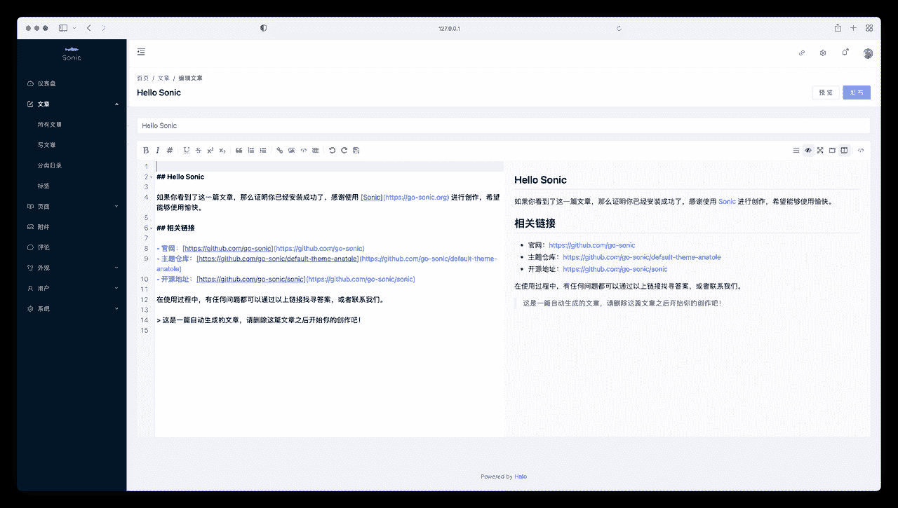

# Sonic - Go 开发的博客平台

> 来源：[https://yunyingmenghai.feishu.cn/docx/NSged66NooNFX7xSTZoc6MEanng](https://yunyingmenghai.feishu.cn/docx/NSged66NooNFX7xSTZoc6MEanng)

### [sonic](https://github.com/go-sonic/sonic)

Sonic 是 Go 开发的博客平台，简单而强大：



# Sonic：一个用Go语言开发的高性能博客平台

## 简介

Sonic，一个以其速度如声速般快速而命名的博客平台，是一个用Go语言开发的高性能博客系统。正如其名字所暗示的，Sonic旨在提供一个简单而强大的博客解决方案。这个项目受到了Halo项目团队的启发，前端部分是基于Halo项目的分支。

## 特点

Sonic具有以下显著特点：

1.  **多数据库支持**：支持SQLite和MySQL（PostgreSQL支持待开发）。

1.  **轻量级**：安装文件仅10MB大小。

1.  **高性能**：文章详情页能够承受2500 QPS的访问量（测试环境：Intel Xeon Platinum 8260 4C 8G，SQLite3）。

1.  **主题更换支持**：用户可以根据自己的喜好更换博客主题。

1.  **跨平台支持**：支持Linux、Windows、Mac OS，以及x86、x64、Arm、Arm64、MIPS架构。

1.  **对象存储支持**：支持MINIO、Google Cloud、AWS、AliYun等对象存储服务。

## 预览

Sonic的默认主题Anatole提供了一个简洁而现代的界面，以下是其截图预览：

[https://github.com/go-sonic/default](https://github.com/go-sonic/default-theme-anatole/raw/master/screenshot.png)-theme-anatole/raw/master/screenshot.png

## 安装

安装Sonic的步骤如下：

1.  **下载最新安装包**：

1.  bash

```
wget https://github.com/go-sonic/sonic/releases/latest/download/sonic-linux-amd64.zip -O sonic.zip
```

1.  **解压**： 解压下载的sonic.zip文件。

1.  **启动**：

1.  bash

```
cd sonic
./sonic -config conf/config.yaml
```

1.  **初始化**： 打开浏览器访问http://ip:port/admin#install进行初始化设置。初始化完成后，你可以通过浏览器访问Sonic，管理后台的URL为http://ip:port/admin，默认端口为8080。

## 构建

如果你想要自己构建Sonic，可以按照以下步骤操作：

1.  **拉取项目**：

1.  bash

```
git clone --recursive --depth 1 https://github.com/go-sonic/sonic
```

1.  **运行**： 在Windows上编译此包，你需要安装gcc编译器，例如TDM-GCC工具链。

构建完成后，你的项目就准备好使用了。

## Docker

[Sonic也提供了Dock](https://hub.docker.com/r/gosonic/sonic)er镜像，可以在Docker Hub上找到：gosonic/sonic。

## 主题生态

Sonic拥有一个活跃的主题生态，以下是一些可用的主题：

+   Anatole

+   Journal

+   Clark

+   Earth

+   PaperMod

+   Tink

## 待办事项

Sonic的开发团队正在努力实现以下功能：

+   国际化（i18n）

+   PostgreSQL支持

+   更好的错误处理

+   基于Wasm的插件系统

+   使用新的Web框架（Hertz）

## 贡献

Sonic欢迎任何形式的贡献。你可以提出问题或提交Pull Requests。Sonic遵循Contributor Covenant行为准则。

### 贡献者

这个项目得以存在，感谢所有贡献者的努力。特别感谢Evan（evanzhao@88.com），他设计了Sonic的Logo。

## 许可

Sonic的源代码在MIT许可下可用。