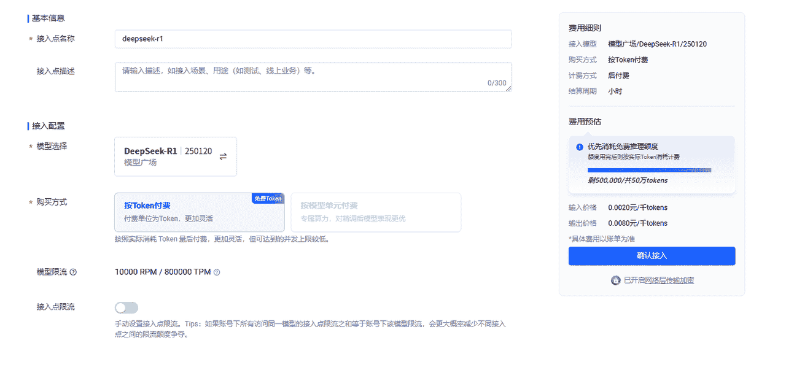

# 白嫖火山引擎DeepSeek R1 模型

> 来源：[https://yunyingmenghai.feishu.cn/docx/MXK8dX0cGobE0mxGWQwcmhVxnlf](https://yunyingmenghai.feishu.cn/docx/MXK8dX0cGobE0mxGWQwcmhVxnlf)

## 创建推理接入点

1.  访问[方舟控制台-在线推理](https://console.volcengine.com/ark/region:ark+cn-beijing/endpoint?config=%7B%7D)。

1.  点击页面上方 **账号全部资源** 下拉箭头，切换需要创建推理接入点的项目空间。

1.  单击 **创建推理接入点** 按钮，在打开的页面中选择推理接入点配置。

1.  [按照界面完成](https://www.volcengine.com/docs/82379/1099522#f9c0cd93)配置，如对参数有疑问，可以参考配置参数说明。

1.  打开 [方舟控制台-在线推理](https://console.volcengine.com/ark/region:ark+cn-beijing/endpoint?config=%7B%7D) 查看推理接入点 ID。

如提示模型未开通,点击立即开通即可

