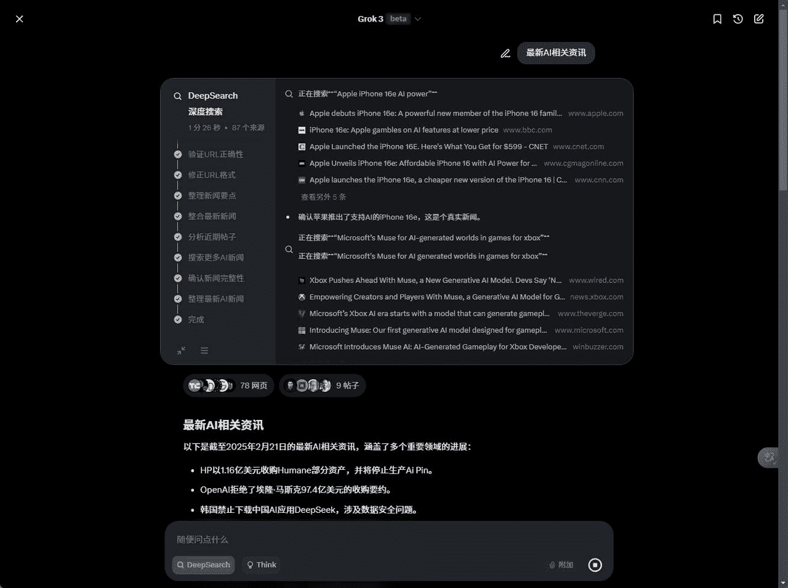

# 马斯克xAI正式开放Grok-3免费体验！新手详细使用指南

> 来源：[https://yunyingmenghai.feishu.cn/docx/S3oUdWdlIoWh0txEe2KcnIpAnve](https://yunyingmenghai.feishu.cn/docx/S3oUdWdlIoWh0txEe2KcnIpAnve)

# 马斯克xAI正式开放Grok-3免费体验！新手详细使用指南

## 前言：为什么值得关注？

北京时间2月20日，马斯克旗下人工智能公司xAI宣布**全面开放Grok-3模型免费使用**，这是继ChatGPT之后AI领域的又一重大动向。本次开放有两大核心亮点：

+   **零成本体验**：所有用户无需付费即可使用

+   **无门槛限制**：仅需注册账号即可访问

+   **企业级技术**：与X Premium+/SuperGrok订阅服务同源技术

> 划重点：官方明确表示「**免费服务将持续到服务器达到承载极限**」，建议尽早体验

---



## 一、Grok-3核心功能解析（新手向）

### 1.1 基础功能清单

```
- 智能问答：处理复杂问题查询
- 多场景适配：日常助手/专业领域应用
- 实时学习：持续更新的知识库
```

### 1.2 免费版 vs 付费版

| 功能 | 免费版 | X Premium+/SuperGrok |
| --- | --- | --- |
| 基础对话 | ✅ | ✅ |
| 语音交互模式 | ❌ | ✅ |
| 深度使用权限 | ❌ | ✅ |
| 响应优先级 | 普通队列 | 专属通道 |

---

## 二、三步快速体验指南

### 2.1 注册流程演示

1.  访问[xAI官网](https://www.xai.com)

1.  选择邮箱/Twitter账号登录

### 2.2 新手推荐用法

+   知识查询：直接输入问题获取解答

+   效率工具：尝试生成日程表/简单文档

+   技术探索：询问AI工作原理（支持中文）

### 2.3 注意事项

⚠️ 当前已知限制：

+   高峰期可能出现响应延迟

+   复杂任务需切换付费版本

+   不支持敏感话题讨论

---

## 三、付费服务深度解读

### 3.1 订阅用户特权

+   **语音模式**：支持语音输入/输出交互

+   **专业工具**：数据分析/代码调试等进阶功能

+   **优先访问**：新功能提前体验权限

### 3.2 服务定价

+   X Premium+：包含基础付费功能

+   SuperGrok：企业级深度应用支持

> 官方提示：免费用户不会自动转为付费，需手动订阅

---

## 四、技术影响与未来展望

### 4.1 行业意义

+   首个开放免费试用的企业级AI模型

+   降低AI技术体验门槛

+   推动多模态交互普及

### 4.2 发展预测

根据xAI官方透露：

1.  将持续收集免费用户反馈

1.  可能推出梯度付费方案

1.  重点优化服务器承载能力

---