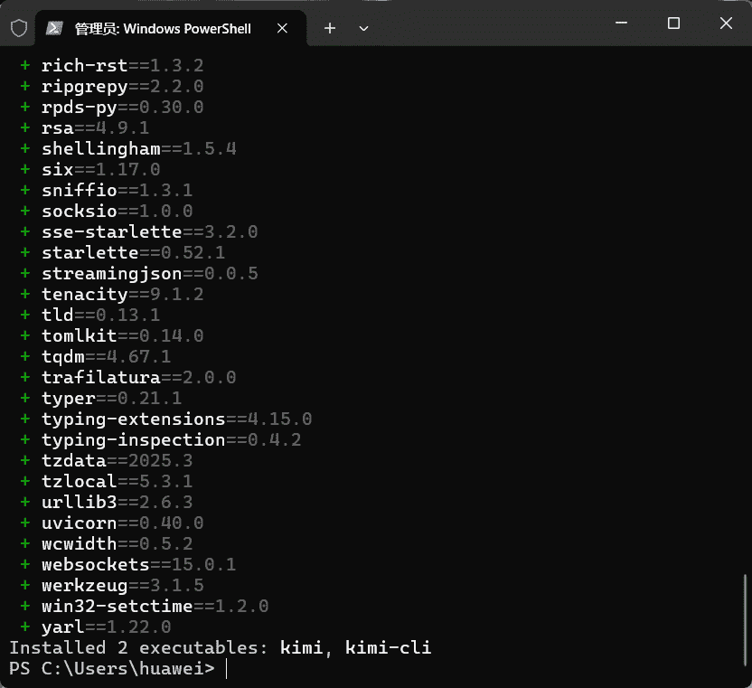

# Win11安装Kimi code

> 来源：[https://yunyingmenghai.feishu.cn/docx/GOZyd4l9ioSEn7xwB9RcCFountf](https://yunyingmenghai.feishu.cn/docx/GOZyd4l9ioSEn7xwB9RcCFountf)

https://www.kimi.com/code

某些安全软件会阻止新线程的网络访问：

1.  临时关闭防火墙测试：

1.  powershell

1.  复制

```
netsh advfirewall set allprofiles state off
# 测试 curl 是否正常
curl https://api.moonshot.cn
# 测试完记得开启
netsh advfirewall set allprofiles state on
```

1.  检查是否有第三方安全软件拦截（如 360、火绒、卡巴斯基等），临时退出测试。

# 最通用的 自动检测路径 的防火墙规则命令（复制粘贴即可，无需手动修改路径）：

powershell# 自动检测 kimi 路径并添加防火墙规则（管理员 PowerShell）

```
$kimiPath = (Get-Command kimi).Source; netsh advfirewall firewall add rule name=&quot;Kimi CLI&quot; dir=out action=allow program=&quot;$kimiPath&quot; enable=yes
```

或者分步写法（更稳定）：

powershell

```
# 1. 获取实际路径
$kimiPath = (Get-Command kimi).Source

# 2. 添加规则
netsh advfirewall firewall add rule name=&quot;Kimi CLI&quot; dir=out action=allow program=&quot;$kimiPath&quot; enable=yes

# 3. 验证
netsh advfirewall firewall show rule name=&quot;Kimi CLI&quot;
```

# PowerShell 默认阻止执行网上下载的脚本，你需要调整执行策略。

```
Set-ExecutionPolicy RemoteSigned -Scope CurrentUser
```

```
irm https://code.kimi.com/install.ps1 | iex
```

# uv 已经安装成功后，终端没识别到新路径；添加路径到系统变量

```
[Environment]::SetEnvironmentVariable(&quot;Path&quot;, &quot;$env:USERPROFILE\.local\bin;&quot; + [Environment]::GetEnvironmentVariable(&quot;Path&quot;, &quot;User&quot;), &quot;User&quot;)
```

```
uv tool install --python 3.13 kimi-cli
```

## 临时禁用实时保护

如果方案 1 无效，可能是 Windows Defender 阻止了：

1.  Windows 安全中心 → 病毒和威胁防护 → 管理设置

1.  暂时关闭实时保护（安装完记得重新打开）关闭杀毒软件如腾讯管家

1.  再次运行安装命令

```
uv cache clean
uv tool install kimi-cli --reinstall
```

# 如果安装较慢或失败，可以尝试国内镜像加速：

```
# 设置国内镜像（清华源）$env:UV_DEFAULT_INDEX = &quot;https://pypi.tuna.tsinghua.edu.cn/simple&quot;
uv tool install kimi-cli
```



### 如何升级 Kimi Code CLI

使用 uv 升级到最新版本：

```
uv tool upgrade kimi-cli --no-cache
```