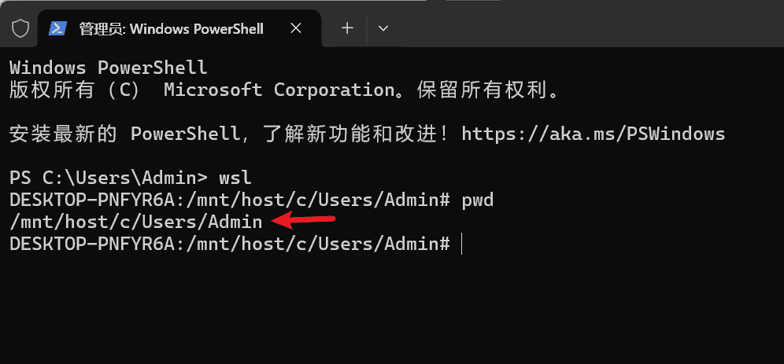

# Hermes-agent WIN整合包

> 来源：[https://yunyingmenghai.feishu.cn/docx/MuRWd68mqoePMixwS8rco3YonJe](https://yunyingmenghai.feishu.cn/docx/MuRWd68mqoePMixwS8rco3YonJe)

# Hermes-agent整合包下载

链接：https://pan.quark.cn/s/34d70bcb9b01

# 使用说明:

1.  运行:hermes ui  页面配置模型/代理

1.  start-webui.bat  # 启动 Web UI

1.  start-hermes.bat # 启动 Cli命令行对话框

```
model:
  default: kimi-latest  
  base_url: https://api.kimi.com/coding/v1
  api_mode: anthropic_messages
```

# 配置文件路径:

```
C:\Users\替换自己的用户名\.hermes
.env
config.yaml
```

# 常见问题:

## 附件上传后无法读取或本地文件路径无法读取

```
wsl-windows-path-conversion
==========================

Convert Windows paths to WSL-accessible paths when Hermes runs inside WSL but accesses Windows filesystem.

Triggers:
- User provides a Windows path (e.g., C:\Users\...)
- File not found errors on Windows paths
- Workspace path starts with C:\ or other drive letters
- Need to access Windows files from WSL environment

Problem
-------

Hermes Agent runs inside a WSL (Windows Subsystem for Linux) environment. When the user specifies a Windows path like C:\Users\Admin\workspace, Hermes&#x27; file tools (search_files, read_file, write_file, terminal) cannot access it directly because WSL uses a different filesystem mount point.

Conversion Rule
---------------

Replace the Windows drive letter with the WSL mount path:

  C:\Users\X\workspace  →  /mnt/host/c/Users/X/workspace
  D:\Some\Path          →  /mnt/host/d/Some/Path
  E:\Project             →  /mnt/host/e/Project

General formula:
  &lt;X&gt;:\&lt;path&gt;  →  /mnt/host/&lt;lowercase_x&gt;/&lt;path_with_forward_slashes&gt;

Verification
------------

Always verify the converted path exists before using it:

  ls -la /mnt/host/c/Users/Admin/workspace

Current Workspace Mapping
-------------------------

  Windows Path                WSL Path
  --------------------------  --------------------------------
  C:\Users\Admin\workspace    /mnt/host/c/Users/Admin/workspace

Usage in Tools
--------------

- search_files: Use /mnt/host/c/... path
- read_file:    Use /mnt/host/c/... path
- write_file:   Use /mnt/host/c/... path
- terminal:     Use /mnt/host/c/... path or cd to it first

Environment Note
----------------

The current WSL environment shows:
- Working directory: /mnt/host/d/Hermes/Hermes-Agent-Portable
- Windows drives mounted under: /mnt/host/&lt;drive&gt;/

Common Pitfalls
---------------

1. Do NOT use /mnt/c/... — use /mnt/host/c/... (the &quot;host&quot; prefix is required in this WSL setup)
2. Backslashes in Windows paths must become forward slashes in Linux
3. Drive letters must be lowercase in the WSL path
4. Spaces in paths should be escaped or quoted in terminal commands
```

Hermes 配置中的 Windows 绝对路径必须转换为 Linux 能识别的格式：



## AI 工具的 WSL 集成层在尝试启动 shell 时失败了—它默认要找 /bin/bash， WSL 里没有装 bash

```
#打开终端
wsl
#在 WSL 里装 bash：
apk add bash
```

# 相关使用教程:

https://hermes-agent.nousresearch.com/docs/getting-started/quickstart

# 原项目地址:

多维表格（RWesbCUiLaxjKXsorlPc61Hqn3g_tblfeogASD0DBsfe）