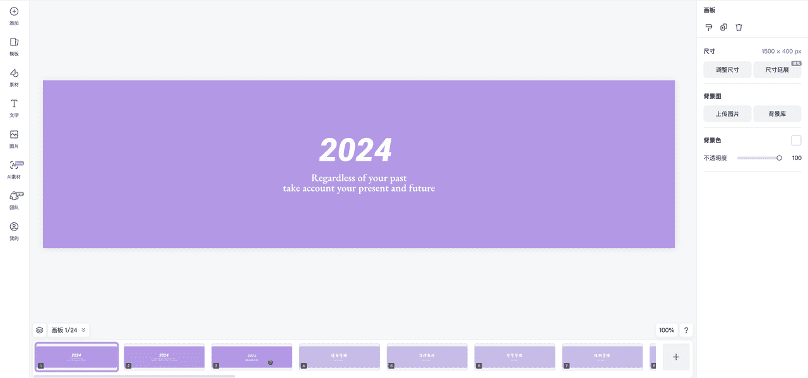
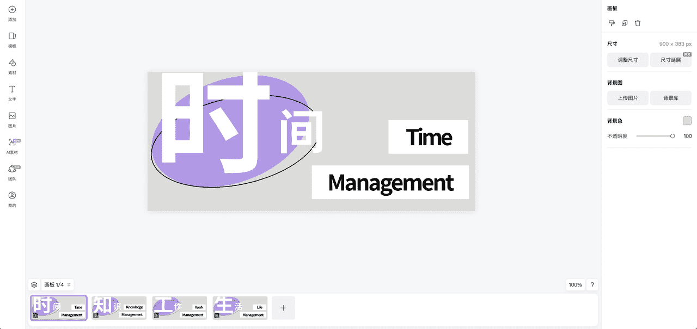
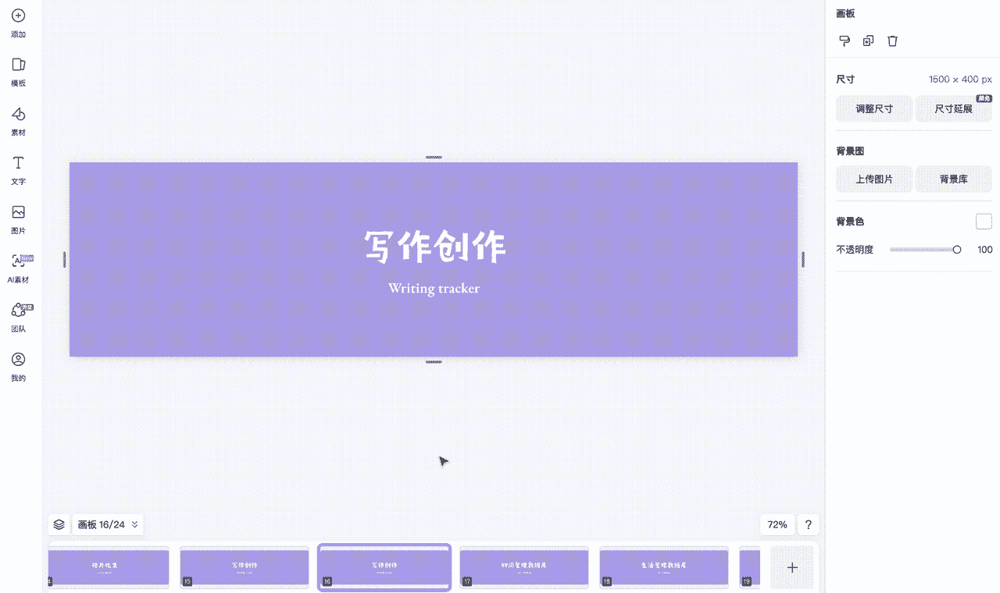
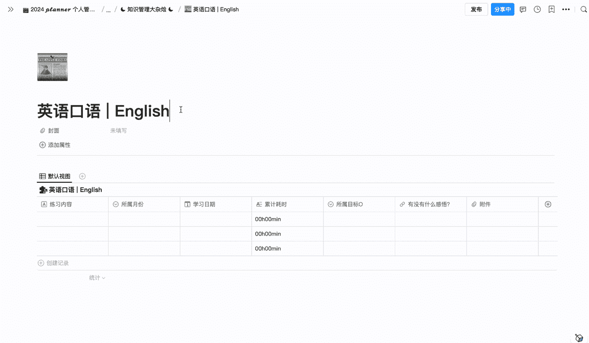
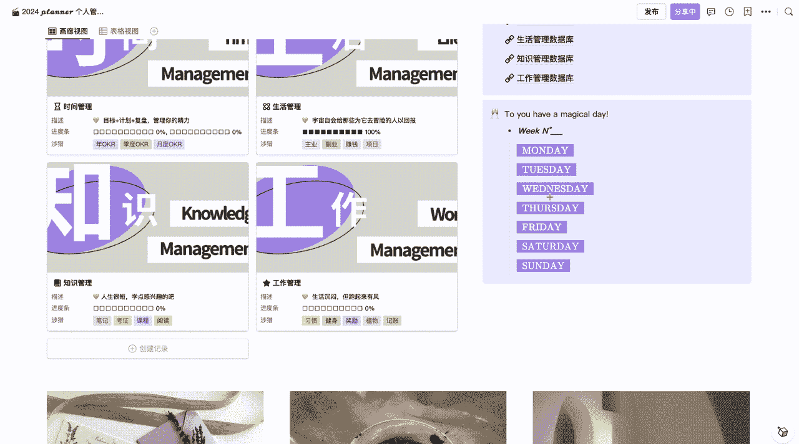
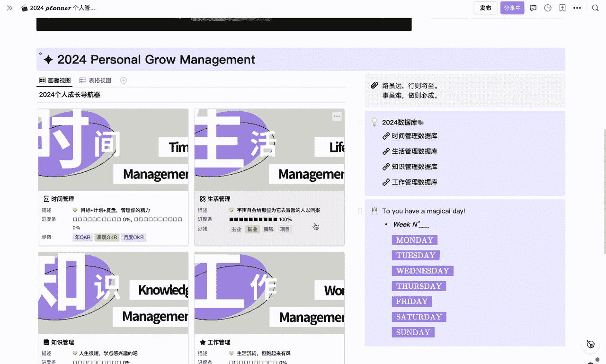

# 线上用户 ◎ idea集锦

> 来源：[https://docs.feishu.cn/docx/YIDId9fvQoblodxzCt6cI1j7nHc](https://docs.feishu.cn/docx/YIDId9fvQoblodxzCt6cI1j7nHc)

# 封面相关

## 01 如何给整套模板修改颜色

有小伙伴问：现在整套模板的颜色是紫色，如果我要修改成其他颜色，应该怎么修改呢？

首先需要先有一个自己的**稿定设计**账号，具体访问网页：https://www.gaoding.com/。

然后根据自己的需求，用下方对应的链接，去复制一份封面到自己的稿定空间里，之后直接修改即可。

背景封面和bar制作：https://www.gaoding.com/dam/share/4XoAovgGb0lUBGjVOCd

导航器封面制作：https://www.gaoding.com/dam/share/A5dORXO9518uOaM3Khw

## 02 给知识管理增加封面

**有小伙伴提**出疑**问：如果我**给知识管理加了新的数据库，那呈现的封面要怎么添加呢？

这里假如我在知识管理部分增加了「英语口语」这张数据表，那么我们要先去稿定设计做一张封面，然后添加到FlowUs里面。具体操作如下：

# 数据库问题解答

## 01 关联属性与规则关联

**有小伙伴提出疑问：**关联属性都是手动建立记录的关联吗？可以创建规则自动关联吗？

**周一：**是的，目前Notion和FlowUs都需要手动进行记录的关联。And俺也期待它有自动关联的那一天。具体关联方式看这篇文章：「关联」「汇总」功能一起来了！到底怎么用？速戳查看功能指南！

## 02 如何增加新的数据库

假如说我想要在知识管理部分增加**「英语口语」**这张数据表，那么先去到**「知识管理数据库」**，然后创建数据表。**具体操作如下：**

有了数据之后，我们去到**知识管理视图**，把数据给给填充到视图里面。**具体操作如下：**

# 问题集合漏斗

多维表格（OrjwbNi75anYossthH1caF2pnzh_tblQMZH7zWsa8XZY）