# 手把手教你玩转飞书文档

> 来源：[https://docs.feishu.cn/docx/Pd3ydBjEBoCouNxpmCFcg6wNnre](https://docs.feishu.cn/docx/Pd3ydBjEBoCouNxpmCFcg6wNnre)

# 📸前言

**使用飞书云文档**3年+的时间，MD语法内容累计产生200w文字+，见证飞书文档引入画板、流程图、分栏等功能的出现，不断在探索并应用其中各种神奇的用法。

今天就来一通沉淀下，如何把**飞书文档**，高效地融入到个人生活和业务流程中的方方面面，带你查看千奇百态的**飞书文档**。

在下面的文章中，将分享飞书文档的各种花式玩法，带你探索飞书文档的五彩斑斓。开始探索ing~


# 一、📡基础简介：工欲善其事，必先利其器

## 从哪开始

平时经常给身边的好朋友安利**飞书云文档**，但安利完成之后，它们就会有个疑惑，如果**从0开始上手飞书云文档****，我应该**从哪个开始呢？我的答案是从飞书文档开始。

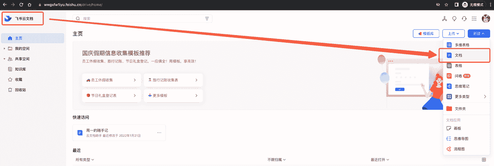

因为谈到其他类型的文档类型，像多维表格、思维笔记、画板、流程图等等，这些对于有些小伙伴来说，它们有可能都是第一回听说，刚创建可能都不知道从哪开始上手。而前边提到的这些东西，也都可以内嵌到文档里面。所以，不如先上手文档，其他的功能，慢慢地就会在文档中，去打开探索的旷野了。

## 应用场景

那在日常生活中，飞书文档都有哪些使用场景呢？

+   **会议记录**** —— 一次会议会**产生很多的头脑风暴，参加会议的小伙伴们可以同时在云文档里面进行编辑，达到了消息的及时性。

+   **沉淀业务文档** —— **比如，最近小组内有个**小伙伴在负责某个平台的新手教程开发，这其实就是个从零到一的过程。那在写代码的过程中，coding可能是非常快乐的。不过呢，如果不把这个模块的逻辑设计等内容给沉淀下来，那等到下一次再负责相同模块时，有可能又是从0开始。因此，就可以在开发的过程中，去沉淀一份新手教程相关的业务文档，方便自己以后迭代时使用，也方便其他小伙伴学习和围观。一份知识，N份快乐。

+   **写文章** **—— 日常在网上冲浪的**时候，可能会看到很多好用的小知识。在此过程中，也可以通过飞书文档来记录各种有用的小知识，并最终通过不断的打碎、重组、整合和归纳，形成一篇经过个人理解沉淀下来的文章。

+   **周报月报** —— 平常每天都要干很多事情，只有及时追溯自己做过哪些事情，才能更好地为下一次的工作做铺垫。同样，可以用飞书文档，来生产自己的日报和月报，及时追溯每日进展、工作产出、遇到的问题，以及撰写一天的反思。

+   更多场景待你挖掘……

## 打开协作的大门

**下面谈谈**飞书文档另一个让我很兴奋的点：在线协作。以前用过其他家的协作工具，但整体使用下来总感觉好像还差了点什么。

直到遇到飞书，它其实是做到了在一个应用软件里面，就可以即时地看到所有你编辑过的文档的内容。同时，还满足了电脑、ipad、手机多端同步。

**这样下来，从某种程度上****可以极大地减少**小**编的「心智负担」。只需要把我**想写的内容进行记录，文档会自动地实时同步。过后如果因为什么事情突然离开当前页面，我也不用担心数据会丢失。且不管当前在我身边的设备是电脑、ipad还是手机，都可以随时随地，想看就看，想记就记。

# 二、🗝基础操作：带你了解隐藏的武功秘籍

基础简介介绍完啦！接下来将介绍**飞书文档**那些隐藏的武功秘籍。个人认为，对于**一款工具软件**来说，首先要去了解的就是它的各种快捷操作。

快捷操作不乏包括**快捷键**、**特定语法**、**特定逻辑符号触发**等等，这些快捷操作可以让我们在写文档的过程中，大幅度地减少重复点击的操作，从而更快速地达到用户所期望的界面效果。

## 认识「/」

首先是认识「/」，我们可以在文档的每一行里**面，敲击键盘**「/」，唤起对应的功能界面。如下图所示：

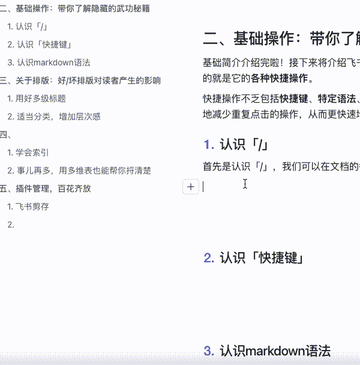

认**识了「/**」**以后，就**是了解「**/」后**，可以做些什么事情。在上面这个界面里面，有非常多预**置的功能，这**些单独的功能，它们都有拼音简称和拼音全称。比如：高亮块的拼音全称是gaoliangkuai，简称是glk。那如果我们想要在界面里面唤起一个高亮块，该怎么处理呢？如下图所示：

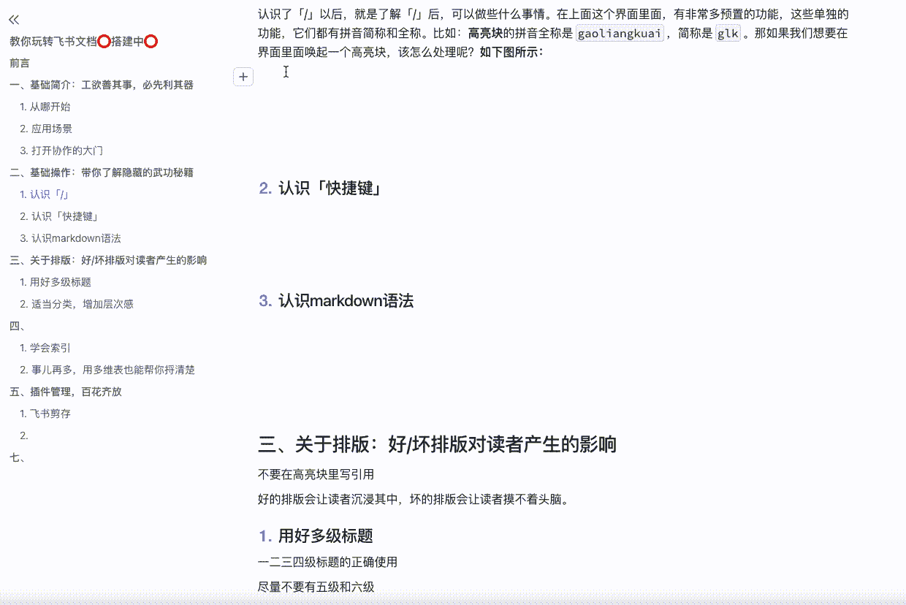

那像其他类型的功能，也是同样的用法，小伙伴们可以自行操作加深印象。

## 认识「快捷键」

**飞书文档的**快捷键有两个地方可以唤起，第一**个地方是键盘**的操作符『cmd+/』。如下图所示：

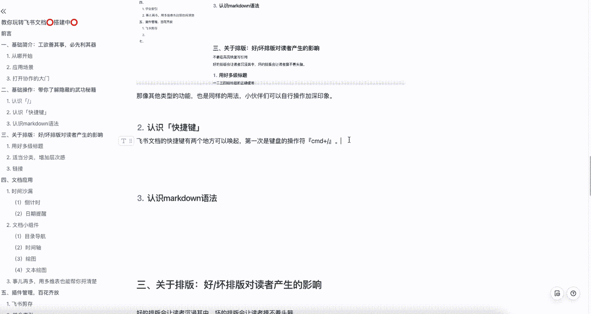

**第二个地方**是添加面板里面的hover状态。**如下图所示：**

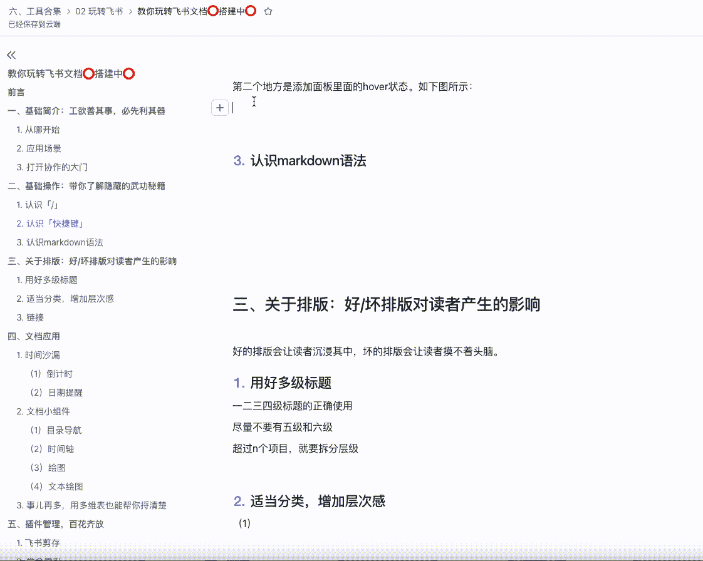

## 认识markdown语法

最后一种要了解的快捷操作是**Markdown语法**（**也称md**语法）。飞书文档对Markdown语法有着强大的支持。在快捷键面板往下面滑动，也可以看到预置的Markdown语法。具体有：

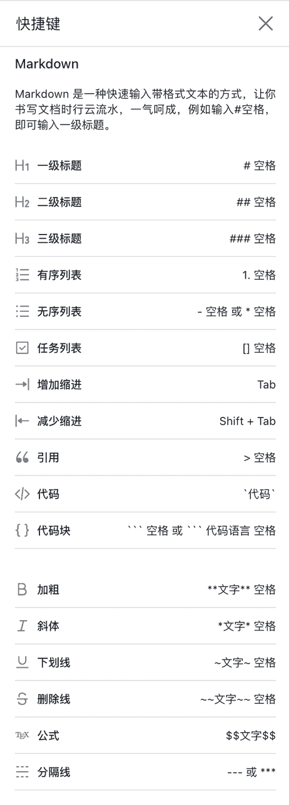

来尝鲜下这个神奇的语法是怎么运转的。如下图所示：


# 三、🔍关于排版：好/坏排版对读者产生的影响

常言道：好的排版会让读者沉浸其中，坏的排版会让读者摸不着头脑。所以当写一篇文章时，如果想让读者停留的时间更长，那么「把排版做好」这件事就至关重要了。下面就来聊聊几种，比较常见的排版方式。

## 用好多级标题

### （1）层次分级

在飞书文档中，预置了**1~9级**的标题，一般来说，一级的字体**最大**，九级的字体**最小**。

那在平常的文章撰写中，一般是从**一级**开始使用，最多用到**四级**，也就是4个层次。

为什么只用4种级别呢，因为在网页的SEO中，它会按照 H1、H2、H3、H4…… 这个顺序，依次去抓取整篇文章的关键词。层级越小，在SEO的排序就越靠前。

还有另外一个点是，使用4个层级对整篇文章的阅读来说，「心智负担」刚刚好。当读者读到第三层的时候，想着再读下第四层，马上就读完了。而如果写了六七层，读者读到第4层的时候，内心可能想着：怎么这个小标题后面还有这么多内容啊😭

不过在极个别情况下，有可能一个小标题下面就是会**有很多衍生的东西。**那这个时候就可以考虑：合并内容，拆分层级。比如这样：

/

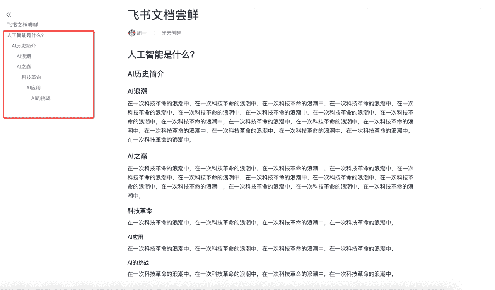

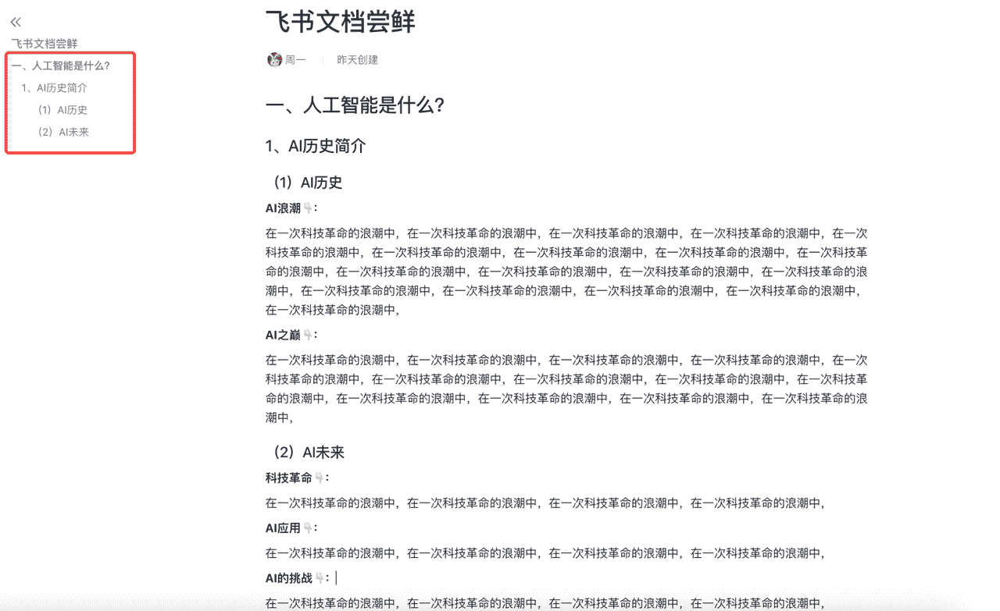

### （2）标明序号

**在分完层**级之后，还要做的一件事情是尽量给各个层级增加序号。为什么这里会谈到序号呢？

我们可以发现，我们在看书或者看一些知识合辑的**时候**，上面的序号都会标注得很明确。然后我们读到某一章的时候，就只需要记住读到哪一章哪一节，心里就形成了一个标记。

后**来周一**在写技术文章的时候，也实践了一番。如果文章很长，但是我没有做序号，看起来会总觉得有点不知头尾。但是做了序号的文章，心里就会形成一种秩序感，同时也让我们快速定位到想要找的文件在哪里。

**虽说这一步很繁**琐，但是这个时间跟后续的阅读体验相比，就会觉得这一步的行动是值得的。下面来看一些小案例：

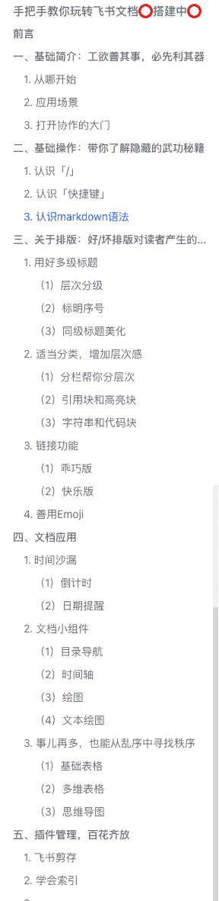

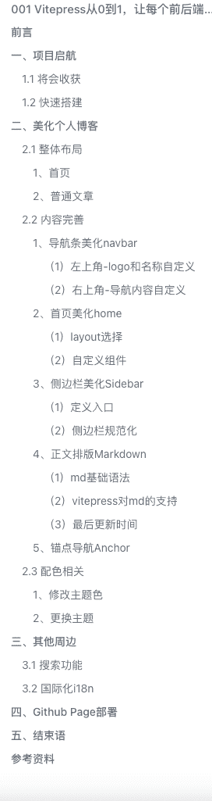

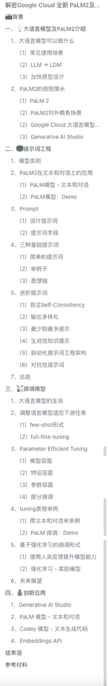

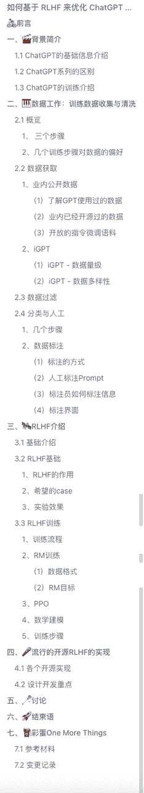

### （3）同级标题美化

最后再讲一个关于同级标题的小Tips。同级标题文字遵循三种规律：①从多到少；②从少到多；③不相上下。来看几个小案例👇🏻：

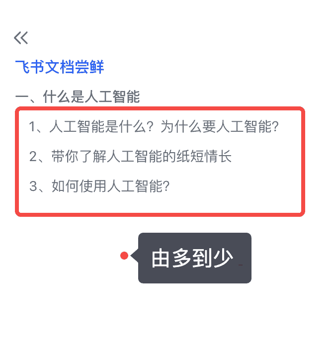

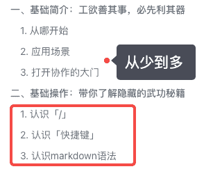

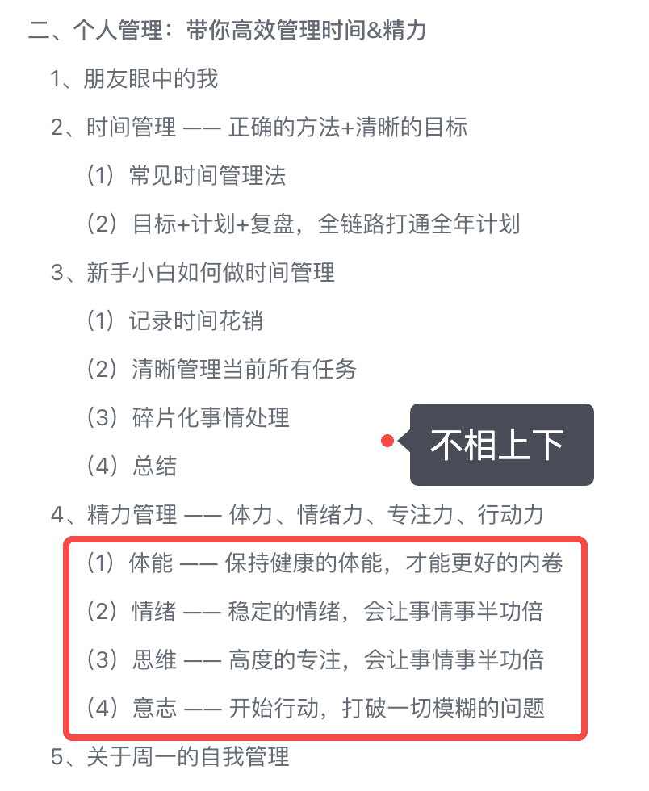

**PS：**这一点只是突然想到，不属于排版的的高优范畴。（怎么开心怎么来就好了~😜）

## 适当分类，增加层次感

### （1）分栏帮你分层次

飞书文档中有个**分栏**功能**，这个功能可以帮我**们对各个模块进行分栏，能够有效地帮我们解决各种过于拥挤或过于稀疏的文本段落。先来看几个巧用分栏的案例：

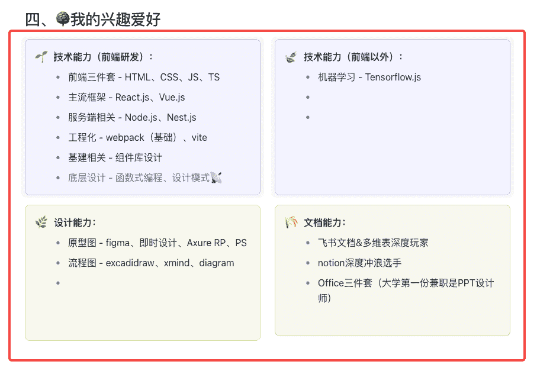

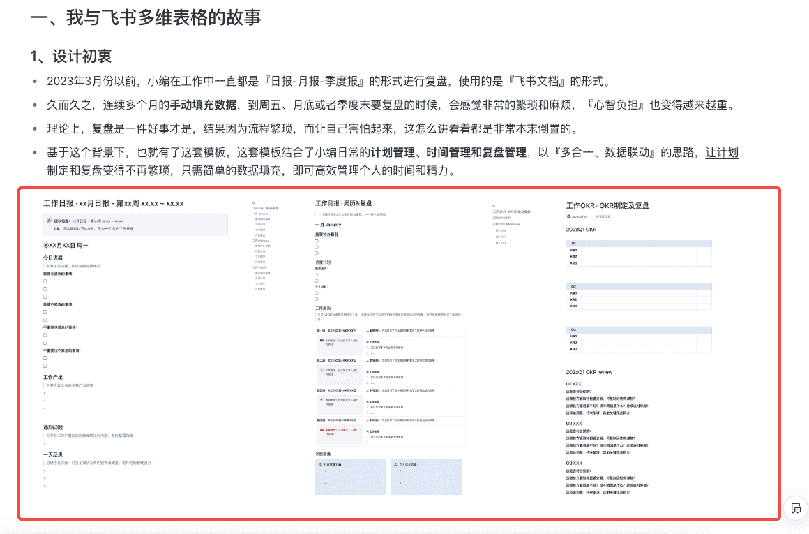

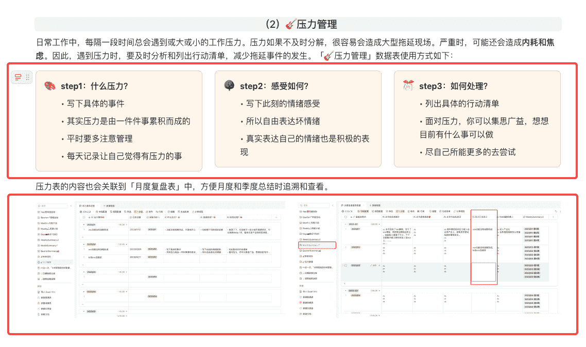

分析下上面这三个案例：

**案例①** —— 如果把所有信息都从上到下进行平铺，那么会导致读者的视角不够集中，有些内容过于紧密，有些内容过于稀疏。而如果像上面这样排版，可以让读者的视角，集中于四个方块中，一下子抓住了重点。

**案例②** —— 第二个案例，可以看到每一张图片都特别长。如果从上到下排列，那**么读者都不断滑动鼠标**，看到后面就忘了前面。而如果像上面这样分栏展示，那么读者可以挑选自己感兴趣的图片进行点击，进而提升在当前内容区域的阅读时长。

**案例③** —— 橙色里面的三个模块，分析了压力管理的三个步骤。刚好它们各自的字数都差不多，所以用分栏的形式平铺下来，让整体阅读起来均匀有度。

介绍完几个案例之后，相信大家已经感受到了分栏的快乐。下面来展示下一些分栏的基础操作，如下图所示：


### （2）引用块和高亮块

下面聊聊引用和高亮块。它们分别长什么样呢？来看下面的展示：

**引用块长这样👇🏻：**

> 我是引用块，我是引用块。

> 我是引用块，我是引用块。

**高亮块长这样👇🏻：**

> 我是高亮块，我是高亮块。

---

对于**引用块**来说，它在出现的那一刻，就是**灰色**的。所以这意味着，**引用块**起到一个提醒的效果，但又不能太明显。一般有以下使用场景：

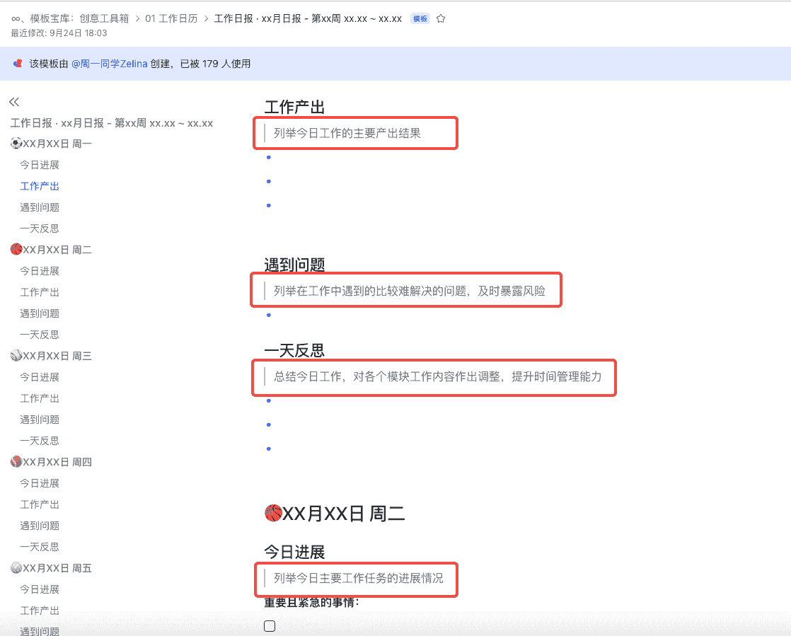

**上面**这张图中，把它放在了大标题下面，起到了提醒，但又不过分干扰用户视线的效果。

---

而对于**高亮块**来说，一般起到了**强提醒**的作用。刚开始你可能会先说一个**观点**，然后引出了**高亮块**里面的内容。举例几个使用场景：

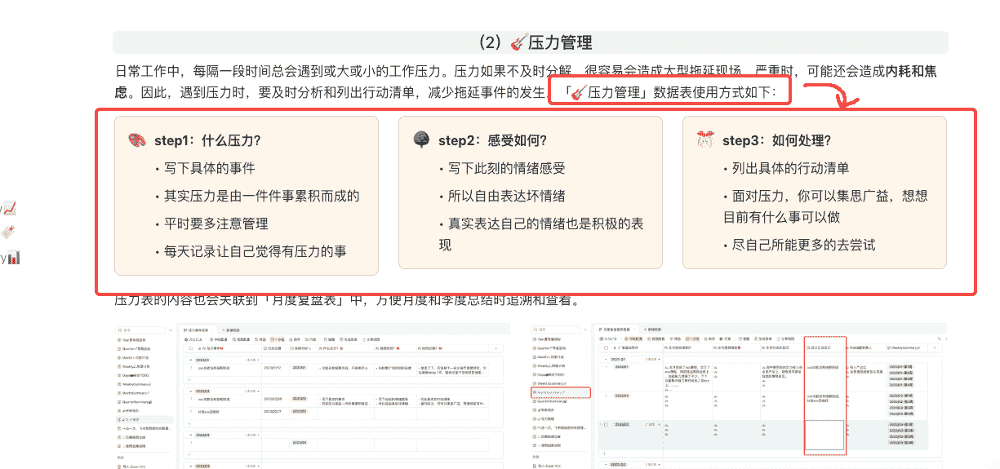

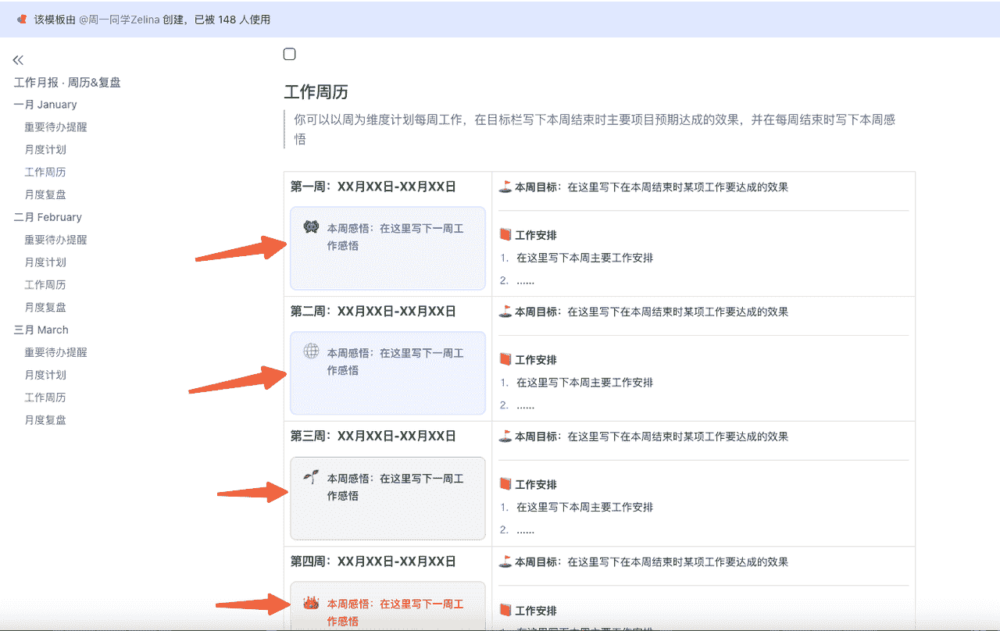

大部分情况下，都可以使用**高亮块**来达到**强提醒、美化和文本聚焦**的效果。

---

值得注意的是，这里有个**小Tips**：不要在高亮块里写引用块！！看个小示例：

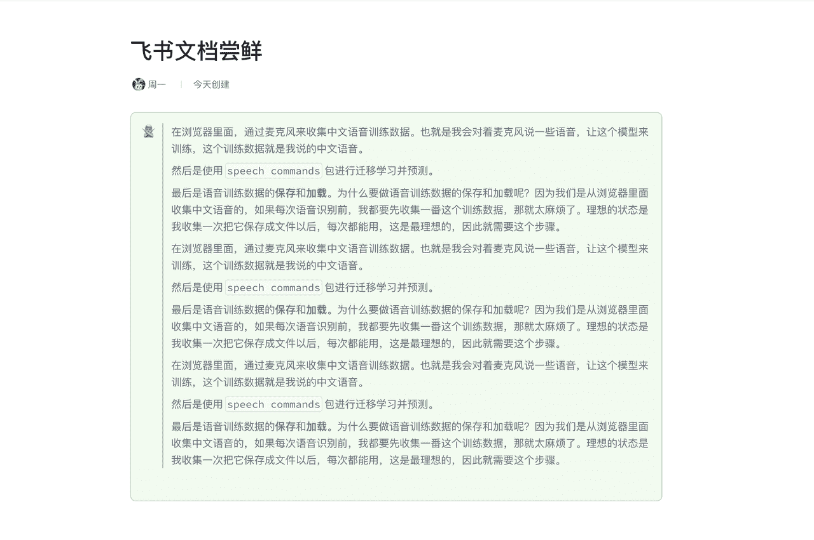

上**面这个高亮块看起来**负担是非常重。内心OS可能是：我应该看高亮还是看引用块呢。但是引用块又是灰体字，这是不是说明这个模块不太重要呢。所以呢，在高亮块可以尽量避免使用引用块。小编先去改回来先👇🏻：

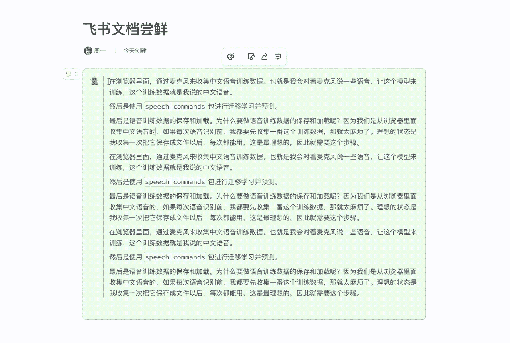

### （3）字符串和代码块

下面来分析下字符串和代码块这两种类型。它们分别长什么样呢？来看下面的展示：

**字符串**长这样**👇🏻：**

我是字符串：12345

我是字符串：Panda

我是字符串：vocabulary

**代码块**长这样**👇🏻：**

```
// 我是代码块
const fn = () =&gt; {}
```

---

那什么时候用字符串？什么时候用代码块呢？

一般来说，如果是像英文、数字、长串逻辑符号等这类非中文的符号，就可以考虑用**字符串**。比如这样：

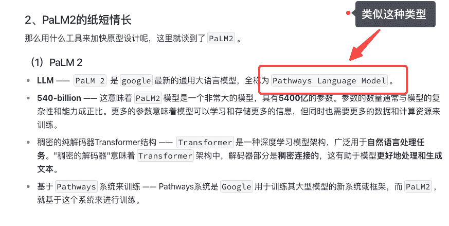

---

**而如果**是有很长一段的英文段落，或者是命令行、代码实现等，就可以考虑用代码块来撰写。比如：

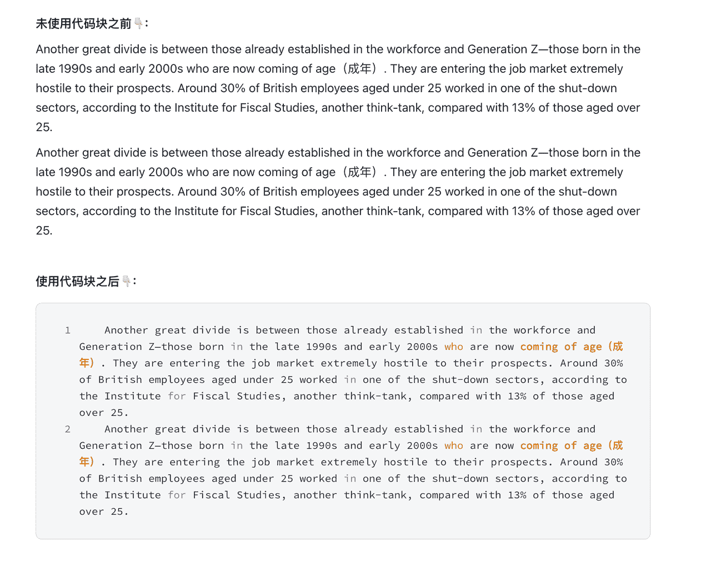

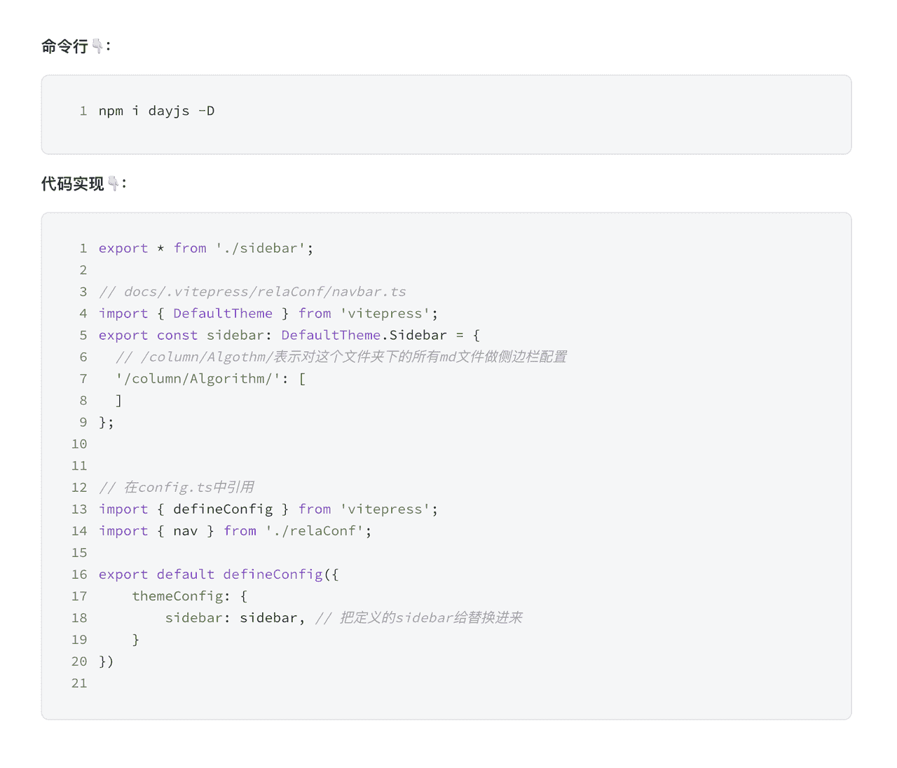

---

**另外还有个小ti**p：**如果英文后面**跟着相对应的连体含义，用粗体或下划线会更好。比如像下面这样：


**可以看到，第一句这样**子其实不好找到句子的层次，我们第一眼就会被一小块一小块的字符串给吸引住了。因此，我们可以通过加粗和下划线的方式，把句子的层次给稍微分一下，减少不必要的阅读负担。

## 链接功能

**学会**分类了以后，**我们来看**看飞书文档的链接。飞书文档的链接功能可谓是百花齐放，预置了很多种类型的视图。

### （1）乖巧版

一般来说，如果我们想要在**文档**里面放链接，一般**是希望用户能够**直接打开这个链接**的。那有时候**，我们还希望用户在看到链接的时候，就已经这个网站是个什么样的网站。这个时候，就需要给这个链接加一些中文注释，来让用户可以更快速地了解。因此，我们就可以用「cmd+k」来解决这个事情。如下图所示：


### （2）快乐版

**上面是一**种**比较乖巧**的**方式，除**此**之外，飞**书文**档本身**也预设了4种视图：链接视图、标题视图、卡片视图和预览视图。以📕为例，来看下具体的展现形式👇🏻：


## 善用Emoji

#### （1）使用技巧

Emoji的使用也有一定的规律可循，适当的emoji能够增强读者的阅读体验，同时一些肢体类的emoji也可以起到引导作用。

这里有一点要注意的是，不要大面积使用。emoji本身只是起到局部美化效果，文章的重点还是在于文字身上。如果使用过多的emoji，会无形中增加读者的负担。

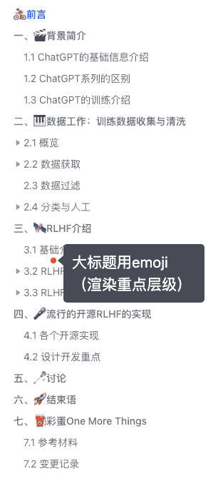

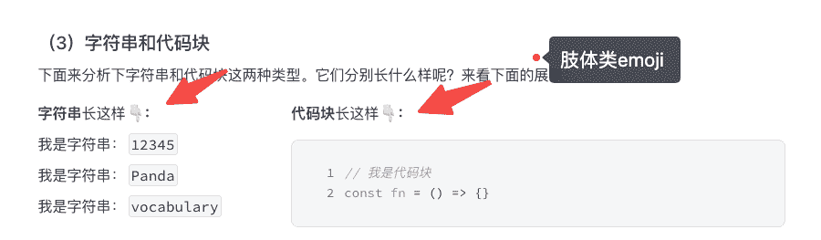

#### （2）如何使用

下面聊聊有哪些方式可以找到emoji。

**第一种：特定网站。**这里附上来自互联网上的一些emoji网站：

**第二种：本地输入法。**比如我使用的是**搜狗输入法**，并且我知道这个输入法可以通过ctrl+shift+e来唤起。所以我会这样做：

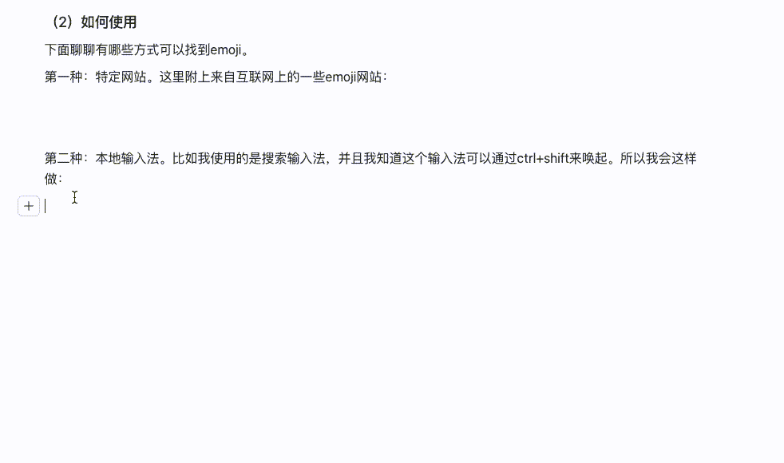

**第三种：知其意画其图。**这种就是，自己知道某个想要的emoji在输入法里面的名称，然后通过输入的形式快速把想要的emoji给打出来。比如我想**要画🎨这个**emoji，它在搜索输入法里面的名称是「调色板」。那么我可以这么做：


# 四、📀文档应用

排版技巧了解完了，下面就来到飞书文档中一些隐藏的文档应用。

## 时间沙漏

首先聊聊和时间相关的两个应用。

### （1）倒计时

第一个是倒计时功能。常见场景有：

+   **面向多个用户开放的**文档，设置DDL能够给其他阅读文档的读者起到提醒的作用。

+   做某场活动时，让参与者可以及时知道活动所剩时间还有多少。

+   …………

这个倒计时功能还有个**气泡框**提示，当计时时间到最终点时，会在文档内部这样显示👇🏻：

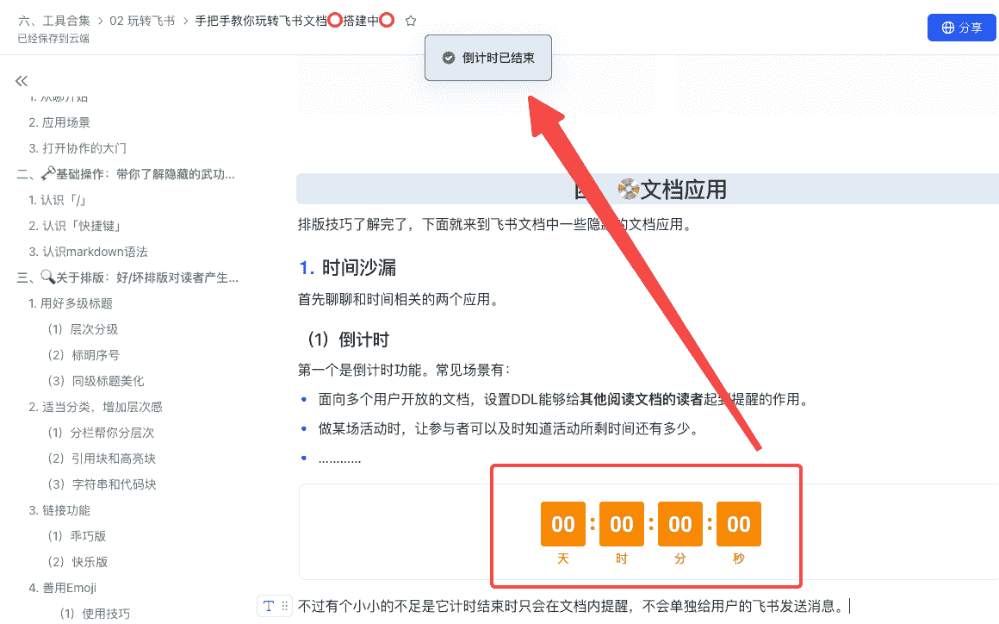

### （2）日期提醒

第二个跟时间有关的就是**日期提醒**。当**北京时间**到达设置的指定时间时，会通过飞书消息给发送提醒。来看看具体什么操作👇🏻：

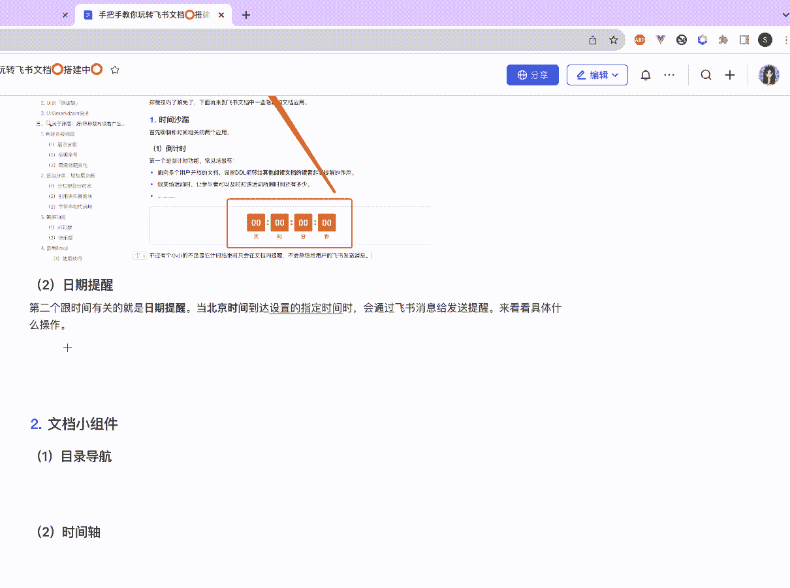

## 文档小组件

了解完「时间沙漏」相关的内容，下面来了解文档中的其他小组件。

### （1）目录导航

**第一个是目录导**航。一般来说，目录导航更多的会放在整篇文档的顶部，方便读者刚进入文档时，可以先了解整篇文档都有些哪些内容。具体操作方式如下所示：

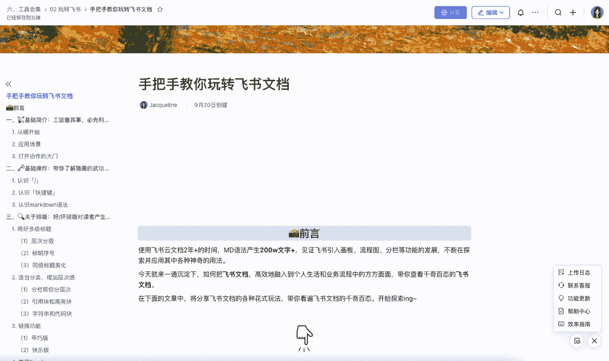

### （2）时间轴

第二个要谈到的组件是**时间轴****。第一次**接触到这个组件的时候，**让小编甚是兴奋，**因为它解决了过往很多扎堆文本的痛点，尤其适用于各种需要时间段来呈现的文本。来看个小栗子🌰：

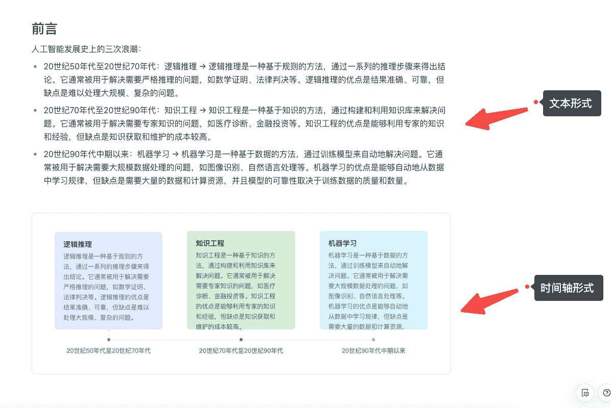

在上面的图中，如果只是用**文本****的形式**，会显得很拥挤，并且比较难抓到重点。而如果用下面时间轴的形式，就会发现，内容被一块一块地分出来了，并且因为颜色不同，辨识度也更高了。

### （3）文本绘图

第三个要谈到的小组件是**文本绘图**功能，其预置了流程图、时序图、类图、ER图、甘特图、饼图等类型的功能。比如画个时序图：

这类图形的代码规范遵循**mermaid语法**，具体可戳此链接进一步了解：[文本绘图小组件](https://www.feishu.cn/hc/zh-CN/articles/496118428959-%E6%96%87%E6%9C%AC%E7%BB%98%E5%9B%BE%E5%B0%8F%E7%BB%84%E4%BB%B6)。

## 文档创意彩绘

**上面谈到了三种**文档小组件，接下来到了很有趣的部分：画图工具的介绍。基本上不论是什么行业，都会涉及到画图。做项目汇报的时候，需要画图。PPT汇报的时候，需要图片辅助理解……

那在下面，就来介绍下飞书文档内嵌的一些画图相关的功能。

### （1）画板

第一种画图工具：**画板**。如下图所示🎨：

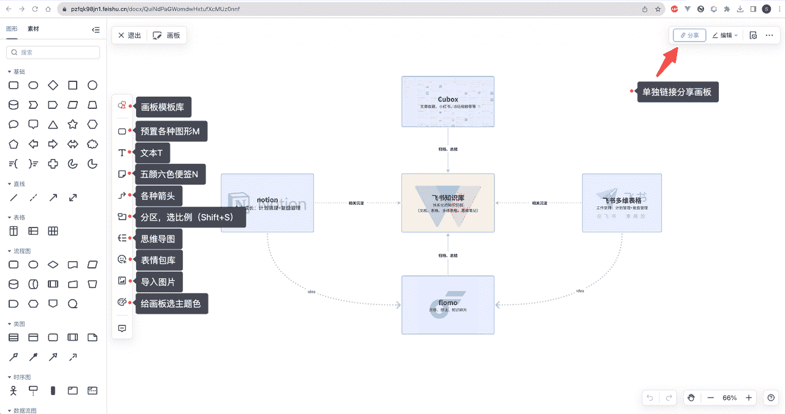

### （2）流程图

第二种画图工具：**流程图**。流程图分为旧版和新版，**旧版**主要是基于开源库draw.io嵌套进来的一个流程图工具，**新版**则是飞书自研的**流程图工具。那其****实，新版的这**个流程图工具也可以理解为在画板上画流程图。因为画板上面介绍了，我们下面来另外体验下旧版的流程图。如下图所示：

体验下来，新版的视觉体验更为丰富，内置的内容也百花齐放。而旧版则更依赖于Draw.io库，各有千秋，找到适合自己的就好了~👻

## 事儿再多，也能从乱序中寻找秩序

文档应用的最后一部分，讲讲**逻辑整理****相关**的内**容。一般**来说，不管是多么复杂的文本模块，都能用表格或者思维导图来帮我们捋清楚。

### （1）基础表格

下面介绍几种常见的表格使用技巧。

**技巧一：**善用背景色区分模块。如下表格所示👇🏻：

| **商品明细** | **数量** | **单价** | **总价** |
| --- | --- | --- | --- |
| **品类1：三只松鼠** |  |  |  |
| 吃货1 | 2 | 10 | 24 |
| 吃货2 | 2 | 12 | 24 |
|  |  |  |  |
|  |  |  |  |
| **品类2：洽洽瓜子** |  |  |  |
| 吃货1 | 2 | 10 | 24 |
| 吃货2 | 2 | 12 | 24 |
|  |  |  |  |
|  |  |  |  |

**技巧二：**善用色块区分每一列。如下图所示👇🏻：

| **商品明细** | **数量** | **单价** | **总价** |
| --- | --- | --- | --- |
| 吃货1 | 2 | 10 | 24 |
| 吃货2 | 2 | 12 | 24 |
|  |  |  |  |
|  |  |  |  |

### （2）多维表格

从基础表格衍生过来，就是**多维表格**。如果把**基础表格**比喻为一个初学乍练的小孩，那么**多维表格****便是那位博学多才的长者。**多维表格可以进一步理解为：事儿再多，也能帮你捋清楚。比如，帮你规划年度工作：

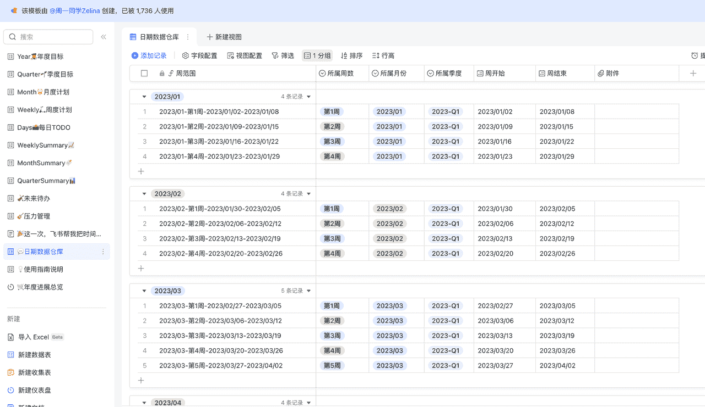

又或者，打造个人的声影瑰宝阁：


再进阶，用多维表格玩游戏：

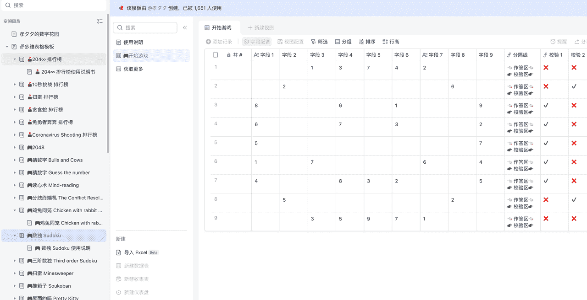

这里附上一些多维表格的游玩库：

+   官方模板库 → 多维表格模板社区 Base Templates Community

+   多维表格研究所 → [多维表格研究所](https://base.feishu.cn/)

+   官方帮助中心 → [带你快速入门多维表格](https://www.feishu.cn/hc/zh-CN/category/7001026198159540225-%E5%BF%AB%E9%80%9F%E5%85%A5%E9%97%A8)

+   孝夕夕的多维表格模板 → [🧩多维表格模板](https://hsiaohsihsi.feishu.cn/wiki/AzmiwkyHIiTpxnkS6LGcJWojncZ)

+   陶晨毅的多维表格模板 → [📊 多维表格模板（持续更新）](https://sudo.feishu.cn/wiki/wikcnqftUBiowXThqMosGqeQxrf)

### （3）思维导图

**最后一个****和逻辑整理相**关的内容是：思维导图。这里先夸夸思维导图，思维导图让我在通勤时间实现了笔记自由📒的快乐。平常小编有通勤时间看书的习惯，但对于电子书来说，边看边记笔记似乎是个比较困难的事。后来，发现飞书的思维导图能够帮我解决这个事情。

一般在看一本书之前，我会先新建一个文档，然后对应地，每个章节都建**立一个导图，之后**每个导图里面又会把书的大纲给打进去。然后在通勤的时候，我就只需要对应章节对应序号，边看边记笔记就好了（主打一个打破时间和空间的限制👏）。等到书看完的时候，只需要再来翻下思维导图的笔记，重新做新的整合和归纳，就可以形成最终的笔记。浅浅看个小案例：

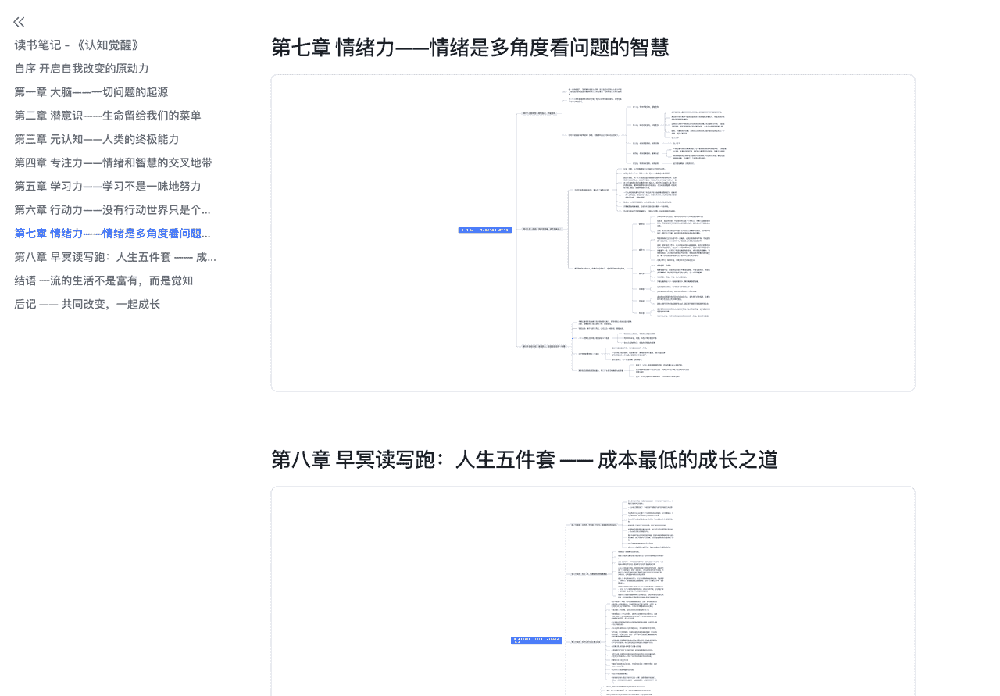

除了上述这个场景外，思维导图的应用还很广泛。平常一些需要树形扩展的知识，都很适合用思维导图来记录。

# 五、📑插件管理，百花齐放

文档应用终终终终于讲完啦！倒数第二部分，来聊聊飞书文档的一些周边插件。

## 飞书剪存

平常我们在互联网冲浪时，会看到很多写的很**好**的文章。但**往****往**一些文章会遇到一些问题：①没有目录；②页面的宽度较窄，不能让我们在阅读的时候沉浸于其中；③想写点小笔记，不知道往哪里写比较好。

那**么，飞**书剪存就帮我们解决了这个问题。通过插件的形式，只需点击「剪存」按钮，就可以把一个网页里面的内容给剪出来变成一个飞书文档的形式，并保存到我们飞书的个人空间中。那废话不多说，安装方式指路这里👇🏻：

## 飞书幻灯片

飞书文档还有一个**演示模式**，这个非常适合做汇报。不用做PPT，但是也能甚似PPT般的放映。来看看演示效果：

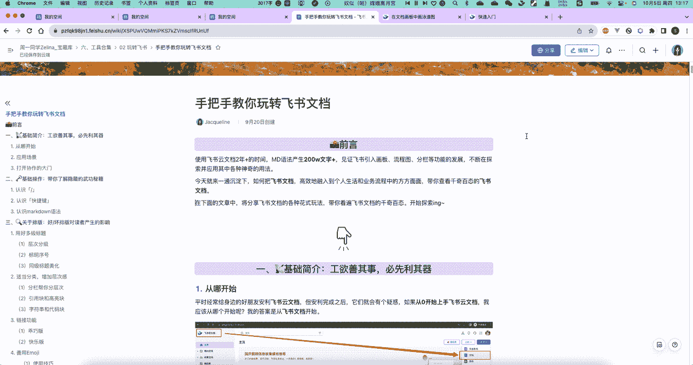

# 六、🛒其他小功能

讲完飞书文档的周边插件，最后来到一些细碎的小功能。

## 页宽设置

文档分为三种页宽：**默认**、**较宽**和**全宽**。如下图所示👇🏻：

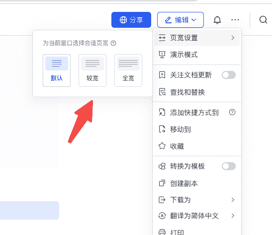

## 下载管理

与此同时，文档也可以导出为Word和PDF形式。如下图所示👇🏻：

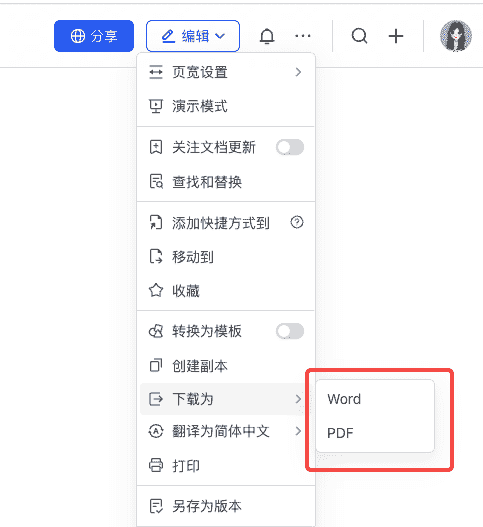

## 历史记录

除此之外，文档还可以查看**历史记录**，并回退到**某一个特定版本**。如下图所示👇🏻：

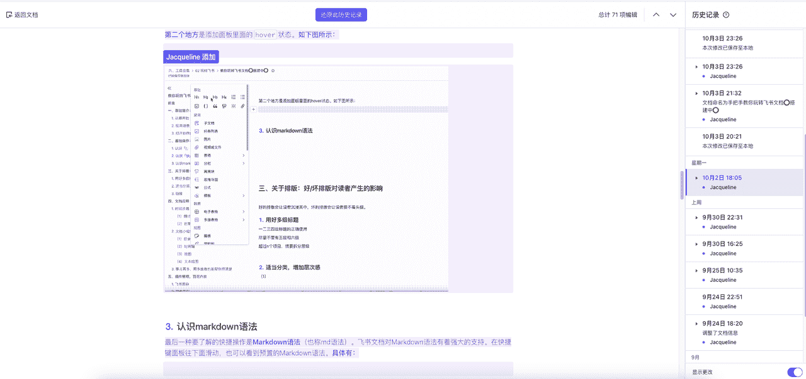

# 七、🖇结束语

到这里，关于飞书文档花式玩法的介绍就结束啦！希望对小伙伴们有帮助~

以上仅为小编平时写文章时所沉淀下来的所思所得，可能会存在些许不合理的地方，也非常欢迎交流更优质的撰写方法。salute~

Ending，我们下次见！🍻🍻🍻

# 🐣彩蛋One More Things

## 变更记录

多维表格（YVNUbURvda83Yws3CwDcRXEMnDc_tblc24T9UJJdbuDy）

## 模板产品铺

**如果你想挖掘更多**有趣的知识管理技巧，欢迎来小编的模板产品铺挖宝🚏😉

多维表格（YVNUbURvda83Yws3CwDcRXEMnDc_tblmLfDtOH3KkDbp）

## 如何找到我

**经常更新的地方：**👸号「星期一研究室」

[Zelina的个人说明书](https://pzfqk98jn1.feishu.cn/wiki/wikcnTijikVNdkWdBEKzQpiA6ie)份阅读量100000+的个人说明书：

## 交流&反馈

<https://my.feishu.cn/sync/NDLNdHb8XsZy88boGFJc86Bunwf>

## 近期好文推荐

0基础解锁新时代「卡片笔记工具」，输入文本秒出精美排版

14大场景实测！扣子向左做生态，艾莉向右攻垂直，谁代表未来？

Flowith AI，解锁下一代「知识交易市场」

Cubox AI，把碎片信息收集玩到极致 🧩