# 飞书超30000+人都在看的时间管理模板，速来抱走！｜文末附模板

> 来源：[https://docs.feishu.cn/docx/M4jXdHM7zojCJoxxuCEcz6CLn6d](https://docs.feishu.cn/docx/M4jXdHM7zojCJoxxuCEcz6CLn6d)

# 前言

从**2023年3月**开始，就一直在用**飞书多维表格**来做工作的**时间管理**和**复盘管理**。

用了三年，今年年底写绩效评估的时候，已然是信手拈来。

季度的OKR设定和OKR Review**，每周都要写**的**周报，每天都**要执行的todo，自动化流转今日TODO和明日TODO。

一张飞书多维表格，快速帮你一镜到底。

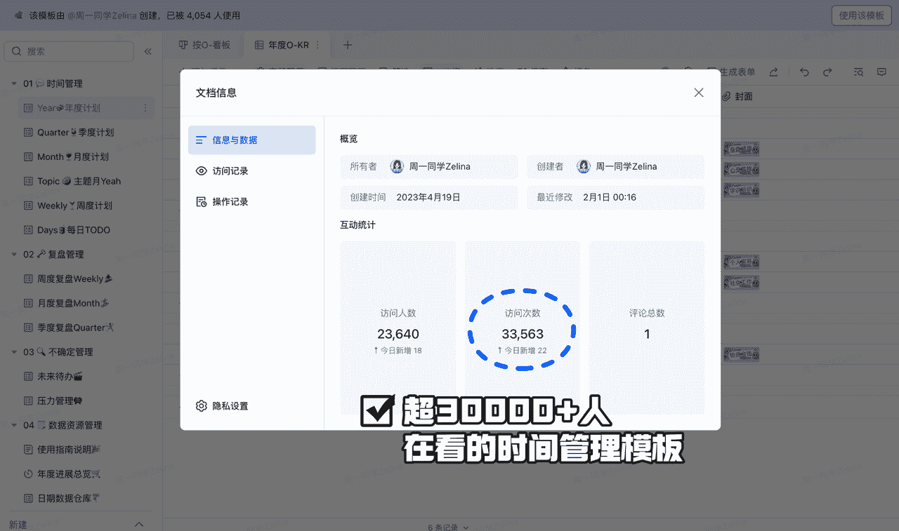

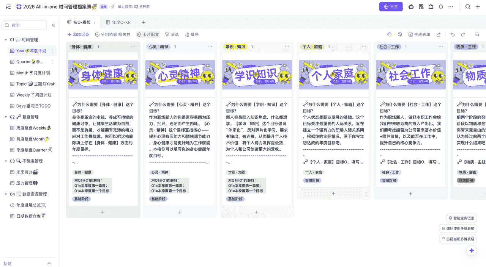

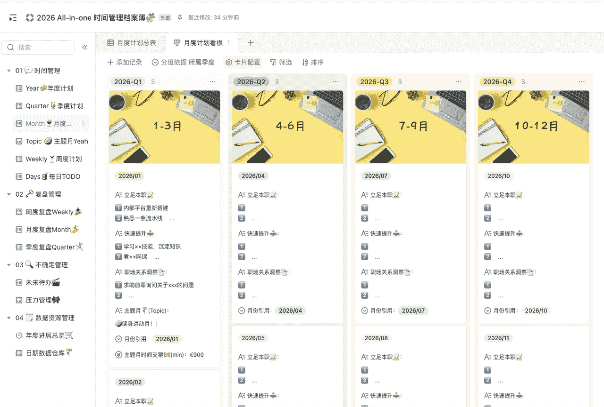

# 一、飞书多维表格一览表

## 1、每天快速制定TODO

每天早上写好今天的todo，按优先级依次完成。

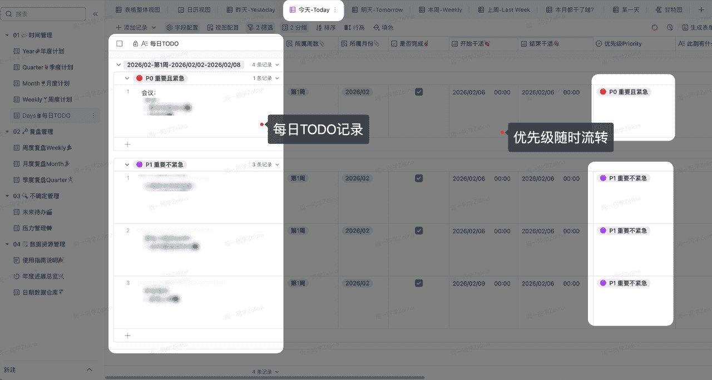

日历视图一镜到底，很快速地看出哪一天比较忙，哪一天比较空闲些。

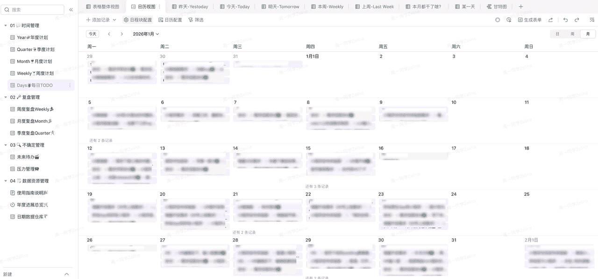

下班的时候，如果今天的活没干完，点击『TODO 2 Tomorrow』，自动流转到明天。

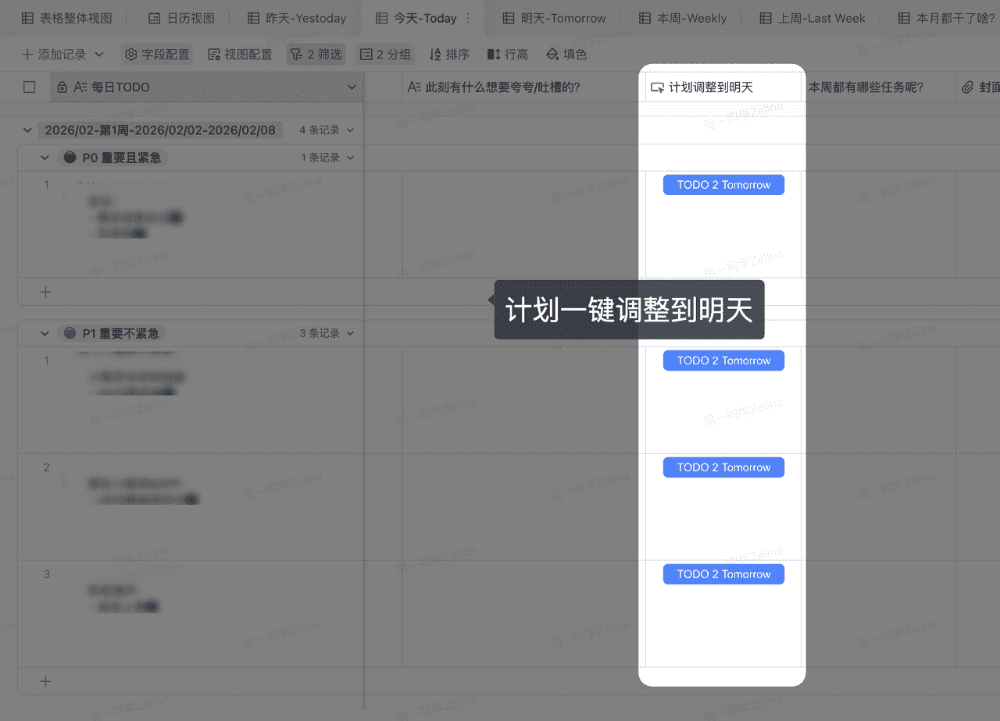

## 2、每周五用 AI 无痛写周报

每到周五下午，公司系统要提交周报。这个时候，一般有两种方式。

**在过去，**我会打开本周这张表，看看我这周做了什么，然后总结下直接提交到周报系统中。

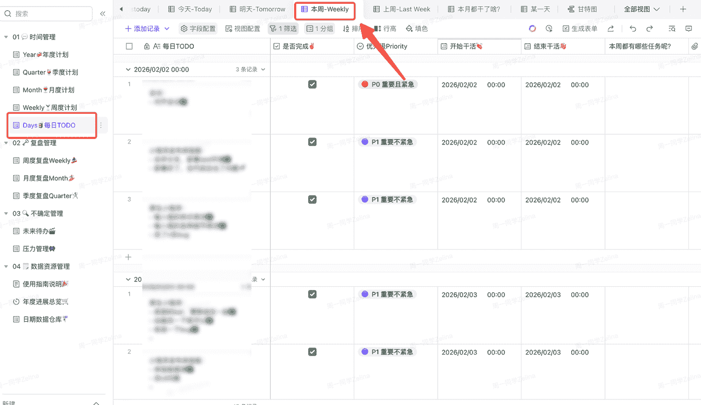

而在多维表格支持AI功能以后，我会直接唤起多维表格的AI功能，让AI我总结，然后直接把生成结果，复制粘贴到周报系统，火速完成。

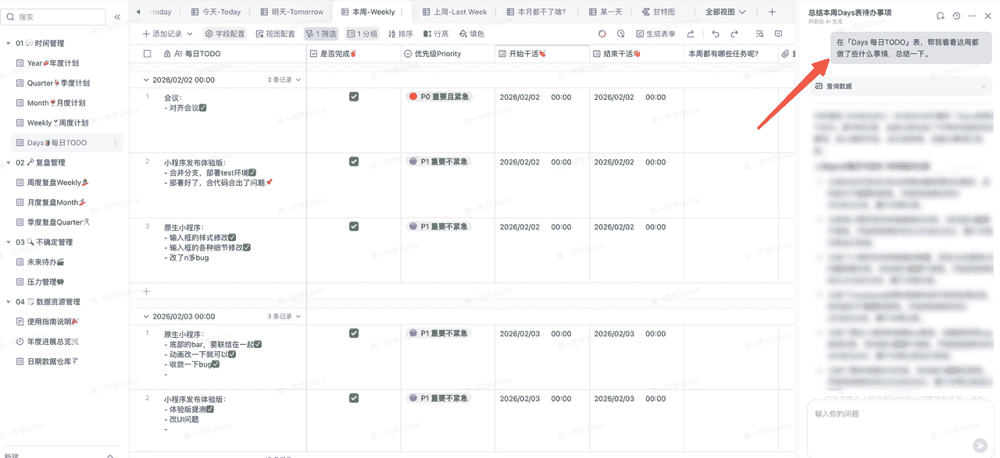

深深感受到，在AI爆发时代，你只管记录，AI自会帮你把周报完整写上。

## 3、怕下周来了忘事？快速把周计划定了

一般周五下班的时候，收尾了本周的工作，就会还留有一些下周来了要做的事情。

所以一般在周五下班的时候，我会顺便在「周度计划」表，把下周的事情给快速定了。

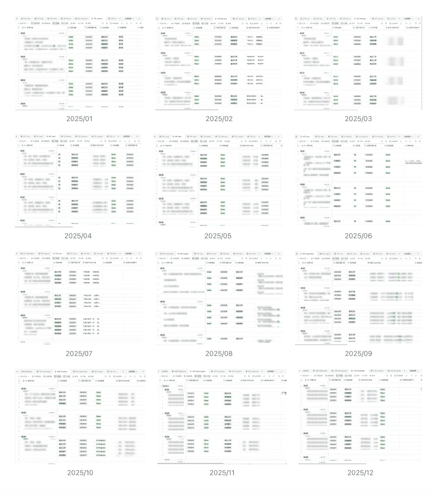

## 4、每个季度OKR快速设定

由于在厂每个季度都需要设定下OKR，所以就把这个事情放在一张表给做掉了。

**然后每个季**度初准备设定OKR的时候，就可以快速参考以往的季度OKR，不用再去系统翻来切去，快速把季度计划给设定完成。

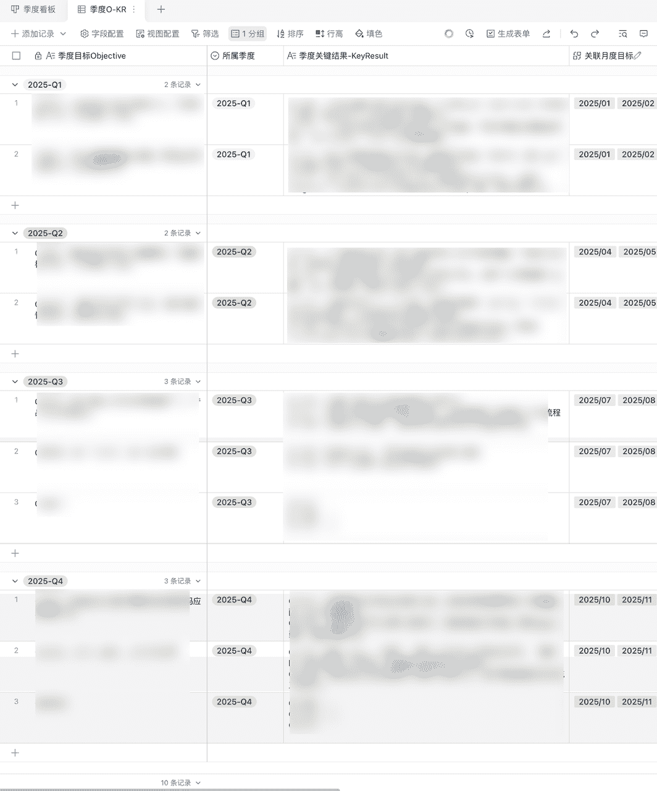

# 二、复盘管理一镜到底

## 1、周度复盘

每周工作过程中，会遇到很多成长和收获，也会遇到不顺心的事情。这个时候就适合用「周度复盘」表来一次性完成管理。

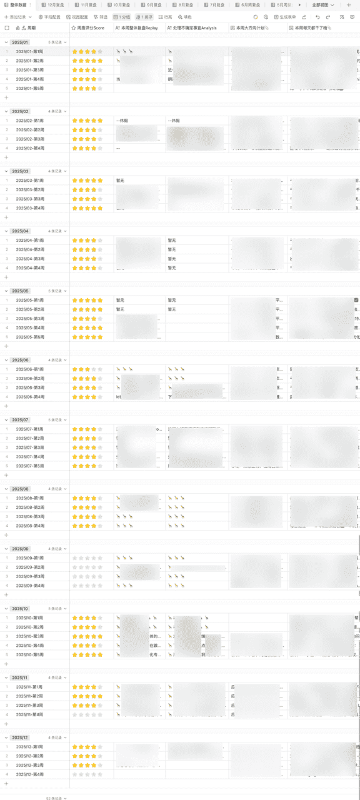

回去反了一下，还发现了一个规律，复盘多的那几周，要么是成长超级快的，学了超级多东西；要么就是职场遇到瓶颈了，需要通过复盘来看看有哪些增长的空间👵

## 2、每个季度快速做OKR Review

前面说到了**季度OKR快速制定**，那自然还会有**季度OKR Review**的环节。跟季度OKR设定一样，因为可以直接在表里面直接看到过去几个季度的review，所以基于过往经验，review起来也会快很多。

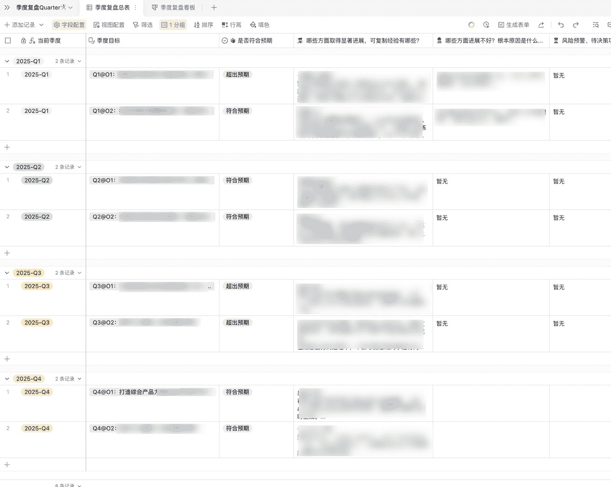

# 三、结束语

到这里，关于飞书多维表格的极致时间管理讲解就到尾声啦！

今年**第四年**用的时候，依然是感觉**飞书多维表格**还是太好用了，且一直有新的功能在注入，一直可以阶段性敏捷迭代和优化逻辑🧚‍♀️🧚‍♂️

欢迎小伙伴们多多使用模板，并来提需&反馈，帮助小编迭代&进化模板😉

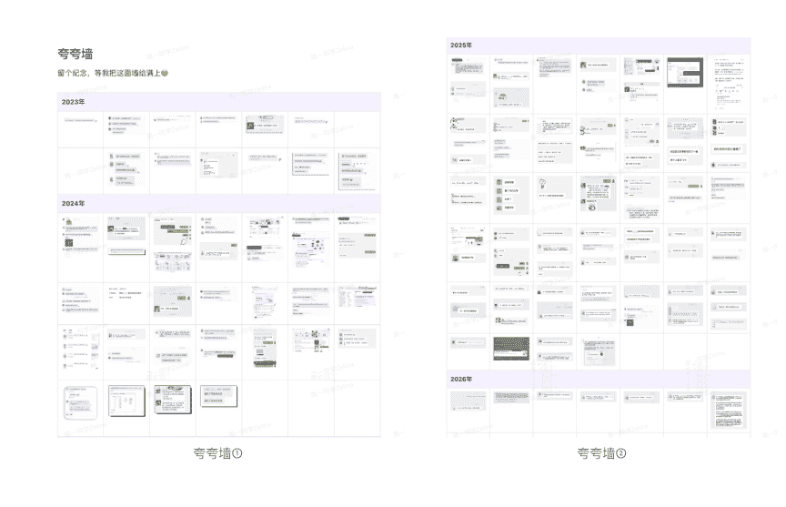

以上就是本期的全部内容，我们下期见🍻🍻🍻

# 彩蛋One More Things

## 1、模板获取

**获取模板：**

**关注👸号【星期一研究室】，回复「飞书2026多维表」，**领取你的2026飞书专属模板🔥🔥🔥

---

**另外，跟官方同学帮**大家争取**到了一****个飞书多维**表格VIP的福利，新用户可以领3个月会员，原价买需要花一百多，现在完全免费，欢迎兑换👏

兑换链接：https://fcna6swh3rtl.feishu.cn/share/base/form/shrcn8BkxqoKYeA6XyZZAB7zK73

**兑换步骤：****点击上述链接进行注册，注册完**成以后，填写兑换码Code2pqH4DtsXO，提交后等待官方审核，预计1-2个工作日内完成。

## 2、变更记录

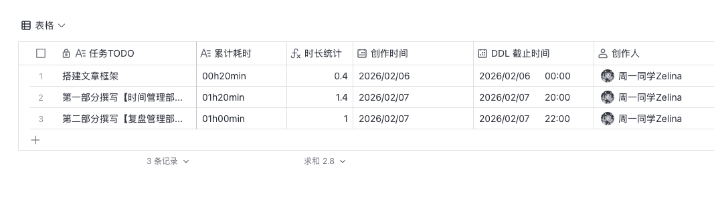

## 3、知识问答专区

**本文章已上线**至「第25小时」知识库！不想长篇阅读？欢迎到知识问答专区直接进行提问😉

**知识库链接：**

<https://ask.feishu.cn/shared-space/7590992675327708381?referrer=gzh_mondaylab>