# 30小时做了张WPS多维表，帮你省下2026年80%的时间成本 | 文末附模板

> 来源：[https://docs.feishu.cn/docx/S9rudQSJeo2kCDxGNHzcDO1pn9W](https://docs.feishu.cn/docx/S9rudQSJeo2kCDxGNHzcDO1pn9W)

# 🏖前言

最近一段时间一直在探索各大厂商的多维表格，想对比看看厂商们的产品经理在做同类产品的时候，会有哪些不同的思考。

刚好今年年初**WPS研发的小伙伴****送了周一同学一**个大会员的礼品卡，然后想着用大会员来深度体验下WPS多维表格各种更好玩的功能。

在打开多维表之前，我在想什么场景能够更好地让我渗透到整个多维表格的逻辑链路里面。

思前想后，决定做一套2026年的个人效率管理表。提前对未来的预见性假设，可能是最能让我产生高心流创作的事情了😉

下面跟随小编一起，来看看这套模板是怎么创作的，以及WPS多维表格里面，有哪些好玩的功能在等你来挖掘👻

> PS：文末附创作模板获取方式🧙‍♀️🤫🤫

# 一、🚌框架搭建

## 1、建立多维表格

首先是要先打开WPS软件，这里预设大家都已经下载了WPS软件。

如果还没有下载的小伙伴可以点击访问 https://www.wps.cn/ 进行下载，这里对于下载部分的地方不做过多赘述。

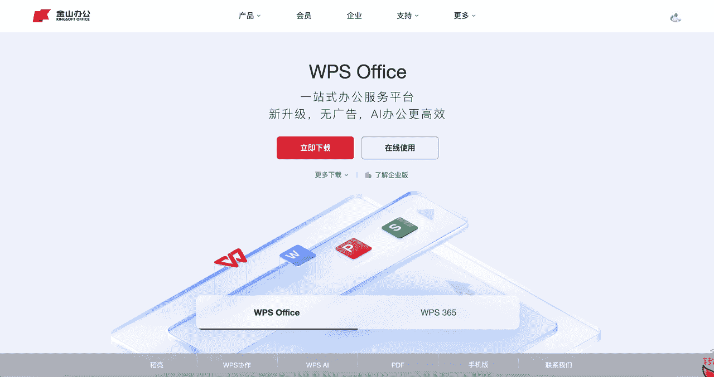

**接着，我**们**到 WPS 的**主页，新建一张多维表格。具体操作如下：

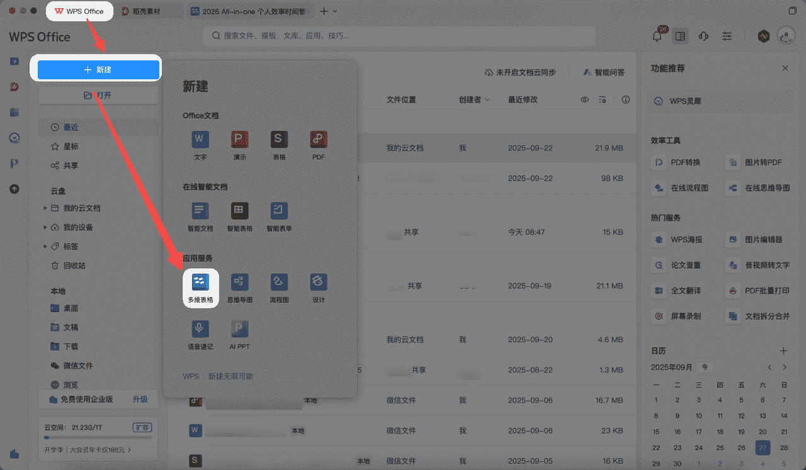

创建完了之后，我先来给这张多维表格做个命名：

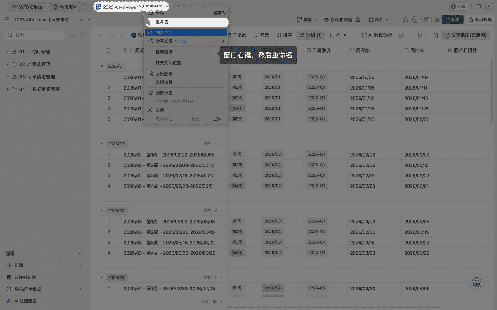

**重命名完**了之后，我们这个多维表格的胚子框架就起来啦！

## 2、建立文件夹

接下来，来搭建一些**基础设施**。先来**建立文件夹**：

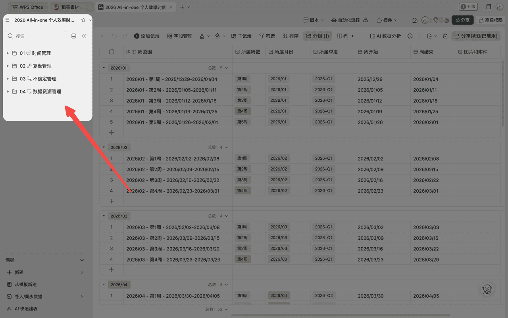

在**一整年的计划**里面，小编把它分为4个板块，分别是：「01 💬 时间管理」、「02 🗝 复盘管理」、「03 🔍 不确定管理」和「04 🗒 数据资源管理」。

## 3、拉数据表

**文件夹**建立以后，就准备在每个文件夹里面，都建立一些数据表。

### （1） 💬 时间管理

对于**「01 💬 时间**管理」这个模块来说，我们一共建立了5张数据表，分别是「Year◎年度计划」、「Quarter◎季度计划」、「Month◎月度计划」、「Weekly◎周度计划」和「Days◎每日TODO」。具体如下图所示：

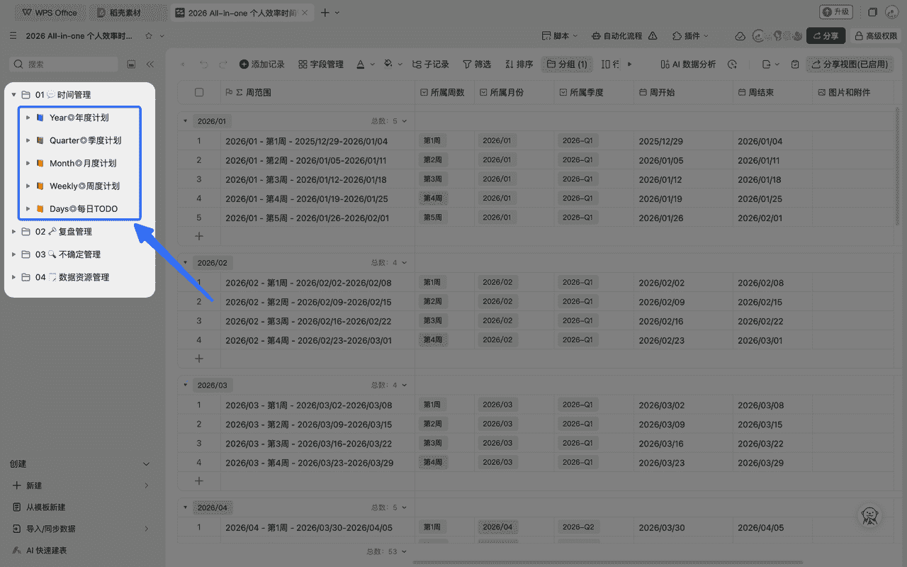

### （2）🗝 复盘管理

对于「02 🗝 复盘管理」这个模块来说，我们一共建立了3张数据表，分别是**「周度复盘Wee**kly」、「月度复盘Month」和「季度复盘Quarter」。具体如下图所示：

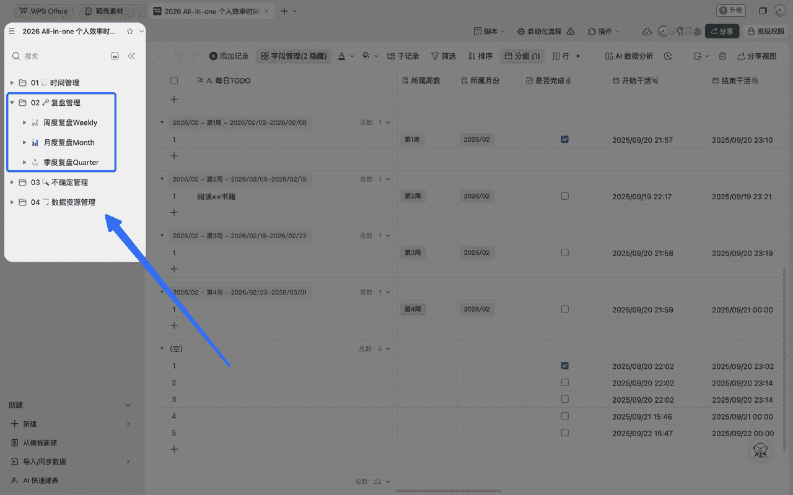

### （3）🔍 不确定管理

对**于「03 🔍 不**确定管理」这个模块来说，我们一共建立了5张数据表，分别是「未来待办」和「压力管理」。具体如下图所示：

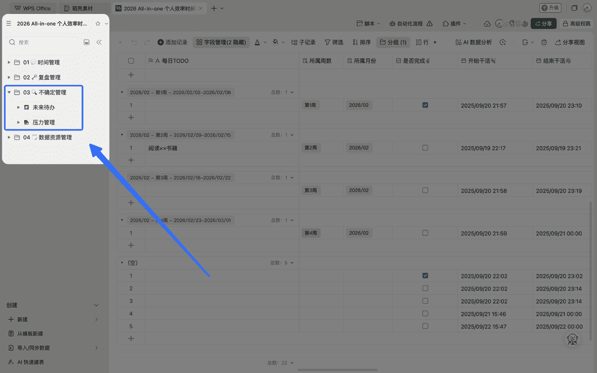

### （4）🗒 数据资源管理

对于「04 🗒 数据资源管理」这个模块来说，我们一共建立了5张数据表，**分别是「日期数据**仓库🚏」、「变更记录」、「变更记录」和「年度进展总览🛒」。具体如下图所示：

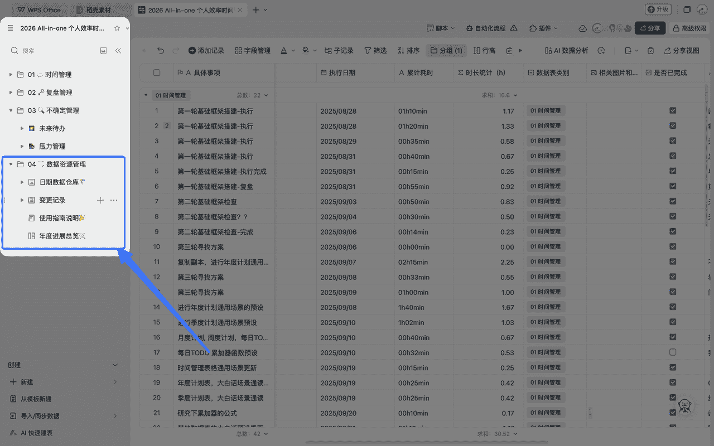

到这里，我们整个大框架的搭建就七七八八了，接下来要在数据表里面，去建立各种数据视图。

# 二、🚕细节雕刻

## 1、拉视图

当我们把数据表都搭建起来之后，接下来，每张数据表，我们希望说，通过筛选、分组、字段隐藏等方式，来拉取各种视图。

比如说，在「Weekly◎周度计划」这张数据表下，我们希望可以有12个视图，这12个视图里面分别可以看到1~12月里，每个月所制定的计划。

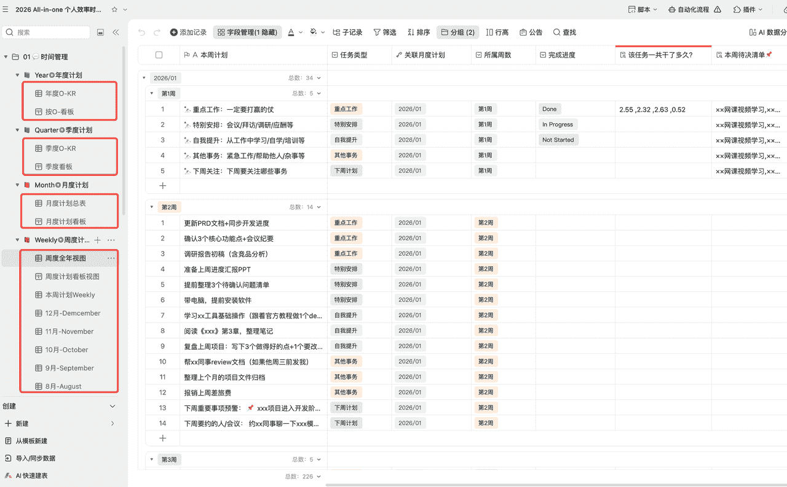

## 2、填充数据

把**视图**全部拉取完之后，下一步就是**填充数据**了。填充数据的过程，也就是真切地去填写任务TODO的过程。

先在「Year◎年度计划」数据表里面，填写你的年度计划：

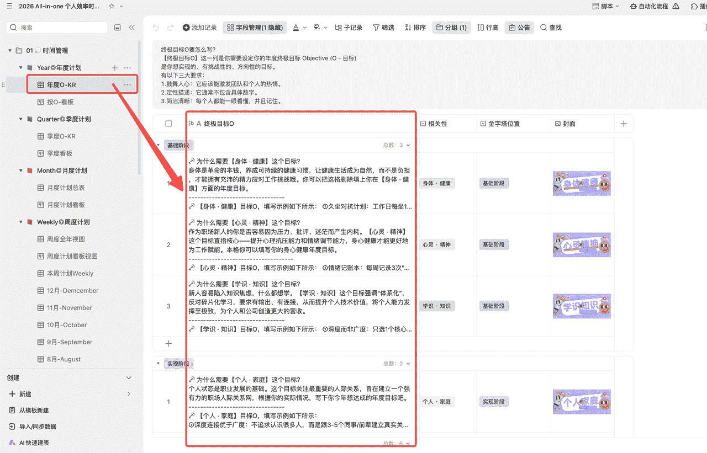

接着，在「Quarter◎季度计划」数据表里面，填写你当前季度的计划：

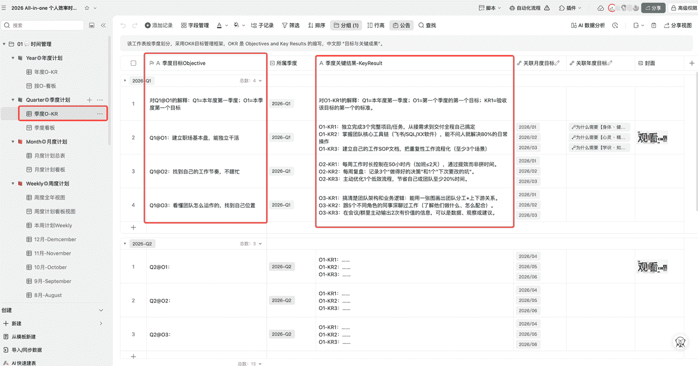

**继续**，在「Month◎月度计划」数据表里面，概括一下你本月要做的一些事情：

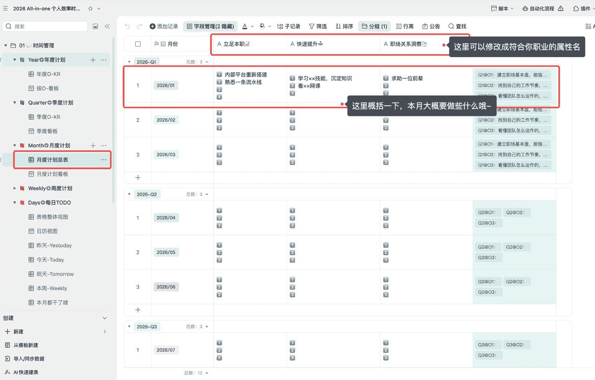

然后呢，在「Weekly◎周度计划」数据表里面，填写本周的工作安排：

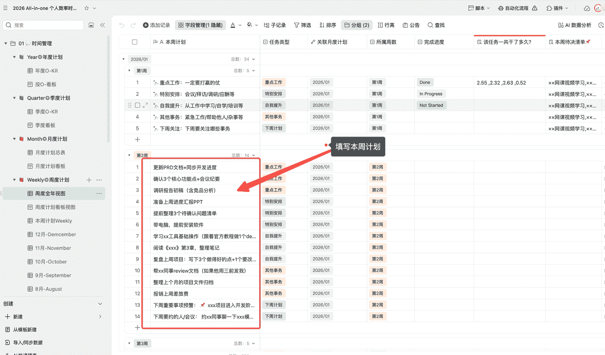

最后，每天要做的事情，就在「Days◎每日TODO」这张表里面填写啦~

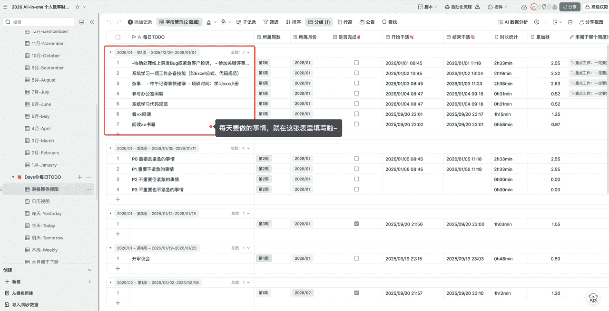

后面的「周度复盘Weekly」、「月度复盘Month」、「季度复盘Quarter」等数据表的填写方式也跟上面类似，以此类推。

# 三、🚖方法论

**文章的第**三部分，来聊聊这套时间管理多维表格，背后隐藏的各种与时间管理、精力管理相关的方法论。

## 1、数据资源管理

在拿到表的第一时间，首先看「💬日期数据仓库」表**。这张表会存放一整年的时**间数据源，包含季度、月份、周数、周范围等数据。在其他数据表中，都将会引用到这张表的数据，这样设计主要考虑到以下因素：

+   把**日期的数据**统一存放到一张表里面，这样等以后到2027、2028、2029年的时候，修改数据时，就只需要改一张表的数据即可，而不用到处定位数据源，然后还得修修整整、删删补补。

+   不同的小伙伴对**周开始和周结束**的定位不一样。周一在设计的时候，如果当前月份最后还剩下4天，就算是这个月的。如果不足4天**，就算是下**个**月的。那**有一些小伙伴可能不这么考虑，所以可以依据自身的想法，直接修改具体的时间和所属周数即可。

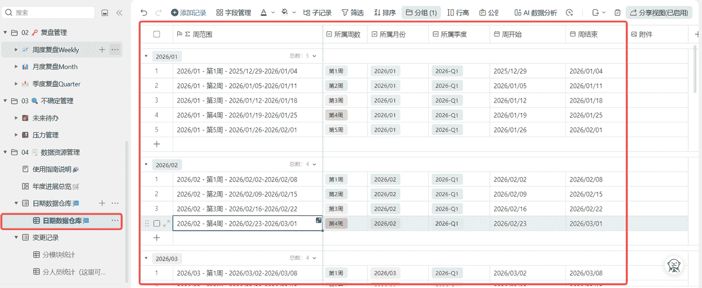

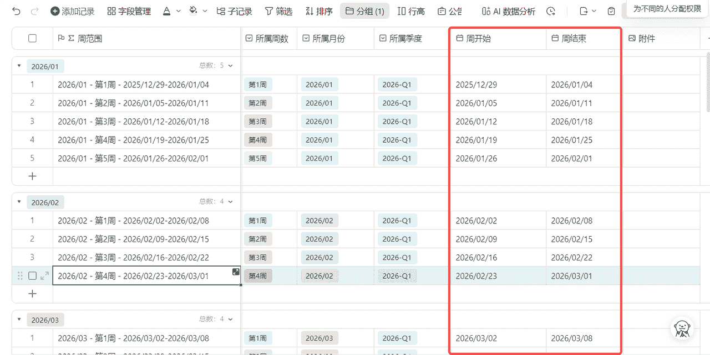

### （2）年度进展总览

**数据资源管理**里面，还有一个「年度进展总览🛒」的仪表盘。可以直**接在这个仪**表盘里，总览当年的各种数据的可视化进度。

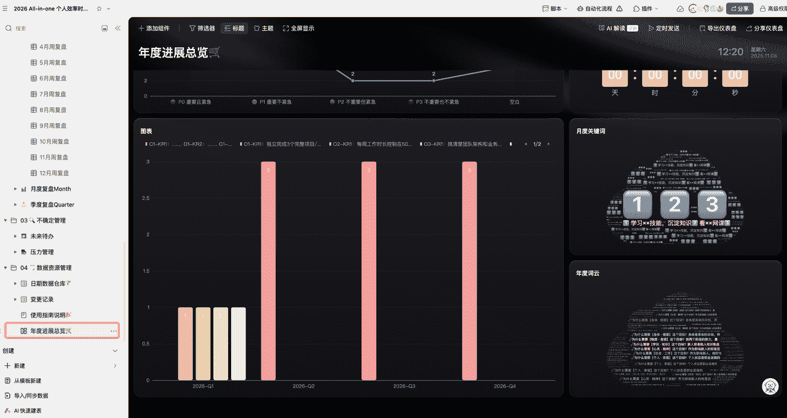

还可以有更细致的主题配置、图标配置、AI解读等功能。如下图所示👇🏻：

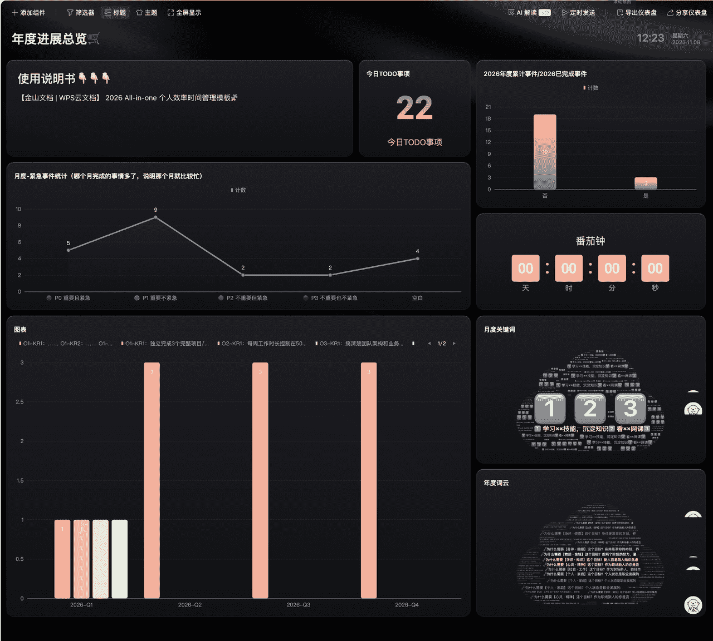

## 2、时间管理方法论

首先来看看，时间管理对应的5张数据表里面，都涉及到哪些**时间管理**方法论。

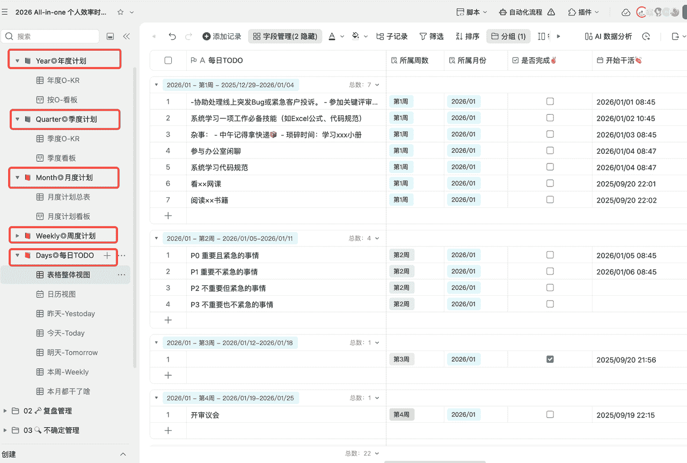

### （1）Year◎年度计划

年度计划采用的是「梦想 · 金字塔模型」来进行年度计划的制定。关于金字塔模型的学习，可以先戳这两条笔记复习一波：

除了升职加薪，人生还有什么其他可能？

怎样写梦想清单与长期目标｜建立梦想金字塔

---

在了解了金字塔模型之后，现在来看看这张表要怎么使用？制定方式如下👇🏻：

🗓先在「终极目标O」这一列填写年度的目标；

🗓在「金字塔位置📍」填写每个O对应金字塔所处的位置；

🗓在「相关性」这一列给每个O打上标签。

年度计划的制定相对比较宏观些，一般也会跟随着一整年的事情**不断做调整，所**以这里在制定的时候，可以用SMART法则，去做一些可能性的预估，之后再阶段性来回顾。

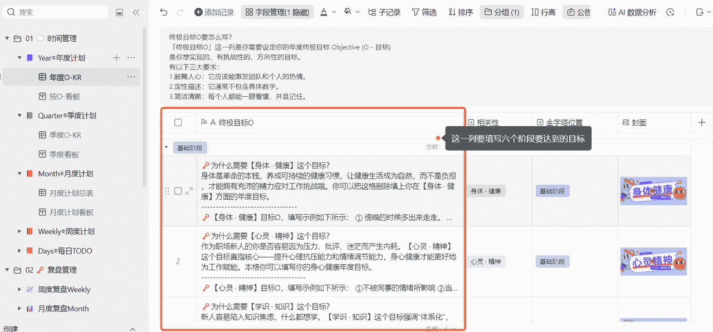

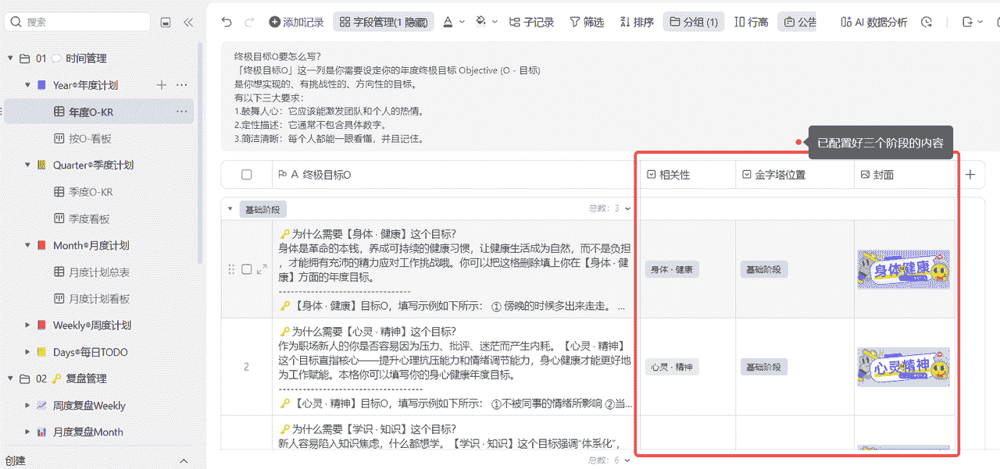

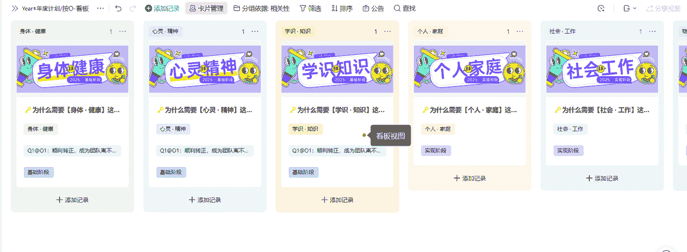

### （2）Quarter◎季度计划

季度计划采用的是**OKR**的形式。关于OKR的解读，先用这个思维导图来梳理下：

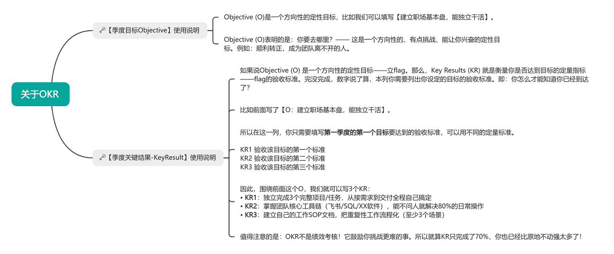

基于「Year◎年度计划」数据表，制定季度OKR。方式如下👇🏻：

🗒在「季度目标Objective」属性中填写每个季度的目标，填写完成后，针对每个目标O，在「季度关键结果-KeyResult」属性中，填写O背后相应的KR（一般一个目标对应3~5个KR）。

**🗒季度里的每个目标都**会去对应**到年度里面**的KR，做双向关联，方便及时查看季度目标是否对应上年度计划，及时暴露风险。

🗒同时，每个季度的目标也会关联到「月度目标表」，这么映射的目的是为了及时制定和查看「每个月的月度计划」。

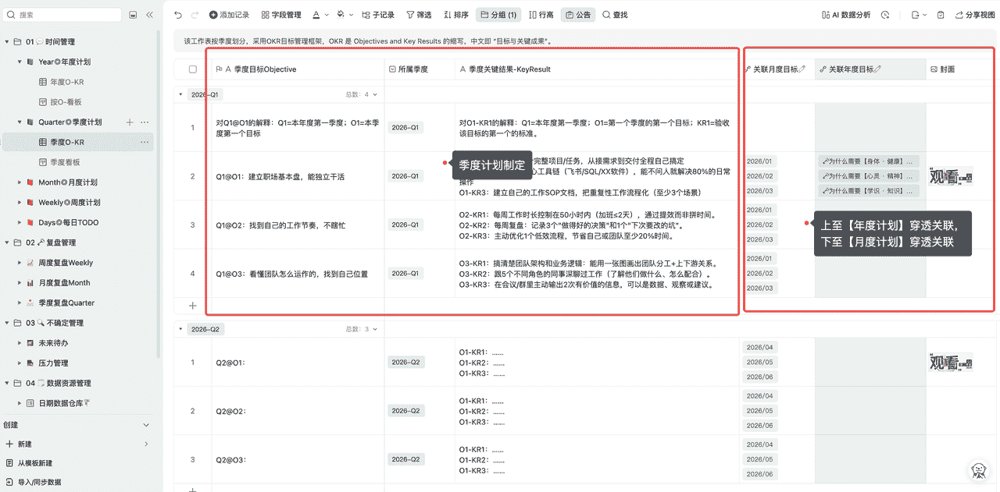

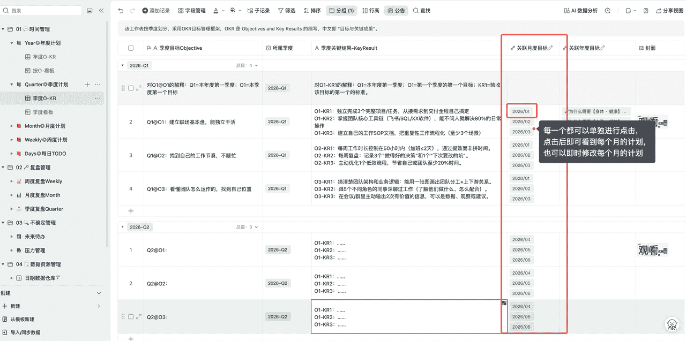

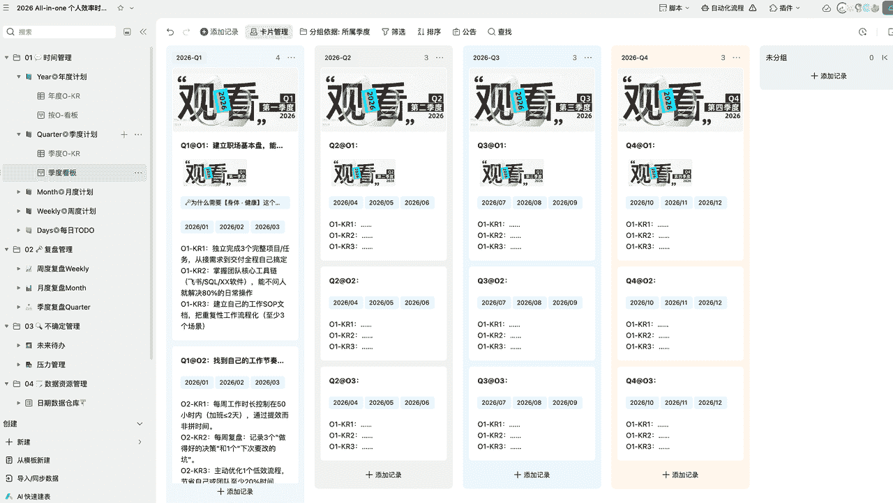

### （3）Month◎月度计划

**基于「Q**uarter◎季度计划**」数据表**，制定月度计划。月度计划采用的方式是主题分离，把你每个月的工作划分成多个板块，之后进行一一填写。

方式如下👇🏻：

📆在每个月的月末或者月中旬，提前「制定下个月的计划」，方便在阶段性任务完成后，及时查看下一阶段的计划。

📆在小编的工作计划中，包括①**需求迭代、**②**基础建设和**③**快速提升三**大部分。那么在计划制定时，每一列就可以写上 3-4 项计划。

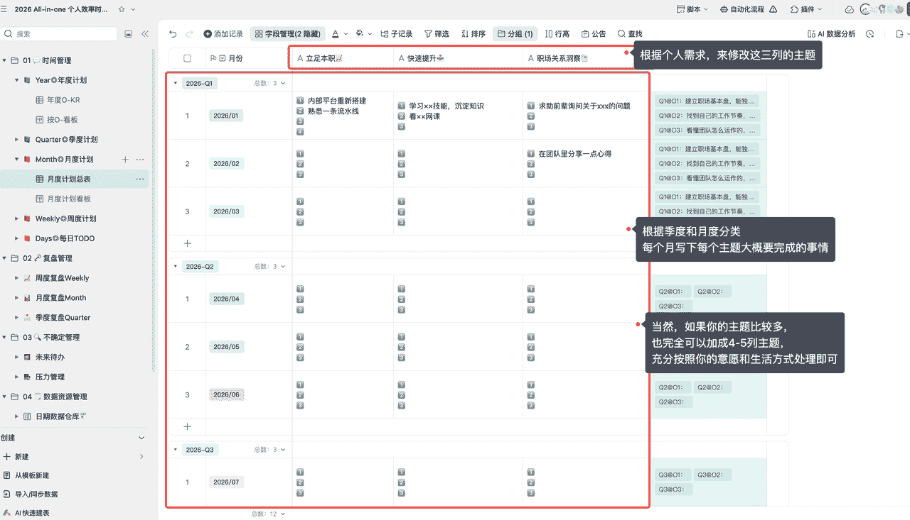

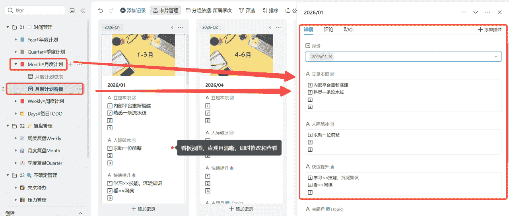

### （4）Weekly◎周度计划

**月度计**划的制定，是为了更好的安排周计划，周计划可以说是所有计划中最好把控的一种计划了。它没有每日计划那么琐碎，又比每月计划更好掌控一些。在「Weekly◎周度计划」数据表中，包含以下设计👇🏻：

**🔭重点工作：一**定要打赢的仗

**🔭特别安排：会**议/拜访/调研/应酬等

**🔭自我提升：从**工作中学习/自学/培训等

🔭其**他事务：**紧急工作/帮助他人/杂事等

🔭下**周关注：下**周要关注哪些事务

在每周的周末，可以花上5-10min的时间，用上面的这个范例，去制定下一周的计划。

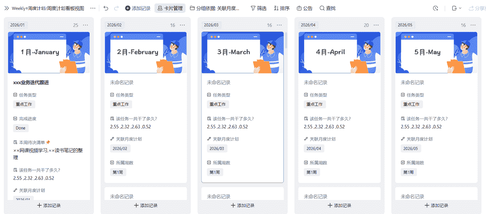

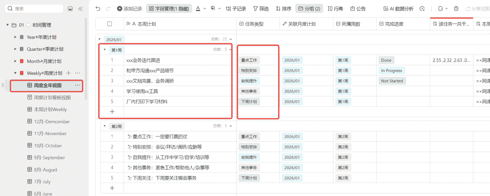

### （5）Days◎每日TODO

有了周度计划以后，就可以围绕周度计划，来制定「每日计划」啦！具体方式如下：

🧗每日计划采用的是四**象限法则。**

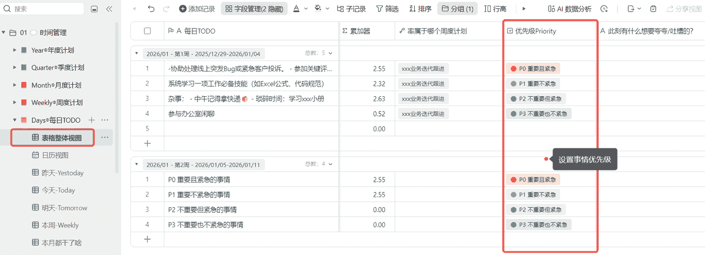

🧗在去年的视图中，分别设置1-12月的单独窗口，方便追溯每个月做的事儿。那在2025年以后，这部分的内容就去掉了，过去两年实践下来使用频率感觉较低，去掉后也更聚焦一些，同时也减少一些心智负担。

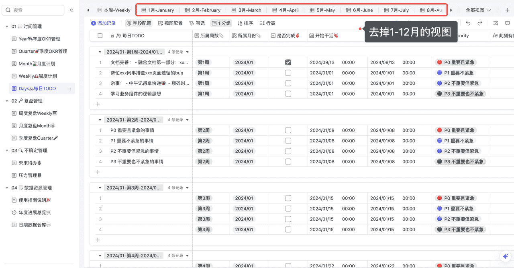

🧗同时，还设置「昨天、今天、明天和本周」四个窗口，方便每天整理近一周要干的活，让自己制定变得更加有秩序。

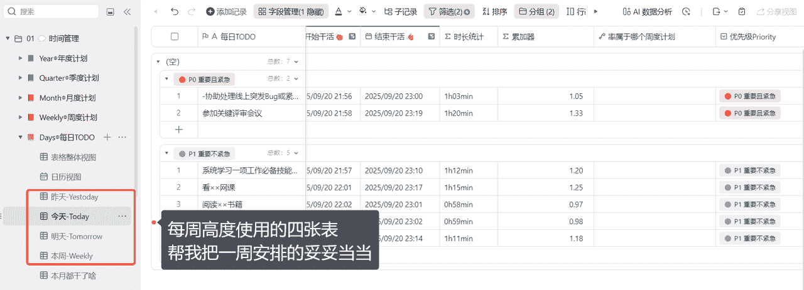

🧗与此同时，增加日**历视图，**且用四种颜色区分四象限规则。分别为：①P0 重要且紧急🔴；②P1 重要不紧急🟣；③P2 不重要但紧急🔵；④P3  不重要也不紧急🟢。

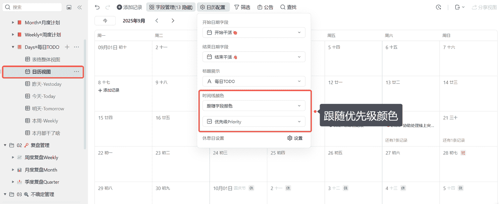

🧗除此之外，还设置将T**ODO移动到今天和明天的**功能，只需触发列表里的按钮，即可将对应事项移动到对应的日期。

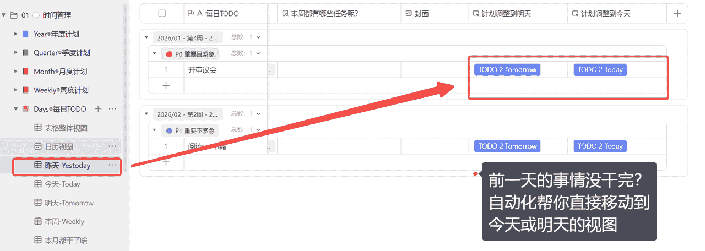

🧗值得注意的是，今年还增加了时**长统计的**功能。来看看怎么设计：

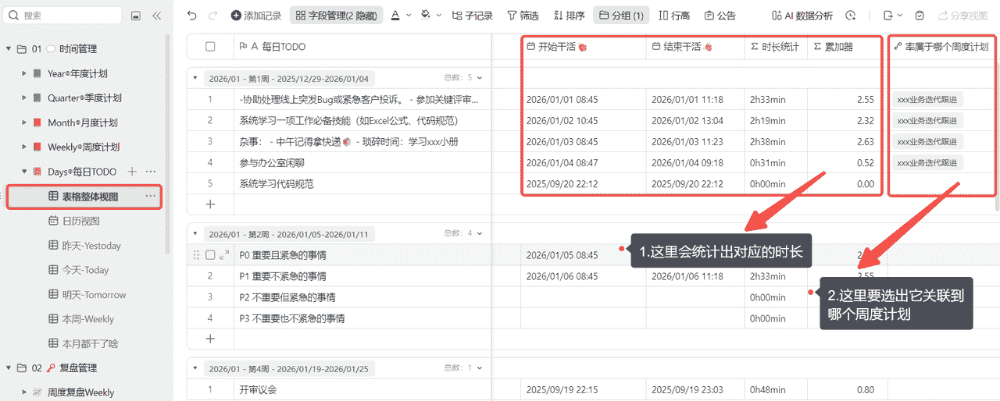

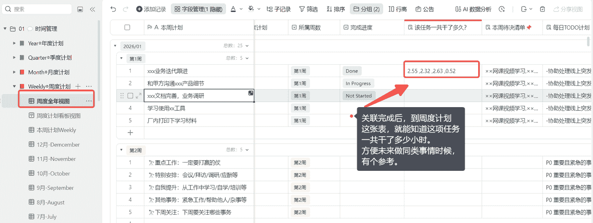

不过这个时长统计比较适合针对特定时间特定任务的情况，可以有效降低心智负担和减少一些不确定性。

btw……如果你的工作安排是比较不规则的，比如完全有可能被同事或者老板打断你的某项计划。那就写下具体的每日TODO以及打下优先级就好啦，时间这个完全可以直接抛弃使用掉。

Remind📢📢📢：计划是为了做决策和行动，切记不能为了计划而计划，只要取出对自己有切实有用的部分即可。

## 3、复盘管理方法论

### （1）周度复盘Weekly

**在周中的某一个时刻，有时候**或多或少会遇到些困难。在困难解决后，需要反思哪里做得好、哪里做的不好。因此，周度复盘所涉及的表「周度复盘Weekly」来啦！

「周度复盘Weekly表」采用的是SRA法则。

此数据表包含以下内容：

**📍周度评分Score：将**每周所有实现的完成度按百**分制进**行打分，一颗星代表20%，这样如果低于4颗星的时候，可以即时预警下。

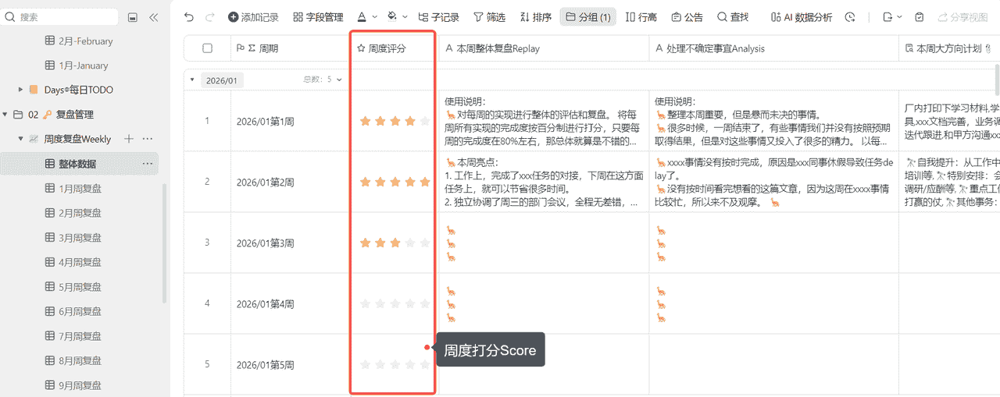

**📍本周整体反思Replay：对**每周的实现进行整体的评估和复盘，只要每周的完成度在80%左右，那总体就算是不错的。 保持20%的灵活度去迎接未知，迎接挑战。 保证完成的事情里面，是对自己最重要的事情。

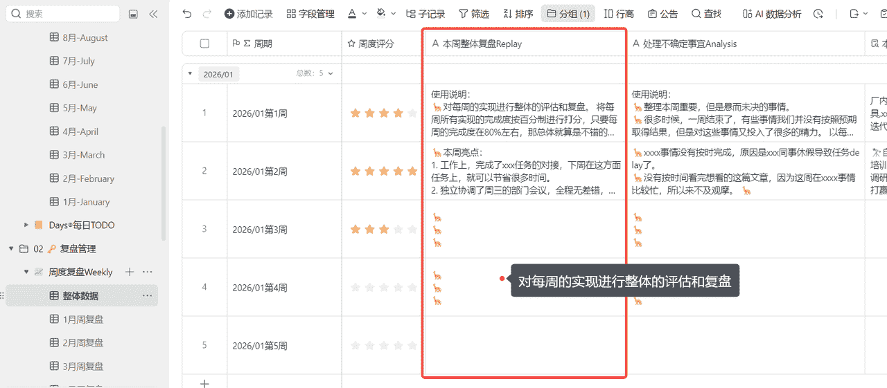

📍处理不确定事宜Analysis：整理本周重要，但是悬而未决的事情。 很多时候，一周结束了，有些事情我们并没有按照预期取得结果，但是对这些事情又投入了很多的精力。以每周为一个单位，将未产生结果的事情罗列出来，单独整理出来，可以帮助我们更好的往下追踪，或者去解决。 我们对自己投入的每一份精力，都应该负责，所以每一件事情它都应该有一个结果，无论是好的结果还是不好的结果。如果这件事情无法解决，我们更应该给它画上句话；如果这件事情还有价值，还有做下去的必要，就把它安排进下周的事项，努力完成它。

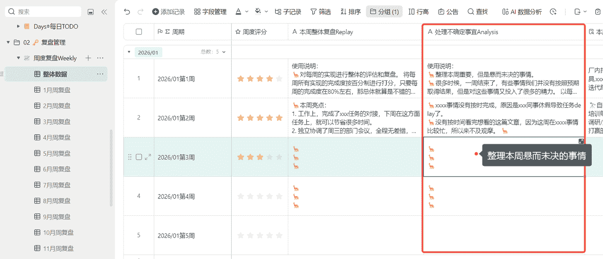

这套复盘方法采用的是SRA法则，市面上也有GRAI、KPT等法则，可以参考并挑选出最适合自己的即可。

### （2）**月度复盘Month**

双向关联「周度复盘Weekly🎹」表，整合后做月度复盘。基于过去4-5周，复盘本月。「月度复盘Month🏄」表采用的是PATH四格法（PATH Quadrant Method），该思维方法的解释如下：

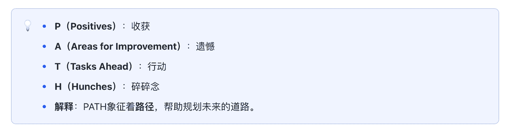

下面解释下「月度复盘Month🏄」表的具体使用方式，如下👇🏻：

**🧩本月收获清单： **①带来多巴胺的事件，是你前进的动力； ②具体事件，为什么让你有成就感。

**🧩 本月遗憾清单： **①人生需要承受失败，下一个惊喜才会出现，学会接受自己的错误才能遇见更好的自己； ②具体事件，为什么让你有遗憾。

**🧩本月行动反思： **①基于过去的经历，提升时间管理能力。

**🧩碎碎念： **放一些闲杂的又无关的内容，可能是附件、材料、备注之类的。临时性脑袋突然间想到啥，但是又跟前面没关系的，都可以写到这里。

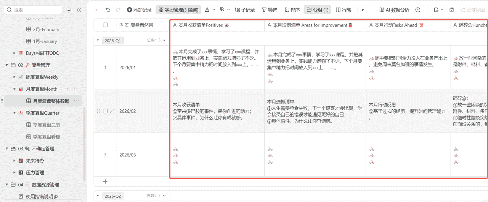

### （3）季度复盘Quarter

季度复盘，对齐月度复盘和月度计划，对过去三个**月所做的事情进行整体**总结，对整个季度进行OKR Review。具体包括：

🖇是**否符合预期：①**比预期差；②符合预期；③超出预期。

🖇G**ood：**哪些方面取得显著进展，可复制经验有哪些？

**🖇Not Good：哪**些方面进展不好？根本原因是什么？后续应对举措？

🖇风**险：风**险预警、待决策项、其他关键信息同步。

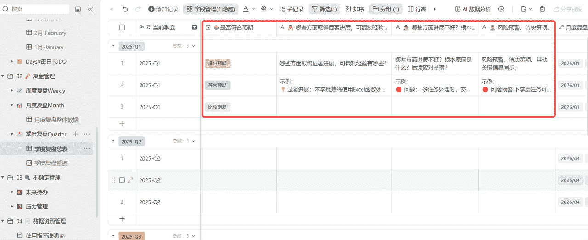

## 4、不确定管理方法论

**对于不确**定管理来说，本质上可以理解为是精力管理的一部分。当我们把情绪和焦虑也一起管理起来的时候，就能更快速地全情投入。

### （1）未来待办

日常工作中，总会遇到一些**不确定的事宜。**比如**：在社区里面看**到一个很感兴趣的视频（视频时长2h+），但是现在没时间看，自己也不确定能安排在什么时间段来观看这个视频。因此，就需要找个地方，把这些事情先丢进去，减少我们去思考它的负担。而这个地方，就是「未来待办表」。数据表的使用如下：

+   填写相关的未确定事件，以及事件所涉及的一些信息来源，把它们记下来，减少心智负担；

+   同时，先预计下预计哪个月份哪一周回去做这个事情，也把它们填充进表里面；

+   填写对应的待办日期是为了把它映射到我们的「周度计划表」里面，方便我们在做周度计划时，可以直接查看待决清单📌。

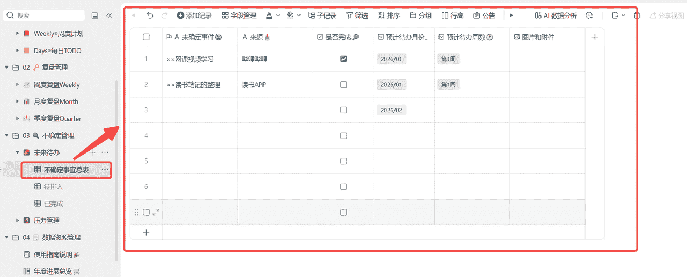

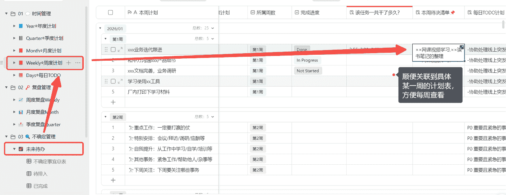

### （2）压力管理

日**常工作中，每**隔一段时间总会遇到或大或小的工作压力。压力如果不及时分解，很容易会造成大型拖延现场。严重时，可能还会造成内耗和焦虑。因此，遇到压力时，要及时分析和列出行动清单，减少拖延事件的发生。「压力管理👾」数据表使用方式如下：

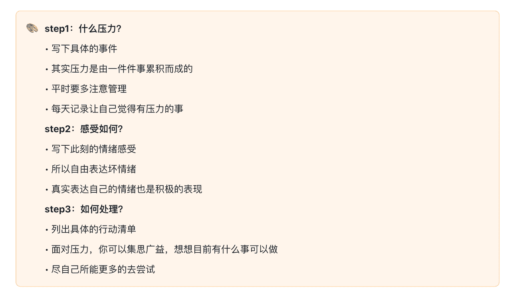

压力表的内容也会关联到「月度复盘Month表」中，方便月度和季度总结时追溯和查看。

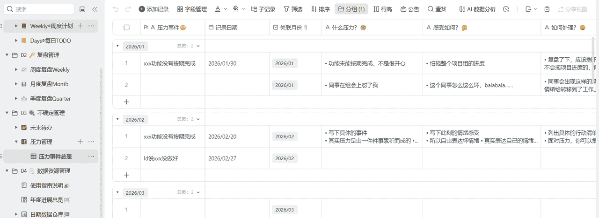

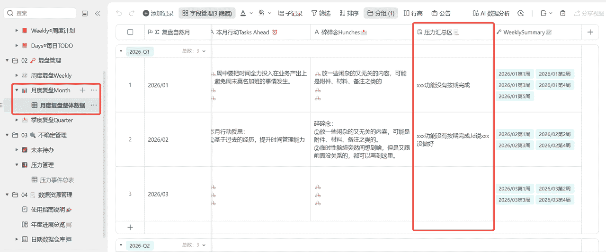

关于所有表的方法论讲解，到这里就结束啦！

# 四、🚉最佳实践探索

由于这张表小编用了多年很顺手，忽略了新手小白有可能遇到的问题。

然后小伙伴们在大家的过程中，提到了很多新的问题，所以这次想再补充个最佳实践探索。

新手刚用的时候，先从**每日TODO**和**周度计划**开始，之后一段时间后，**月度计划**和**季度计划**可以挑一个写。

小编是因为单位有季度性的OKR和OKR Review，才会每个季度都写。大部分情况下，季度性的目标是一个比较泛、比较抽象的概念，实际实践起来，都会和原先的计划多多少少有一点出入。

同时，从过往其他小伙伴的实践经历来看，如果单位没有说要制定季度性的目标和季度性的review，这张表写起来都说不太好写，因为3个月的进度不太好把控。

但是如果变成一个月一个月来写的话，就只需要关注当前月份所对应的4个星期即可。在这种情况下，我们会比较好把控接下来1个月要做些什么事情。

这套模板在刚开始熟悉的时候会花一点时间，但这**些是为了熟悉以**后能够毫不费力地直接来这个时间管理档案馆找到你想要的数据。如果你在记录的时候是持续性地觉得很麻烦，那么建议即时停止，去找寻更方便、并且能够减少你心智的方法。

记住，**计划的制定是为了行动！**当发现写计划都让你感觉很有负担的时候，说明这个方法此刻大概率不适合你，需要及时调整然后去找到自己合适的方法。

Maybe……感觉这套模板J人用起来应该会比较顺手，如果有P人使用的话，欢迎留言。感觉可以出个P人版本，做下相关类别的删减。

如果你有更多最佳实践心得，欢迎来多多交流😉

# 五、⛵️AI体验

**看到 A**I 体验，但因为篇幅太长了，先初步体验了下，下回再来单独对AI功能做个测评😉

## 1、AI快速建表

首先是AI快速建表。在用多维表格的时候，你如果觉得每次单独拉一个表格很麻烦，那么可以直接在这里用「AI快速建表」来解决这个问题。

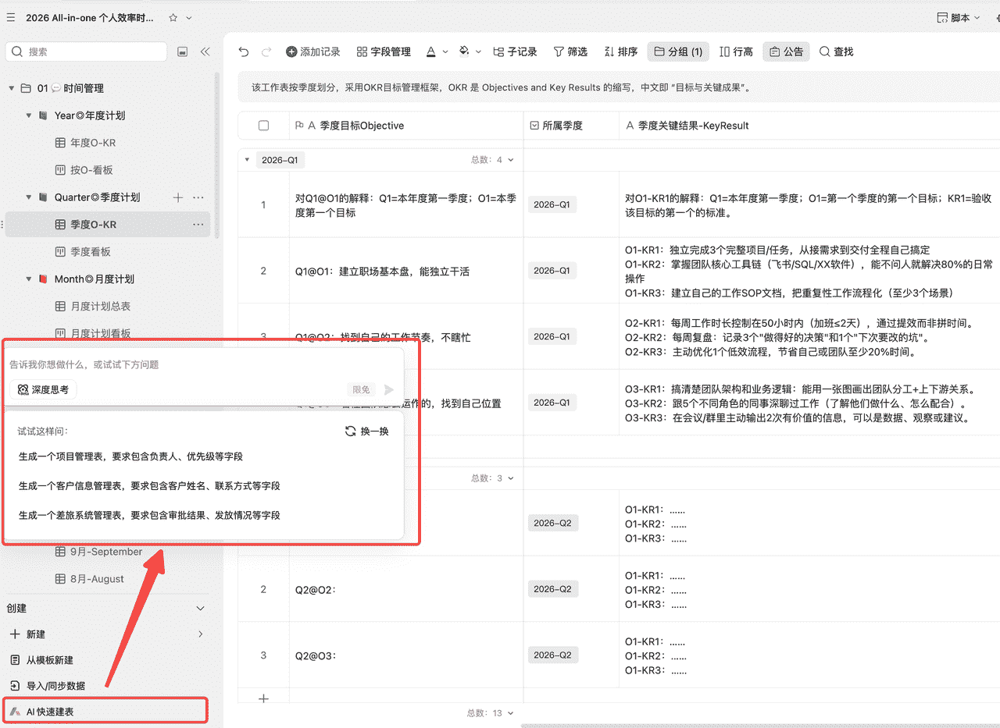

## 2、AI内容总结

除此之外，如果在一张多维表格里面，你填充了很多数据，想要一次性对部分数据，进行内容总结，那么你可以用内容总结字段中心来解决这个问题。

比如我让AI来帮我总结月度计划，我可以这样处理：

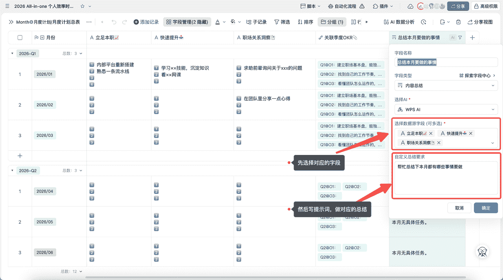

初步小试一下，下回单独出一篇WPS AI的测评文章😉

# 六、🏍结束语

到这里，关于**WPS多维表格**的初步探索就先告一段落啦！

这套模板在社群摇了五个小伙伴来一起帮忙，最终累计花费了40h+的时间，终于竣工！

相比于去年，再**减熵**了一些内容。希望看到这套模板的时候，能给你带来一些新的视角和体验。

期待你的使用和评论~😉

以上就是本期全部内容，我们下期见！

# 🐣彩蛋One More Things

## 1、获取模板

**关注公众号【星期一研究室】，回复「WPS多维表**」，领取你的2026专属模板🔥🔥🔥

## 2、变更记录

