# 飞书向公众号定点排版

> 来源：[https://docs.feishu.cn/docx/BkRVdJDUyo3hxHxNwLzcEYOpnSh](https://docs.feishu.cn/docx/BkRVdJDUyo3hxHxNwLzcEYOpnSh)

# 一、关于图床

腾讯云OSS+PicGO解决方案

# 二、定点排版

如何把飞书的文章快速排版并发布到公众号：

## 飞书到typora

+   在飞书写完一篇文章后，用「cmd+A」全选复制，复制完成后，把它粘贴到typora下

+   在Typora处理「暂时无法在飞书文档外展示此内容」

+   通常情况下，飞书复**制下**来的图片，到typora需要转两遍才能使用。第一遍上传，第二遍是处理.null后缀的图片。全部处理后，需要再搜索一遍.null，看看有没有都替换到位了。

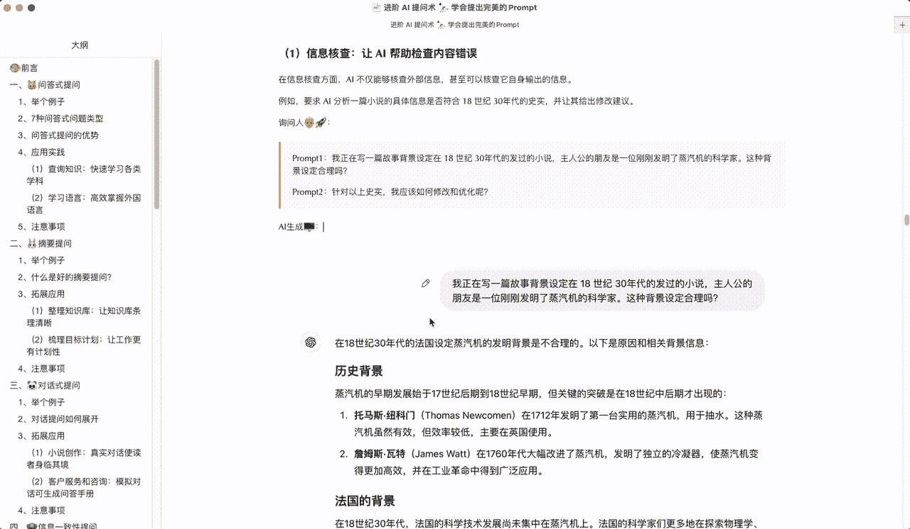

+   全局处理完成后，对全文**所有图片**进行重命名，注意看图片转过来的时候，有没有一些错位了。

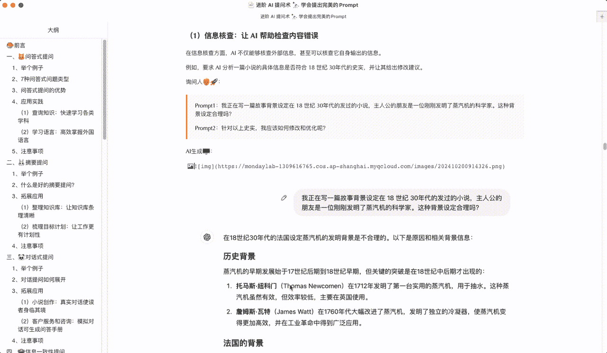

+   重命名完成以后，要全局搜索.null和[img这两个字符串的内容，看看是否有漏上传的图片，以及忘记命名的图片。

+   给所有**下划线**的位置，加上下划线。对应快捷键：Ctrl+U。

+   识别飞书支持的格式，但是typora不支持的格式，做内容平铺化整理。比如：①飞书可以在表格内嵌入图片，但是typora不可以。②有些表格在飞书呈现很好，但是到公众号不一定能呈现的很好看，这个时候可以在飞书截成图片，然后复制到typora。

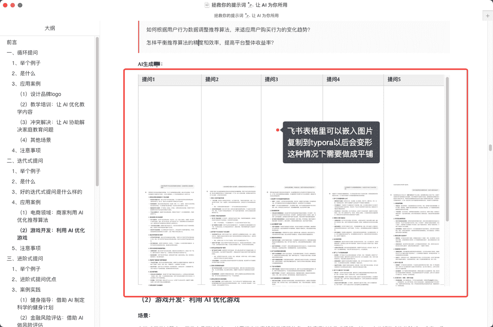

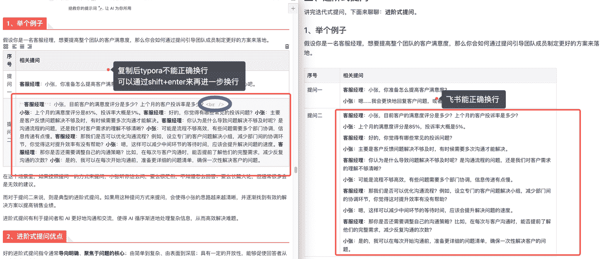

## 处理特殊字符

| **问题** | **问题描述** | **附图说明** |
| --- | --- | --- |
| **** |  | 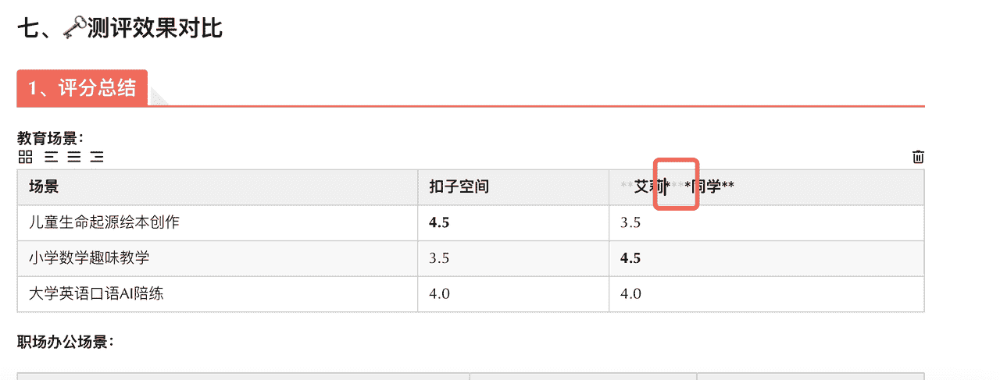 |
| **``** | 这种类型的格式，在mdnice几乎没法识别出来 |  |
| )! | 处理连续图片，会导致上下排列堆叠的问题 | 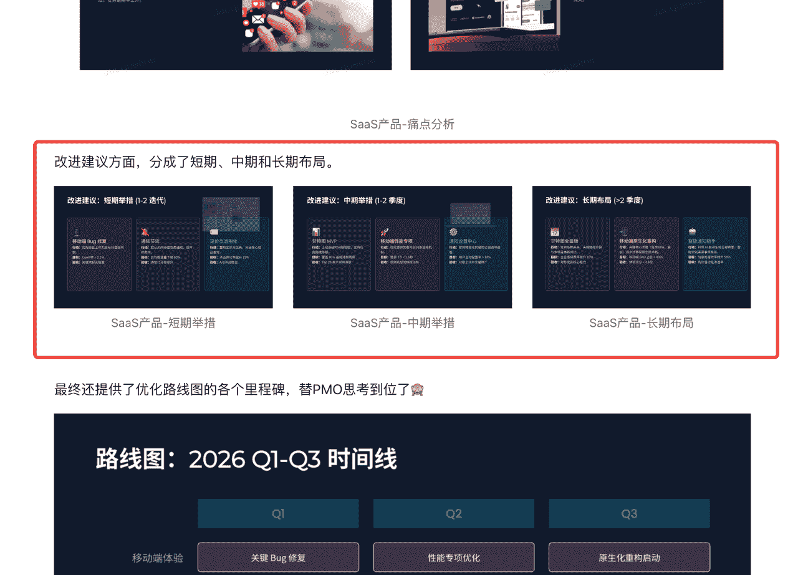 |
|  |  |  |

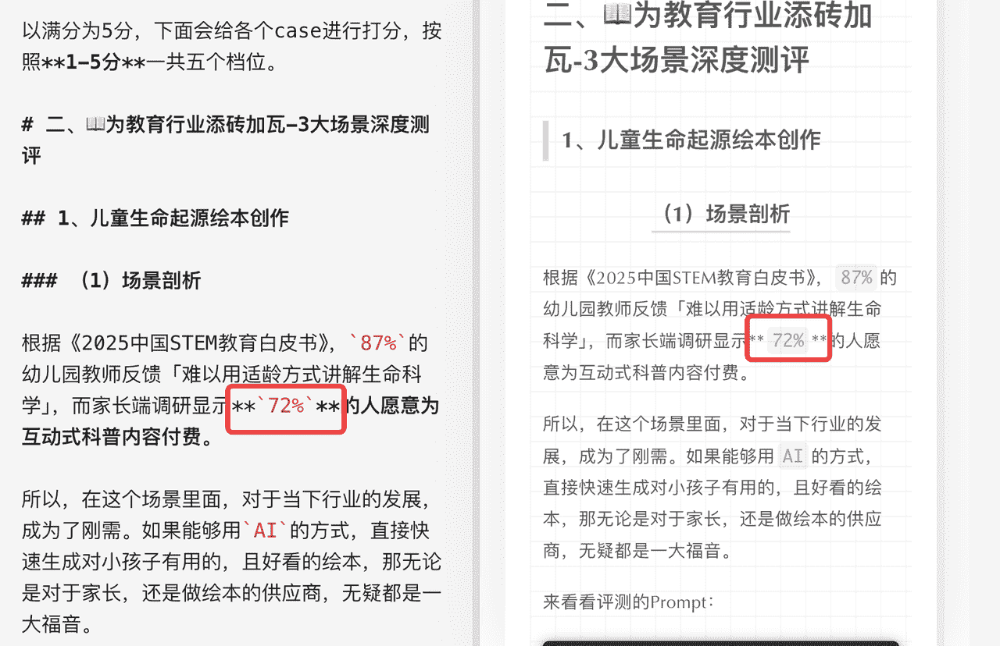

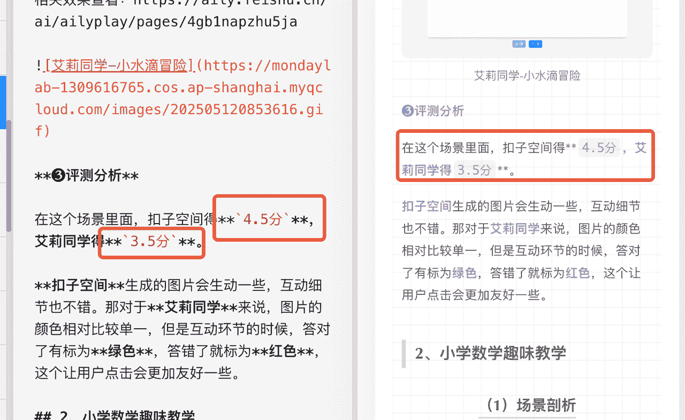

## typora到mdnice

+   把在Typora处理好的文章，**全选**复制到mdnice。

+   复制完成后，选择喜欢的主题；然后输入快捷键cmd+option+L，转换下外部链接，变成reference。

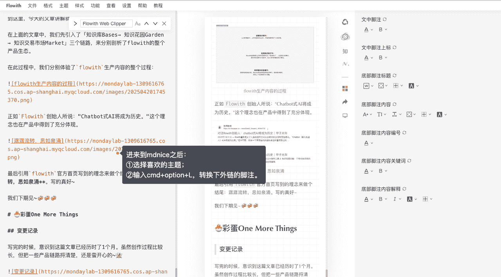

## mdnice到公众号

+   在mdnice，点击下方按钮，直接复制到公众号。

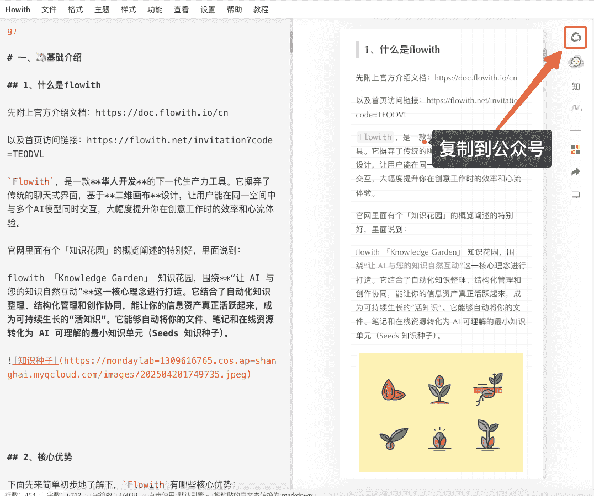

+   复制进来后，是这样的。

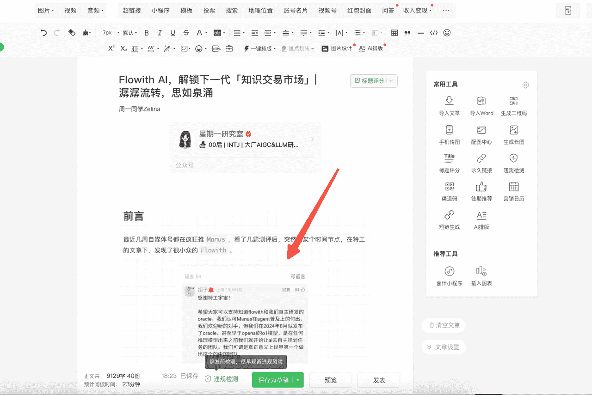

+   下一步，访问135编辑器：https://www.135editor.com/**beau**tify_editor.html。找到对应位置的样式，把对应的动画，插入到推文里面，注意要找主题一致的。

+   插入完成后，对文章的封面、描述、转载、原创等进行设置。之后发送预览到手机端，检查在手机端的情况下，是否有错别字，及时修改。

# 三、其他平台

**公众号**发布完成后，还要发布到其他平台：

# 四、其他工具

我开发了一款排版器：20秒，完成公众号排版

壹伴和其他排版，支持的主体都没有那么多，而且有一些格式会丢失，RAG都不太强大，基本得自己开发了。