# 这一次，飞书帮你把时间管理撼到极致！

> 来源：[https://docs.feishu.cn/docx/VsYWdIHZ3oiFHmxXRvKcNxrXn8g](https://docs.feishu.cn/docx/VsYWdIHZ3oiFHmxXRvKcNxrXn8g)

**如果你想挖掘更多有趣的知**识管理技巧，欢迎来Zelina的模板产品铺挖宝🚏😉

多维表格（Kq47buqWqa0W4osqVdLcYmA5n1e_tbl5w9JuHxWHNKfR）

# 一、我与飞书多维表格的故事

## 1、设计初衷

+   2023年3月份以前，小编在工作中一直都是『日报-月报-季度报』的形式进行复盘，使用的是『飞书文档』的形式。

+   久而久之，连续多个月的**手动填充数据**，到周五、月底或者季度末要复盘的时候，会感觉非常的繁琐和麻烦，『心智负担』也变得越来越重。

+   理论上，**复盘**是一件好事才是，结果因为流程繁琐，而让自己害怕起来，这怎么讲看着都是非常本末倒置的。

+   **基于这个背景下，也就有了这套**模板。这套模板结合了小编日常的计划管理、时间管理和复盘管理，以『多合一、数据联动』的思路，让计划制定和复盘变得不再繁琐，只需简单的数据填充，即可高效管理个人的时间和精力。

| 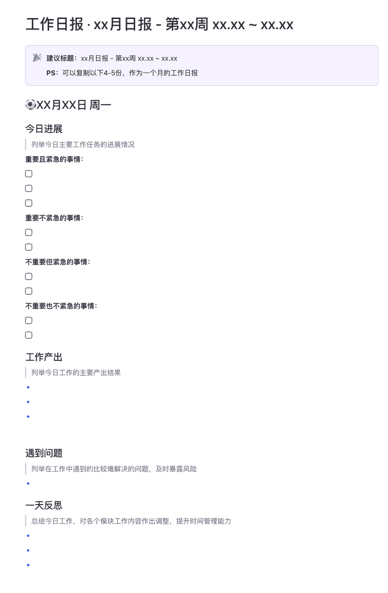 | 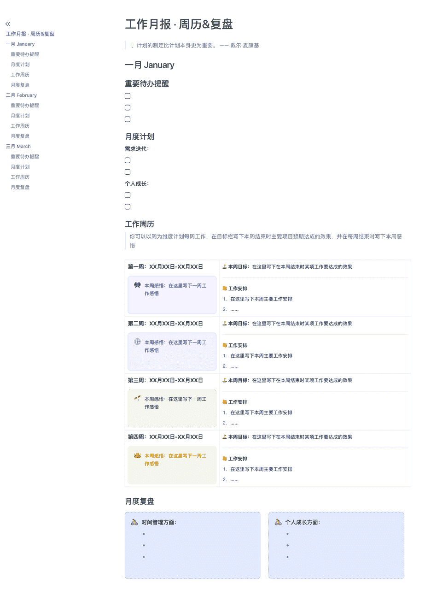 | 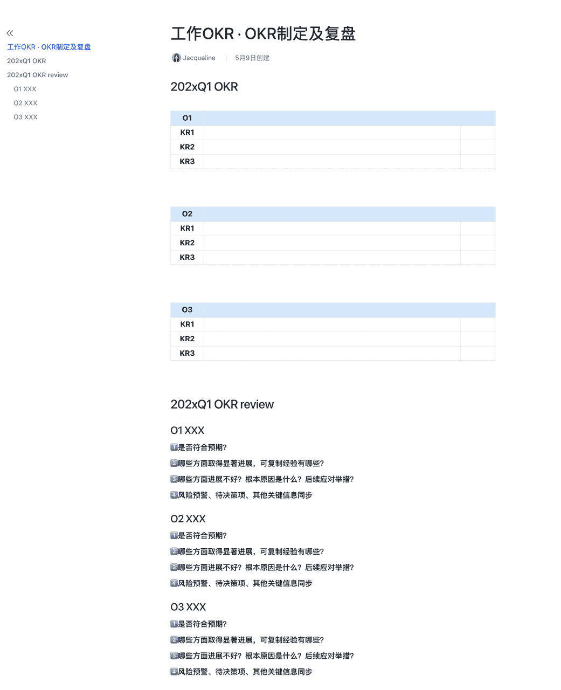 |
| --- | --- | --- |

## 2、模板先知晓

首先先附上模板地址👇🏻：

[2024 All-in-one 年度工作视图🧩](https://pzfqk98jn1.feishu.cn/wiki/wikcn8MifznjIBher9B3dP3F99e?table=tblz9FTyCVpM077t&view=vewleyoa4a)

下面将依据上面这套模板，讲解具体的使用方法~

# 二、模板使用指南说明

## 1、日期数据仓库

在拿到表的第一时间，首先看「💬日期数据仓库」表**。这**张**表会**存**放一**整**年的时**间数据源，包含季度、月份、周数、周范围等数据。在其他数据表中，都将会引用到这张表的数据，这样设计主要考虑到以下因素：

+   把**日期的数据**统一存放到一张表里面，这样等以后到2024、2025、2026年的时候，修改数据时，就只需要改一张表的数据即可，而不用到处定位数据源，然后还得修修整整、删删补补。

+   不同的小伙伴对**周开始和周结束**的定位不一样。周一在设计的时候，如果当前月份最后还剩下4天，就算是这个月的。如果不足4天**，就算是下**个**月的。那**有一些小伙伴可能不这么考虑，所以可以依据自身的想法，直接修改具体的时间和所属周数即可。

+   在设计第一版的时候，周一发现「周度计划表」的月份和所属周数经常得手动填充，有时候**计划**写**着写**着就会漏掉这部分的数据**操作。所**以现在这个问题也解决啦！「周度计划表」的月份和周数只需填写一次，然后配置日期范围的查找引用，每次就可以自动填充对应的月份和周数。

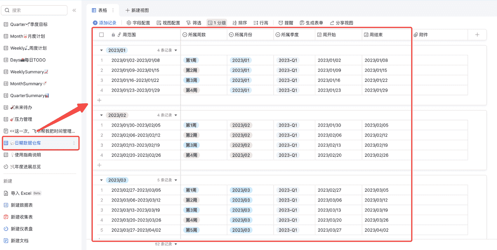

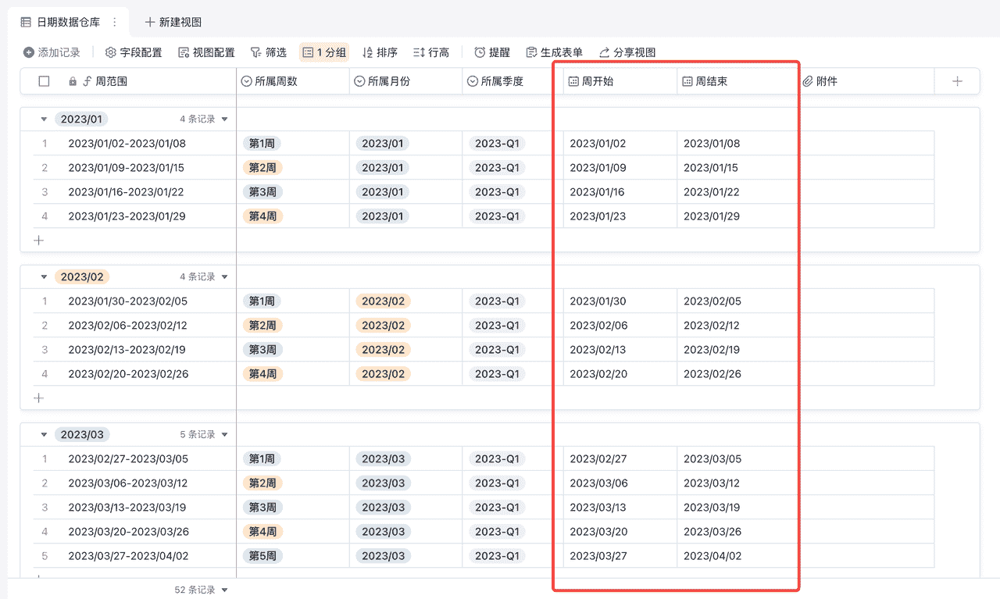

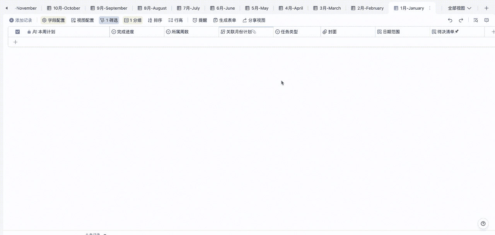

## 2、计划管理

### （1）Year🛰年度OKR管理

| 年度OKR采取**O-KR**的方式，制定方式如下👇🏻： | 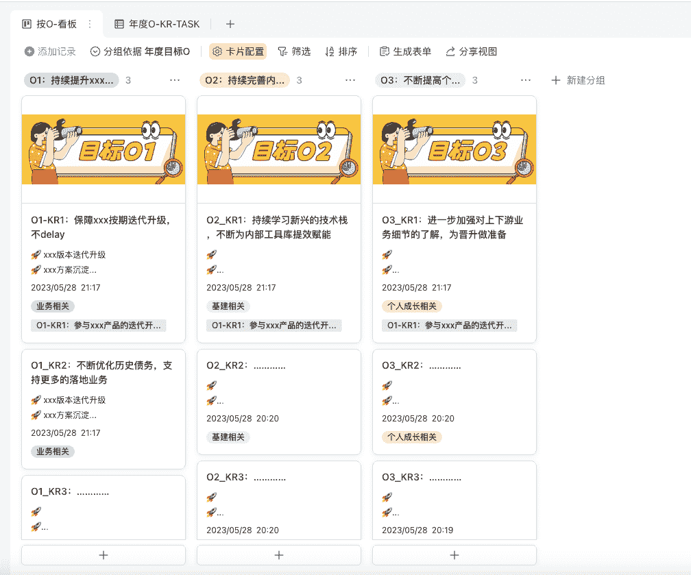 |
| --- | --- |
| 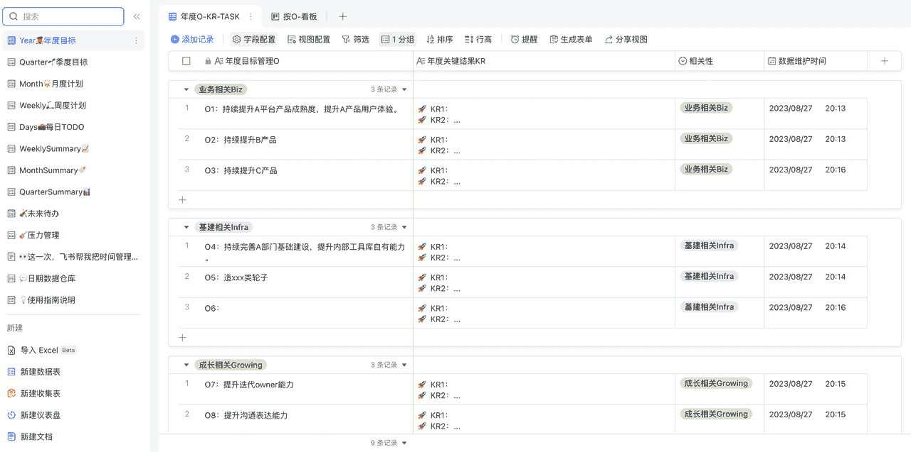 |  |

### （2）Quarter🚀季度OKR管理

基于「Year🛰年度OKR管理」数据表，制定季度OKR。方式如下👇🏻：

🗒在「季度目标O管理」属性中填写每个季度的目标，填写完成后，针对每个目标O，在「季度KR管理」属性中，填写O背后相应的KR（一般一个目标对应3~5个KR）。

🗒季**度里的每个目标都**会去对应**到年度里面**的KR，做双向关联，方便及时查看季度目标是否对应上年度计划，及时暴露风险。

🗒同时，每个季度的目标也会关联到「月度目标表」，这么映射的目的是为了及时制定和查看「每个月的月度计划」。

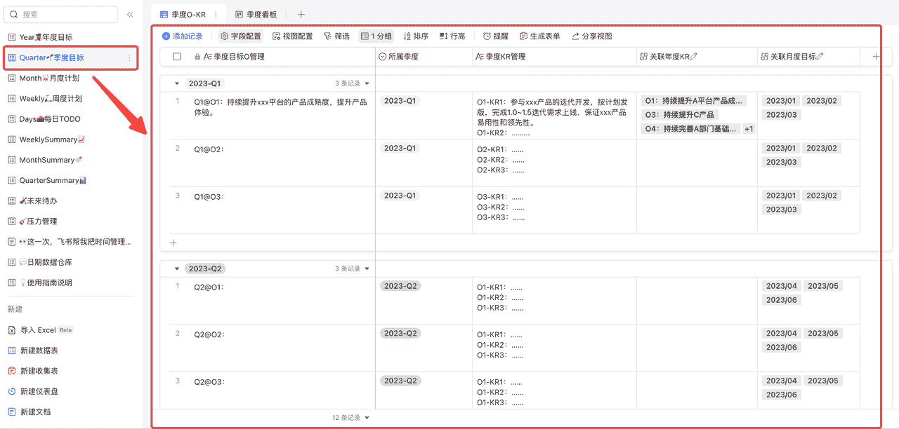

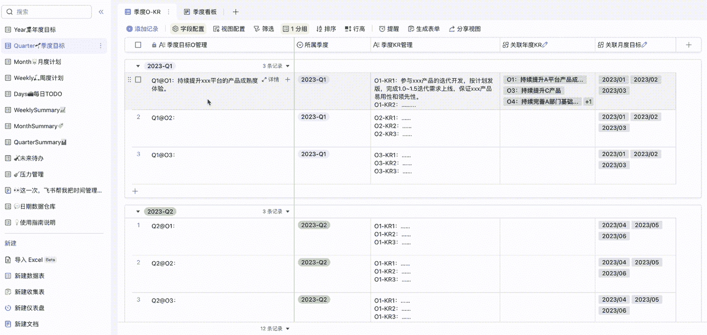

### （3）Month🚠月度计划

基于「Quarter🚀季度OKR管理」数据表，制定月度计划。方式如下👇🏻：

📆在每个月的月末或者月中旬，提前「制定下个月的计划」，方便在阶段性任务完成后，及时查看下一阶段的计划。

📆在小编的工作计划中，包括①需求迭代、②基础建设和③个人成长三大部分。那么在计划制定时，每一列就可以写上 3-4 项计划。

📆除此之外，月度计划表「Month🚠月度计划表」还设计了月度关键词，这一列是为了督促自己每个月改掉一些不良习惯。比如，4月份发现工作时「专注度不够」，导致加班的时间变长了。因此，就把它写到「月度关键词」中，来更好地督促自己。

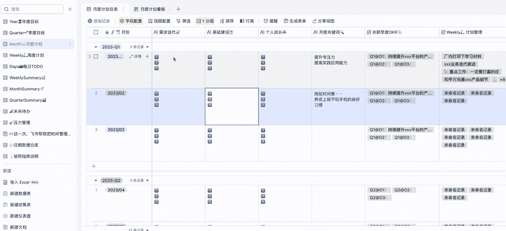

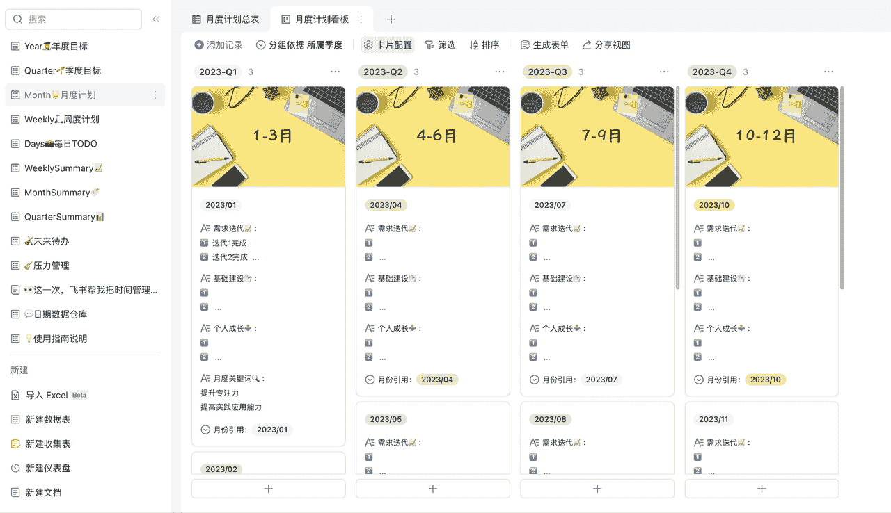

### （4）Weekly🛴周度计划

**月度计**划的制定，是为了更好的安排周计划，周计划可以说是所有计划中最好把控的一种计划了。它没有每日计划那么琐碎，又比每月计划更好掌控一些。在「Weekly🛴周度计划」数据表中，包含以下设计👇🏻：

🔭重**点工作：一**定要打赢的仗

🔭特**别安排：会**议/拜访/调研/应酬等

🔭自**我提升：从**工作中学习/自学/培训等

🔭其**他事务：紧**急工作/帮助他人/杂事等

🔭下**周关注：下**周要关注哪些事务

在每周的周末，可以花上5-10min的时间，用上面的这个范例，去制定下一周的计划。

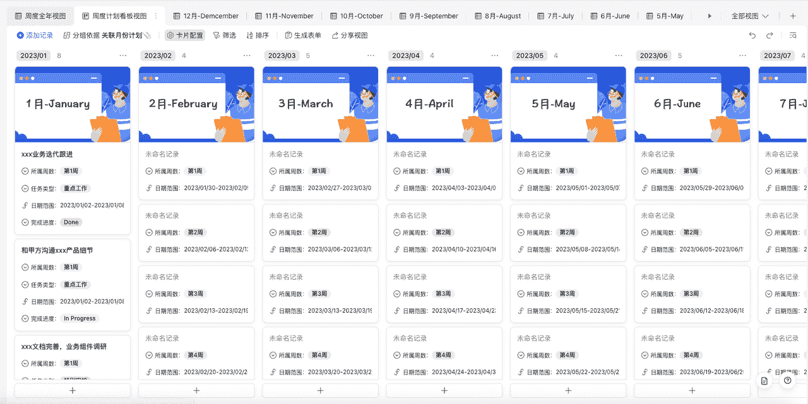

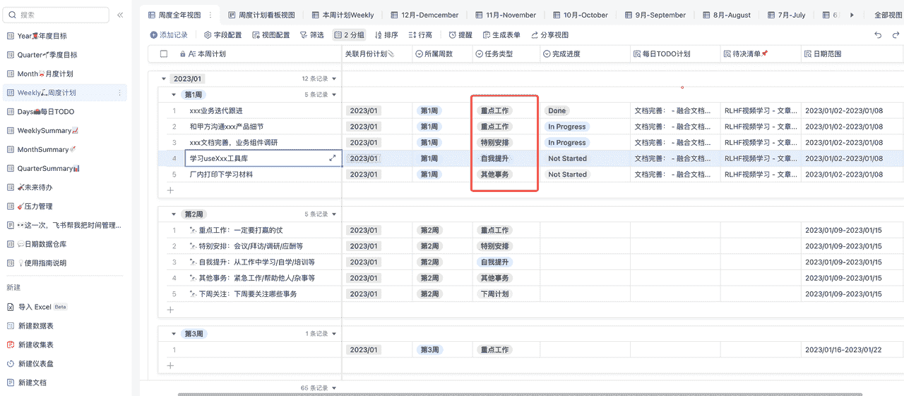

### （5）Days🚲每日TODO

有了周度计划以后，就可以围绕周度计划，来制定「每日计划」啦！具体方式如下：

🧗每日计划采用的是四**象限法则。**

🧗分别设置1-12月的单独窗口，方便追溯每个月做的事儿。

🧗同时，还设置「昨天、今天、明天和本周」四个窗口，方便每天整理近一周要干的活，让自己制定变得更加有秩序。

🧗与此同时，增加日**历视图，**且用四种颜色区分四象限规则。分别为：①P0 重要且紧急🔴；②P1 重要不紧急🟣；③P2 不重要但紧急🔵；④P3  不重要也不紧急🟢。

🧗除此之外，还设置将**TODO移动到今天和明天的**功能，只需触发列表里的按钮，即可将对应事项移动到对应的日期。

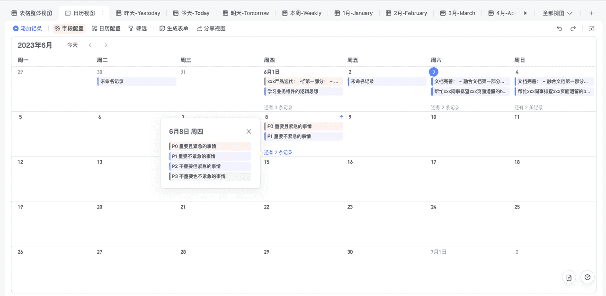

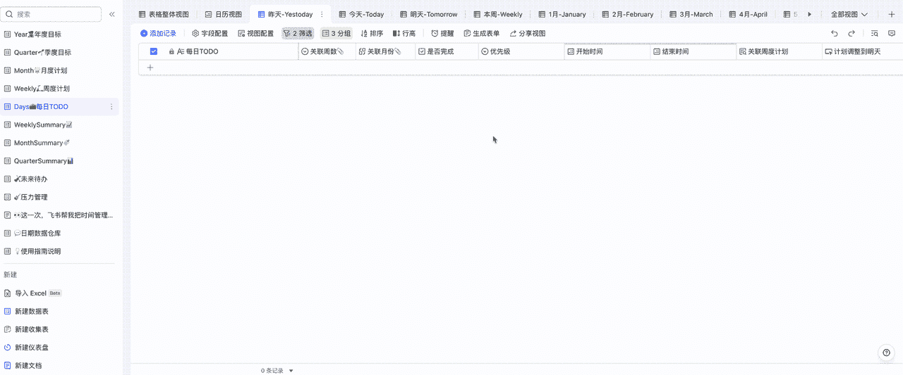

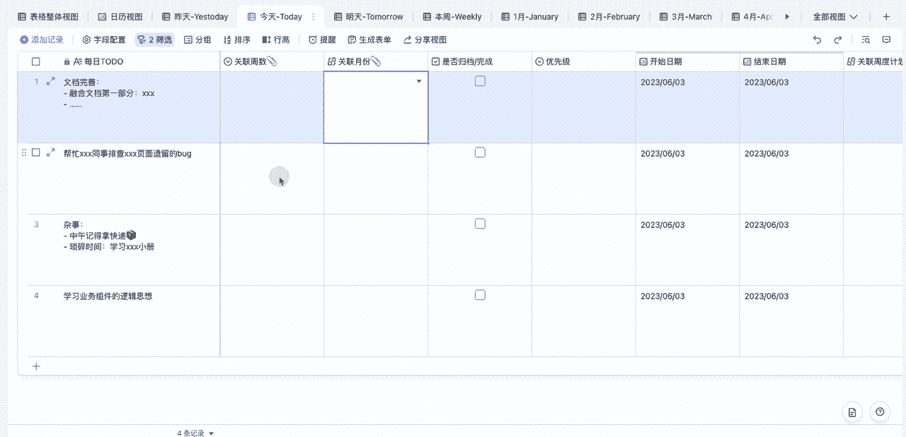

## 3、复盘管理

### （1）周度复盘Weekly🎹

| **在周中的某**一**刻时刻，有时**候或多或少会遇到些困难。在困难解决后，需要反思哪里做得好、哪里做的不好。因此，周度复盘所涉及的表「周度复盘Weekly🎹」来啦！此数据表包含以下内容： | 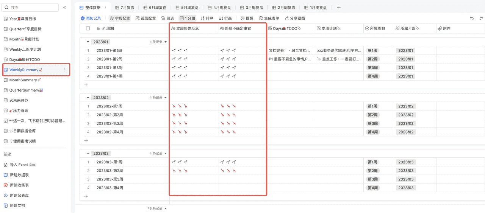 |
| --- | --- |

### （2）月度复盘Month🎼

双向关联「周度复盘Weekly🎹」表，整合后做月度复盘。基于过去4-5周，复盘本月。具体方式如下：

🧩本**月收获清单： **①带来多巴胺的事件，是你前进的动力； ②具体事件，为什么让你有成就感。

🧩 本**月遗憾清单： **①人生需要承受失败，下一个惊喜才会出现，学会接受自己的错误才能遇见更好的自己； ②具体事件，为什么让你有遗憾。

🧩本**月行动反思： **①基于过去的经历，提升时间管理能力。

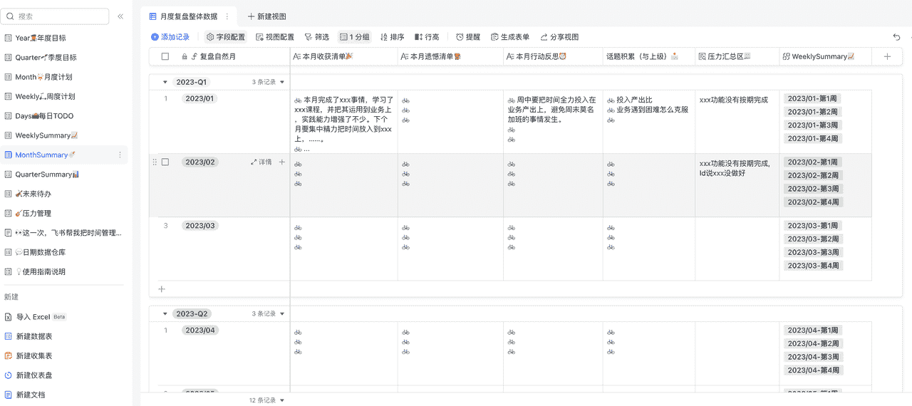

### （3）季度复盘Quarter🎤

季度复盘，对齐月度复盘和月度计划，对过去三个月所做的事情进行整体总结，对整个季度进行OKR Review。具体包括：

🖇是**否符合预期：①**比预期差；②符合预期；③超出预期。

🖇G**ood：哪**些方面取得显著进展，可复制经验有哪些？

🖇N**ot Good：哪**些方面进展不好？根本原因是什么？后续应对举措？

🖇风**险：风**险预警、待决策项、其他关键信息同步。

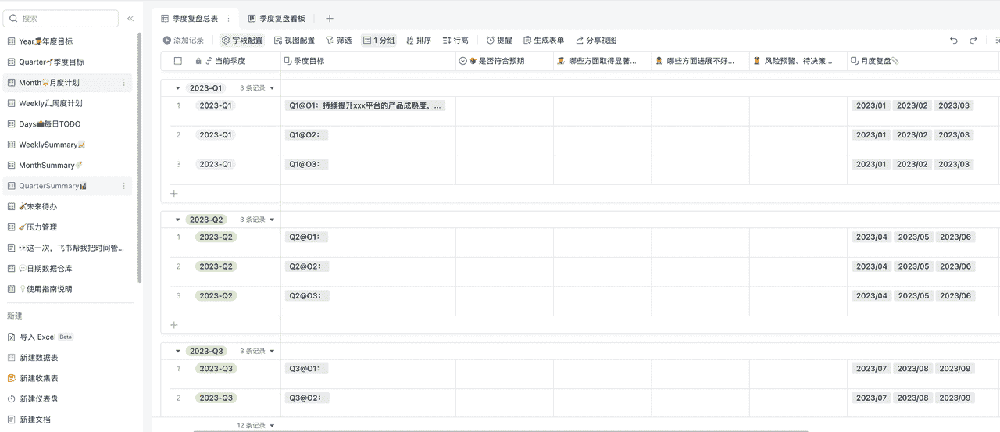

## 4、不确定管理

### （1）🎙未来待办

日常工作中，总会遇到一些不确定的事宜。比如：在社区里面看到一个很感兴趣的视频（视频时长2h+），但是现在没时间看，自己也不确定能安排在什么时间段来观看这个视频。因此，就需要找个地方，把这些事情先丢进去，减少我们去思考它的负担。而这个地方，就是「未来待办表」。数据表的使用如下：

+   填写相关的未确定事件，以及事件所涉及的一些信息来源，把它们记下来，减少心智负担；

+   同时，先预计下预计哪个月份哪一周回去做这个事情，也把它们填充进表里面；

+   填写对应的待办日期是为了把它映射到我们的「周度计划表」里**面，方便我们**在做周度计划时，可以直接查看待决清单📌。

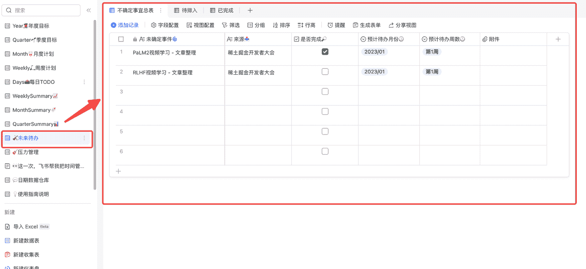

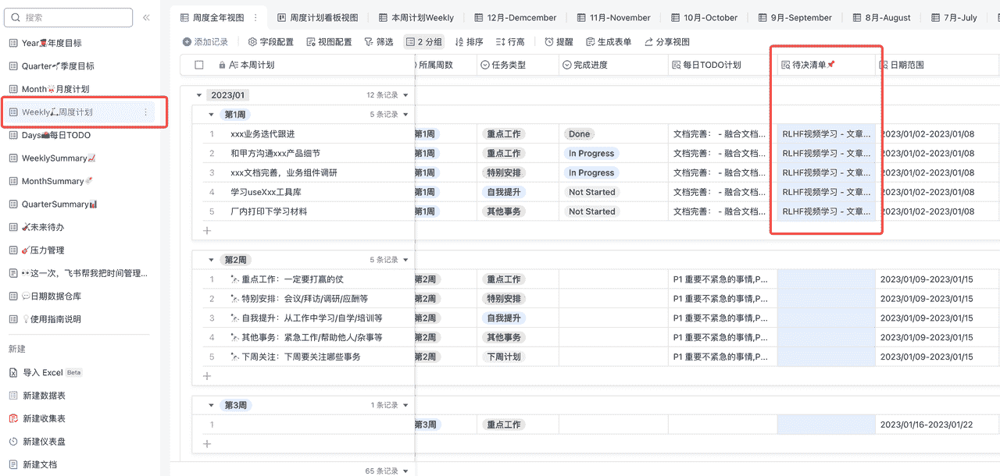

### （2）🔋压力管理

日**常工作中，**每隔一段时间总会遇到或大或小的工作压力。压力如果不及时分解，很容易会造成大型拖延现场。严重时，可能还会造成内耗和焦虑。因此，遇到压力时，要及时分析和列出行动清单，减少拖延事件的发生。「🎸压力管理」数据表使用方式如下：

|  |  |  |
| --- | --- | --- |

> **step1：什么压力？**

> • 写下具体的事件

> • 其实压力是由一件件事累积而成的

> • 平时要多注意管理

> • 每天记录让自己觉得有压力的事

> **step2：感受如何？**

> • 写下此刻的情绪感受

> • 所以自由表达坏情绪

> • 真实表达自己的情绪也是积极的表现

> **step3：如何处理？**

> • 列出具体的行动清单

> • 面对压力，你可以集思广益，想想目前有什么事可以做

> • 尽自己所能更多的去尝试

压力表的内容也会关联到「月度复盘Month🎼表」中，方便月度和季度总结时追溯和查看。

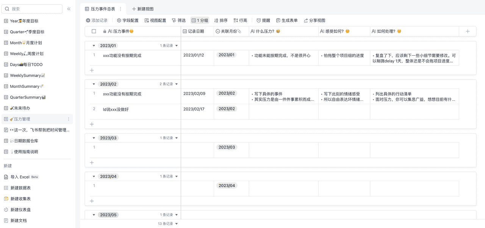

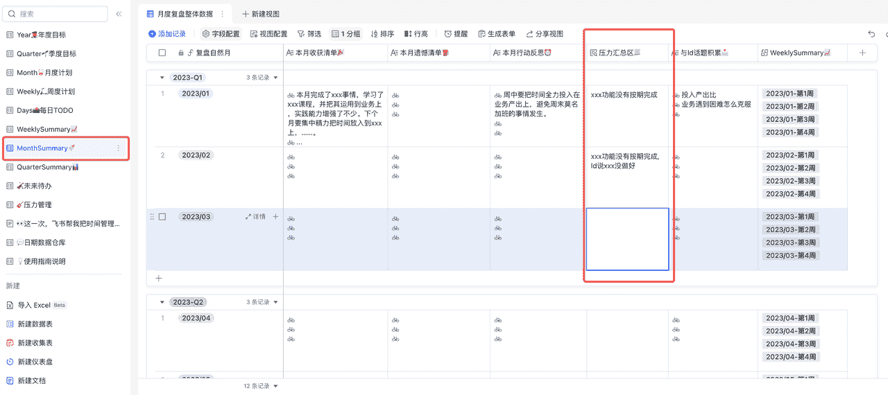

# 三、实践感悟录

## 1、碎碎念随笔

实践**这套多维表累**计6个月+，发现心智负担降了不少。让我不再把精力放在周末月末的搬运和填写上，而是把精力放在数据上。简单填写后，等到需要相关某个模块的数据时，再打开相关的数据表来查找生产数据，即可快速对自己的工作内容进行回溯和总结。

真正做到了：把琐碎的事情交给多维表格，让自己能够把所有时间和精力都投入到重要的思考上，而不再是繁琐的搬运和填写。

整张表会有一点点学习成本，如果是新同学入门的话，建议可以先从「Days📷每日TODO」这张表开始，先尝试着去了解自己每天都做了些什么，有了基础的每日记录后，再慢慢过渡到周计划、月计划，最终制定季度和年度计划。

## 2、未来TODO

目前整个数据表还有一些未来TODO，敬请期待。TODO如下👻：

多维表格（Kq47buqWqa0W4osqVdLcYmA5n1e_tblTRFmdAbQSAst8）

到这里，整个模板的使用教程讲解也就接近尾声啦！如果模板有更好的建议或使用心得，欢迎交流。saluate~

🛰️🧩：mondaylab712

飞书🧩：周[一同学Zelina](https://www.feishu.cn/invitation/page/add_contact/?token=5fch34c2-7852-4d44-aade-fd8816e6f01b&unique_id=-EAQ0htdTh1yBN_MSSxzAA==)

# 四、探索飞书的历程

## 1、附带一些适合新手入门的模板

+   小编**第一次做时间管理**使用的模板： [每日时间记录清单](https://pzfqk98jn1.feishu.cn/wiki/IfLqw84OWihai1ka4rocqmgtn2c?table=ldxuJx01OVaafGGb)

+   小编**刚工作时**使用的模板：[工作日报 · xx月日报 - 第xx周 xx.xx ~ xx.xx](https://pzfqk98jn1.feishu.cn/wiki/wikcnaWHhHJXhbXLmaFoGJkGhWU)

+   小编**工作了半年后**使用的模板：[工作月报 · 周历&复盘](https://pzfqk98jn1.feishu.cn/wiki/wikcnE3y2Tc3uldYacm0a1fitMd)

+   小编开始做季度[工作OKR · OKR制定及复盘](https://pzfqk98jn1.feishu.cn/wiki/wikcnLvUAJ8XP737vkVjJfbMIye)KR Review后使用模板：

## 2、与多维表的其他故事

+   2023/06/09：[记 · 飞书多维表格工作坊之旅](https://pzfqk98jn1.feishu.cn/wiki/L0N2wFOJQiwZb2kvPelcyRiwnPb)