# ⛳️告别迷茫，事事有章法！码住这份OKR拆解及进度管理指南

> 来源：[https://docs.feishu.cn/docx/Cv3ed9BHQoviNIxPFDacLbgAnyd](https://docs.feishu.cn/docx/Cv3ed9BHQoviNIxPFDacLbgAnyd)

> 最佳实践参考：[OKR拆解及进度管理（前端原理知识进阶）](https://pzfqk98jn1.feishu.cn/wiki/U3ExwZppQiDDFzkmbgXcUXxEnEf?table=tblqFMjiIKgpL9rL&view=vewh3X6k52)

# 设计初衷

这份模板起源于2022年初做毕业设计的时候，当时遇到的问题是：感觉做了很多东西、但是进度无法追踪。软件做一半都不知道跑到哪个部分，论文写一半也不知道自己是不是该写的都写了，不该写的会不会不小心写了没仔细看到。

然后在某个迷茫的早上，我就在飞书文档里刷模板，突然被一套类似的模板吸引住。之后，我对当时那套模板学了大概一个多小时，一直在看里面的数据流和设计思路，最终发现就很适合当时我在找的一个模板方向。

此后，小编就一直用这套模板来管理各种阶段性小目标。

# 实践过程

那这套模板实践下来，我的毕业论文就有了追踪方向：

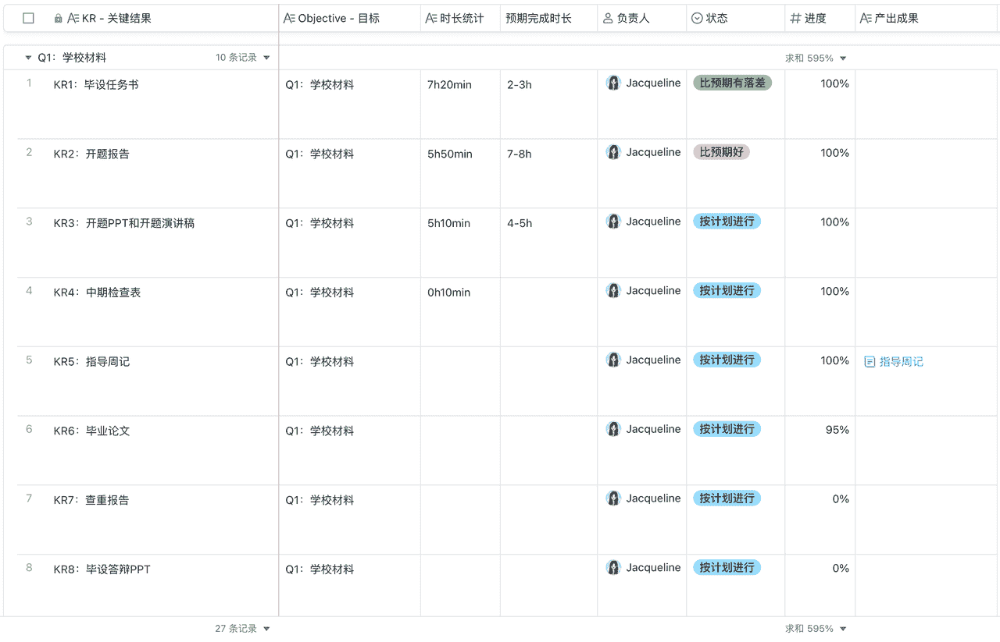

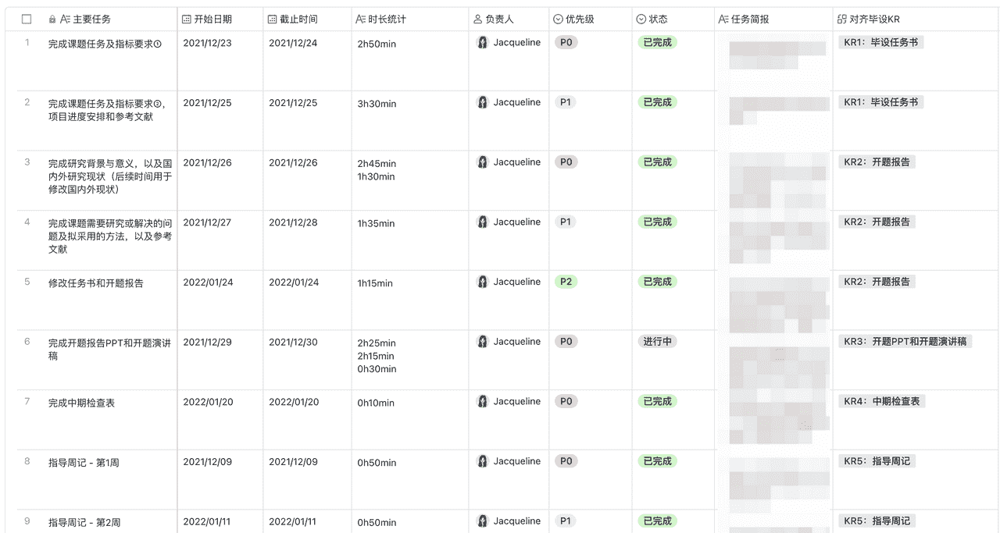

再到后来，我又做了些改造，应用到工作和日常学习中的各种场景。比如，学习前端开发，我是这样制定O-KR-TASK的：

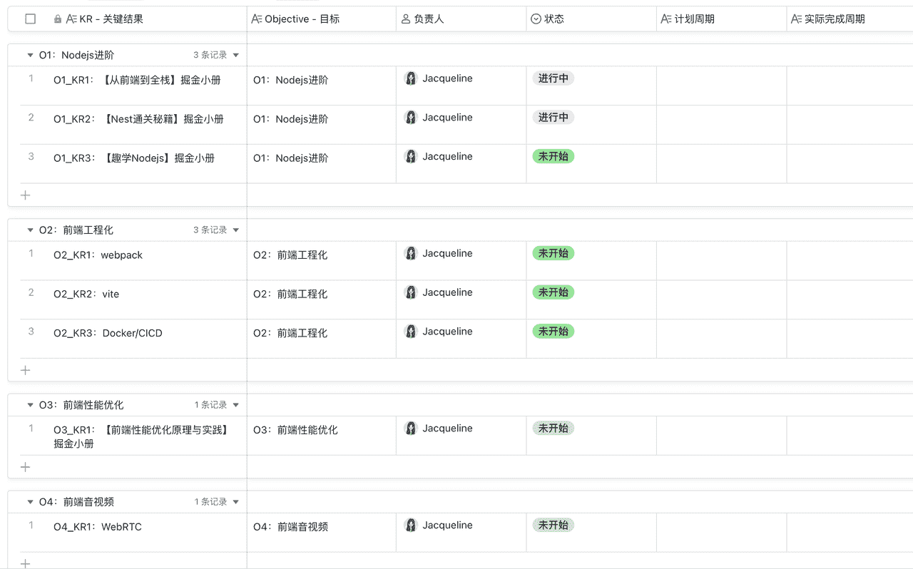

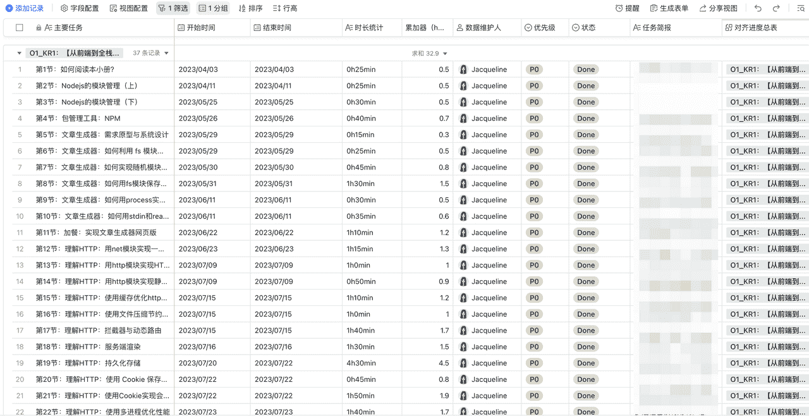

再比如，学习机器学习和人工智能，我是这样制作O-KR-TASK的：

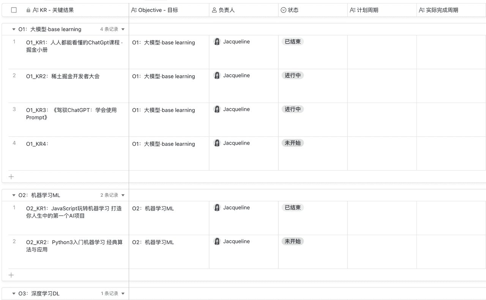

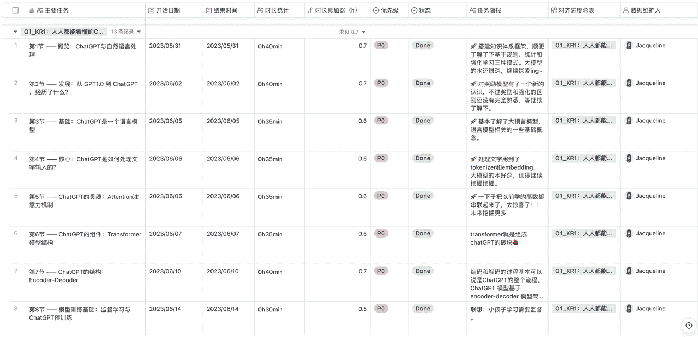

**对于这种**类型的多维表呢，一般算是周一用来存储数据的一个过程。它的目的主要有以下几点：

+   能够更加直观地知道在一个阶段性目标里面我都学了些什么，哪部分更难哪部分更容易？依据我在这过程当中的一些复盘，做下一步的计划调整。

+   增加了**时长统计**，能够让我知道一个课程大概多久很完成，然后在下一次我遇到相同的新的目标时，就知道大概花多少时间能够快速把事情做好。

+   当做生产数据来使用，方便年底时做年终总结。

# 使用说明

## （1）OKR任务总表 - 计划制定

首**先先**到「🦒OKR任务总表」，填写对应的「Objective - 目标」和「KR -关键结果」。然后有一列为状态，状态的话分以下五种情况：

+   🟢未开始 → 指当**前KR未**开始；

+   🟠进行中 → 指当前KR在完成的过程中；

+   🔴已结束 → 指当前KR已圆满结束；

+   **🟣暂停中 → 指**学了一半，后面的内容短期并不会用到，比它有意义的任务还多很多，暂时先去学其他的啦！

+   🔵已终止 → 指学了一半，此时觉得这个任务ROI不高，所以先终止掉。

设置完**状态**之后，之后可以再填写下**计划周期**和**实际完成周期**，这一步主要是为了以后复盘时使用。

## （2）OKR任务拆解 - TASK细化

填**写完任务**「🦒OKR任务总表」后，下面来到「👀OKR任务拆解」数据表。在这个数据表中，主要是为了对刚刚设置的KR，做进一步的任务拆解。可以把O-KR-TASK理解为：

有了对概念的基础了解之后，下面我们来说说，如何使用这张表。

**第一步：****先选择第**一步对应的KR，这一步是为了要和进度总表先对齐好。如下图所示👇🏻：

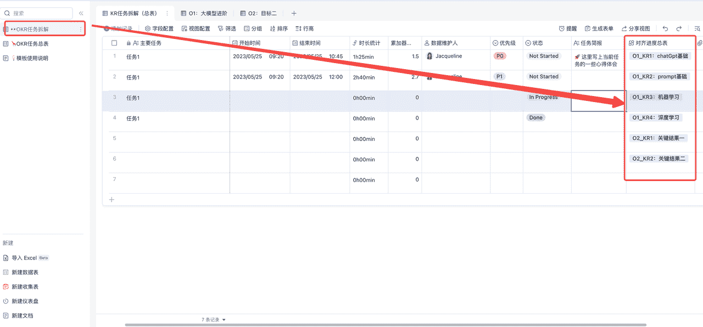

**第二步：**填写当前KR对应的n个任务。如下图所示👇🏻：

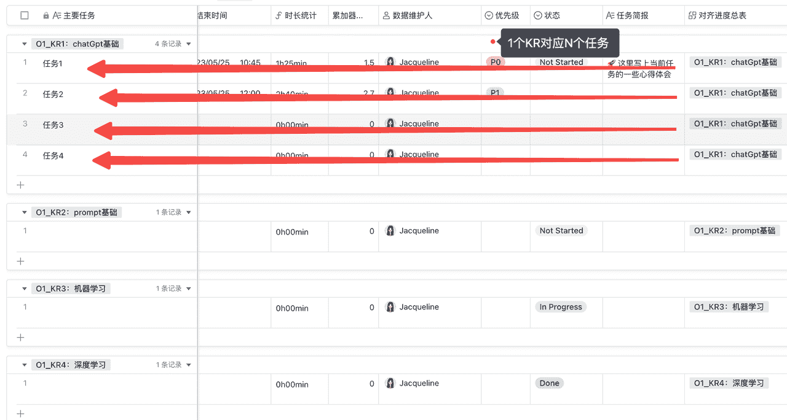

**第三步：**填写时间相关字段。如下图所示👇🏻：

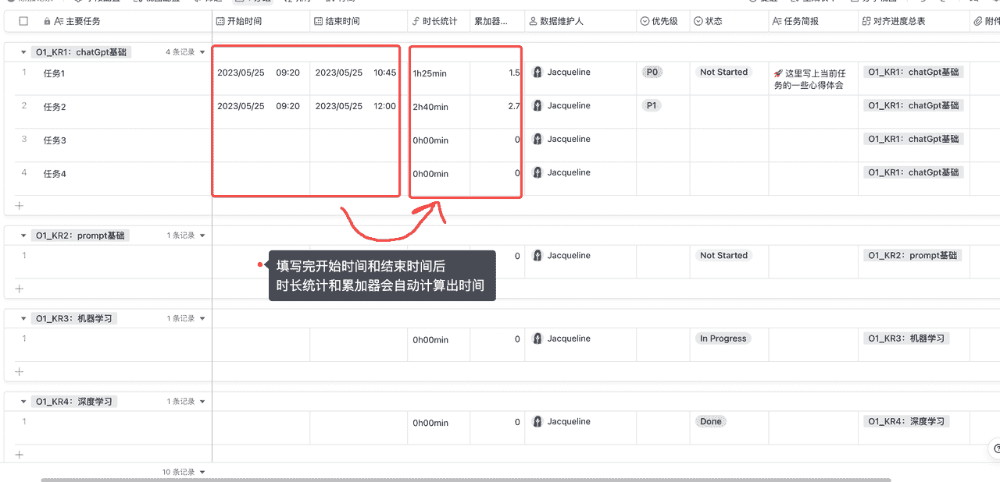

**第四步：**填写负责人、优先级和状态。如下图所示👇🏻：

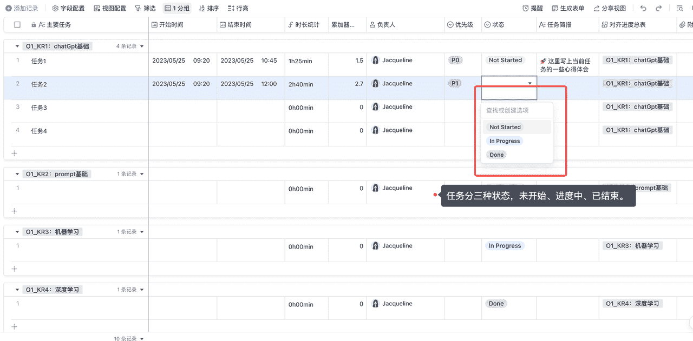

**第五步：**写任务简报，方便后续复盘。如下图所示👇🏻：

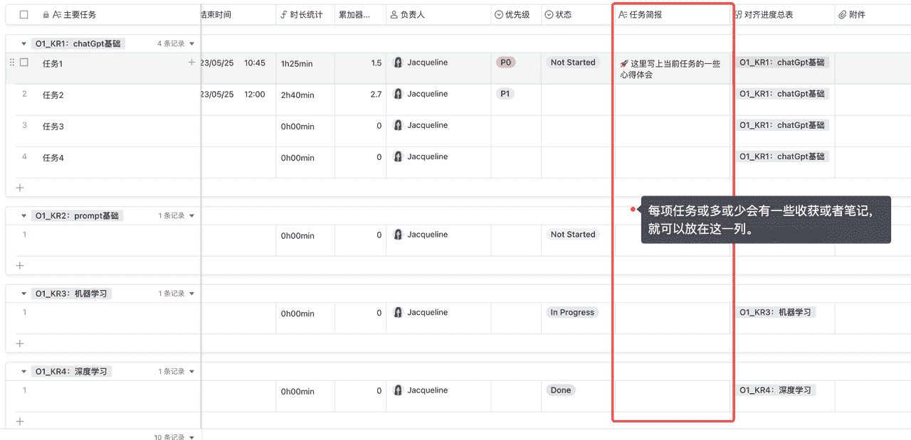

## （3）OKR任务总表 - 复盘归档

上面每个KR完成后，会做一次复盘。所以最后，**我们又回**到了「OKR任务总表」，**这次来到**复**盘视图。**我**们会根据之前****写**的每个任务简报、计划周期、实际完成周期等内容，来做最后一轮的复盘。复盘一般包含三个步骤：①先给自己打个分，范围是1~5分；②总结做的好的，下回完成相同任务时，可以借鉴当前思路；③复盘做的不好的，下回完成相同任务时，就可以更好地避免。如下图所示：

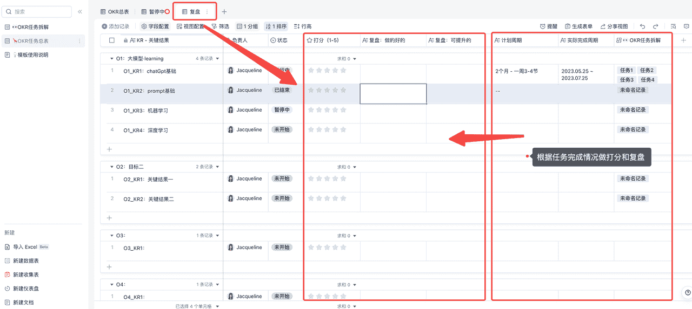

至此，关于**模板的使用**介绍完毕，cheers~🍻