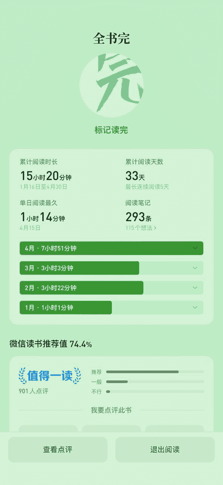
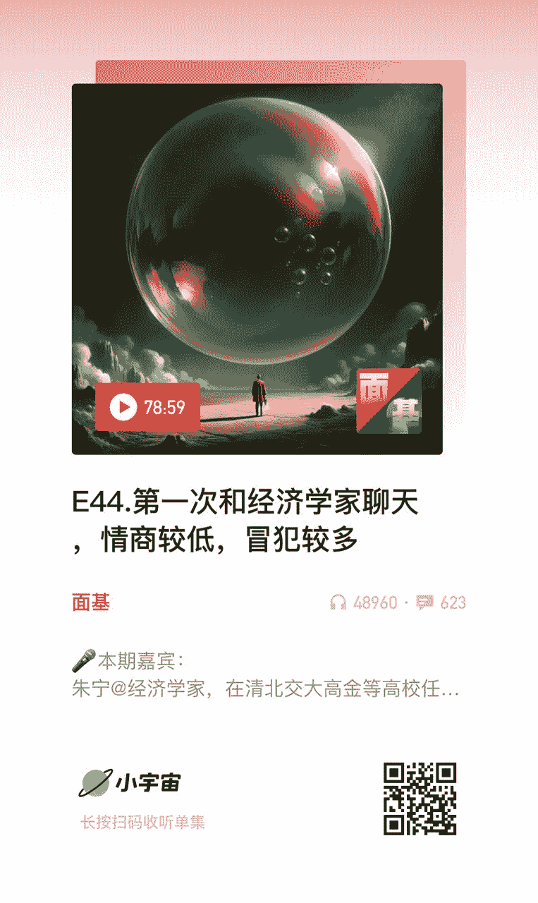

# 时势 —— 周期波动下的国家、社会和个人

> 来源：[https://docs.feishu.cn/docx/IbFydagU4oXKnIxKcTncDWkynSf](https://docs.feishu.cn/docx/IbFydagU4oXKnIxKcTncDWkynSf)

> 看完时势，浅浅写个读后感。

> 基础感悟正如《面基》这期播客一样，第一次接触经济学，情商较低，多有冒犯😀

> 当时在听播客的时候，里面谈到90年代的日本，08年的美国，那会还没完全理解。

> 看完《时势》的时候，突然间一下子豁然开朗。

> 想起大学读英美文化的时候，第一次接触到英美两国党派时产生的好奇。

> **经济学看着看**着，突然知道为什么中学时候很喜欢历史了，因为有很多时间线可以帮助捋清楚线索。

>

> And 还给自己提出了一些问题：

> 经济泡沫是怎么出现的？

> 货币贬值为什么会促进出口？

> 财政部和央行是什么关系？

> 失业率是怎么计算出来的？

> 为啥韩国在军阀时期经济反而会起飞？

> 苏联解体和湾区战争，印度后续的一系列操作带来了什么样的影响？

> 希腊债务危机时期，与欧盟之间又产生了什么样的连接？

> 英国脱欧时期，梅姨的废话文学，意味着什么？

> 中东从天而降的石油，引发了后续一系列的交易和通货膨胀，究竟是怎么产生的？

> 俄罗斯从叶利钦时代到普京时代，发生了哪些变化？

> 土耳其为什么会执行非常反人性的降息操作？

> 宗教信仰对人性的影响有哪些？

